# The Role of Socialization {background-color="#1B2A4A"}

::: {.takeaway}
Socialization is the lifelong process in which people learn the attitudes, values, and behaviors appropriate for members of a particular culture. Without it, there is no social self.
:::

## Feldman's Study of Prisoner-Firefighters in Arizona {.smaller}

:::: {.columns}
::: {.column width="50%"}
- Sociologist Lindsey Feldman spent **15 months** observing crews of prison inmates who fight wildfires in the western United States; she became a certified wildland firefighter and worked alongside them
- Fieldnotes, 10 June 2016: twenty-five firefighters walk into a restaurant, faces sooty from a three-day fire in the Arizona mountains; the restaurant-goers stand and applaud
- A small boy runs over, hugs one crew member's leg, and says: "I want to be like you when I grow up!"

::: {.fragment}
- The crew was **22 prisoners and 3 correctional officers**. Sammy, the man with the boy attached to his leg, was serving nine years for possession of methamphetamines
- Minutes later, with tears in his eyes, he said: "**That just healed me.**"
:::
:::

::: {.column width="50%"}
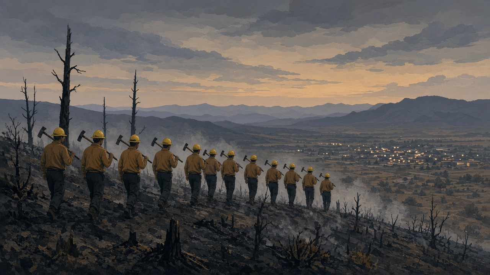{fig-alt="Generated illustration of a wildland fire crew in matching shirts and helmets walking a burned hillside at dusk, seen from behind."}

<!-- ::: {.small} -->
<!-- Generated illustration, not a photograph of the Arizona program (Feldman 2018:1–2). -->
<!-- ::: -->
:::
::::

## The Same People Carried Two Social Identities

::: {.center}
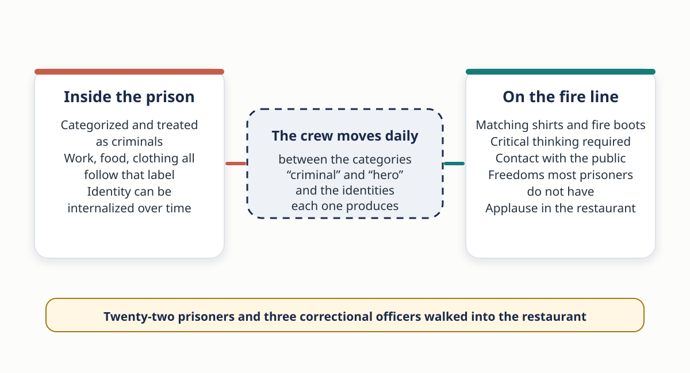{fig-alt="Two cards: inside the prison, members are categorized as criminals; on the fire line they fill a heroic role. The crew moves daily between the two."}
:::

::: {.small}
- The chapter uses the prisoner-firefighters to show that socialization can have a powerful impact **even on adults**
- Every day the crew left the prison, "a space where criminality is defined and maintained," and moved into a space between the categories *criminal* and *hero*
- Prisoner-firefighters had to use critical-thinking skills, interact with the public, and enjoyed freedoms other prisoners lacked; they built more positive identities and better outcomes in prison and after release (Feldman 2018)
:::

## Socialization and Personality Defined

- **Socialization** — the lifelong process in which people learn the attitudes, values, and behaviors appropriate for members of a particular culture
- It occurs through human interactions that begin in infancy and continue through retirement
- We learn from the people most important to us (family, friends, teachers) and from people on the street, on television, in social media, and in films
- Socialization also shapes our **self-images**: people who do not match a culture's ideal of physical attractiveness are disadvantaged socially and in hiring, which can lower self-esteem
- **Personality** — a person's typical patterns of attitudes, needs, characteristics, and behavior

::: {.question-box}
How much of a person's personality is shaped by culture? Which agents of socialization are the most powerful?
:::

## Nature Versus Nurture: From Debate to Interaction

- Researchers once clashed over biological inheritance versus environment in human development: the **nature versus nurture** (heredity versus environment) debate
- Today most social scientists have moved beyond the debate and study the **interaction** of the two
- To see how each factor works, examine situations in which one operates almost entirely without the other (Homans 1979)

::: {.center}
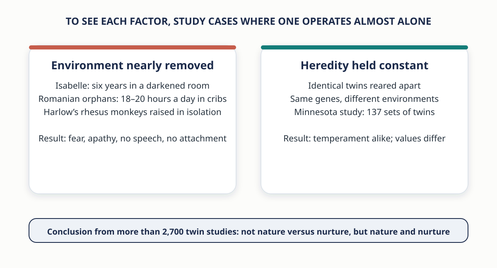{fig-alt="Two cards: isolation cases remove the social environment; twin studies hold heredity constant. The conclusion is nature and nurture."}
:::

## Extreme Isolation: The Case of Isabelle

- For the first six years of her life, Isabelle lived in almost total seclusion in a darkened room
- Her only contact was her mother, who could neither speak nor hear; her grandparents, ashamed of the circumstances of her birth, kept the child hidden
- Ohio authorities discovered her in **1938**, when her mother escaped with her
- At age six she could not speak, only make croaking sounds; she communicated with her mother by simple gestures
- She showed a strong fear of strangers, then extreme apathy; on tests of maturity she scored at the level of an **infant**

::: {.takeaway}
She had the physical and cognitive potential to learn. What she lacked was interaction.
:::

## Isabelle's Recovery Showed What Socialization Builds

- Specialists designed a systematic training program; after a few days she made her first attempt to speak
- In a little over **two months** she was speaking in complete sentences; nine months later she could identify words and sentences
- Before age 9 she was ready for school with other children; by **14** she was in sixth grade, doing well, and emotionally well adjusted
- Without socialization in her first six years she had been "hardly human in the social sense" (K. Davis 1947)
- The scientists concluded that all children need socialization in the form of love, care, and affection; that need does not end with childhood but continues through the life span

## Extreme Neglect: The Romanian Orphans

- In the 1990s attention turned to orphanages in the formerly communist countries of eastern Europe
- In Romanian orphanages, babies once lay in cribs **18 to 20 hours a day**, curled against their feeding bottles, with little adult care, for their first five years
- Many grew up fearful of human contact and prone to unpredictable antisocial behavior; as recently as 2004, some **32,000** Romanian children were institutionalized
- Among orphans adopted abroad, about **20 percent** had adjustment problems so dramatic that adoptive families asked for help
- In 2001 Romania halted international adoptions and placed children with birth families, Romanian adoptive families, or small group homes; UNICEF now uses the program as a model
- Worldwide, an estimated **2.7 million** children live in institutional care (Petrowski, Cappa, and Gross 2017)

## Harlow's Rhesus Monkeys and the Artificial Mothers

:::: {.columns}
::: {.column width="48%"}
- Harry Harlow (1971) raised rhesus monkeys away from their mothers and from other monkeys
- Like Isabelle, the isolated monkeys were fearful and easily frightened; they did not mate, and females who were artificially inseminated became abusive mothers
- He then offered isolated infants two substitute mothers: a **wire** model that gave milk and a **cloth**-covered model that did not
- Monkey after monkey went to the wire mother for milk, then spent far more time clinging to the cloth mother
:::

::: {.column width="52%"}
::: {.center}
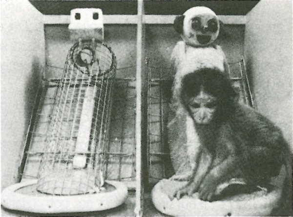{fig-alt="A rhesus monkey clings to Harlow's soft cloth-covered artificial mother beside the wire artificial mother that supplied milk." height=430}
:::
:::
::::

## What Twin Studies Show About Heredity and Environment

:::: {.columns}
::: {.column width="70%"}
- The Minnesota Twin Family Study has followed **137 sets** of identical twins reared apart
- **Hereditary leanings:** temperament, voice patterns, and nervous habits are strikingly similar even in twins reared apart
- **Environmental leanings:** attitudes, values, chosen mates, and even drinking habits differ far more
- Worldwide, more than **2,700 twin studies** cover **14.5 million** twins. The conclusion: not nature *versus* nurture but nature *and* nurture
- Bipolar disorder has significant genetic components; eating disorders have a much larger social-environment component (Lakhani et al. 2019; Polderman et al. 2015)
<!-- - Twins reared apart in similar settings score alike on intelligence tests, often closer than one person taking the test twice; twins raised in dramatically different environments score quite differently (Segal 2012) -->
:::

::: {.column width="30%"}
::: {.center}
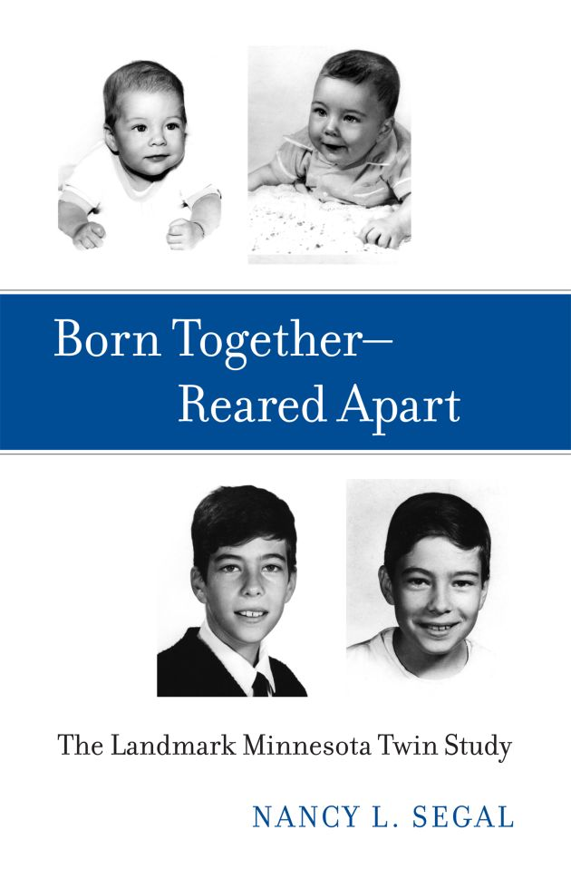{fig-alt="Cover of Nancy Segal's book Born Together—Reared Apart: The Landmark Minnesota Twin Study." height=520}
:::
:::
::::

## Apply the Evidence: Design a Children's Home in Kuwait

::: {.board}
A children's residential home receives funding for **one improvement first**. Which should it choose?
:::

1. More caregivers on each shift
2. The same caregivers staying with the same children over time
3. Daily small-group play and conversation
4. Better rooms, equipment, and screens

# The Self and Socialization {background-color="#1B2A4A"}

::: {.takeaway}
We are not born knowing who we are. The self emerges as we interact with others, and it keeps changing for as long as we live.
:::

## The Self Emerges Through Interaction

- We all hold perceptions, feelings, and beliefs about who we are. We were not born with them
- **Self** — according to George Herbert Mead, a distinct identity that sets us apart from others
- The self is not static; it continues to develop and change throughout our lives
- Sociologists and psychologists both study how the individual develops and modifies the sense of self through social interaction
- Charles Horton Cooley and George Herbert Mead, pioneers of the interactionist approach, did the foundational sociological work

## Cooley's Looking-Glass Self

- In the early 1900s Cooley argued that we learn who we are by interacting with others
- Our view of ourselves comes not only from thinking about our own qualities but also from how we think others perceive us
- **Looking-glass self** — Cooley's phrase emphasizing that the self is the product of our social interactions
- The process has three phases: we imagine how we present ourselves, imagine how others evaluate us, and develop a feeling about ourselves

:::: {.columns}
::: {.column width="72%"}
::: {.center}
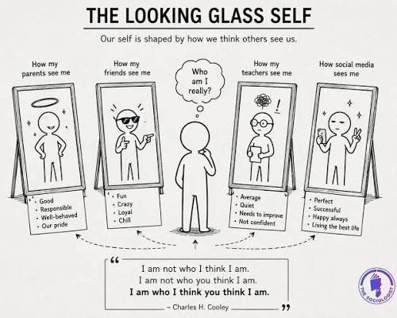{fig-alt="Illustration of a person facing several mirrors, each showing how parents, friends, teachers, and social media may see that person." height=390}
:::
:::

::: {.column width="28%"}
::: {.center}
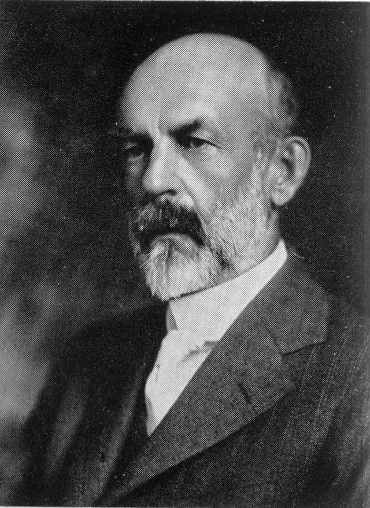{fig-alt="Portrait of sociologist Charles Horton Cooley." height=390}
:::
:::
::::

## The Looking-Glass Self Can Be Built on Mistaken Perceptions

- The self results from our **imagination** of how others view us, so a self-identity can rest on an incorrect perception
- A student reacts strongly to a teacher's criticism: (1) the teacher criticized me → (2) the teacher must think I am stupid → (3) I am stupid
- Self-identities also change: if the student receives an A at the end of the course, the feeling of being stupid usually disappears
- **Double consciousness** (W. E. B. Du Bois, Chapter 1) — the division of an individual's identity into two or more social realities; the looking-glass self is a broader view of the same idea

<!-- ::: {.question-box}
Think of one judgment about yourself that came from imagining how others saw you. Was the imagined judgment accurate?
::: -->

## Mead's Three Stages of the Self

:::: {.columns}
::: {.column width="25%"}
::: {.center}
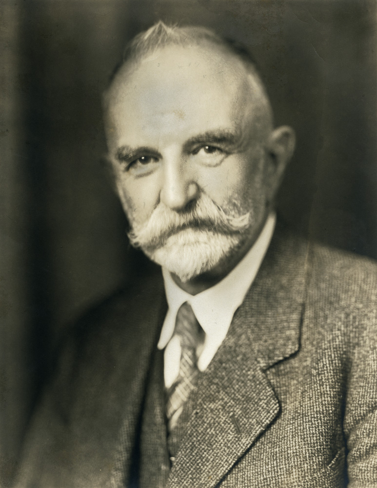{fig-alt="Portrait of sociologist George Herbert Mead." height=430}
:::
:::

::: {.column width="75%"}
- Mead continued Cooley's exploration of interactionist theory and described the process by which the self emerges in three distinct stages

::: {.center}
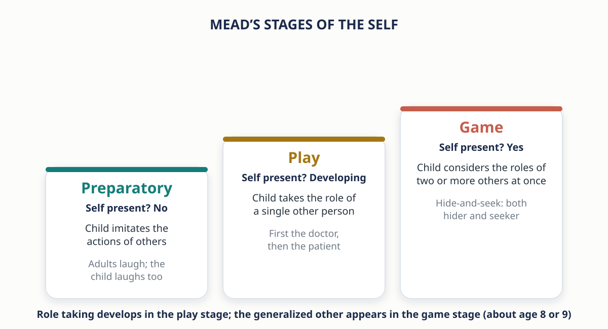{fig-alt="Three rising cards: preparatory stage with no self present, play stage with the self developing, game stage with the self present."}
:::
:::
::::

## Mead's Preparatory and Play Stages

- **Preparatory stage:** children merely imitate the people around them, especially family members. A small child bangs on wood while a parent does carpentry, or throws a ball because an older sibling is doing so
- As they grow, children become more adept with **symbols**, the gestures and words that form the basis of human communication, learned from relatives, friends, cartoons, and picture books
- **Play stage:** children begin to pretend to be other people. As an actor "becomes" a character, a child becomes a doctor, parent, superhero, or ship captain
- **Role taking** — the process of mentally assuming the perspective of another and responding from that imagined viewpoint
- A child learns when to ask a parent for favors: if the parent comes home in a bad mood, the child waits until after dinner

## Mead's Game Stage and the Generalized Other

- **Game stage:** at about age eight or nine the child no longer just plays roles but considers several tasks and relationships at once
- As in a football match, players must understand their own position and everyone else's; a Scout on a hike must know her own duties and those of the other Scouts and the leaders
- **Generalized other** — the attitudes, viewpoints, and expectations of society as a whole that a child takes into account in his or her behavior
- A child does not act polite merely to please one parent; the child learns that politeness is a widespread value endorsed by parents, teachers, and religious leaders

::: {.takeaway}
Play stage: one role at a time. Game stage: many roles at once, and an awareness of what "everyone" expects.
:::

## Give Me an Example of Each of Mead's Stages

| Stage | Self present? | Definition | Example |
|---|---|---|---|
| **Preparatory** | No | Child imitates the actions of others. | When adults laugh and smile, child laughs and smiles. |
| **Play** | Developing | Child takes the role of a single other, as if he or she were the other. | Child first takes the role of doctor, then the role of patient. |
| **Game** | Yes | Child considers the roles of two or more others simultaneously. | In game of hide-and-seek, child takes into account the roles of both hider and seeker. |

::: {.question-box}
Give me one new example of the **preparatory**, **play**, and **game** stages.
:::

## Mead's Theory of the Self: From the Center Outward

- According to Mead (1964b), the self begins at a **privileged, central position** in a person's world
- Shown a mountain scene and asked what an observer on the other side would see, young children describe only what is visible from their own side
- This tendency never entirely disappears: people afraid of flying assume the plane that goes down will be theirs; who reads the horoscope page without checking their own sign first?
- As people mature, the self begins to reflect greater concern about the reactions of others
- **Significant others** — the individuals most important in the development of the self, such as a parent, friend, or teacher. Many young people are drawn to the same kind of work their parents do

<!-- ## Use Your Sociological Imagination: How Do You View Yourself?

::: {.board}
How do you view yourself as you interact with others around you? How do you think you formed this view of yourself?
:::

- Which **significant others** shaped it: a parent, a grandparent, a sibling, a teacher, a coach, a close friend?
- Which **generalized other** do you consult before acting in a lecture hall, a diwaniya, a hospital ward, or a family WhatsApp group?
- Can you remember a moment when the mirror changed, when someone's reaction altered how you saw yourself?
-->

## Goffman: Impression Management and the Dramaturgical Approach

:::: {.columns}
::: {.column width="72%"}
- Erving Goffman asked how we manage our "self" and display to others who we are
- Many daily activities are attempts to convey impressions of who we are
- **Impression management** — Goffman's term for the altering of the presentation of the self in order to create distinctive appearances and satisfy particular audiences
- **Dramaturgical approach** — a view of social interaction in which people are seen as theatrical performers
- A clerk tries to appear busier than he is when a supervisor is watching; the prisoner-firefighters allow the public to mistake them for full-time firefighters
<!-- - Many daily activities are attempts to convey impressions of who we are; we learn to slant our presentation of the self to create distinctive appearances and satisfy particular audiences -->
:::

::: {.column width="28%"}
::: {.center}
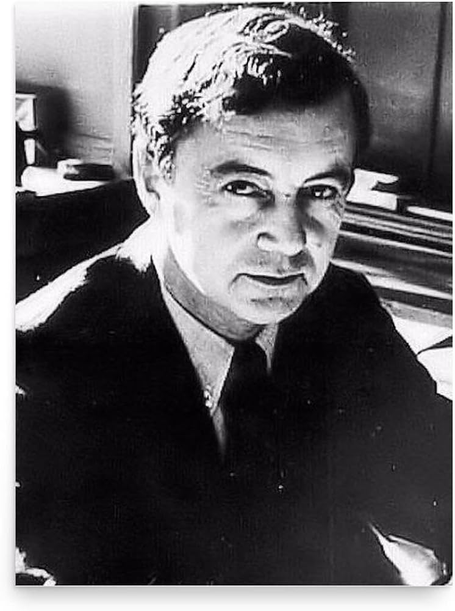{fig-alt="Portrait of sociologist Erving Goffman." height=440}
:::
:::
::::

## Box 4-1: Impression Management After Exam Grades {.smaller}

::: {.question-box}
Grades come back. Imagine the scenario between two students who both scored high; a high scorer and a friend who failed; two students who both failed.
:::

::: {.fragment}
**Ace–Ace encounters**
:::

::: {.fragment}
are open: there is comfort in sharing a high mark, and even bragging is acceptable. "It's much easier to admit a high mark to someone who has done better than you, or at least as well."
:::

::: {.fragment}
**Ace–Bomber encounters**
:::

::: {.fragment}
are sensitive: Bombers avoid them so as not to "emerge looking like the dumb one"; when forced to interact they appear gracious. Aces offer sympathy, call their own high scores "lucky," and stress how unfair the exam was so Bombers can save face.
:::

::: {.fragment}
**Bomber–Bomber encounters**
:::

::: {.fragment}
are closed: students share disappointment in "pity parties" and rehearse excuses such as "I had four exams and two papers due that week" (Albas and Albas 1988, 1996).
:::

## Impression Management on Video Calls

- During the coronavirus, sociologists watched impression management move onto Zoom
- The point of a video call is to see others, yet most people constantly stare at their own square to double-check the impression they are conveying

<!-- ::: {.question-box} -->
<!-- Which audiences do you manage differently: your Instagram followers, the family group chat, your professors, your closest friends? What changes between them? -->
<!-- ::: -->

## Face-Work and Cooling Out

- **Face-work** — Goffman's term for the efforts people make to maintain the proper image and avoid public embarrassment
- After being turned down, a person may say, "There really isn't an interesting person in this entire crowd." We need to maintain a proper image of the self to keep interaction going
- **Cooling out** — Goffman's term for the strategy of delivering bad news gradually, as when an interviewer gives a candidate a chance before the rejection
- Junhow Wei (2016) studied rejected *American Idol* contestants: they are allowed to vent and reassured that they "have the talent," minimizing the failure

::: {.takeaway}
Face-work is not dishonesty. It is the repair work that keeps social life from stalling after embarrassment.
:::

## Cooley, Mead, and Goffman Compared

::: {.center}
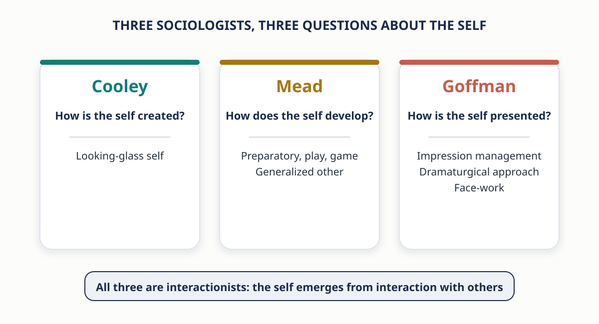{fig-alt="Three cards: Cooley asks how the self is created, Mead how it develops, Goffman how it is presented."}
:::

::: {.small}
Cooley stressed the process by which we **create** a self; Mead focused on how the self **develops** as we learn to interact; Goffman emphasized how we consciously **create images** of ourselves for others.
:::

## Freud: The Self as a Social Product with Opposing Parts

:::: {.columns}
::: {.column width="72%"}
- Early psychology, especially Sigmund Freud (1856–1939), stressed the role of **inborn drives** in channeling human behavior
- Like Cooley and Mead, Freud believed the self is a social product, influenced by other people and especially by parents
- Unlike them, he argued that the self has components that work **in opposition**: natural impulsive instincts in constant conflict with societal constraints
- Part of us seeks limitless pleasure; another part favors rational behavior. Through interaction we learn society's expectations and select behavior appropriate to our culture
- Freud was well aware that we sometimes distort reality and behave irrationally
:::

::: {.column width="28%"}
::: {.center}
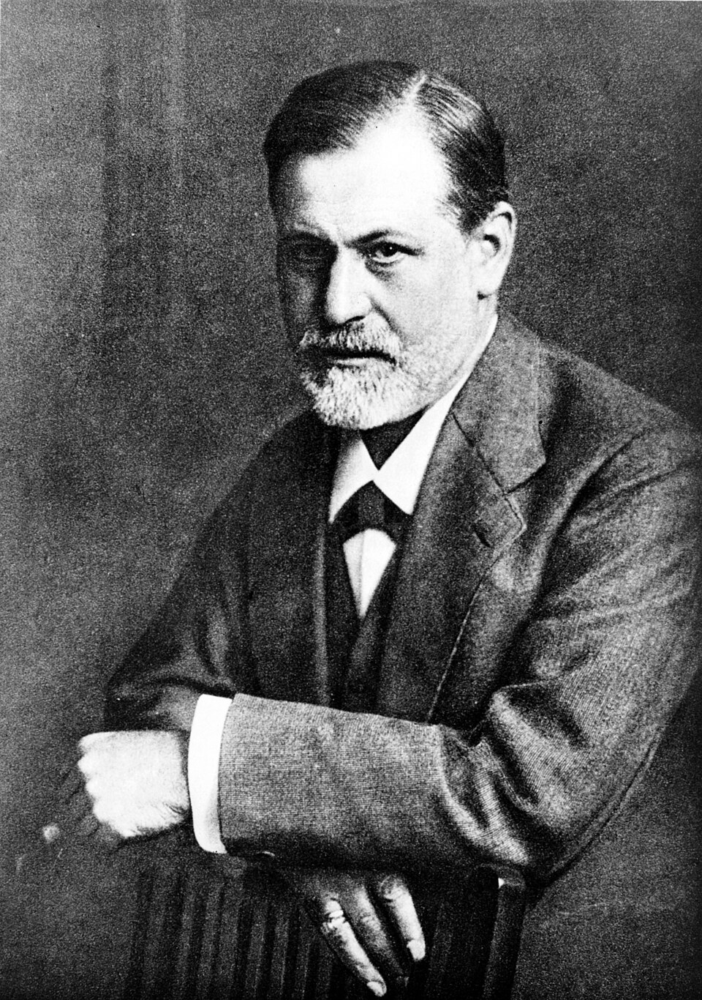{fig-alt="1909 portrait of Sigmund Freud by Max Halberstadt." height=440}
:::
:::
::::

## Piaget: Newborns Have No Looking-Glass Self

:::: {.columns}
::: {.column width="72%"}
- The Swiss child psychologist Jean Piaget (1896–1980) found that newborns have **no self** in the sense of a looking-glass image
- Yet they are entirely self-centered: they demand that all attention be directed toward them
- Newborns have not yet separated themselves from the universe; "you and me" has no meaning, only "me"
- As they mature, children are gradually socialized into social relationships, even within a self-centered world
:::

::: {.column width="28%"}
::: {.center}
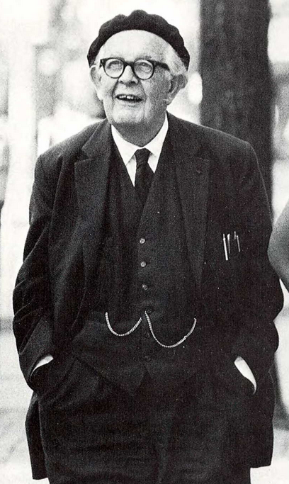{fig-alt="Jean Piaget at the University of Michigan in 1967 or 1968." height=440}
:::
:::
::::

## Piaget's Cognitive Theory of Development

- **Cognitive theory of development** — Piaget's (1954) theory that children's thought progresses through four stages of development

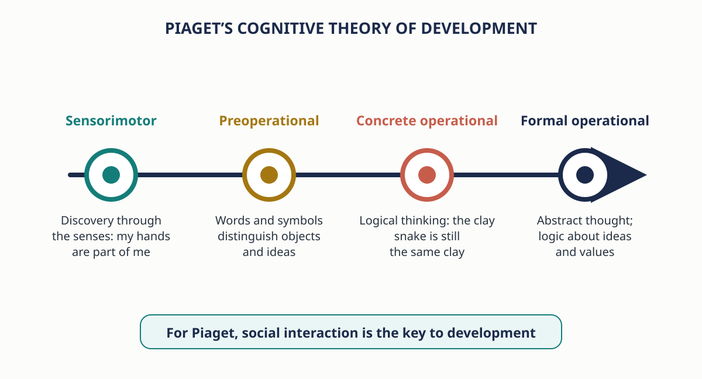{fig-alt="Timeline of Piaget's four stages: sensorimotor, preoperational, concrete operational, formal operational."}

- Social interaction is the key to development: to form a distinct personality each of us needs opportunities to interact with others. Isabelle was denied them, and the consequences were severe (Kitchener 1991)

## Table 4-2: Theoretical Approaches to Development of the Self {.smaller}

| Scholar | Key concepts and contributions | Major points of theory |
|---|---|---|
| **Charles Horton Cooley** 1864–1929, sociologist (USA) | Looking-glass self | Stages of development not distinct; feelings toward ourselves developed through interaction with others |
| **George Herbert Mead** 1863–1931, sociologist (USA) | The self; generalized other | Three distinct stages of development; self develops as children grasp the roles of others in their lives |
| **Erving Goffman** 1922–1982, sociologist (USA) | Impression management; dramaturgical approach; face-work | Self developed through the impressions we convey to others and to groups |
| **Sigmund Freud** 1856–1939, psychotherapist (Austria) | Psychoanalysis | Self influenced by parents and by inborn drives, such as the drive for sexual gratification |
| **Jean Piaget** 1896–1980, child psychologist (Switzerland) | Cognitive theory of development | Four stages of cognitive development |

## Thinking Critically: Mead's Stages and Piaget's Stages Compared

::: {.board}
What are some similarities between Mead's stages of the self and Piaget's cognitive development stages? What are some differences?
:::

- Both describe development as an ordered sequence; both make **social interaction** the engine
- Mead's stages describe the growth of a *social* self: whose perspective can the child take?
- Piaget's stages describe the growth of *thinking*: what kinds of operations can the child perform?
- Where might Mead's game stage and Piaget's concrete operational stage overlap in age and ability?

# Agents of Socialization {background-color="#1B2A4A"}

::: {.takeaway}
Socialization is carried out by social forces that continue and alter it throughout life. The family comes first; six other agents keep working on us.
:::

## Seven Agents Shape the Self Across Life

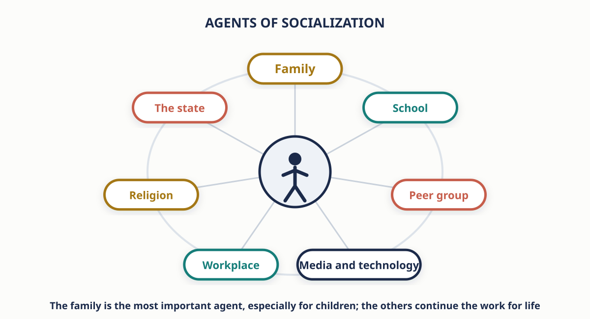{fig-alt="A person at the center of a ring of seven labelled agents: family, school, peer group, media and technology, workplace, religion, the state."}

::: {.small}
Schaefer: the family is the most important agent of socialization, especially for children. This chapter also discusses six others: the school, the peer group, the mass media and technology, the workplace, religion, and the state.
:::

## Family: Socialization Begins at Birth {.smaller}

:::: {.columns}
::: {.column width="50%"}
- Learning begins shortly after birth. Newborns can hear, see, smell, taste, and feel heat, cold, and pain, so they constantly orient themselves to the surrounding world
- Family members form an important part of that environment, feeding, cleaning, carrying, and comforting the baby
- All families engage in socialization, though the content varies enormously
- In Kuwait, a boy taken to the diwaniya learns, first by imitation and later by role taking, whom to greet first, when to stand, how to hold the finjan, and when to stay quiet. Nobody hands him a rulebook
:::

::: {.column width="50%"}
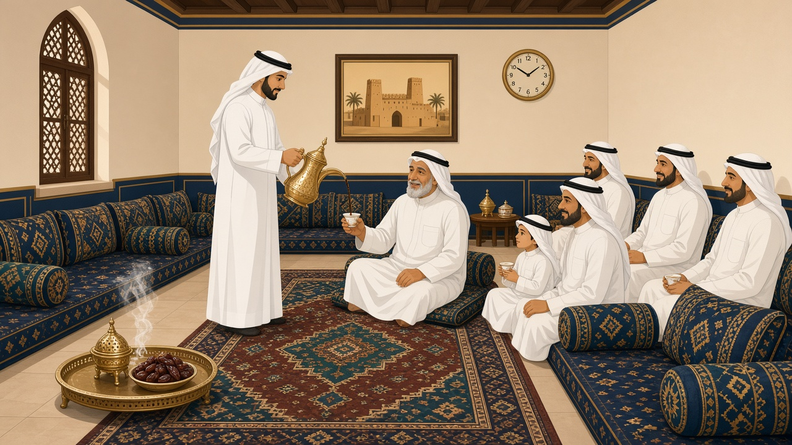{fig-alt="Generated illustration of a Kuwaiti diwaniya: a young man pours Arabic coffee while a small boy beside his grandfather copies how the cup is held."}

::: {.small}
Generated illustration. The diwaniya example is a local application, not a Schaefer case.
:::
:::
::::

## Box 4-2: Rumspringa and Amish Child-Rearing {.smaller}

:::: {.columns}
::: {.column width="64%"}
- The Amish embrace a lifestyle of the mid-1800s: no dancing, no music, no television, no Internet.
- **Rumspringa** ("running around") — a period of discovery in which adolescents test the subculture's boundaries at barn dances and by breaking norms against drinking, smoking, and driving. The Amish religion does not support it
- Parents often look the other way. No punishment for listening to the radio, using a phone, or riding a motorcycle/car.
:::

::: {.column width="36%"}
::: {.center}
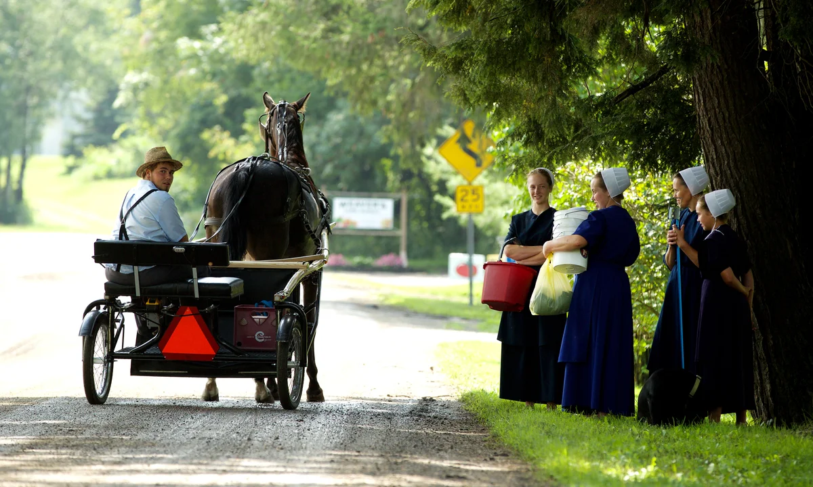{fig-alt="An Amish man driving a horse-drawn buggy past a group of Amish women and girls." height=360}
:::
:::
::::

::: {.question-box}
After tasting mainstream culture freely, what share of Amish youths return and accept the faith?
:::

::: {.fragment}
- **85% to 90%** accept the faith as young adults (Kraybill 2019).
:::

## Gender Roles Are Learned, Not Genetically Fixed

- **Gender role** — expectations regarding the proper behavior, attitudes, and activities of males and females
- We traditionally read "toughness" as masculine and "tenderness" as feminine; other cultures do not assign these qualities the same way
- Gender roles do not mean males and females inevitably assume certain roles, or that the roles are entirely distinct. They mean that males and females are **not genetically predetermined** to occupy certain roles
- Parents are the primary guides into a society's gender roles; other adults, older siblings, mass media, and religious and educational institutions also contribute
- When girls are socialized mainly by mothers and boys by fathers, girls may miss survival skills: in South Asia, fathers teach sons to swim for a fishing life, and girls typically never learn. When the **2004 tsunami** struck, many more men survived than women

## School: Teaching the Values and Customs of Society

- Like the family, schools have an explicit mandate to socialize people, especially children, into the norms and values of the culture
- Conflict theorists: schools foster **competition** through built-in rewards and punishments, grades and teacher evaluations. A child struggling with a new skill can come to feel stupid and unsuccessful
- As the self matures, children make increasingly realistic assessments of their intellectual, physical, and social abilities
- **Functionalists:** schools teach children the values and customs of the larger society
- **Conflict theorists** agree but add that schools reinforce divisions, especially of social class: costly higher education gives affluent students an advantage in reaching universities and the best-paying, most prestigious jobs

## Peer Group: Peers Become Significant Others {.smaller}

- As a child grows, the family becomes somewhat less important and **peer groups** increasingly assume the role of Mead's significant others
- Within the peer group, young people associate with others of roughly the same age and often similar social status (Giordano 2003)
- In Tokyo, new arrivals can literally **rent a friend**: Client Partners provides a friend or an entire family for a price, because "happiness is born from relationships between people" (Client Partners 2020; Colin 2016)
<!-- - The importance of peers shows when war or disaster strips them away. In 2012 Fatmeh was a typical Syrian teenager: school, classes, friends, homework. Three years later, at 15, she lived in a makeshift shelter in Lebanon, working farm fields seven days a week with her family. Her only link beyond the family was a cell phone. She kept "very small, small hope" of returning to school (Beaubien and Davis 2015) -->

<!-- ## Table 4-3: High School Popularity {.smaller} -->

<!-- ::: {.question-box} -->
<!-- Before the reveal: what made girls popular in high school? What made boys popular? Will college men and college women agree? -->
<!-- ::: -->

<!-- ::: {.fragment} -->
<!-- | Rank | Girls, per college men | Girls, per college women | Boys, per college men | Boys, per college women | -->
<!-- |---|---|---|---|---| -->
<!-- | 1 | Physical attractiveness | Grades/intelligence | Participation in sports | Participation in sports | -->
<!-- | 2 | Grades/intelligence | Participation in sports | Grades/intelligence | Grades/intelligence | -->
<!-- | 3 | Participation in sports | General sociability | Popularity with girls | General sociability | -->
<!-- | 4 | General sociability | Physical attractiveness | General sociability | Physical attractiveness | -->
<!-- | 5 | Popularity with boys | Clothes | Car | School clubs/government | -->

<!-- - Neither men nor women ranked sexual activity, drug use, or alcohol in the top five, but college men were much more likely to mention them as routes to popularity, for both boys and girls (Suitor et al. 2001; students at seven U.S. universities, 1998) -->
<!-- ::: -->

## Mass Media and Technology: Socialization Moves Online

- Radio, movies, recorded music, television, and the Internet have become important agents of socialization. The question is no longer whether young people are plugged in, but **how** they use these resources
- The age at which children go online keeps falling. The American Academy of Pediatrics (2016) advises avoiding digital media, except video-chatting, for children under **18 to 24 months**; for older toddlers, choose high-quality programming and use media together, never solo
- Your feed is an agent of socialization with human curators: the accounts and influencers you follow decide which bodies, purchases, and opinions look normal to you

## Technology Lets Socialization Cross Distance

- Zadhe Iyombe once needed an **eight-day** boat trip up the Congo River to talk to his mother; with mobile phones, they could text daily
- Many expatriate workers in Kuwait live apart from the families they support. Calls, voice notes, and video chats can make frequent contact possible across distance
- Technology can carry more than conversation: family routines, advice, language, celebrations, and everyday care can now travel through a phone

::: {.question-box}
What parts of family socialization can travel through a phone—and what still requires being physically present?
:::

## Workplace: Occupational Socialization Continues for Life

- Learning to behave appropriately in an occupation is a fundamental aspect of socialization
- Occupational socialization is most intense in the school-to-job transition but continues through one's work history; technological change may require **resocialization**
- From ages 18 to 52 the typical person holds **12 jobs**, nearly half of them between 18 and 24, for men and women, graduates and non-graduates alike (Bureau of Labor Statistics 2019i)
<!-- - Work once began when schooling ended; now many U.S. adolescents work for spending money: **80 percent** of high school seniors say little or none of their earnings go to family expenses -->
<!-- - Teen employment in the U.S. is the highest among industrial countries; educators complain it hurts schoolwork, one possible reason U.S. students lag on international tests -->

## The State Regulates the Life Course

- Social scientists treat government, or **the state**, as an agent of socialization because it organizes important transitions across the life course
- Public agencies such as hospitals, clinics, schools, and child care centers take on some protective and socializing functions once centered mainly in families
- Government regulations set the ages at which a person may drive, vote, marry without parental permission, work overtime, and retire
- These legal thresholds are not strict rites of passage, but they still mark when society recognizes new rights and responsibilities

## Thinking Critically: Functionalist and Conflict Views of Media Socialization

::: {.board}
How would functionalist and conflict theorists differ in their analysis of socialization by the mass media?
:::

::: {.fragment}
**Functionalist questions:** What shared norms, values, and information do media transmit? How do they integrate dispersed people, as Iyombe's texts link Kinshasa to his mother's town?
:::

::: {.fragment}
**Conflict questions:** Who owns the platforms? Whose values do algorithms and advertisers amplify? Who is excluded when fewer than 1 in 100 people in low-income nations have broadband phones?
:::

# Socialization throughout the Life Course {background-color="#1B2A4A"}

::: {.takeaway}
Societies mark the passage from one status to another with rituals, and they keep socializing us, forward into new roles and sometimes backward out of old ones.
:::

## Rites of Passage Mark Transitions in Status

- **Rite of passage** — a ritual marking the symbolic transition from one social position to another
- These may mark a **separation**, as in a graduation ceremony, or an **incorporation**, as in an initiation into an organization (Van Gennep [1909] 1960)

<!-- 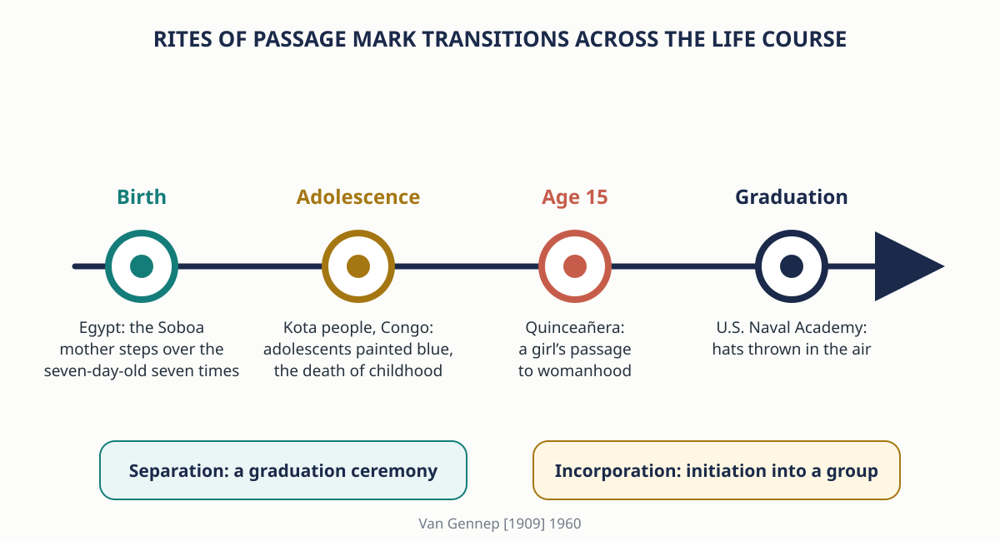{fig-alt="Timeline of rites of passage: the Egyptian Soboa at birth, Kota blue paint in adolescence, the quinceañera at fifteen, Naval Academy graduation."} -->

## Rites of Passage in Kuwait: Classify the Cases

::: {.board}
Which of these are rites of passage? Does each mark a separation, an incorporation, or both?
:::

- A child's first full-day fast in Ramadan, and the family's celebration of it
- High-school graduation and the announcement of results
- The sequence from engagement to wedding
- The first salary, and what is customarily done with it
- National service, for those who complete it, and the first day in a white coat for medical students

## The Life Course Approach

- **Life course approach** — a research orientation in which sociologists and other social scientists look closely at the social factors that influence people throughout their lives, from birth to death
- Life course researchers recognize that biological changes **shape but do not dictate** human behavior
- Several life events mark the passage to adulthood, including marriage and the birth of a first child; these turning points vary from one society, and even one generation, to the next

## When Does Adulthood Begin?

- In the United States the key event seems to be the **completion of formal schooling**, but completion is less clearly defined than a generation ago: people take full-time jobs while studying or return for certificates and advanced degrees
- Leaving home, finding a stable job, and establishing a long-term relationship no longer occur at specific ages (Silva 2012; T. Smith 2003)
- Result: no clear dividing line between adolescence and adulthood. Few young people finish school, marry, and leave home at about the same age
- New terms describe the prolonged ambiguous status of people in their 20s: **youthhood**, **emerging adulthood**, **pre-adult**, **not quite adult** (Gilmore 2019)

## Use Your Sociological Imagination: Which Milestone Marks Adulthood?

::: {.board}
Why might the end of formal schooling be the most important milestone of adulthood today? What about marriage, full-time employment, or financial independence? Which milestone matters most?
:::

- In Kuwait, is adulthood marked by graduation, the first job, marriage, the first child, or something else?
- Living with one's parents until marriage is common here. Is that a *delay* of adulthood, or evidence that the milestone list itself is local?
- Who decides when you count as an adult: the state, your family, your employer, or you?

## Anticipatory Socialization and Resocialization

- The development of a social self is a lifelong transformation that begins in the crib and continues as one prepares for death
- Two types of socialization recur throughout the life course

::: {.center}
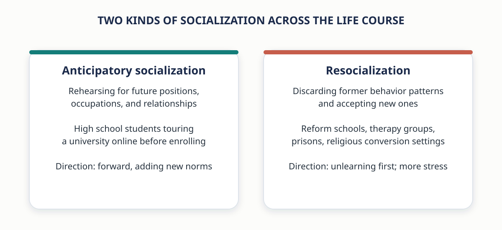{fig-alt="Two cards: anticipatory socialization rehearses future roles; resocialization discards old patterns and accepts new ones, often with considerable stress."}
:::

## Anticipatory Socialization: Rehearsing a Future Role

- **Anticipatory socialization** — processes of socialization in which a person rehearses for future positions, occupations, and social relationships
- A culture functions more smoothly when members learn the norms, values, and behavior of a status **before** assuming it
- It begins in childhood and adolescence and continues as we prepare for new responsibilities
- High school students once studied college brochures or visited campuses; now universities build websites with virtual tours and audio clips of everything from the anthem to a sample zoology lecture
- Your internships, clinical rotations, site visits, and this course itself are anticipatory socialization for roles you do not yet hold

## Resocialization: Unlearning an Established Orientation

- Assuming a new social or occupational position sometimes requires us to **unlearn** an established orientation
- **Resocialization** — the process of discarding former behavior patterns and accepting new ones as part of a transition in one's life
- It often occurs during an explicit effort to transform an individual: reform schools, therapy groups, prisons, religious conversion settings
- The prisoner-firefighters are a case of resocialization
- Resocialization typically involves considerable stress, much more than socialization in general or even anticipatory socialization (Gecas 2004)

## Goffman's Total Institution {.smaller}

- **Total institution** — Goffman's term for an institution that regulates all aspects of a person's life under a single authority, such as a prison, the military, a mental hospital, or a convent
- Cut off from the rest of society, it provides for all its members' needs and often becomes a miniature society

::: {.center}
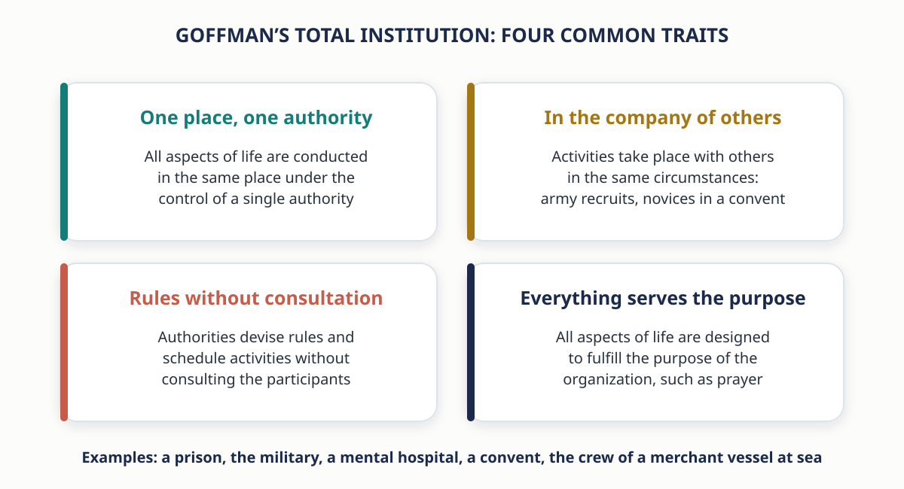{fig-alt="Four cards listing Goffman's traits of a total institution: one place under one authority, activities with others in the same circumstances, rules without consultation, everything designed for the organization's purpose." height=430}
:::

::: {.question-box}
**Test case: the K-pop trainee system.** Agencies sign recruits in their mid-teens, house many in company dormitories, schedule training from morning until late night, cut trainees at monthly evaluations, and monitor weight, phones, and dating. How many of the four traits does it satisfy, and which does it miss?
:::

## Degradation Ceremonies Strip Away Individuality

- People often lose their individuality within total institutions
- **Degradation ceremony** — an aspect of the socialization process within some total institutions, in which people are subjected to humiliating rituals
- A person entering prison is stripped of clothing, jewelry, and other personal possessions
- From that point, scheduled routines allow little or no personal initiative; the individual becomes secondary and rather invisible in the overbearing social environment (Garfinkel 1956)

::: {.takeaway}
Resocialization is most effective inside a total institution precisely because the institution controls the whole mirror.
:::

## The Prisoner-Firefighters Explained with the Chapter's Concepts

::: {.board}
Use the vocabulary to explain what "healed" Sammy in the restaurant.
:::

- **Total institution** and **degradation ceremony**: the prison defined and maintained the identity "criminal"
- **Resocialization**: the fire crew demanded new skills, judgment, and public contact
- **Looking-glass self**: a town that stands and applauds is a different mirror from a cell block
- **Generalized other** and **impression management**: the crew let the public read them as firefighters, and the reading stuck
- Now argue two ways. **Functionalist:** resocialization returns a member to a valued role. **Conflict:** prisoners fighting wildfires is also inexpensive, dangerous labor by a captive workforce. Who benefits from each identity?

## Thinking Critically: Your Own Anticipatory Socialization

::: {.board}
What examples of anticipatory socialization did you experience as a child or teenager? What examples are you currently experiencing?
:::

- Childhood: playing doctor, teacher, or shopkeeper; being told "when you are older you will..."
- Adolescence: choosing a major because of what you imagined the job would be like
- Now: lab coats, internships, LinkedIn profiles, learning how engineers or physicians or managers talk
- What have you already begun to **unlearn** since starting university?

# Role Transitions throughout the Life Course {background-color="#1B2A4A"}

::: {.takeaway}
We do not experience the same things the same way at different points in the life course. Midlife, caregiving, and retirement are social transitions, not only biological ones.
:::

<!-- Skipped by instructor decision (Oct 2026): Schaefer's "falling in love differs by life stage" example.
The one point that matters, that stages can be named only in general terms, now closes the Levinson slide.

## Even Falling in Love Differs by Life Stage

- Young unmarried adults tend to treat love as a noncommittal game or an obsession marked by possessiveness and dependency
- People over 50 are much more likely to see love as commitment and take a practical approach to finding a partner who meets rational criteria
- Romance does not disappear with age: among those **65 and over**, **39 percent** are "head over heels in love," compared with only **25 percent** of those 18 to 34 (G. Anderson 2009; Montgomery and Sorell 1997)
- How we move through the life course varies with preferences and circumstances, shaped by class and gender; only in general terms can we speak of stages
-->

## Levinson's Transitions and the Midlife Crisis

- Psychologist Daniel Levinson identified a transitional stage when an individual gradually **enters the adult world**: moving out of the parental home, beginning a career, or entering a marriage
- The next transition, the **midlife transition**, typically begins at about age 40
- **Midlife crisis** — a stressful period of self-evaluation that begins at about age 40, in which people realize they have not achieved basic goals and ambitions and have little time left to do so
- Levinson (1978, 1996) found that most adults surveyed experienced tumultuous midlife conflicts, within the self and with the external world
- The last major transition occurs after age 60, sometimes well after, given better health care and longer lives
- How we move through the life course varies with preference and circumstance, shaped by class and gender; only in general terms can we speak of stages

## The Sandwich Generation

- **Sandwich generation** — adults who simultaneously try to meet the competing needs of their parents and their children

::: {.center}
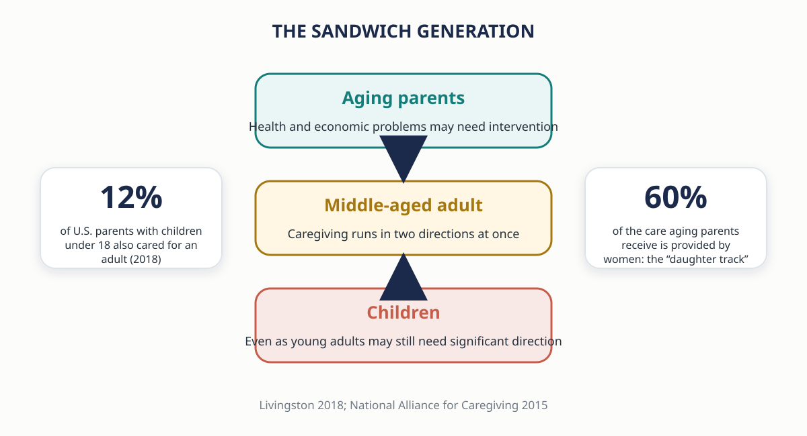{fig-alt="A middle-aged adult between aging parents above and children below; callouts show 12 percent of parents also caring for an adult and women providing 60 percent of parental care."}
:::

::: {.small}
The "daughter track": middle-aged women, and younger, find their time and attention diverted by the needs of aging mothers and fathers (Livingston 2018; National Alliance for Caregiving 2015).
:::

## Retirement Is a Rite of Passage, Increasingly Delayed

- You enter the labor force, work until a certain age, and retire: a rite of passage marking a critical transition. Increasingly, people delay retirement or move into a different type of job
- About **40 percent** of people 55 and older are working or looking for work; the labor force participation rate is projected to grow fastest among people **65 to 74** and **75 and older**
- More than **42 percent** of workers 55+ are in management, professional, and related occupations, and older workers have higher rates of self-employment (Toossi and Torpey 2017)
- Why the reversal? Changes in Social Security benefits, economic uncertainty, worries about health insurance and pensions, plus longer lives and better health (Toossi 2012)

## Retirement in Kuwait Runs the Other Way: Citizens and Expatriate Workers {.smaller}

- A Kuwaiti employee can draw a pension after **30 years' service (men) or 25 (women) with no age condition**, or at age 55 (men) or 50 (women) with 15 years; the 2019 early-retirement law lowered the cost of the earliest exits (PIFSS; KUNA 2019)
- More than **four in five** employed Kuwaitis work in the government sector (CSB labour market data, 2024). The IMF noted that the early-retirement age for civil servants was lowered by five years partly to make room for new graduates, widening the pension fund's actuarial gap to about **45 percent of GDP** (IMF 2020)
- Schaefer's reasons for delay (benefit cuts, insurance worries, economic uncertainty) largely do not apply when the pension is state-guaranteed and health care is public. The timing of retirement follows institutions, not only preference
- Expatriate workers sit outside the pension system: they receive an **end-of-service indemnity**, not a pension, and residence depends on a work permit, so for many, retirement means leaving Kuwait. From 2020 to late 2024 a separate rule restricted or added fees to permit renewals for workers aged 60 and over without a university degree, before it was cancelled (PAM Decision 294/2023, revoked November 2024)

::: {.question-box}
Same country, same age, two different "retirements." What impacts could this have?
:::

## Atchley's Phases of Retirement {.smaller}

| Phase | Description |
|---|---|
| **Preretirement** | A period of anticipatory socialization as the person prepares for retirement |
| **Near phase** | The person establishes a specific departure date from his or her job |
| **Honeymoon phase** | An often euphoric period in which the person pursues activities he or she never had time for before |
| **Disenchantment phase** | Retirees feel a sense of letdown or even depression as they cope with new lives that may include illness or poverty |
| **Reorientation phase** | The development of a more realistic view of retirement alternatives |
| **Stability phase** | The person has learned to deal with life after retirement in a reasonable and comfortable fashion |
| **Termination phase** | Begins when the person can no longer engage in basic day-to-day activities such as self-care and housework |

: Gerontologist Robert Atchley (1976)

## Retirement Is a Series of Adjustments, Not One Event

- The length and timing of each phase differ with financial status and health; a person will not necessarily pass through all of them (Reitzes and Mutran 2006)
- People who retire involuntarily or without the necessary means may never experience the honeymoon phase; many U.S. retirees take part-time jobs to supplement pensions
- The experience varies by gender and resources, so anticipatory socialization for retirement is unevenly distributed

::: {.question-box}
If a Kuwaiti can retire in her late forties with thirty or more healthy years ahead, which of Atchley's phases stretch, which compress, and which might be skipped?
:::

## Figure 4-1: Support for Government Spending on Retirement

::: {.center}
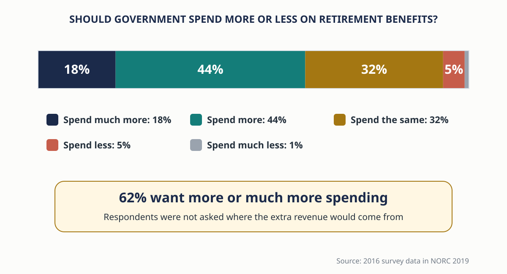{fig-alt="Bar showing support for government spending on retirement benefits: much more 18 percent, more 44, the same 32, less 5, much less 1."}
:::

::: {.small}
Should the government do more for retirees? Sixty-two percent of Americans said yes. Nobody asked them who would pay (NORC 2019). The same thing happens here: a pension increase is always popular, and the IMF estimates Kuwait's pension fund is short by about 45 percent of GDP (IMF 2020). Ask people about benefits without mentioning costs and they will say yes every time. Remember that from Chapter 2 when you read a survey.
:::

## Naturally Occurring Retirement Communities in the U.S., Aging at Home in Kuwait {.smaller}

- **Naturally occurring retirement community (NORC)** — an area that has gradually become an informal center for senior citizens
- Rather than nursing homes or planned retirement communities, many older Americans **age in place**; NORCs account for an estimated **17 to 25 percent** of people 65 or older, from a single apartment building to a city neighborhood, and businesses serving the elderly follow the customers
- Some are threatened by **gentrification**, the takeover of low-income neighborhoods by higher-income residents; residents lose not only housing but a community (Gregor 2013; Piturro 2012)

::: {.fragment}
- Kuwait has aging in place by law rather than by drift. Law 18 of 2016 makes family care of elders a legal duty, in order: spouse, then children, grandchildren, siblings. When its regulations were issued, the Ministry of Social Affairs' residential home housed about **30** elders while mobile home-care served more than **3,200**, and admission is restricted so as not to "encourage family breakdown" (Ministry of Social Affairs 2016)
:::

## Thinking Critically: Dependent Adult Children and Dependent Parents

::: {.board}
Many young adults live with their parents after finishing school. Contrast their situation with that of the elderly who live with their children. Does society treat dependent adult children the same way as dependent parents?
:::

- In Kuwait, where do most elders live and spend their days? Where do unmarried graduates live?
- Which arrangement is read as normal, which as a problem, and by whom?
- How have people close to you handled retirement from the labor force?

# Social Policy and Sociological Research: Child Care around the World {background-color="#1B2A4A"}

::: {.takeaway}
Child care programs are not babysitting. They are an agent of socialization with enormous influence on young children, and societies disagree about who should provide and pay for them.
:::

## Looking at the Issue: Who Cares for Preschoolers? {.smaller}

- The rise in single-parent families, job opportunities for women, and the need for additional income have moved mothers of young children into the working world; in most countries, preschoolers are no longer cared for only by their parents during the day
<!-- Schaefer's U.S. figures, kept for the quiz stage: children aged 3 to 5 are more likely to be cared for daily by other relatives than by parents; over a third are cared for by nonrelatives (Bureau of the Census 2015b; NCES 2019f); 88 percent of employed U.S. mothers depend on others for care, and 30 percent of non-employed mothers have regular arrangements -->
- **Worldwide**, fewer than one in three children aged 3 to 4 attend any early childhood education programme; in the **Middle East and North Africa** the figure is about one in four (UNICEF)
- Only **57 of 178** countries guarantee any childcare for children aged 0 to 2. Between the end of parental leave and the start of childcare lies a "childcare policy gap" averaging **4.2 years**, filled by unpaid family work or, as the ILO puts it, "reliance on domestic workers" (ILO 2022)
- **Kuwait:** public kindergarten from age 4 is free for citizens but not compulsory, and about two-thirds of the age group are enrolled in pre-primary (UNESCO 2019). Below age 4, care is mostly private: roughly **460** licensed nurseries under the Ministry of Social Affairs, employer nurseries where the labour law requires them, grandparents, and about **781,000** domestic workers nationwide (PACI, end of 2024)

::: {.question-box}
Who should care for the children of working mothers during working hours?
:::

## Research Finds High-Quality Child Care Does Not Harm Socialization

- High-quality child care centers do not adversely affect children's socialization; good day care **benefits** children
- U.S. studies found no significant differences between infants with extensive nonmaternal care and those cared for solely by their mothers; the overall quality of arrangements has improved (Campbell et al. 2014; NICHD 2007)
- Generalizing is difficult because providers and state policies vary so much
- The coronavirus pandemic exposed the need: when schools closed, health, food-supply, and transport workers still needed care for their children. Child care workers were suddenly "essential," though they rarely received the hazard pay given to other essential workers (Goldstein and Bosman 2020)

## Applying Sociology: Four Perspectives on Child Care {.smaller}

:::: {.columns}
::: {.column width="46%"}
- **Interactionist:** quality lives in face-to-face interaction between carer and child, a micro-level question with macro-level consequences for the family
- **Functionalist:** in Scandinavia, subsidized day care introduces children from immigrant families to the values and culture of their new country; Denmark considered requiring children in poor, mostly immigrant neighborhoods to attend day care 25 hours a week (*The Economist* 2019b)
- **Conflict:** quality care is easier to find in affluent communities; the poorest U.S. families spend 25 percent of income on preschool care, others 6 percent or less
- **Feminist:** care is dismissed as "merely a way to let women work"; 97 percent of U.S. child care workers are women, paid about $11 an hour
:::

::: {.column width="54%"}
::: {.center}
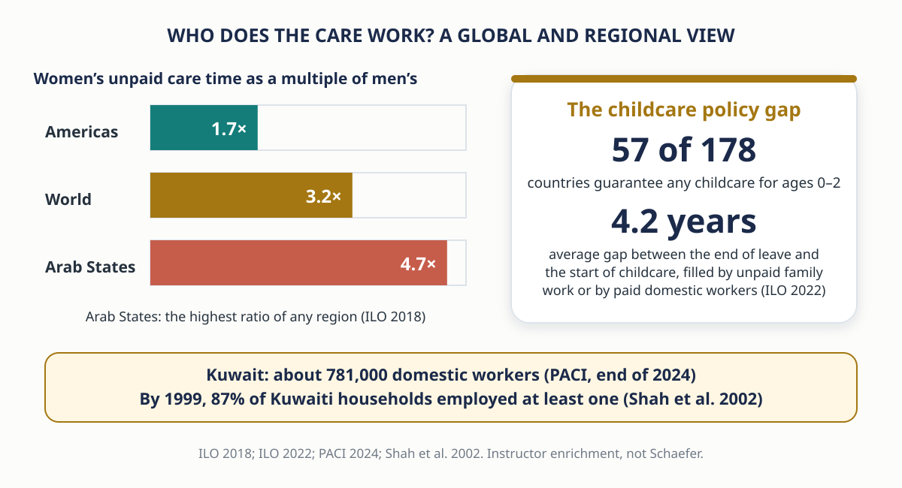{fig-alt="Bars showing women's unpaid care time as a multiple of men's: 1.7 in the Americas, 3.2 worldwide, 4.7 in the Arab States; a card notes that only 57 of 178 countries guarantee childcare for ages 0 to 2 and that the average childcare policy gap is 4.2 years; a banner gives Kuwait's roughly 781,000 domestic workers."}
:::
:::
::::

## Initiating Policy: Child Care Policies Vary Worldwide {.smaller}

- Most developing nations lack the economic base for subsidized care; working mothers rely on relatives or take children to work
- In western Europe, government provides child care as a basic service at little or no cost, though even subsidized systems fall short of demand
- In **Sweden and Denmark**, one-half to two-thirds of preschoolers are in government-subsidized care full-time
- In the **United States**, 2019 annual fees for full-time infant care ranged from **$5,760** in Mississippi to **$20,880** in Massachusetts (Child Care Aware 2020)
- In **Japan**, married mothers traditionally left the labor force; day care has not kept pace. Policymakers ask, "Is your work so important that you must put your baby in childcare? Why are you being so self-centered?" One private center had a waiting list of **25,000** children (Tabuchi 2013)
- In Europe, **53 percent** of women report not working or working part-time because care is too expensive; another **25 percent** cannot find it (Janta 2014)

## Take the Issue with You: Who Should Pay for Child Care?

::: {.board}
Should the costs of day care be paid by government, by the private sector, or entirely by parents?
:::

- Were you ever in a nursery or day care program? Do you recall it as good or bad? Is it desirable to expose young children to the socializing influence of day care?
- Conflict theorists say child care receives little support because it is "merely a way to let women work." Can you think of other explanations?
- Optional: in Kuwaiti households, young children may be cared for by parents, grandparents, nurseries, or hired caregivers. What does each arrangement mean for who socializes the child, and in which language?

# Socialization in Your Life and Your Field {background-color="#1B2A4A"}

::: {.takeaway}
What looked like individual choice, who you are, when you grew up, how you present yourself, turns out to follow social patterns that can be named.
:::

## Sociology in Your Major

::: {.center}
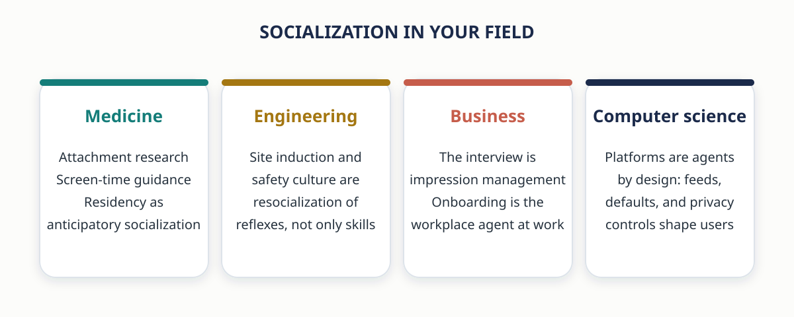{fig-alt="Four cards applying socialization to medicine, engineering, business, and computer science."}
:::

::: {.small}
Medicine: attachment research sits behind pediatric practice, the screen-time guidance is applied socialization research, and residency is anticipatory socialization inside something close to a total institution. Engineering: onboarding and safety culture are resocialization. Business: the interview is impression management under examination; plan for the 12-jobs finding. Computer science: platforms are agents of socialization by design.
:::

## Before You Leave

- Heredity and environment **interact**: Isabelle and the orphans show what happens without interaction; the twins keep the genes honestly in the picture
- The self is **created** through others' imagined judgments (Cooley), **develops** through role taking toward the generalized other (Mead), and is **presented** to audiences (Goffman); Freud and Piaget add inborn drives and cognitive stages
- Seven **agents** carry socialization for life: family, school, peers, media and technology, workplace, religion, the state
- Societies mark transitions with **rites of passage**, prepare us through **anticipatory socialization**, and sometimes rebuild us through **resocialization**, most completely inside a **total institution**
- Midlife, the sandwich generation, and retirement are social transitions; child care is socialization policy

::: {.small}
Next: Chapter 5, Social Interaction, Groups, and Social Structure. What happens when socialized selves meet?
:::
