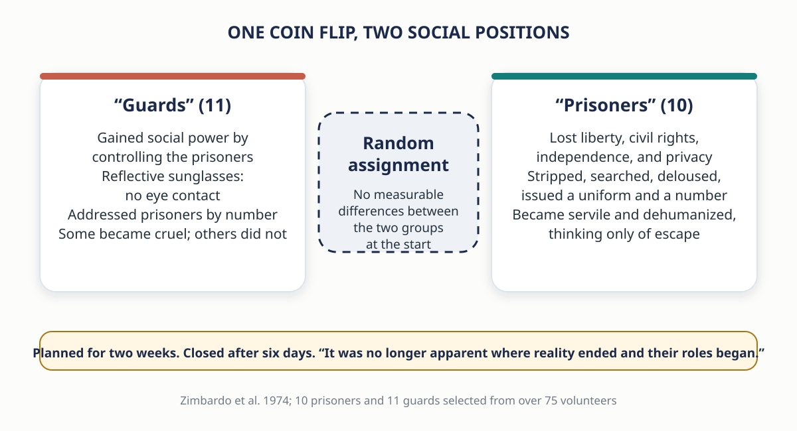
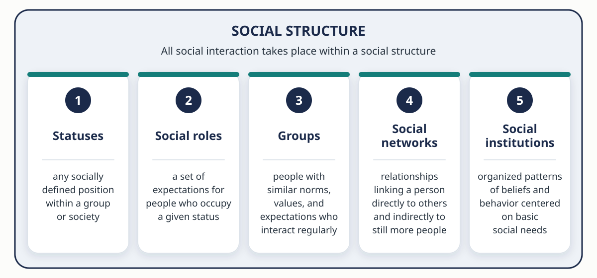
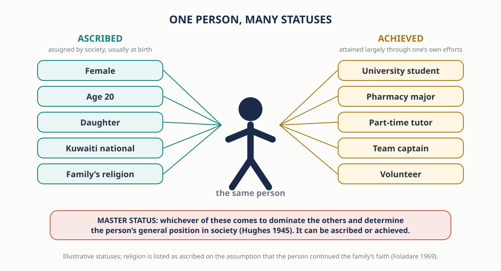
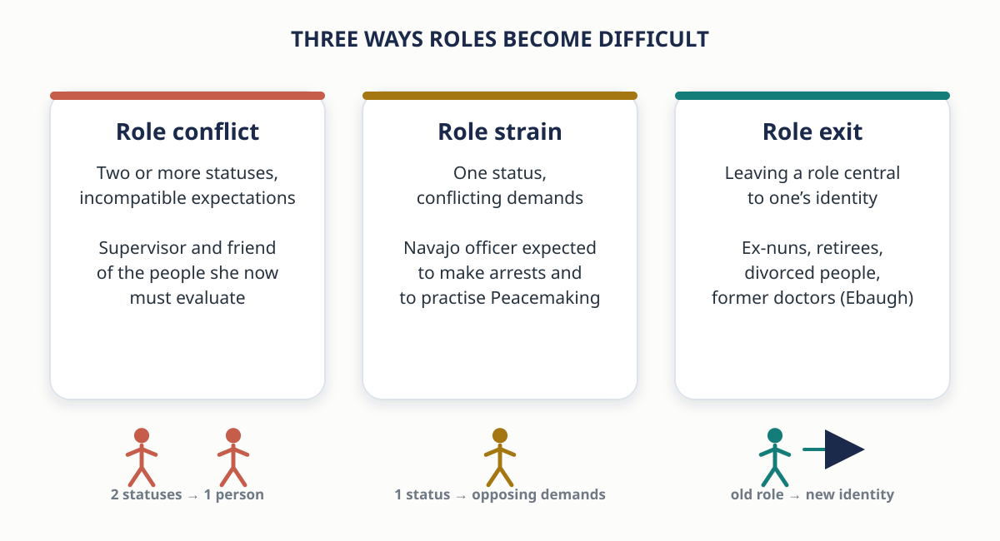
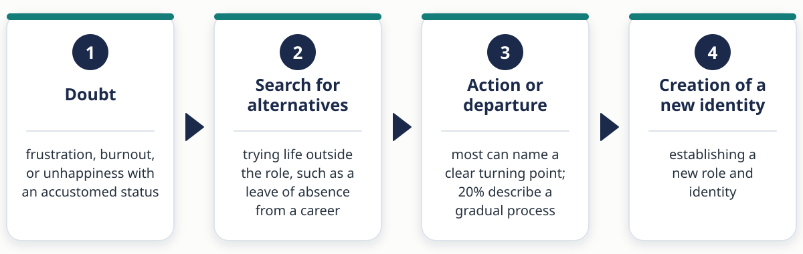
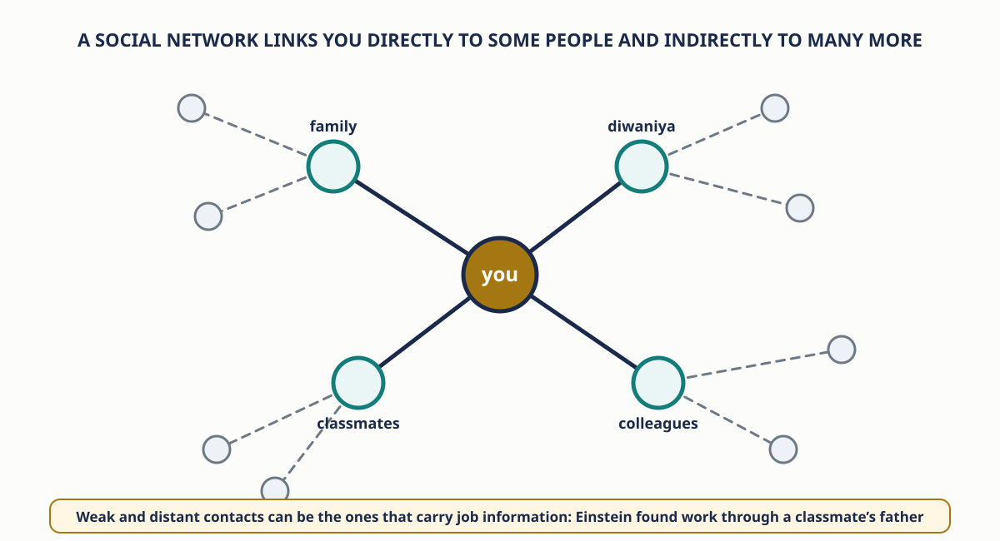
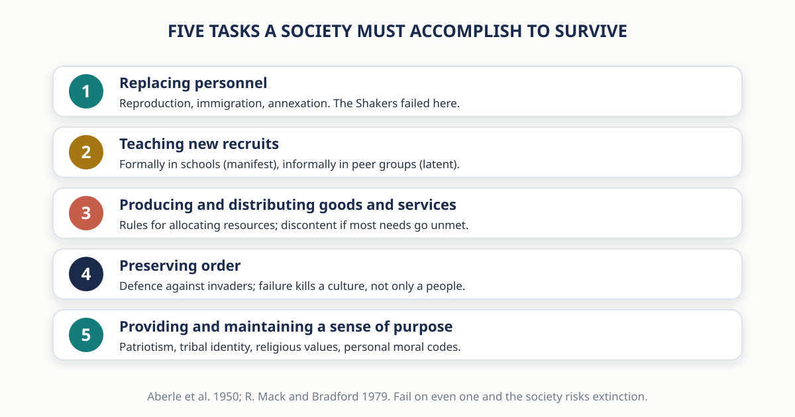

# Social Interaction and Reality {background-color="#1B2A4A"}

::: {.takeaway}
We do not simply react to one another. We interpret, define, and respond to meanings, and those meanings are built in interaction, inside a structure that was there before we arrived.
:::

## Zimbardo's Mock Prison: A Summer Sunday in Palo Alto {.smaller}

:::: {.columns}
::: {.column width="55%"}
- A quiet Sunday morning in Palo Alto, California, 1971. Police sweep through the city picking up college students in a surprise mass arrest
- Each suspect is charged with a felony, warned of his rights, pushed against the car, searched, handcuffed, and taken to the station for booking
- Blindfolded, each is transported to the "Stanford County Prison". They are searched, had their possessions taken, and issued a uniform, bedding, soap, and a towel
- By late afternoon ten "first offenders" sit in dazed silence on the cots of their empty cells

::: {.fragment}
- None of it was real. Social psychologist **Philip Zimbardo** built a mock prison to study how people adapt when some are called "prisoners" and others "guards"
- **10 prisoners and 11 guards**, chosen from more than 75 volunteers, were assigned to their roles **at random**. At the start there were no measurable differences between the two groups
:::
:::

::: {.column width="45%"}
{fig-alt="Two cards: guards gained power and wore reflective sunglasses; prisoners lost liberty and were issued numbers. Assignment was random. The study closed after six days."}
:::
::::

## The Experiment Was Planned for Two Weeks and Closed After Six Days

- "It was no longer apparent to most of the subjects (or to us) where reality ended and their roles began"
- Some guards treated prisoners "as if they were despicable animals, taking pleasure in cruelty"; prisoners "became servile, dehumanized robots who thought only of escape"
- "In less than a week the experience of imprisonment undid (temporarily) a lifetime of learning: human values were suspended; self-concepts were challenged" (Zimbardo et al. 1974)

<!-- ::: {.question-box} -->
<!-- If you had been assigned to be a guard, would you have mistreated the inmates? Before you answer, remember that the guards were ordinary students who would probably have said the same thing a week earlier. -->
<!-- ::: -->

## Social Interaction and Social Structure Defined

- **Social interaction** — the ways in which people respond to one another, whether face-to-face, over the telephone, or on the computer
- In the mock prison, interaction was highly impersonal. Guards addressed prisoners by **number** rather than name and wore reflective sunglasses that made eye contact impossible
- **Social structure** — the way in which a society is organized into predictable relationships
- The prison's structure gave guards almost total control over prisoners, and that structure shaped how they interacted. It was a real prison "in the minds of the jailers and their captives" (Zimbardo et al. 2009)
- The experiment has been repeated, with similar findings, in the United States and in other countries

::: {.takeaway}
Random assignment means the students did not bring cruelty or servility with them. The structure and the roles brought it out.
:::

## Criticism, Replication, and Why the Experiment Still Matters {.smaller}

- Critics object to using students as subjects, and some suggest Zimbardo **coached** the guards to torment the prisoners
- Zimbardo admits he did not step in to limit the cruelty, but documentation from the study shows he did not encourage or suggest it (Zimbardo 2018)
- In 2004 the abuse of Iraqi prisoners by U.S. soldiers at **Abu Ghraib** renewed interest in the study. Zimbardo noted the guards' conduct could have been predicted from his research. The structure of a wartime prison plus intense pressure for information broke down the guards' behavior (Ratnesar 2011; Zimbardo 2015)
- Entering the mock prison began a process of **resocialization**. The students adjusted to a new social structure and learned new rules for interaction

## What This Chapter Asks

- What determines a person's **status** in society?
- How do our **social roles** affect our interactions?
- What place do **social institutions** such as the family, religion, and government have in social structure?
- How can we understand and manage large **organizations** such as ministries and multinational corporations?

<!-- ::: {.small} -->
<!-- How interaction shapes reality → the five elements of social structure (statuses, roles, groups, networks, institutions) → formal organizations and bureaucracy → Durkheim, Tönnies, and Lenski on simpler and modern societies → social policy: labor unions worldwide. -->
<!-- ::: -->

## Blumer: We Interpret Each Other's Actions Instead of Merely Reacting

- When someone in a crowd shoves you, do you automatically push back? Or do you consider the circumstances and the attitude of the person first? Most people do the latter
- Herbert Blumer (1969): the distinctive feature of human interaction is that "human beings interpret or 'define' each other's actions instead of merely reacting to each other's actions"
- Our response to someone's behavior is based on the **meaning** we attach to it. Reality is shaped by our perceptions, evaluations, and definitions
- Those meanings reflect the norms and values of the dominant culture and our socialization within it
- Social reality is literally **constructed** from our social interactions (Berger and Luckmann 1966)

## Defining Social Reality: Medical Masks Before and After the Pandemic

- Until recently, wearing a medical mask in public was unusual outside a few Asian nations
- With the coronavirus, masks became common, then recommended, then required by governments and shopkeepers
- People drew silly expressions on homemade masks or displayed team logos, perhaps to make them less frightening at a time when being in public felt uncomfortable (Taylor 2020)

::: {.question-box}
What did a face mask **mean** on a Kuwait street in 2019, in 2021, and today? Who changed the meaning: the mask, or the people interpreting it?
:::

<!-- ## Marriage as Relationship or Status: Japan's Beloved Wives Day {.smaller} -->

<!-- - What counts as reality varies across cultures. In Western societies, with their emphasis on romantic love, couples see marriage as a **relationship** as well as a social status; professions of love, from Valentine's flowers to everyday gestures, are expected -->
<!-- - In Japan, marriage is considered more a **social status** than a relationship. Saying "I love you" does not come easily, especially to husbands; most do not call their wives by name (they prefer "Mother") or look them in the eyes -->
<!-- - In 2006 some Japanese men formed the Devoted Husband Organization and sponsored a new holiday, **Beloved Wives Day** -->
<!-- - In 2008 dozens of men stood in a cabbage patch north of Tokyo and shouted "I love you!" to their wives, some of whom had never heard the words. They also pledged to be home by 8 p.m. that day (Japan Aisaika Organization 2020; Kambayashi 2008) -->

## Thomas: The Definition of the Situation Reflects Power {.smaller}

- The ability to define social reality reflects a group's **power** within a society. A crucial aspect of the relationship between dominant and subordinate groups is the dominant group's ability to define a society's values
- **W. I. Thomas** (1923), an early critic of theories of racial and gender differences, recognized that the **"definition of the situation"** could mold the thinking and personality of the individual
- People respond not only to the objective features of a person or situation but also to the **meaning** that person or situation has for them
- Two students get a B+ on the same midterm. One needs an A to keep a scholarship or reach a competitive medical specialty, so for her the grade feels like a crisis. The other was afraid of failing, so for him it is a relief. The letter on the paper is the same, but they react in opposite ways because it means different things to each of them.
- Zimbardo's "guards" and "prisoners" accepted the definition of the situation, including the traditional roles of guard and prisoner, and acted accordingly
- Social change involves **redefining or reconstructing** social reality: members of subordinate groups challenge traditional definitions and begin to experience reality in a new way

## Apply Blumer and Thomas: Which Definition Is Operating?

::: {.board}
For each situation, give **two** different definitions a person could attach to it, and the different reaction each produces.
:::

- The car behind you on the Fifth Ring Road flashes its headlights twice
- A professor says nothing for five seconds after your answer in class
- A cousin arrives forty minutes late to a family lunch
- A classmate you barely know sends you a voice note at 11 p.m. asking for the lecture slides

<!-- ::: {.small} -->
<!-- Instructor enrichment. The sociological point is Blumer's: the reaction follows the definition, not the act itself. -->
<!-- ::: -->

# Elements of Social Structure: Statuses and Roles {background-color="#1B2A4A"}

::: {.takeaway}
Any social structure can be broken into five elements: statuses, social roles, groups, social networks, and social institutions. They make up social structure just as a foundation, walls, and ceilings make up a building.
:::

## Five Elements Make Up Social Structure

::: {.center}
{fig-alt="A frame labelled social structure, in which all social interaction takes place, containing five numbered tiles: 1 statuses, 2 social roles, 3 groups, 4 social networks, 5 social institutions, each with a one-line definition."}
:::

::: {.small}
All social interaction takes place within a social structure, including the interactions that redefine social reality. This section covers statuses and roles; the next two cover groups and networks, then institutions.
:::

## Status Means Any Socially Defined Position, Not Only Prestige

- In everyday speech, "status" suggests influence, wealth, and fame
- **Status** — sociologists use the term for any of the full range of socially defined positions within a large group or society, from the lowest to the highest
- A person can occupy the status of president, fruit picker, son or daughter, violinist, teenager, resident of a particular city, dental technician, or neighbor
- A person holds **a number of statuses at the same time**

::: {.question-box}
Write down five statuses you hold right now. Keep the list; we will sort it in a few minutes.
:::

## Ascribed Status Is Assigned; Achieved Status Is Earned

:::: {.columns .small}
::: {.column width="46%"}
- **Ascribed status** — a social position assigned to a person by society without regard for the person's unique talents or characteristics. Usually assigned at birth: ethnic/racial background, gender, and age
- These are biological in origin but matter mainly because of the **social meanings** attached to them. Conflict theorists take special interest in ascribed statuses because they often confer privileges or mark membership in a subordinate group (Linton 1936)
- **Achieved status** — a social position attained largely through one's own efforts: computer programmer, prison guard, lawyer, pianist, convict, social worker. We must *do* something to acquire it
:::

::: {.column width="54%"}
{fig-alt="One person with ascribed statuses on the left (female, age 20, daughter, Kuwaiti national, family's religion) and achieved statuses on the right (student, pharmacy major, tutor, team captain, volunteer); a master status dominates the others."}
:::
::::

## An Ascribed Status Can Be Reinterpreted: Age in the U.S. and China {.smaller}

- We can do little to change an ascribed status, but we can try to change the traditional **constraints** associated with it
- The **Gray Panthers**, an activist group founded in 1971, worked to modify negative stereotypes of the elderly; the ascribed status of "senior citizen" is no longer as difficult for millions of older Americans
- An ascribed status does not carry the same meaning everywhere. Gary Huang (1988) confirmed that respect for the elderly is an important norm in China: calling someone "old teacher" is like calling a U.S. judge "your honor." In the United States, "old man" is closer to an insult
- Norms are not guarantees. In 2013 China passed an **Elderly Rights Law** that warns adult children never to "neglect or snub elderly people," requires regular visits regardless of distance, and backs this with fines or jail (Martinez-Carter 2013)

::: {.small}
Compare Chapter 4: Kuwait's Law 18 of 2016 also makes family care of elders a legal duty, in order of spouse, children, grandchildren, siblings. 
:::

## Three Complications in How Statuses Work

1. **Ascribed status heavily influences achieved status.** Being male decreases the likelihood that a person will be encouraged to consider a career in child care
2. **A status may or may not be desirable.** Family background (ascribed) can place you in a positive or negative position; an achieved status can be *criminal* or *hero*
3. **Some statuses can be either ascribed or achieved,** depending on circumstances. Religion is ascribed if a person carries on the family's faith and achieved if he or she settles on a religion after exploring several (Foladare 1969)

::: {.question-box}
Return to your list of five statuses. Label each A (ascribed) or Ach (achieved). Which of your achieved statuses would have been much harder, or much easier, to reach with a different ascribed status?
:::

## Master Status Dominates the Others

- Each person holds many, sometimes conflicting, statuses. How do others judge one's **overall** position?
- Everett Hughes (1945): societies deal with the inconsistency by agreeing that certain statuses matter more than others
- **Master status** — a status that dominates other statuses and thereby determines a person's general position in society
- Throughout the world, many people with disabilities find that "disabled" receives undue weight, overshadowing their actual ability to perform in meaningful employment
- A master status can also be positive: ask any first-year medical student how quickly relatives started calling them "Doctor"

## Box 5-1: Disability as a Master Status {.smaller}

- Historically people with disabilities were treated as subhuman. In Japan more than **16,000** women with disabilities were involuntarily sterilized with government approval from 1945 to 1995; Sweden apologized for the same action against **62,000** of its citizens in the 1970s
- Hostile treatment gave way to a **medical model**, in which the disabled are viewed as chronic patients
- Disability rights advocates now criticize that model too. In a **civil rights model**, it is the unnecessary physical and attitudinal **barriers** in the environment, more than any biological limitation, that stand in the way. Most voting places, for example, are inaccessible to wheelchair users
- Drawing on Goffman, sociologists note that society attaches a **stigma** to many disabilities: others see "the blind" or "the wheelchair user" rather than a complex person for whom the disability is one aspect of life
- Attitudes are changing. Botswana plans services for its largely rural disabled population; activists worldwide target employment, housing, education, and access to public buildings

<!-- ## Let's Discuss: Does Our Campus Present Barriers to Disabled Students? -->

<!-- ::: {.board} -->
<!-- Walk mentally from the parking lot to this room. What barriers would a wheelchair user, a blind student, or a deaf student meet along the way: physical, attitudinal, or both? -->
<!-- ::: -->

<!-- - Why do nondisabled people see disability as the *most important* characteristic of a disabled person? -->
<!-- - What can be done to help people see beyond the wheelchair and the guide dog? -->
<!-- - Which model does our campus operate on in practice, the medical model or the civil rights model? -->

## Classify the Status: Ascribed, Achieved, or Master?

::: {.board}
Sort each case. Where could it be more than one? Where does it depend on circumstances?
:::

- Eldest son
- First-year student
- "Abu Ahmad" (father of Ahmad)
- Licensed pharmacist
- Teenager
- National team player
- Person with a visual impairment
- Retiree
- Someone who converted to a religion as an adult

## Social Roles Are the Expectations Attached to a Status {.smaller}

- **Social role** — a set of expectations for people who occupy a given social position or status
- We expect taxi and ride-share drivers to know their way around a city, and police officers to act when a citizen is threatened
- Each status, ascribed or achieved, carries role expectations, but **actual performance varies**: one secretary takes on wide administrative responsibilities; another sticks to clerical work. Some of Zimbardo's guards were brutal; others were not
- **Functionalist view:** roles contribute to stability by letting members anticipate one another's behavior and pattern their actions accordingly
- Roles can also be **dysfunctional** when they restrict relationships: if we see a person only as "police officer" or "supervisor," it is hard to relate to him or her as a friend or neighbor

## Three Ways Roles Become Difficult

::: {.center}
{fig-alt="Three cards: role conflict between two statuses, role strain within one status, and role exit from a role central to identity."}
:::

## Role Conflict: Incompatible Expectations from Two Statuses {.smaller}

- A woman has worked for a decade on an assembly line and is named supervisor of her unit. Should she still go to lunch with her longtime friends? Must she recommend firing an old friend who cannot keep up?
- **Role conflict** — the situation that occurs when incompatible expectations arise from two or more social positions held by the same person
- Fulfilling the roles of one status may directly violate the roles of another. Such conflicts call for **ethical choices**: how much allegiance does she owe her friend, and how much her employer?
- A second type of role conflict occurs when people enter occupations that society doesn't traditionally associate with their ascribed status. Male preschool teachers and female police officers, for example, must navigate expectations about gender and work. Female officers face a particular challenge: they must reconcile the demands of police work with traditional expectations of women. They must also contend with the “code of silence,” an informal rule that discourages officers from reporting misconduct by their colleagues (Fletcher 1995; S. Martin 1994).

## Role Strain: Conflicting Demands within One Status

- Role conflict is about holding two positions at once. A **single** position can also cause problems
- **Role strain** — the difficulty that arises when the same social position imposes conflicting demands and expectations
- Members of minority cultures may experience it while working in the mainstream culture. Criminologist Larry Gould (2002) interviewed officers of the **Navajo Nation Police Department**
- Besides enforcing the law, Navajo officers practice **Peacemaking**, seeking reconciliation between the parties to a crime. They are confident in it, but worried that without making arrests, other agencies would think them "too soft" or "just taking care of their own"
- All felt the strain of being considered "too Navajo" or "not Navajo enough"

## Role Conflict or Role Strain? Decide the Case

::: {.board}
Name the concept, then name the two expectations that collide.
:::

1. A medical intern is on call the night of her brother's wedding
2. A professor is expected to grade strictly and to be an approachable mentor to the same students
3. A police officer stops a car and recognizes his cousin at the wheel
4. A nurse is told to move patients through quickly and to give each one compassionate attention
5. A ministry employee is asked by a relative to "look at" a file that is not next in the queue
6. A student works evenings in the family business and has an exam the next morning

<!-- ::: {.small} -->
<!-- Instructor enrichment. Case 5 is where wasta lives in the vocabulary of this chapter: a kin role and an official role making incompatible claims on one person. -->
<!-- ::: -->

## Role Exit: Ebaugh's Four Stages {.smaller}

- We usually focus on preparing for a role, the anticipatory socialization of becoming a lawyer, chef, spouse, or parent. Until recently social scientists paid little attention to **leaving** roles
- **Role exit** — the process of disengagement from a role that is central to one's self-identity in order to establish a new role and identity (Ebaugh 1988)
- Helen Rose Fuchs Ebaugh, herself an ex-nun, interviewed **185** people, among them ex-convicts, divorced men and women, recovering alcoholics, ex-nuns, former doctors, and retirees

{fig-alt="Four numbered stages joined by arrows: 1 doubt, 2 search for alternatives, 3 action or departure (most name a clear turning point; 20% describe a gradual process), 4 creation of a new identity."}

## Role Exit from School to University: Objects That Say "This Is Me"

- Many of you went through a role exit when you moved from high school to university: you left the role of child at home and took on the role of a somewhat independent student among peers
- Ira Silver (1996) studied the **objects** students choose in this transition. Items left at home (stuffed animals, dolls) belong to the prior identity; students may stay attached to them but do not want them seen as part of the new self
- Objects brought along, phones and wall posters, are calculated to say, "**This is me**"

::: {.question-box}
What did you stop carrying, wearing, or saying when you entered Kuwait University? What did you start? Which of Ebaugh's stages did you notice, and which did you skip?
:::

# Groups and Social Networks {background-color="#1B2A4A"}

::: {.takeaway}
Much of social life happens in groups, and groups link us to networks that reach far beyond the people we know. Who counts as "we" turns out to shape what we think is true.
:::

## A Group Requires Regular Interaction

- **Group** — any number of people with similar norms, values, and expectations who interact with one another on a regular basis
- A women's basketball team, a hospital's business office, a congregation, or a symphony orchestra is a group. The residents of a suburb are **not**, since they rarely interact at one time
- Much of our social interaction takes place within groups and is governed by their **norms and sanctions**
- Being a teenager or a retired person takes on special meaning inside groups designed for that status; the expectations attached to brother, sister, or student become clearer in the context of a group

<!-- ::: {.question-box} -->
<!-- Which of these is a group in Schaefer's sense: this lecture section; your family WhatsApp group; everyone at The Avenues on a Friday night; the regulars at one diwaniya? -->
<!-- ::: -->

## Group Solidarity After Tragedy: Hawdon and Ryan at Virginia Tech

- Durkheim ([1893] 1933) observed that a heinous crime shocks us and draws a **communal response** that protects us in the future
- In April 2007 a student at Virginia Tech killed 32 people and wounded 17 on campus
- Sociologists James Hawdon and John Ryan (2011) surveyed students and faculty three times, nine days after the shooting and again up to ten months later
- Joining activities specific to the tragedy did not necessarily bring relief or solidarity. What mattered more for recovery was **continued participation in clubs and friendship groups** in the following weeks
- Group solidarity makes a difference, and the ordinary groups did the most work

## Decision Making in the Jury Room {.smaller}

- After the family, juries are the most studied groups. 
- Four popular research methods: interviews after the verdict, observation of jurors during trials, observation of actual deliberations (rarely permitted), and mock juries of volunteers
- In *Twelve Angry Men* (1957) Henry Fonda's lone juror converts the whole jury. Research disagrees; in reality jurors generally do not change their minds after the first ballot. In **225 cases**, if a majority voted to convict on the first ballot, there was only a **5 percent** chance of later acquittal
- Many jurors form tentative verdicts early, despite instructions, and then weight supporting testimony more heavily than contradicting testimony
- Juries are more likely to convict on *some* charge when given several alternatives to an absolute "not guilty"
- Jurors who expect the forensic science they see on *CSI* may wonder why extraordinary tests were not used

<!-- ::: {.question-box} -->
<!-- Kuwait's courts use judges, not juries. Is a jury a typical group? Think of a thesis committee or a family council deciding a marriage proposal. Would the first-ballot finding apply there? -->
<!-- ::: -->

## Primary and Secondary Groups

- Charles Horton Cooley (1956) coined **primary group** — a small group characterized by intimate, face-to-face association and cooperation. A family in one household, a street gang, and a group of college "sisters" are all primary groups
- Primary groups play a pivotal role in **socialization**. During the pandemic we tried to keep face-to-face interaction alive through Zoom, FaceTime, Houseparty, and Skype. When we find ourselves **identifying** with a group, in person or online, it is probably a primary group
- **Secondary group** — a formal, impersonal group in which there is little social intimacy or mutual understanding. Large college classes and business associations are examples; secondary groups often emerge in the workplace among people who share an occupation

## Table 5-1: Comparison of Primary and Secondary Groups

| Primary group | Secondary group |
|---|---|
| Generally small | Usually large |
| Relatively long period of interaction | Relatively short duration, often temporary |
| Intimate, face-to-face association | Little social intimacy or mutual understanding |
| Some emotional depth to relationships | Relationships generally superficial |
| Cooperative, friendly | More formal and impersonal |

<!-- ::: {.question-box} -->
<!-- A study group of four strangers formed in Week 1 is now a group of four friends in Week 6. What changed in the table? Can a group move from one column to the other and back? -->
<!-- ::: -->

## In-Groups and Out-Groups {.smaller}

- A group can mean something special to its members because of its relation to **other** groups, especially one perceived as culturally or racially different. William Graham Sumner (1906) named the "we" and "they" feelings
- **In-group** — any group or category to which people feel they belong: everyone regarded as "we" or "us." It may be as narrow as a clique or as broad as a whole society
- **Out-group** — a group or category to which people feel they do not belong: "they" or "them"
- In-group members typically feel distinct and **superior**. Proper behavior for the in-group is seen as unacceptable for the out-group. Robert Merton (1968) called this the conversion of **"in-group virtues" into "out-group vices"**
<!-- - The double standard runs through debates about terrorism: a group’s own aggression is “necessary,” even when civilians are hurt; the opponent’s is condemned, and then the condemners retaliate in kind -->

<!-- ::: {.small} -->
<!-- Conflict between in-groups and out-groups can turn violent. Schaefer cites the 1999 Columbine school attack, in which members of an out-group struck at an in-group that had taunted them. Keep the tone sober. -->
<!-- ::: -->

## In-Group Virtues and Out-Group Vices: Spot the Double Standard

::: {.board}
Two perspectives on the same behavior.  
:::

<!-- ::: {.fragment} -->
<!-- - We are **loyal to family**. They are **clannish**. -->
<!-- ::: -->
::: {.fragment}
- Our fans are **passionate**. Their fans are **hooligans**.
:::
::: {.fragment}
- We **network**. They **use wasta**.
:::
::: {.fragment}
- We are **careful with money**. They are **stingy**.
:::
::: {.fragment}
- We are **confident**. They are **arrogant**.
:::

::: {.small}
Schaefer: "Try putting yourself in the shoes of an out-group member. What does your in-group look like from that perspective?"
:::

## Reference Groups Set Standards and Provide Comparisons {.smaller}

- **Reference group** — any group that individuals use as a standard for evaluating themselves and their own behavior
- A student who wants to join a circle of hip-hop devotees emulates dress, music, and hangouts of that group
- Two functions for reference groups (Merton and Kitt 1950). **Normative:** setting and enforcing standards of conduct and belief. **Comparison:** serving as a standard against which people measure themselves; an actor evaluates herself against other actors
- Reference groups help **anticipatory socialization**: a finance major who reads the *Wall Street Journal*, studies annual reports, and tracks the market on a phone is using financial experts as a reference group
- Several reference groups act on us at once (family, neighbors, co-workers), and they **change over the life course**: an executive who leaves the rat race at 45 to become a social worker finds new standards

## Your Reference Groups: Who Is the Standard?

::: {.question-box}
When you get your grades, whose marks did you compare yours with? When you decide what is a normal amount to spend on a weekend, whose spending is the measure?
:::

- The accounts you follow are a reference group you chose; influencers set the **comparison** standard for bodies, purchases, and holidays
- "Future doctors" or "future engineers" is a reference group you are using **before** you belong to it: anticipatory socialization, from Chapter 4
- Connecting it to Cooley's looking-glass self: the reference group is the mirror you choose to look into

## Coalitions Form as Groups Grow Larger

- **Coalition** — a temporary or permanent alliance geared toward a common goal; broad or narrow, with many possible objectives
- William Julius Wilson (1999) described community organizations in Texas that brought together whites and Latinos, working class and upper class, to work for sidewalks, drainage, and paved streets; he hoped such coalitions would build better understanding across groups
- Some coalitions are intentionally short-lived. Short-term alliances are the key to winning programs like *Survivor*
- Opposing politicians or political parties can "work across the aisle" when they need to: the U.S. Congress approved a budget for 2020 and 2021 by agreeing to limit expressions of anger to their own constituencies rather than voicing them on the floor

<!-- ::: {.question-box} -->
<!-- OPEC, founded in 1960 with Kuwait among its five founding members, is a permanent coalition of states with one common goal. Describe one coalition from your own experience, in a group project, a club, or a family decision. Did it work? What had to be overcome? -->
<!-- ::: -->

<!-- ::: {.small} -->
<!-- The OPEC example is instructor enrichment. -->
<!-- ::: -->

## Social Networks Link Us Beyond the Groups We Belong To {.smaller}

:::: {.columns}
::: {.column width="48%"}
- Groups also **link the individual to the larger society**: through acquaintances we connect with people in different circles
- **Social network** — a series of social relationships that link a person directly to others, and through them indirectly to still more people. One of the five elements of social structure
- Networks cover all routine interaction: job information, news, gossip. Do not equate social media such as Instagram with social networks, which are much broader
- **Networking** is especially valuable for finding employment. Albert Einstein found a job only when a classmate's father put him in touch with his future employer. Even weak and distant contacts can be crucial
:::

::: {.column width="52%"}
{fig-alt="A person at the center with direct ties to family, classmates, a diwaniya, and colleagues, and dashed indirect ties beyond them."}
:::
::::

## Networks Are Not Equal: Networking, Exclusion, and Wasta

- Not everyone participates equally in networks, in person or online. Like in-groups, networks can become **elitist or exclusionary**; women and minorities are at a disadvantage when seeking better jobs or contacts (Erikson and Occhiuto 2017; Trimble and Kmec 2011)

::: {.board}
Einstein got his job through a classmate's father. In Kuwait, what do we call it when a job comes through a relative's friend? When is it "networking" and when is it "wasta," and who gets to decide which word applies?
:::

- A network transmits information and opportunity to those **inside** it, which means it also withholds them from those outside
- What looked like one person's luck or one family's connections is a **pattern** in how structure distributes opportunity

<!-- ::: {.small} -->
<!-- Instructor enrichment. Discussion only; no one is asked to describe how they or their relatives found work. -->
<!-- ::: -->

## Online Networks Distort Social Reality

- Highly social activities such as parties are exaggerated online because of their visual impact; solitary activities such as reading, homework, or praying are rarely posted
- The **friendship paradox**: 98 percent of people have many fewer real-life friends than online "friends." The gap fosters a sense of **isolation**, especially among adolescents (Jackson 2019)
- A generation ago network research studied face-to-face encounters, phone calls, and letters; it now builds on those findings to study social media

<!-- ::: {.question-box} -->
<!-- Your feed shows your classmates' best moments, not their week. Blumer again: you react to the meaning you attach to that feed, not to their actual week. What definition of "a normal weekend" does your feed teach? -->
<!-- ::: -->

<!-- ## Box 5-3: Twitter Networks from Wildfires to Hurricanes {.smaller} -->

<!-- - With about **126 million** active daily users in 2019, Twitter became a research site for disaster communication -->
<!-- - University of Vermont researchers studied the five costliest disasters of the 2010s: accounts with relatively **small followings (200 to 300 people)** had the greatest impact in sharing information on food, emergency supplies, and practical details, at three stages: before, during, and after the event. During an event, the most shared information was the location of available **generators** (Niles et al. 2019) -->
<!-- - Sutton et al. (2015) tracked how often three kinds of official message were retransmitted across threat types: -->

<!-- | Message type | 1st (most retweets) | 2nd | 3rd and 4th | 5th (fewest) | -->
<!-- |---|---|---|---|---| -->
<!-- | Informational (phone numbers, websites) | Flood | Hurricane | Terrorist attack · Blizzard | Wildfire | -->
<!-- | Closures or openings of facilities and roads | Terrorist attack | Flood | Blizzard · Hurricane | Wildfire | -->
<!-- | Evacuation and shelter | Wildfire | Flood | Terrorist attack · Blizzard | Hurricane | -->

<!-- - Tweets with a **URL** to more information or an **emotive phrase** such as "stand strong" were especially likely to be passed on. An Australian study found Twitter can give real-time information on the severity and location of damage. The research costs almost nothing and does not interfere with the response -->

<!-- ## Let's Discuss: Why Did Retweets Vary by Disaster and Message? -->

<!-- ::: {.board} -->
<!-- Why would evacuation messages travel farthest for wildfires but least for hurricanes? Why would closure messages travel farthest after a terrorist attack? -->
<!-- ::: -->

<!-- - What other variables would you have studied? -->
<!-- - What are the most important practical implications for a civil defense agency? -->
<!-- - Think back to the heavy rains of November 2018 in Kuwait. Where did you first learn which roads were closed: official channels, the news, or a family group chat? Who were the "small accounts" in your network? -->

<!--  ::: {.small} --> 
<!-- <!-- The Kuwait prompt is instructor enrichment; the rest is Box 5-3. --> 
<!-- <!-- ::: --> 

# Social Institutions {background-color="#1B2A4A"}

::: {.takeaway}
Institutions are the organized patterns that meet a society's basic needs. Functionalists ask what they do; conflict theorists ask whom they serve; interactionists ask how they shape everyday behavior.
:::

## Social Institutions Are Organized Patterns Centered on Basic Needs

- **Social institution** — an organized pattern of beliefs and behavior centered on basic social needs, such as replacing personnel (the family) and preserving order (the government)
- The mass media, the government, the economy, the family, and the health care system are all social institutions
- Studying institutions reveals a society's structure. Religion, for example, adapts to the segment it serves: religious groups in a skid-row mission tend the ill and provide food and shelter, while religious groups in an affluent suburb counsel couples, run youth activities, and oversee cultural events
<!-- - Figure 5-2 in Schaefer summarizes the elements of social structure, including social institutions. Our five-element diagram from earlier is the same map -->

## Functionalist Perspective: Five Functional Prerequisites

::: {.center}
{fig-alt="Five numbered rows: replacing personnel, teaching new recruits, producing and distributing goods and services, preserving order, and providing a sense of purpose."}
:::

## The Prerequisites in Detail: Shakers, Schools, and Purpose {.smaller}

- **Replacing personnel** through immigration, annexation, acquisition of slaves, or reproduction. The **Shakers**, a religious sect that came to the United States in 1774, committed to celibacy and could only recruit. They peaked at about **6,000** members in the 1840s; as of 2020 the only community left was a farm in Maine with **two** members
- **Teaching new recruits** formally in schools, where learning is a *manifest* function, or informally in peer groups, where it is a *latent* function
- **Producing and distributing goods and services** by rules for allocating resources; satisfy most members to some extent or risk discontent and disorder
- **Preserving order:** indigenous peoples worldwide have struggled to protect themselves from invaders; failure means the death of a culture, not only a people
- **Providing a sense of purpose** through patriotism, tribal identity, religious values, or personal moral codes; without it, people have little reason to contribute
- The list does not say *how* a society does each task: one amasses weapons, another stays neutral and cooperative. Fail on even one and the society risks extinction (Aberle et al. 1950; R. Mack and Bradford 1979)

## Conflict Perspective: Institutions Maintain Privilege {.smaller}

- Conflict theorists agree that institutions are organized to meet basic needs but reject the idea that the outcome is necessarily efficient or desirable
- The present organization of institutions is **no accident**: major institutions such as education help maintain the privileges of the most powerful while contributing to the powerlessness of others
- Schaefer's example: U.S. public schools are financed largely through local **property taxes**, so affluent areas buy better-equipped schools and better-paid teachers, and their children arrive better prepared to compete
- Institutions have an inherently **conservative** nature; reforms that promote equal opportunity are hard to implement. Functionalists see change as potentially dysfunctional; conflict theorists ask why an unfair structure should be preserved
- Institutions also operate in **gendered** environments: assumptions such as "women cannot make tough decisions" show up in who is promoted and in employer decisions about child care and parental leave

## Interactionist Perspective: Institutions Shape Everyday Behavior

- Institutions affect us whether we are driving down the street or waiting in a long line
- Research on **humor in the workplace** finds that employees who laugh together are more creative and collaborative, which raises productivity. But a joke at a subordinate's expense, or one in bad taste, encourages bad behavior; done properly, humor motivates people to act for the organization (Yam 2017)
- Our behavior is conditioned by the **roles and statuses** we accept, the **groups** we belong to, and the **institutions** within which we function
<!-- - The role of judge exists inside the criminal justice system, in relation to attorney, plaintiff, defendant, and witness, and to the institution of government. Courts and jails have symbolic weight, but the system lives in the roles people carry out in interaction (Berger and Luckmann 1966) -->

## Table 5-2: Sociological Perspectives on Social Institutions

| Perspective | Role of social institutions | Focus |
|---|---|---|
| **Functionalist** | Meeting basic social needs | Essential functions |
| **Conflict** | Meeting basic social needs | Maintenance of privileges and inequality |
| **Interactionist** | Fostering everyday behavior | Influence of the roles and statuses we accept |

<!-- ## Thinking Critically: Kuwait University from All Three Perspectives -->

<!-- ::: {.board} -->
<!-- Describe one institution you are part of, this university, from a functionalist, a conflict, and an interactionist perspective. -->
<!-- ::: -->

<!-- - **Functionalist:** which of the five prerequisites does the university serve? Which is manifest and which is latent? -->
<!-- - **Conflict:** who benefits from how admission, majors, and grades are organized? Which ascribed statuses still shape achieved ones here? -->
<!-- - **Interactionist:** how does the status "student" change the way you speak, sit, and joke in this room compared with your friends or at a family lunch? -->

<!-- ## Thinking Critically: Health Care from All Three Perspectives -->

<!-- ::: {.board} -->
<!-- Describe health care in Kuwait from a functionalist, a conflict, and an interactionist perspective. -->
<!-- ::: -->

<!-- - **Functionalist:** which of the five prerequisites does health care serve? Which of its functions is manifest and which is latent? -->
<!-- - **Conflict:** who is seen quickly and who waits? How do money, private insurance, and personal connections shape who reaches a specialist? -->
<!-- - **Interactionist:** how does a white coat change what a patient says, what they leave out, and whether they ask questions? Do patients speak to a doctor the way they speak to a pharmacist? -->

## Thinking Critically: Social Media from All Three Perspectives

::: {.board}
Describe social media, and influencer culture in particular, from a functionalist, a conflict, and an interactionist perspective.
:::

- **Functionalist:** which of the five prerequisites does social media serve? Which of its functions is manifest and which is latent?
- **Conflict:** who profits from an influencer's sponsored post: the influencer, the brand, or the platform? Which ascribed statuses, such as family name or inherited wealth, help someone build a following?
- **Interactionist:** how does filming for an audience change the way people behave at a restaurant, a wedding, or a family gathering?