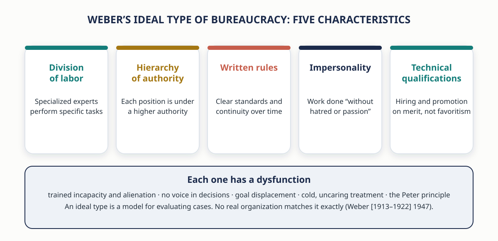
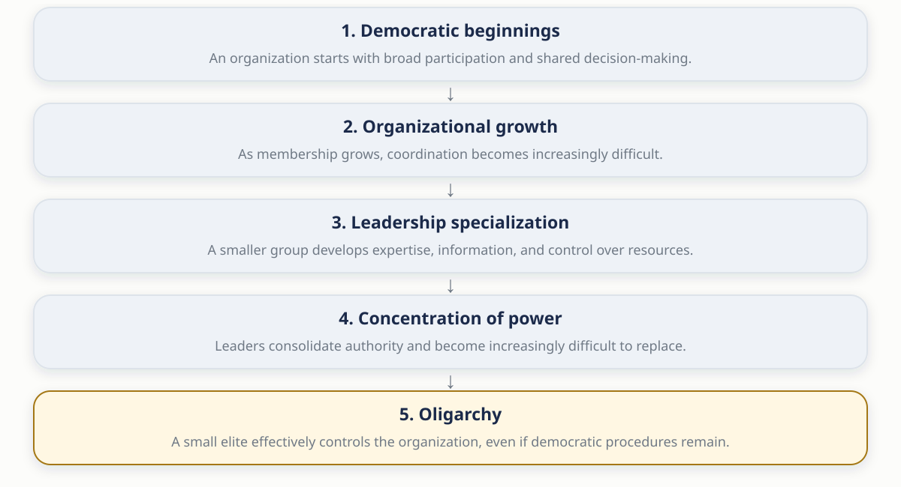
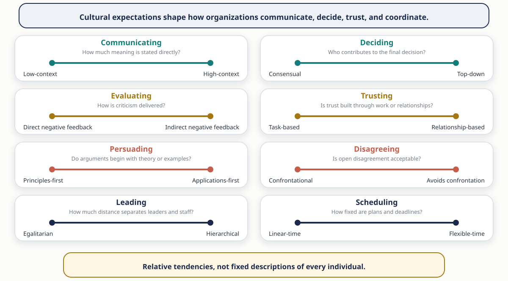
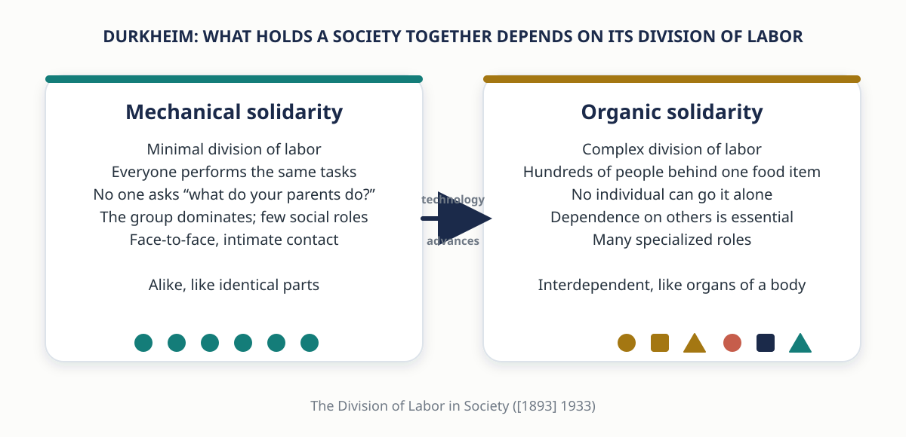
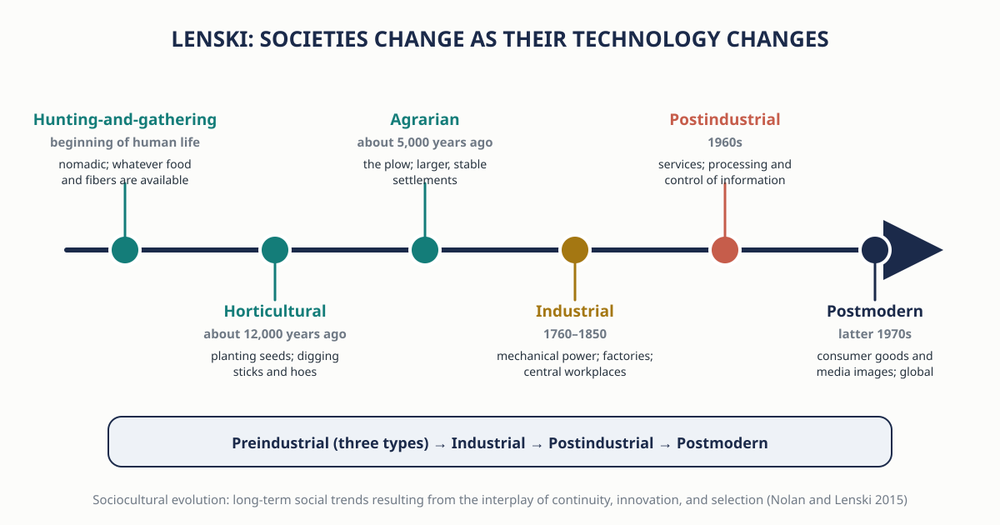
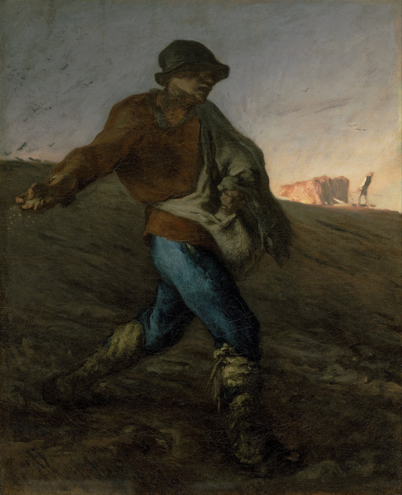
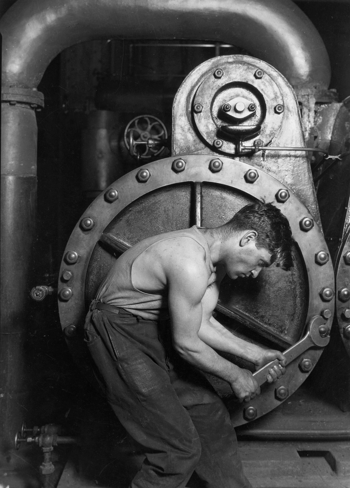
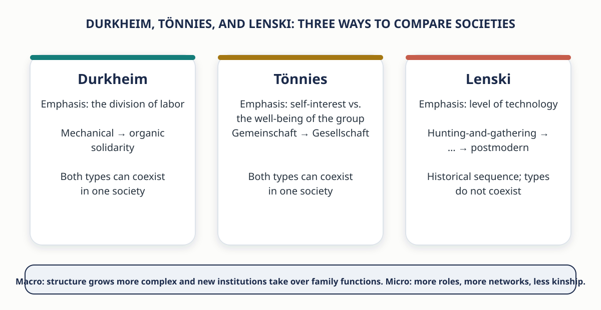

# Social Interaction and Reality {background-color="#1B2A4A"}

::: {.takeaway}
We do not simply react to one another. We interpret, define, and respond to meanings, and those meanings are built in interaction, inside a structure that was there before we arrived.
:::

## Zimbardo's Mock Prison: A Summer Sunday in Palo Alto {.smaller}

:::: {.columns}
::: {.column width="55%"}
- A quiet Sunday morning in Palo Alto, California, 1971. Police sweep through the city picking up college students in a surprise mass arrest
- Each suspect is charged with a felony, warned of his rights, pushed against the car, searched, handcuffed, and taken to the station for booking
- Blindfolded, each is transported to the "Stanford County Prison". They are searched, had their possessions taken, and issued a uniform, bedding, soap, and a towel
- By late afternoon ten "first offenders" sit in dazed silence on the cots of their empty cells

::: {.fragment}
- None of it was real. Social psychologist **Philip Zimbardo** built a mock prison to study how people adapt when some are called "prisoners" and others "guards"
- **10 prisoners and 11 guards**, chosen from more than 75 volunteers, were assigned to their roles **at random**. At the start there were no measurable differences between the two groups
:::
:::

::: {.column width="45%"}
{fig-alt="Two cards: guards gained power and wore reflective sunglasses; prisoners lost liberty and were issued numbers. Assignment was random. The study closed after six days."}
:::
::::

## The Experiment Was Planned for Two Weeks and Closed After Six Days

- "It was no longer apparent to most of the subjects (or to us) where reality ended and their roles began"
- Some guards treated prisoners "as if they were despicable animals, taking pleasure in cruelty"; prisoners "became servile, dehumanized robots who thought only of escape"
- "In less than a week the experience of imprisonment undid (temporarily) a lifetime of learning: human values were suspended; self-concepts were challenged" (Zimbardo et al. 1974)

<!-- ::: {.question-box} -->
<!-- If you had been assigned to be a guard, would you have mistreated the inmates? Before you answer, remember that the guards were ordinary students who would probably have said the same thing a week earlier. -->
<!-- ::: -->

## Social Interaction and Social Structure Defined

- **Social interaction** — the ways in which people respond to one another, whether face-to-face, over the telephone, or on the computer
- In the mock prison, interaction was highly impersonal. Guards addressed prisoners by **number** rather than name and wore reflective sunglasses that made eye contact impossible
- **Social structure** — the way in which a society is organized into predictable relationships
- The prison's structure gave guards almost total control over prisoners, and that structure shaped how they interacted. It was a real prison "in the minds of the jailers and their captives" (Zimbardo et al. 2009)
- The experiment has been repeated, with similar findings, in the United States and in other countries

::: {.takeaway}
Random assignment means the students did not bring cruelty or servility with them. The structure and the roles brought it out.
:::

## Criticism, Replication, and Why the Experiment Still Matters {.smaller}

- Critics object to using students as subjects, and some suggest Zimbardo **coached** the guards to torment the prisoners
- Zimbardo admits he did not step in to limit the cruelty, but documentation from the study shows he did not encourage or suggest it (Zimbardo 2018)
- In 2004 the abuse of Iraqi prisoners by U.S. soldiers at **Abu Ghraib** renewed interest in the study. Zimbardo noted the guards' conduct could have been predicted from his research. The structure of a wartime prison plus intense pressure for information broke down the guards' behavior (Ratnesar 2011; Zimbardo 2015)
- Entering the mock prison began a process of **resocialization**. The students adjusted to a new social structure and learned new rules for interaction

## What This Chapter Asks

- What determines a person's **status** in society?
- How do our **social roles** affect our interactions?
- What place do **social institutions** such as the family, religion, and government have in social structure?
- How can we understand and manage large **organizations** such as ministries and multinational corporations?

<!-- ::: {.small} -->
<!-- How interaction shapes reality → the five elements of social structure (statuses, roles, groups, networks, institutions) → formal organizations and bureaucracy → Durkheim, Tönnies, and Lenski on simpler and modern societies → social policy: labor unions worldwide. -->
<!-- ::: -->

## Blumer: We Interpret Each Other's Actions Instead of Merely Reacting

- When someone in a crowd shoves you, do you automatically push back? Or do you consider the circumstances and the attitude of the person first? Most people do the latter
- Herbert Blumer (1969): the distinctive feature of human interaction is that "human beings interpret or 'define' each other's actions instead of merely reacting to each other's actions"
- Our response to someone's behavior is based on the **meaning** we attach to it. Reality is shaped by our perceptions, evaluations, and definitions
- Those meanings reflect the norms and values of the dominant culture and our socialization within it
- Social reality is literally **constructed** from our social interactions (Berger and Luckmann 1966)

## Defining Social Reality: Medical Masks Before and After the Pandemic

- Until recently, wearing a medical mask in public was unusual outside a few Asian nations
- With the coronavirus, masks became common, then recommended, then required by governments and shopkeepers
- People drew silly expressions on homemade masks or displayed team logos, perhaps to make them less frightening at a time when being in public felt uncomfortable (Taylor 2020)

::: {.question-box}
What did a face mask **mean** on a Kuwait street in 2019, in 2021, and today? Who changed the meaning: the mask, or the people interpreting it?
:::

<!-- ## Marriage as Relationship or Status: Japan's Beloved Wives Day {.smaller} -->

<!-- - What counts as reality varies across cultures. In Western societies, with their emphasis on romantic love, couples see marriage as a **relationship** as well as a social status; professions of love, from Valentine's flowers to everyday gestures, are expected -->
<!-- - In Japan, marriage is considered more a **social status** than a relationship. Saying "I love you" does not come easily, especially to husbands; most do not call their wives by name (they prefer "Mother") or look them in the eyes -->
<!-- - In 2006 some Japanese men formed the Devoted Husband Organization and sponsored a new holiday, **Beloved Wives Day** -->
<!-- - In 2008 dozens of men stood in a cabbage patch north of Tokyo and shouted "I love you!" to their wives, some of whom had never heard the words. They also pledged to be home by 8 p.m. that day (Japan Aisaika Organization 2020; Kambayashi 2008) -->

## Thomas: The Definition of the Situation Reflects Power {.smaller}

- The ability to define social reality reflects a group's **power** within a society. A crucial aspect of the relationship between dominant and subordinate groups is the dominant group's ability to define a society's values
- **W. I. Thomas** (1923), an early critic of theories of racial and gender differences, recognized that the **"definition of the situation"** could mold the thinking and personality of the individual
- People respond not only to the objective features of a person or situation but also to the **meaning** that person or situation has for them
- Two students get a B+ on the same midterm. One needs an A to keep a scholarship or reach a competitive medical specialty, so for her the grade feels like a crisis. The other was afraid of failing, so for him it is a relief. The letter on the paper is the same, but they react in opposite ways because it means different things to each of them.
- Zimbardo's "guards" and "prisoners" accepted the definition of the situation, including the traditional roles of guard and prisoner, and acted accordingly
- Social change involves **redefining or reconstructing** social reality: members of subordinate groups challenge traditional definitions and begin to experience reality in a new way

## Apply Blumer and Thomas: Which Definition Is Operating?

::: {.board}
For each situation, give **two** different definitions a person could attach to it, and the different reaction each produces.
:::

- The car behind you on the Fifth Ring Road flashes its headlights twice
- A professor says nothing for five seconds after your answer in class
- A cousin arrives forty minutes late to a family lunch
- A classmate you barely know sends you a voice note at 11 p.m. asking for the lecture slides

<!-- ::: {.small} -->
<!-- Instructor enrichment. The sociological point is Blumer's: the reaction follows the definition, not the act itself. -->
<!-- ::: -->

# Elements of Social Structure: Statuses and Roles {background-color="#1B2A4A"}

::: {.takeaway}
Any social structure can be broken into five elements: statuses, social roles, groups, social networks, and social institutions. They make up social structure just as a foundation, walls, and ceilings make up a building.
:::

## Five Elements Make Up Social Structure

::: {.center}
{fig-alt="A frame labelled social structure, in which all social interaction takes place, containing five numbered tiles: 1 statuses, 2 social roles, 3 groups, 4 social networks, 5 social institutions, each with a one-line definition."}
:::

::: {.small}
All social interaction takes place within a social structure, including the interactions that redefine social reality. This section covers statuses and roles; the next two cover groups and networks, then institutions.
:::

## Status Means Any Socially Defined Position, Not Only Prestige

- In everyday speech, "status" suggests influence, wealth, and fame
- **Status** — sociologists use the term for any of the full range of socially defined positions within a large group or society, from the lowest to the highest
- A person can occupy the status of president, fruit picker, son or daughter, violinist, teenager, resident of a particular city, dental technician, or neighbor
- A person holds **a number of statuses at the same time**

::: {.question-box}
Write down five statuses you hold right now. Keep the list; we will sort it in a few minutes.
:::

## Ascribed Status Is Assigned; Achieved Status Is Earned

:::: {.columns .small}
::: {.column width="46%"}
- **Ascribed status** — a social position assigned to a person by society without regard for the person's unique talents or characteristics. Usually assigned at birth: ethnic/racial background, gender, and age
- These are biological in origin but matter mainly because of the **social meanings** attached to them. Conflict theorists take special interest in ascribed statuses because they often confer privileges or mark membership in a subordinate group (Linton 1936)
- **Achieved status** — a social position attained largely through one's own efforts: computer programmer, prison guard, lawyer, pianist, convict, social worker. We must *do* something to acquire it
:::

::: {.column width="54%"}
{fig-alt="One person with ascribed statuses on the left (female, age 20, daughter, Kuwaiti national, family's religion) and achieved statuses on the right (student, pharmacy major, tutor, team captain, volunteer); a master status dominates the others."}
:::
::::

## An Ascribed Status Can Be Reinterpreted: Age in the U.S. and China {.smaller}

- We can do little to change an ascribed status, but we can try to change the traditional **constraints** associated with it
- The **Gray Panthers**, an activist group founded in 1971, worked to modify negative stereotypes of the elderly; the ascribed status of "senior citizen" is no longer as difficult for millions of older Americans
- An ascribed status does not carry the same meaning everywhere. Gary Huang (1988) confirmed that respect for the elderly is an important norm in China: calling someone "old teacher" is like calling a U.S. judge "your honor." In the United States, "old man" is closer to an insult
- Norms are not guarantees. In 2013 China passed an **Elderly Rights Law** that warns adult children never to "neglect or snub elderly people," requires regular visits regardless of distance, and backs this with fines or jail (Martinez-Carter 2013)

::: {.small}
Compare Chapter 4: Kuwait's Law 18 of 2016 also makes family care of elders a legal duty, in order of spouse, children, grandchildren, siblings. 
:::

## Three Complications in How Statuses Work

1. **Ascribed status heavily influences achieved status.** Being male decreases the likelihood that a person will be encouraged to consider a career in child care
2. **A status may or may not be desirable.** Family background (ascribed) can place you in a positive or negative position; an achieved status can be *criminal* or *hero*
3. **Some statuses can be either ascribed or achieved,** depending on circumstances. Religion is ascribed if a person carries on the family's faith and achieved if he or she settles on a religion after exploring several (Foladare 1969)

::: {.question-box}
Return to your list of five statuses. Label each A (ascribed) or Ach (achieved). Which of your achieved statuses would have been much harder, or much easier, to reach with a different ascribed status?
:::

## Master Status Dominates the Others

- Each person holds many, sometimes conflicting, statuses. How do others judge one's **overall** position?
- Everett Hughes (1945): societies deal with the inconsistency by agreeing that certain statuses matter more than others
- **Master status** — a status that dominates other statuses and thereby determines a person's general position in society
- Throughout the world, many people with disabilities find that "disabled" receives undue weight, overshadowing their actual ability to perform in meaningful employment
- A master status can also be positive: ask any first-year medical student how quickly relatives started calling them "Doctor"

## Box 5-1: Disability as a Master Status {.smaller}

- Historically people with disabilities were treated as subhuman. In Japan more than **16,000** women with disabilities were involuntarily sterilized with government approval from 1945 to 1995; Sweden apologized for the same action against **62,000** of its citizens in the 1970s
- Hostile treatment gave way to a **medical model**, in which the disabled are viewed as chronic patients
- Disability rights advocates now criticize that model too. In a **civil rights model**, it is the unnecessary physical and attitudinal **barriers** in the environment, more than any biological limitation, that stand in the way. Most voting places, for example, are inaccessible to wheelchair users
- Drawing on Goffman, sociologists note that society attaches a **stigma** to many disabilities: others see "the blind" or "the wheelchair user" rather than a complex person for whom the disability is one aspect of life
- Attitudes are changing. Botswana plans services for its largely rural disabled population; activists worldwide target employment, housing, education, and access to public buildings

<!-- ## Let's Discuss: Does Our Campus Present Barriers to Disabled Students? -->

<!-- ::: {.board} -->
<!-- Walk mentally from the parking lot to this room. What barriers would a wheelchair user, a blind student, or a deaf student meet along the way: physical, attitudinal, or both? -->
<!-- ::: -->

<!-- - Why do nondisabled people see disability as the *most important* characteristic of a disabled person? -->
<!-- - What can be done to help people see beyond the wheelchair and the guide dog? -->
<!-- - Which model does our campus operate on in practice, the medical model or the civil rights model? -->

## Classify the Status: Ascribed, Achieved, or Master?

::: {.board}
Sort each case. Where could it be more than one? Where does it depend on circumstances?
:::

- Eldest son
- First-year student
- "Abu Ahmad" (father of Ahmad)
- Licensed pharmacist
- Teenager
- National team player
- Person with a visual impairment
- Retiree
- Someone who converted to a religion as an adult

## Social Roles Are the Expectations Attached to a Status {.smaller}

- **Social role** — a set of expectations for people who occupy a given social position or status
- We expect taxi and ride-share drivers to know their way around a city, and police officers to act when a citizen is threatened
- Each status, ascribed or achieved, carries role expectations, but **actual performance varies**: one secretary takes on wide administrative responsibilities; another sticks to clerical work. Some of Zimbardo's guards were brutal; others were not
- **Functionalist view:** roles contribute to stability by letting members anticipate one another's behavior and pattern their actions accordingly
- Roles can also be **dysfunctional** when they restrict relationships: if we see a person only as "police officer" or "supervisor," it is hard to relate to him or her as a friend or neighbor

## Three Ways Roles Become Difficult

::: {.center}
{fig-alt="Three cards: role conflict between two statuses, role strain within one status, and role exit from a role central to identity."}
:::

## Role Conflict: Incompatible Expectations from Two Statuses {.smaller}

- A woman has worked for a decade on an assembly line and is named supervisor of her unit. Should she still go to lunch with her longtime friends? Must she recommend firing an old friend who cannot keep up?
- **Role conflict** — the situation that occurs when incompatible expectations arise from two or more social positions held by the same person
- Fulfilling the roles of one status may directly violate the roles of another. Such conflicts call for **ethical choices**: how much allegiance does she owe her friend, and how much her employer?
- A second type of role conflict occurs when people enter occupations that society doesn't traditionally associate with their ascribed status. Male preschool teachers and female police officers, for example, must navigate expectations about gender and work. Female officers face a particular challenge: they must reconcile the demands of police work with traditional expectations of women. They must also contend with the “code of silence,” an informal rule that discourages officers from reporting misconduct by their colleagues (Fletcher 1995; S. Martin 1994).

## Role Strain: Conflicting Demands within One Status

- Role conflict is about holding two positions at once. A **single** position can also cause problems
- **Role strain** — the difficulty that arises when the same social position imposes conflicting demands and expectations
- Members of minority cultures may experience it while working in the mainstream culture. Criminologist Larry Gould (2002) interviewed officers of the **Navajo Nation Police Department**
- Besides enforcing the law, Navajo officers practice **Peacemaking**, seeking reconciliation between the parties to a crime. They are confident in it, but worried that without making arrests, other agencies would think them "too soft" or "just taking care of their own"
- All felt the strain of being considered "too Navajo" or "not Navajo enough"

## Role Conflict or Role Strain? Decide the Case

::: {.board}
Name the concept, then name the two expectations that collide.
:::

1. A medical intern is on call the night of her brother's wedding
2. A professor is expected to grade strictly and to be an approachable mentor to the same students
3. A police officer stops a car and recognizes his cousin at the wheel
4. A nurse is told to move patients through quickly and to give each one compassionate attention
5. A ministry employee is asked by a relative to "look at" a file that is not next in the queue
6. A student works evenings in the family business and has an exam the next morning

<!-- ::: {.small} -->
<!-- Instructor enrichment. Case 5 is where wasta lives in the vocabulary of this chapter: a kin role and an official role making incompatible claims on one person. -->
<!-- ::: -->

## Role Exit: Ebaugh's Four Stages {.smaller}

- We usually focus on preparing for a role, the anticipatory socialization of becoming a lawyer, chef, spouse, or parent. Until recently social scientists paid little attention to **leaving** roles
- **Role exit** — the process of disengagement from a role that is central to one's self-identity in order to establish a new role and identity (Ebaugh 1988)
- Helen Rose Fuchs Ebaugh, herself an ex-nun, interviewed **185** people, among them ex-convicts, divorced men and women, recovering alcoholics, ex-nuns, former doctors, and retirees

{fig-alt="Four numbered stages joined by arrows: 1 doubt, 2 search for alternatives, 3 action or departure (most name a clear turning point; 20% describe a gradual process), 4 creation of a new identity."}

## Role Exit from School to University: Objects That Say "This Is Me"

- Many of you went through a role exit when you moved from high school to university: you left the role of child at home and took on the role of a somewhat independent student among peers
- Ira Silver (1996) studied the **objects** students choose in this transition. Items left at home (stuffed animals, dolls) belong to the prior identity; students may stay attached to them but do not want them seen as part of the new self
- Objects brought along, phones and wall posters, are calculated to say, "**This is me**"

::: {.question-box}
What did you stop carrying, wearing, or saying when you entered Kuwait University? What did you start? Which of Ebaugh's stages did you notice, and which did you skip?
:::

# Groups and Social Networks {background-color="#1B2A4A"}

::: {.takeaway}
Much of social life happens in groups, and groups link us to networks that reach far beyond the people we know. Who counts as "we" turns out to shape what we think is true.
:::

## A Group Requires Regular Interaction

- **Group** — any number of people with similar norms, values, and expectations who interact with one another on a regular basis
- A women's basketball team, a hospital's business office, a congregation, or a symphony orchestra is a group. The residents of a suburb are **not**, since they rarely interact at one time
- Much of our social interaction takes place within groups and is governed by their **norms and sanctions**
- Being a teenager or a retired person takes on special meaning inside groups designed for that status; the expectations attached to brother, sister, or student become clearer in the context of a group

<!-- ::: {.question-box} -->
<!-- Which of these is a group in Schaefer's sense: this lecture section; your family WhatsApp group; everyone at The Avenues on a Friday night; the regulars at one diwaniya? -->
<!-- ::: -->

## Group Solidarity After Tragedy: Hawdon and Ryan at Virginia Tech

- Durkheim ([1893] 1933) observed that a heinous crime shocks us and draws a **communal response** that protects us in the future
- In April 2007 a student at Virginia Tech killed 32 people and wounded 17 on campus
- Sociologists James Hawdon and John Ryan (2011) surveyed students and faculty three times, nine days after the shooting and again up to ten months later
- Joining activities specific to the tragedy did not necessarily bring relief or solidarity. What mattered more for recovery was **continued participation in clubs and friendship groups** in the following weeks
- Group solidarity makes a difference, and the ordinary groups did the most work

## Decision Making in the Jury Room {.smaller}

- After the family, juries are the most studied groups. 
- Four popular research methods: interviews after the verdict, observation of jurors during trials, observation of actual deliberations (rarely permitted), and mock juries of volunteers
- In *Twelve Angry Men* (1957) Henry Fonda's lone juror converts the whole jury. Research disagrees; in reality jurors generally do not change their minds after the first ballot. In **225 cases**, if a majority voted to convict on the first ballot, there was only a **5 percent** chance of later acquittal
- Many jurors form tentative verdicts early, despite instructions, and then weight supporting testimony more heavily than contradicting testimony
- Juries are more likely to convict on *some* charge when given several alternatives to an absolute "not guilty"
- Jurors who expect the forensic science they see on *CSI* may wonder why extraordinary tests were not used

<!-- ::: {.question-box} -->
<!-- Kuwait's courts use judges, not juries. Is a jury a typical group? Think of a thesis committee or a family council deciding a marriage proposal. Would the first-ballot finding apply there? -->
<!-- ::: -->

## Primary and Secondary Groups

- Charles Horton Cooley (1956) coined **primary group** — a small group characterized by intimate, face-to-face association and cooperation. A family in one household, a street gang, and a group of college "sisters" are all primary groups
- Primary groups play a pivotal role in **socialization**. During the pandemic we tried to keep face-to-face interaction alive through Zoom, FaceTime, Houseparty, and Skype. When we find ourselves **identifying** with a group, in person or online, it is probably a primary group
- **Secondary group** — a formal, impersonal group in which there is little social intimacy or mutual understanding. Large college classes and business associations are examples; secondary groups often emerge in the workplace among people who share an occupation

## Table 5-1: Comparison of Primary and Secondary Groups

| Primary group | Secondary group |
|---|---|
| Generally small | Usually large |
| Relatively long period of interaction | Relatively short duration, often temporary |
| Intimate, face-to-face association | Little social intimacy or mutual understanding |
| Some emotional depth to relationships | Relationships generally superficial |
| Cooperative, friendly | More formal and impersonal |

<!-- ::: {.question-box} -->
<!-- A study group of four strangers formed in Week 1 is now a group of four friends in Week 6. What changed in the table? Can a group move from one column to the other and back? -->
<!-- ::: -->

## In-Groups and Out-Groups {.smaller}

- A group can mean something special to its members because of its relation to **other** groups, especially one perceived as culturally or racially different. William Graham Sumner (1906) named the "we" and "they" feelings
- **In-group** — any group or category to which people feel they belong: everyone regarded as "we" or "us." It may be as narrow as a clique or as broad as a whole society
- **Out-group** — a group or category to which people feel they do not belong: "they" or "them"
- In-group members typically feel distinct and **superior**. Proper behavior for the in-group is seen as unacceptable for the out-group. Robert Merton (1968) called this the conversion of **"in-group virtues" into "out-group vices"**
<!-- - The double standard runs through debates about terrorism: a group’s own aggression is “necessary,” even when civilians are hurt; the opponent’s is condemned, and then the condemners retaliate in kind -->

<!-- ::: {.small} -->
<!-- Conflict between in-groups and out-groups can turn violent. Schaefer cites the 1999 Columbine school attack, in which members of an out-group struck at an in-group that had taunted them. Keep the tone sober. -->
<!-- ::: -->

## In-Group Virtues and Out-Group Vices: Spot the Double Standard

::: {.board}
Two perspectives on the same behavior.  
:::

<!-- ::: {.fragment} -->
<!-- - We are **loyal to family**. They are **clannish**. -->
<!-- ::: -->
::: {.fragment}
- Our fans are **passionate**. Their fans are **hooligans**.
:::
::: {.fragment}
- We **network**. They **use wasta**.
:::
::: {.fragment}
- We are **careful with money**. They are **stingy**.
:::
::: {.fragment}
- We are **confident**. They are **arrogant**.
:::

::: {.small}
Schaefer: "Try putting yourself in the shoes of an out-group member. What does your in-group look like from that perspective?"
:::

## Reference Groups Set Standards and Provide Comparisons {.smaller}

- **Reference group** — any group that individuals use as a standard for evaluating themselves and their own behavior
- A student who wants to join a circle of hip-hop devotees emulates dress, music, and hangouts of that group
- Two functions for reference groups (Merton and Kitt 1950). **Normative:** setting and enforcing standards of conduct and belief. **Comparison:** serving as a standard against which people measure themselves; an actor evaluates herself against other actors
- Reference groups help **anticipatory socialization**: a finance major who reads the *Wall Street Journal*, studies annual reports, and tracks the market on a phone is using financial experts as a reference group
- Several reference groups act on us at once (family, neighbors, co-workers), and they **change over the life course**: an executive who leaves the rat race at 45 to become a social worker finds new standards

## Your Reference Groups: Who Is the Standard?

::: {.question-box}
When you get your grades, whose marks did you compare yours with? When you decide what is a normal amount to spend on a weekend, whose spending is the measure?
:::

- The accounts you follow are a reference group you chose; influencers set the **comparison** standard for bodies, purchases, and holidays
- "Future doctors" or "future engineers" is a reference group you are using **before** you belong to it: anticipatory socialization, from Chapter 4
- Connecting it to Cooley's looking-glass self: the reference group is the mirror you choose to look into

## Coalitions Form as Groups Grow Larger

- **Coalition** — a temporary or permanent alliance geared toward a common goal; broad or narrow, with many possible objectives
- William Julius Wilson (1999) described community organizations in Texas that brought together whites and Latinos, working class and upper class, to work for sidewalks, drainage, and paved streets; he hoped such coalitions would build better understanding across groups
- Some coalitions are intentionally short-lived. Short-term alliances are the key to winning programs like *Survivor*
- Opposing politicians or political parties can "work across the aisle" when they need to: the U.S. Congress approved a budget for 2020 and 2021 by agreeing to limit expressions of anger to their own constituencies rather than voicing them on the floor

<!-- ::: {.question-box} -->
<!-- OPEC, founded in 1960 with Kuwait among its five founding members, is a permanent coalition of states with one common goal. Describe one coalition from your own experience, in a group project, a club, or a family decision. Did it work? What had to be overcome? -->
<!-- ::: -->

<!-- ::: {.small} -->
<!-- The OPEC example is instructor enrichment. -->
<!-- ::: -->

## Social Networks Link Us Beyond the Groups We Belong To {.smaller}

:::: {.columns}
::: {.column width="48%"}
- Groups also **link the individual to the larger society**: through acquaintances we connect with people in different circles
- **Social network** — a series of social relationships that link a person directly to others, and through them indirectly to still more people. One of the five elements of social structure
- Networks cover all routine interaction: job information, news, gossip. Do not equate social media such as Instagram with social networks, which are much broader
- **Networking** is especially valuable for finding employment. Albert Einstein found a job only when a classmate's father put him in touch with his future employer. Even weak and distant contacts can be crucial
:::

::: {.column width="52%"}
{fig-alt="A person at the center with direct ties to family, classmates, a diwaniya, and colleagues, and dashed indirect ties beyond them."}
:::
::::

## Networks Are Not Equal: Networking, Exclusion, and Wasta

- Not everyone participates equally in networks, in person or online. Like in-groups, networks can become **elitist or exclusionary**; women and minorities are at a disadvantage when seeking better jobs or contacts (Erikson and Occhiuto 2017; Trimble and Kmec 2011)

::: {.board}
Einstein got his job through a classmate's father. In Kuwait, what do we call it when a job comes through a relative's friend? When is it "networking" and when is it "wasta," and who gets to decide which word applies?
:::

- A network transmits information and opportunity to those **inside** it, which means it also withholds them from those outside
- What looked like one person's luck or one family's connections is a **pattern** in how structure distributes opportunity

<!-- ::: {.small} -->
<!-- Instructor enrichment. Discussion only; no one is asked to describe how they or their relatives found work. -->
<!-- ::: -->

## Online Networks Distort Social Reality

- Highly social activities such as parties are exaggerated online because of their visual impact; solitary activities such as reading, homework, or praying are rarely posted
- The **friendship paradox**: 98 percent of people have many fewer real-life friends than online "friends." The gap fosters a sense of **isolation**, especially among adolescents (Jackson 2019)
- A generation ago network research studied face-to-face encounters, phone calls, and letters; it now builds on those findings to study social media

<!-- ::: {.question-box} -->
<!-- Your feed shows your classmates' best moments, not their week. Blumer again: you react to the meaning you attach to that feed, not to their actual week. What definition of "a normal weekend" does your feed teach? -->
<!-- ::: -->

<!-- ## Box 5-3: Twitter Networks from Wildfires to Hurricanes {.smaller} -->

<!-- - With about **126 million** active daily users in 2019, Twitter became a research site for disaster communication -->
<!-- - University of Vermont researchers studied the five costliest disasters of the 2010s: accounts with relatively **small followings (200 to 300 people)** had the greatest impact in sharing information on food, emergency supplies, and practical details, at three stages: before, during, and after the event. During an event, the most shared information was the location of available **generators** (Niles et al. 2019) -->
<!-- - Sutton et al. (2015) tracked how often three kinds of official message were retransmitted across threat types: -->

<!-- | Message type | 1st (most retweets) | 2nd | 3rd and 4th | 5th (fewest) | -->
<!-- |---|---|---|---|---| -->
<!-- | Informational (phone numbers, websites) | Flood | Hurricane | Terrorist attack · Blizzard | Wildfire | -->
<!-- | Closures or openings of facilities and roads | Terrorist attack | Flood | Blizzard · Hurricane | Wildfire | -->
<!-- | Evacuation and shelter | Wildfire | Flood | Terrorist attack · Blizzard | Hurricane | -->

<!-- - Tweets with a **URL** to more information or an **emotive phrase** such as "stand strong" were especially likely to be passed on. An Australian study found Twitter can give real-time information on the severity and location of damage. The research costs almost nothing and does not interfere with the response -->

<!-- ## Let's Discuss: Why Did Retweets Vary by Disaster and Message? -->

<!-- ::: {.board} -->
<!-- Why would evacuation messages travel farthest for wildfires but least for hurricanes? Why would closure messages travel farthest after a terrorist attack? -->
<!-- ::: -->

<!-- - What other variables would you have studied? -->
<!-- - What are the most important practical implications for a civil defense agency? -->
<!-- - Think back to the heavy rains of November 2018 in Kuwait. Where did you first learn which roads were closed: official channels, the news, or a family group chat? Who were the "small accounts" in your network? -->

<!--  ::: {.small} --> 
<!-- <!-- The Kuwait prompt is instructor enrichment; the rest is Box 5-3. --> 
<!-- <!-- ::: --> 

# Social Institutions {background-color="#1B2A4A"}

::: {.takeaway}
Institutions are the organized patterns that meet a society's basic needs. Functionalists ask what they do; conflict theorists ask whom they serve; interactionists ask how they shape everyday behavior.
:::

## Social Institutions Are Organized Patterns Centered on Basic Needs

- **Social institution** — an organized pattern of beliefs and behavior centered on basic social needs, such as replacing personnel (the family) and preserving order (the government)
- The mass media, the government, the economy, the family, and the health care system are all social institutions
- Studying institutions reveals a society's structure. Religion, for example, adapts to the segment it serves: religious groups in a skid-row mission tend the ill and provide food and shelter, while religious groups in an affluent suburb counsel couples, run youth activities, and oversee cultural events
<!-- - Figure 5-2 in Schaefer summarizes the elements of social structure, including social institutions. Our five-element diagram from earlier is the same map -->

## Functionalist Perspective: Five Functional Prerequisites

::: {.center}
{fig-alt="Five numbered rows: replacing personnel, teaching new recruits, producing and distributing goods and services, preserving order, and providing a sense of purpose."}
:::

## The Prerequisites in Detail: Shakers, Schools, and Purpose {.smaller}

- **Replacing personnel** through immigration, annexation, acquisition of slaves, or reproduction. The **Shakers**, a religious sect that came to the United States in 1774, committed to celibacy and could only recruit. They peaked at about **6,000** members in the 1840s; as of 2020 the only community left was a farm in Maine with **two** members
- **Teaching new recruits** formally in schools, where learning is a *manifest* function, or informally in peer groups, where it is a *latent* function
- **Producing and distributing goods and services** by rules for allocating resources; satisfy most members to some extent or risk discontent and disorder
- **Preserving order:** indigenous peoples worldwide have struggled to protect themselves from invaders; failure means the death of a culture, not only a people
- **Providing a sense of purpose** through patriotism, tribal identity, religious values, or personal moral codes; without it, people have little reason to contribute
- The list does not say *how* a society does each task: one amasses weapons, another stays neutral and cooperative. Fail on even one and the society risks extinction (Aberle et al. 1950; R. Mack and Bradford 1979)

## Conflict Perspective: Institutions Maintain Privilege {.smaller}

- Conflict theorists agree that institutions are organized to meet basic needs but reject the idea that the outcome is necessarily efficient or desirable
- The present organization of institutions is **no accident**: major institutions such as education help maintain the privileges of the most powerful while contributing to the powerlessness of others
- Schaefer's example: U.S. public schools are financed largely through local **property taxes**, so affluent areas buy better-equipped schools and better-paid teachers, and their children arrive better prepared to compete
- Institutions have an inherently **conservative** nature; reforms that promote equal opportunity are hard to implement. Functionalists see change as potentially dysfunctional; conflict theorists ask why an unfair structure should be preserved
- Institutions also operate in **gendered** environments: assumptions such as "women cannot make tough decisions" show up in who is promoted and in employer decisions about child care and parental leave

## Interactionist Perspective: Institutions Shape Everyday Behavior

- Institutions affect us whether we are driving down the street or waiting in a long line
- Research on **humor in the workplace** finds that employees who laugh together are more creative and collaborative, which raises productivity. But a joke at a subordinate's expense, or one in bad taste, encourages bad behavior; done properly, humor motivates people to act for the organization (Yam 2017)
- Our behavior is conditioned by the **roles and statuses** we accept, the **groups** we belong to, and the **institutions** within which we function
<!-- - The role of judge exists inside the criminal justice system, in relation to attorney, plaintiff, defendant, and witness, and to the institution of government. Courts and jails have symbolic weight, but the system lives in the roles people carry out in interaction (Berger and Luckmann 1966) -->

## Table 5-2: Sociological Perspectives on Social Institutions

| Perspective | Role of social institutions | Focus |
|---|---|---|
| **Functionalist** | Meeting basic social needs | Essential functions |
| **Conflict** | Meeting basic social needs | Maintenance of privileges and inequality |
| **Interactionist** | Fostering everyday behavior | Influence of the roles and statuses we accept |

<!-- ## Thinking Critically: Kuwait University from All Three Perspectives -->

<!-- ::: {.board} -->
<!-- Describe one institution you are part of, this university, from a functionalist, a conflict, and an interactionist perspective. -->
<!-- ::: -->

<!-- - **Functionalist:** which of the five prerequisites does the university serve? Which is manifest and which is latent? -->
<!-- - **Conflict:** who benefits from how admission, majors, and grades are organized? Which ascribed statuses still shape achieved ones here? -->
<!-- - **Interactionist:** how does the status "student" change the way you speak, sit, and joke in this room compared with your friends or at a family lunch? -->

<!-- ## Thinking Critically: Health Care from All Three Perspectives -->

<!-- ::: {.board} -->
<!-- Describe health care in Kuwait from a functionalist, a conflict, and an interactionist perspective. -->
<!-- ::: -->

<!-- - **Functionalist:** which of the five prerequisites does health care serve? Which of its functions is manifest and which is latent? -->
<!-- - **Conflict:** who is seen quickly and who waits? How do money, private insurance, and personal connections shape who reaches a specialist? -->
<!-- - **Interactionist:** how does a white coat change what a patient says, what they leave out, and whether they ask questions? Do patients speak to a doctor the way they speak to a pharmacist? -->

## Thinking Critically: Social Media from All Three Perspectives

::: {.board}
Describe social media, and influencer culture in particular, from a functionalist, a conflict, and an interactionist perspective.
:::

- **Functionalist:** which of the five prerequisites does social media serve? Which of its functions is manifest and which is latent?
- **Conflict:** who profits from an influencer's sponsored post: the influencer, the brand, or the platform? Which ascribed statuses, such as family name or inherited wealth, help someone build a following?
- **Interactionist:** how does filming for an audience change the way people behave at a restaurant, a wedding, or a family gathering?

# Understanding Organizations {background-color="#1B2A4A"}

<!-- ::: {.takeaway} -->
<!-- It sounds more exciting to say we live in the "computer age," but "the age of formal organization" is the more accurate description. Most of you will work in one. -->
<!-- ::: -->

## Formal Organizations Dominate Modern Life

- As societies adopt more advanced technology and more complex structures, our lives are increasingly dominated by large secondary groups called formal organizations
- **Formal organization** — a group designed for a special purpose and structured for maximum efficiency. FedEx, Pick, KOC, the Ministry of Health, PIFSS, this university, a bank, or a telecom company
- Organizations vary in size, specificity of goals, and efficiency, but all are structured to manage large-scale operations, and all take a **bureaucratic** form
- They have become so dominant that we create organizations to supervise other organizations, like CITRA or the Central Bank
- Generally, people don't consciously aim to work in big organizations, but most of us inevitably will. 

## Ascribed Status Inside Organizations: The Lawyers' Pay Gap

- Ascribed statuses such as gender, race, and ethnicity influence how we see ourselves within formal organizations
- A study followed nearly **4,000** lawyers who entered the bar in 2000. Among full-time lawyers, women earned on average **$6,000 less** a year than men at the same career stage, even after accounting for type of firm, specialization, and work history such as family leave
- The gap appeared to stem from a **devaluation of women and their work** within legal organizations. Women in that culture may come to see themselves as worth less and entitled to less
- Over time men and women even record billable hours differently: men bill every snippet of conversation; women bill more selectively. The pattern has been documented across many occupations (Dinovitzer et al. 2009; Sandberg 2015)

## Bureaucracy and Weber's Ideal Type {.smaller}

- **Bureaucracy** — a component of formal organization that uses rules and hierarchical ranking to achieve efficiency
- Rows of desks, endless lines and forms, impossibly complex language, red tape: these images have made "bureaucracy" a dirty word, and few people call themselves bureaucrats. Yet in an industrial society elements of bureaucracy enter almost every occupation
- Max Weber ([1913–1922] 1947) first drew attention to bureaucratic structure. He saw the same basic structure and process in religion ("The Protestant Ethic"), government, education, and business, and contrasted it with the family-run business
- **Ideal type** — a construct or model for evaluating specific cases. Weber built an ideal type of bureaucracy with the most characteristic features of all human organizations. Perfect bureaucracies do not exist; **no real organization matches the ideal type exactly**

::: {.board}
Remember the example of a ruler being an ideal type. A ruler can tell us the length of things, but it's not telling us that everything needs to be the exact length of the ruler.
:::

## Weber's Five Characteristics of Bureaucracy

::: {.center}
{fig-alt="Five cards: division of labor, hierarchy of authority, written rules, impersonality, technical qualifications; a panel notes that each has a dysfunction."}
:::

## Division of Labor: Efficiency, Alienation, and Trained Incapacity {.smaller}

- **Division of labor.** Specialized experts perform specific tasks. The admissions officer does not do the registrar's job; the counselor does not maintain buildings. Specialization builds skill and efficiency, and it is a fairly recent development in modern society
- **Downside:** fragmenting work into smaller and smaller tasks can cut workers off from the organization's overall purpose. Marx and Engels (1848), for example, argued that capitalism reduces workers to "an appendage of the machine"
- **Alienation** — a condition of estrangement or dissociation from the surrounding society. Narrow tasks also weaken **job security**, since replacements are easily trained. An accountant in a large corporation may be well paid yet alienated, far removed from what the company produces
- **Trained incapacity** — the tendency of workers in a bureaucracy to become so specialized that they develop blind spots and fail to notice obvious problems (Veblen 1914). Worse, they may not care what happens in the next department
- Failure to communicate across divisions is the **"silo effect"**; some scholars blame it for lower productivity

<!-- ## The Silo Effect: Five Agencies Before September 11, 2001 -->

<!-- - After the coordinated attacks on the World Trade Center and the Pentagon, Americans asked how the FBI and CIA could have missed an elaborately planned operation -->
<!-- - Part of the answer was the **division of labor** between the FBI, which focuses on domestic matters, and the CIA, which operates overseas. Both huge bureaucracies, both known for jealously guarding information from each other -->
<!-- - Investigations revealed that **five** federal agencies, the CIA, FBI, National Security Agency, Defense Intelligence Agency, and National Reconnaissance Office, knew about Osama bin Laden's network in the early 1990s and failed to share their leads -->
<!-- - The hijackings might not have been preventable, but the bureaucratic division of labor definitely hindered the defense -->

<!-- ::: {.takeaway} -->
<!-- In medicine the silo effect appears at every shift change and referral. A patient handed between departments is the file nobody owns. -->
<!-- ::: -->

## Hierarchy of Authority and Written Rules and Regulations {.smaller}

- **Hierarchy of authority.** Each position is under the supervision of a higher authority. In a typical ministry, the chain runs from the minister to the undersecretary, assistant undersecretaries, department directors, section heads, and staff. A university president heads the administration; in the Roman Catholic Church the pope sits above cardinals, bishops, and so on
- **Written rules and regulations.** What if your sociology professor gave a classmate an A because they shared the same birthday? You would call it unfair, against the rules. Written rules give employees clear standards for adequate or exceptional performance
- Procedures also provide **continuity**: workers come and go, but the structure and records give the organization a life that outlives any one bureaucrat
- Rules can overshadow the goals they serve. What if a domestic abuse counselor refused to listen to an injured woman because her civil ID was expired? **Goal displacement** — overzealous conformity to official regulations (Merton 1968)

## Impersonality and Employment Based on Technical Qualifications {.smaller}

- **Impersonality.** Weber wrote that bureaucratic work is carried out *sine ira et studio*, "without hatred or passion." Officials perform duties without personal consideration of people as individuals
- The norm is meant to guarantee **equal treatment**, but it also produces the cold, uncaring feeling of modern organizations, frustration, and disaffection. Even small firms now filter callers through electronic menus
- **Employment based on technical qualifications.** Hiring rests on qualifications rather than favoritism; performance is measured against standards; written policies govern promotion, with a right of appeal. These protect against arbitrary dismissal and encourage loyalty
- Personnel decisions do not always follow the ideal. 
- **Peter principle** — every employee within a hierarchy tends to rise to his or her level of incompetence (Peter and Hull 1969). Talented people are promoted again and again until some reach a position they cannot handle. 
- The principle suggests that organizations tend to promote people based on how well they perform in their current jobs, rather than how well they would perform in their next jobs. So, the skills that make someone successful in one position aren't necessarily the skills required for success in a higher position.

## Table 5-3: Characteristics of a Bureaucracy {.smaller}

| Characteristic | Positive consequence | Negative consequence for the individual | Negative consequence for the organization |
|---|---|---|---|
| **Division of labor** | Produces efficiency in a large-scale corporation | Produces trained incapacity | Produces a narrow perspective |
| **Hierarchy of authority** | Clarifies who is in command | Deprives employees of a voice in decision making | Permits concealment of mistakes |
| **Written rules and regulations** | Let workers know what is expected of them | Stifle initiative and imagination | Lead to goal displacement |
| **Impersonality** | Reduces bias | Contributes to feelings of alienation | Discourages loyalty to company |
| **Employment based on technical qualifications** | Discourages favoritism and reduces petty rivalries | Discourages ambition to improve oneself elsewhere | Fosters Peter principle |

::: {.small}
Weber's characteristics describe an ideal type. Not every formal organization has all five, and real bureaucracies vary widely.
:::

## Use Your Sociological Imagination: Kuwait University Loses One Characteristic

::: {.board}
Tomorrow morning this university suddenly stops exhibiting **one** of Weber's five characteristics. Pick one. What happens by the end of the week?
:::

::: {.fragment}
- No division of labor: the registrar also teaches anatomy
- No hierarchy: nobody can sign anything
- No written rules: grades are negotiated one by one
- No impersonality: every request is decided by who you are
- No technical qualifications: posts are filled by whoever asks first
:::

<!-- ::: {.small} -->
<!-- Then the harder question: which characteristic do students complain about most, and which would they miss first? -->
<!-- ::: -->

## Box 5-4: McDonald's and the Worldwide Bureaucratization of Society {.smaller}

- George Ritzer's *The McDonaldization of Society* shows all five of Weber's characteristics in one restaurant chain. Food preparation and order-taking follow a painstaking **division of labor**; a **hierarchy** runs from food workers to the store operator to the corporate board; operators learn **written rules** that govern even the amount of ketchup on a hamburger at McDonald's Hamburger University
- Little bonding occurs between servers and customers: **impersonality**, partly from the emphasis on efficiency. Fry machines lift the fries automatically, so staff cannot honor a request for "crispy." Employees need specific **technical qualifications**, though most skills take only brief training
- **McDonaldization** — the process by which the principles of bureaucratization have increasingly shaped organizations worldwide (Chapter 3 introduced the term as a cultural process; here it is an organizational one)
- Predictability, efficiency, and dependence on nonhuman technology now shape medical care, wedding planning, and education. Stadiums worldwide grow alike: unobstructed seats, instant replays, automated scoreboards, applause prompted by digital displays, tightly controlled merchandising. Cruise ships deliver distant ports with minimal exposure to foreign people
- What is new is not the five characteristics. It is the bureaucratization of services and life events that were once **individualized, even spontaneous** (Ormond 2005; Ritzer 2018)

## Let's Discuss: McDonaldization at Universities, Hospitals, and Weddings {.smaller}

::: {.board}
Choose one:

- Analyze life at this university using Weber's model. What elements of McDonaldization do you see? Do you wish life were less McDonaldized?
- Where do efficiency, calculability, predictability, and control appear in a hospital or large clinic? Which features improve care, and where might standardization become a problem?
:::

- What features of fast-food restaurants do you appreciate? What are your complaints?
- A Kuwaiti wedding hall offers packages: the same stage, the same lighting program, the same buffet sequence, priced by guest count. Which of Ritzer's features from Chapter 3 (efficiency, calculability, predictability, control) is that? What has been gained, and what spontaneity has been lost?

<!-- ::: {.small} -->
<!-- The hospital and wedding-hall examples are instructor enrichment. -->
<!-- ::: -->

## Bureaucratization as a Process

- Have you ever spoken to 10 or 12 people in a ministry just to find out who has jurisdiction over your problem, or been transferred between departments until you practically gave up?
- **Bureaucratization** — the process by which a group, organization, or social movement becomes increasingly bureaucratic
- It also happens in small settings. Jennifer Bickman Mendez (1998) studied domestic houseworkers employed by a nationwide franchise in California: tasks were so minutely defined that employees followed **22 written steps** for cleaning a bathroom, and complaints went to an office manager, not the worker

## Michels: The Iron Law of Oligarchy

- Conflict theorists have studied the bureaucratization of **social movements**. Robert Michels (1915) examined socialist parties and labor unions in Europe before World War I and found them growing increasingly bureaucratic
- Emerging leaders, even the most radical, developed a **vested interest** in keeping power: losing office meant returning to full-time manual labor
- **Iron law of oligarchy** — Michels's principle that even a democratic organization will eventually develop into a bureaucracy ruled by a few individuals, an oligarchy
- Why? Leaders usually have the skills, knowledge, or charismatic appeal (as Weber noted) to direct others; the rank and file **look to leaders** for direction and so reinforce rule by a few; and oligarchs are strongly motivated to keep their roles, privileges, and power

## How Democratic Organizations Become Oligarchies

::: {.center}
{fig-alt="Five-step path from democratic beginnings through organizational growth, leadership specialization, and concentration of power to oligarchy."}
:::

<!-- ## Test the Iron Law: Student Clubs and Co-operative Societies -->

<!-- ::: {.board} -->
<!-- Michels says *every* democratic organization ends up run by a few. Pick an organization you can observe and test him. -->
<!-- ::: -->

<!-- - A student association or club at this university: who ran it two years ago, and who runs it now? How did they get there? -->
<!-- - Kuwait's consumer co-operative societies, the *jam'iyyat*, are member-owned, with boards elected by shareholders in each area. What would you need to observe to say the iron law applies, or does not? -->
<!-- - What evidence would **falsify** Michels? Term limits? Frequent turnover? Decisions overturned by members? -->

<!-- Instructor enrichment. The co-ops are offered as a testable case, not a verdict. Keep the discussion on structure, not on individuals. -->

## Scientific Management versus the Human Relations Approach {.smaller}

- How does bureaucratization affect the ordinary worker? Weber focused on management and said little about workers in industry or clerks in agencies
- **Classical theory** (the **scientific management approach**) — workers are motivated almost entirely by economic rewards; only physical constraints limit productivity. Workers can be treated as a resource, like the machines that began to replace them. Management seeks efficiency through scientific planning, performance standards, and close supervision. Planning involves efficiency studies, not studies of attitudes or job satisfaction
- Not until workers organized **unions** and forced management to recognize that they were not objects did theorists revise the classical approach
- **Human relations approach** — emphasizes the role of people, communication, and participation in a bureaucracy, and focuses on the informal structure. It reflects the interactionist interest in small groups and attends to workers' feelings, frustrations, and need for job satisfaction
- Informal groups and networks grow because people create more direct communication than the formal chart allows. Charles Page (1946) called these unofficial activities **"bureaucracy's other face"**

## New Directions in Organizational Research

Organizational research is a huge field, not just in the social sciences but business schools as well. 

New research is now focusing on things like:

- The effect and role of women in high-level management
- The decision-making role of groups outside the top ranks of large corporations
- **Bossless offices** with flat or horizontal hierarchies, where middle managers are eliminated and employees supervise themselves
- The loss of fixed boundaries in organizations that have **outsourced** key functions, and the role of the Internet in shaping business and consumer preferences
- Researchers and employers now use the **electronic footprints** workers leave in e-mail and apps: analysis of e-mail content can show how quickly new employees adopt the language and knowledge the organization expects, and can surface innovative ideas 

## Erin Meyer's Culture Map: Eight Questions About How Work Gets Done

::: {.center}
{fig-alt="Eight continua from Erin Meyer's Culture Map: low-context to high-context communication, direct to indirect negative feedback, principles-first to applications-first persuasion, egalitarian to hierarchical leadership, consensual to top-down decisions, task-based to relationship-based trust, confrontational to conflict-avoiding disagreement, and linear-time to flexible-time scheduling."}
:::

<!-- Instructor enrichment. These are relative cultural tendencies, not fixed descriptions of every individual from a country. -->

<!-- ## Thinking Critically: Analyze a Workplace Both Ways -->

<!-- ::: {.board} -->
<!-- Recall a job you have held, or a group project, a volunteer campaign, or a family business you have seen from inside. Analyze it first with the scientific management approach, then with the human relations approach. Which explains more of what you saw? -->
<!-- ::: -->

<!-- - Where was "bureaucracy's other face": the group chat, the smoking corner, the colleague who knew whom to call? -->
<!-- - If your employer could read the team's e-mail footprints, what would they learn that the organization chart hides? -->

# Social Structure in Global Perspective {background-color="#1B2A4A"}

::: {.takeaway}
Modern societies are complex compared with earlier arrangements. Durkheim, Tönnies, and Lenski each built a way to compare the two, and Kuwait lived through the comparison within a single lifetime.
:::

## Durkheim: Mechanical and Organic Solidarity {.smaller}

- In *The Division of Labor* ([1893] 1933) Durkheim argued that social structure depends on the **division of labor**, the way tasks are performed. Providing food can be done almost entirely by one person, or divided among the hundreds of people who cultivate, process, distribute, and retail a single item
- **Mechanical solidarity** — a collective consciousness that emphasizes group solidarity, characteristic of societies with minimal division of labor. Everyone does the same tasks; no one asks "What do your parents do?" The group dominates; interaction is close and face-to-face; there are few social roles
- **Organic solidarity** — a collective consciousness resting on mutual interdependence, characteristic of societies with a complex division of labor. As technology advances, no individual can go it alone; people depend on one another as the organs of a body do

{fig-alt="Two cards comparing mechanical solidarity, based on sameness, with organic solidarity, based on interdependence."}

## Tönnies: Gemeinschaft and Gesellschaft {.smaller}

- Ferdinand Tönnies (1855–1936) was appalled by the rise of the industrial city in his native Germany. He saw a dramatic change from the ideal of a close-knit community, the **Gemeinschaft**, to an impersonal mass society, the **Gesellschaft** (Tönnies [1887] 1988; Beckwith 2019)
- **Gemeinschaft** (GUH-mine-shoft) — a close-knit community, often rural, in which strong personal bonds unite members. Similar backgrounds; virtually everyone knows one another; people relate personally, not as "clerk" or "manager." Little privacy. Social control is **informal**: moral persuasion, gossip, even gestures, which work because people care what others think. Change is limited across generations
- **Gesellschaft** (GUH-zell-shoft) — a community, often urban, that is large and impersonal, with little commitment to the group or consensus on values. Most people are strangers; relationships grow out of immediate tasks such as buying a product; self-interest dominates; control rests on **formal** laws and punishments; change is evident within a single generation
- Some see apps where you share your name and location with ride-share drivers, online buyers, and home-stay hosts as a return to village life: everyone knows your name and people trust each other (Ravenelle 2017)

## Table 5-4: Comparison of the Gemeinschaft and Gesellschaft {.smaller}

| Gemeinschaft | Gesellschaft |
|---|---|
| Rural life typifies this form. | Urban life typifies this form. |
| People share a feeling of community that results from their similar backgrounds and life experiences. | People have little sense of commonality. Their differences appear more striking than their similarities. |
| Social interactions are intimate and familiar. | Social interactions are likely to be impersonal and task-specific. |
| People maintain a spirit of cooperation and unity of will. | Self-interest dominates. |
| Tasks and personal relationships cannot be separated. | The task being performed is paramount; relationships are subordinate. |
| People place little emphasis on individual privacy. | Privacy is valued. |
| Informal social control predominates. | Formal social control is evident. |
| People are not very tolerant of deviance. | People are more tolerant of deviance. |
| Emphasis is on ascribed statuses. | Emphasis is on achieved statuses. |
| Social change is relatively limited. | Social change is very evident, even within a generation. |

## The Gemeinschaft Has a Price

- It is easy to view the Gemeinschaft with **nostalgia**, as a better way of life than the rat race of modern existence
- But its intimacy comes at a cost. The prejudice and discrimination found there can be confining; **ascribed statuses** such as family background often outweigh a person's talents and achievements
- The Gemeinschaft tends to **distrust** individuals who seek to be creative or simply to be different

::: {.question-box}
Think about it: how would you classify the communities you know? Are they more Gemeinschaft or Gesellschaft? Can one neighborhood be both, depending on who you are?
:::

## Kuwait Within One Lifetime: From the Walled Town to the Suburb {.smaller}

- Before oil revenues transformed the country in the 1950s, Kuwait's town population lived inside a walled town on the bay, organized into neighborhoods (*firjan*) where families, trades, and mosques sat close together. The third and last wall, built in 1920, was demolished in 1957 as the first master plan moved residents to new suburban areas
- Read Table 5-4 against that shift. Which side describes the old town: everyone known by name, control by reputation and "what will people say" (*kalam al-nas*), little privacy, family background weighing on marriage and work?
- Which side describes the suburb and the mall: strangers in task-specific roles, cameras and fines instead of gossip, privacy behind villa walls, achieved credentials on a CV?
- Now the puzzle. A country of this size still runs on "everyone knows everyone": a surname locates you, the diwaniya carries news faster than any app, and a traffic argument can end with "do you know whose son I am?"

::: {.board}
Is Kuwait today a Gesellschaft with Gemeinschaft inside it, or the reverse? Which rows of the table would you mark for each, and does the answer change by age, area, or nationality?
:::

<!-- ::: {.small} -->
<!-- Instructor enrichment. Historical points are limited to the wall dates and the 1950s resettlement; the rest is a classification exercise using Schaefer's table. -->
<!-- ::: -->

## Lenski: Sociocultural Evolution and the Role of Technology {.smaller}

- Gerhard Lenski (1924–2015) took a different view. Rather than two opposite types, he saw societies undergoing a process of change with a dominant pattern
- **Sociocultural evolution** — long-term social trends resulting from the interplay of continuity, innovation, and selection (Nolan and Lenski 2015)
- A society's level of **technology** is critical to how it is organized. **Technology** — cultural information about the ways in which the material resources of the environment may be used to satisfy human needs and desires
- Technology does not completely determine a society's form, but a low level may limit how much it can depend on irrigation or complex machinery. As technology advances, a community evolves from **preindustrial** to **industrial** to **postindustrial**

{fig-alt="Timeline of six stages: hunting-and-gathering, horticultural, agrarian, industrial, postindustrial, postmodern."}

## Preindustrial Societies: Hunting-and-Gathering, Horticultural, Agrarian {.smaller}

:::: {.columns}
::: {.column width="69%"}
- To categorize a preindustrial society, ask how it organizes its **economy**
- **Hunting-and-gathering society** — people rely on whatever foods and fibers are readily available. Minimal technology; small, widely dispersed groups that move constantly in search of food; little division of labor. Groups consist almost entirely of relatives, so **kinship** is the source of authority and the family is central. Differentiation rests on ascribed statuses (gender, age, family); with scarce resources there is little material inequality. By the close of the 20th century such societies had virtually disappeared
- **Horticultural society** — people plant seeds and crops rather than merely subsist on available foods. Emerged about **12,000 years ago**; much less nomadic; more emphasis on tools and household objects; crops cultivated with digging sticks or hoes (Wilford 1997)
- **Agrarian society** — the most technologically advanced preindustrial form, emerging about **5,000 years ago**. Members still produce food, but the **plow** dramatically raises yields; the same fields can be farmed over generations, so larger settlements form. Still human and animal power. More defined roles (net repair, blacksmithing), more elaborate institutions, stronger property rights, and surpluses that allow statues, monuments, and art passed down the generations
:::

::: {.column width="31%"}
{fig-alt="Jean-François Millet's painting The Sower, showing a farmer scattering seed by hand across a field." width="100%"}

<!-- ::: {.small} -->
<!-- [*The Sower*, Jean-François Millet, 1850](https://commons.wikimedia.org/wiki/File:Jean-Fran%C3%A7ois_Millet_-_The_Sower_-_Google_Art_Project.jpg) · Public domain -->
<!-- ::: -->
:::
::::

## Industrial Societies {.smaller}

:::: {.columns}
::: {.column width="65%"}
- The Industrial Revolution produced changes as significant as any political revolution
- It took place largely in **England from 1760 to 1830**: a scientific revolution focused on applying nonanimal, mechanical power to labor tasks
- **Industrial society** — a society that depends on mechanization to produce its goods and services. It relies on new inventions for agriculture and industry and on new energy sources such as steam
- Many societies shifted irrevocably from an agrarian to an industrial base. An individual or family no longer made an entire product; **specialization** and manufacturing spread
- Workers, generally men but also women and children, left family homesteads to work in central locations such as factories
:::

::: {.column width="35%"}
{fig-alt="Lewis Hine's work portrait of a mechanic leaning into a large steam pump with a wrench." width="100%"}

<!-- ::: {.small} -->
<!-- [*Power House Mechanic*, Lewis Hine, 1920](https://commons.wikimedia.org/wiki/File:Lewis_Hine_Power_house_mechanic_working_on_steam_pump.jpg) · Public domain -->
<!-- ::: -->
:::
::::

## Postindustrial and Postmodern Societies {.smaller}

:::: {.columns}
::: {.column width="68%"}
- Lenski at first paid little attention to how mature industrial societies change with even more advanced technology. Later research followed the shift from manufacturing to **service** economies
- **Postindustrial society** — Daniel Bell's ([1973] 1999) term for a society whose economic system is engaged primarily in the processing and control of information. The main output is services; large numbers of people work in teaching, generating, and spreading ideas: advertising, public relations, human resources, computer information systems
- Bell's outlook is **functionalist**: he saw organized working-class groups declining and interest groups on health, education, and the environment rising, with open competition among them reducing conflict and strengthening stability
- Michael Harrington (1980), author of *The Other America*, replied from the **conflict** tradition: scientists, engineers, and economists do take part in major decisions, but not independently of the interests of the rich. Class conflict continues in postindustrial society
- **Postmodern society** — a technologically sophisticated society that is preoccupied with consumer goods and media images (Lemert 2013). Goods and information are consumed on a mass scale, and culture crosses borders: reggae from Jamaica, sushi from Japan, clogs from Sweden, and online networks with no national boundaries
:::

::: {.column width="32%"}
{fig-alt="iPhone Duo." width="100%"}

<!-- ::: {.small} -->
<!-- [Photo by Cheng via Pexels](https://www.pexels.com/photo/picture-on-a-smart-phone-19744850/) -->
<!-- ::: -->
:::
::::

## Table 5-5: Stages of Sociocultural Evolution {.smaller}

| Societal type | First appearance | Characteristics |
|---|---|---|
| **Hunting-and-gathering** | Beginning of human life | Nomadic; reliance on readily available food and fibers |
| **Horticultural** | About 12,000 years ago | More settled; development of agriculture and limited technology |
| **Agrarian** | About 5,000 years ago | Larger, more stable settlements; improved technology and increased crop yields |
| **Industrial** | 1760–1850 | Reliance on mechanical power and new sources of energy; centralized workplaces; economic interdependence; formal education |
| **Postindustrial** | 1960s | Reliance on services, especially the processing and control of information; expanded middle class |
| **Postmodern** | Latter 1970s | High technology; mass consumption of consumer goods and media images; cross-cultural integration |

## Box 5-5: Disney World as a Postmodern Theme Park {.smaller}

:::: {.columns}
::: {.column width="69%"}
- Globally more than **157 million** people visit a Disney theme park each year; Disney operates the eight most visited amusement parks in the world. On three continents, the Magic Kingdom funnels arrivals through a quaint Main Street toward Cinderella's Castle
- Behind the façade are endless opportunities to **shop**, in heavily air-conditioned stores and again at the exit of every attraction, tailored to what visitors have just seen. Museums worldwide now copy the practice
- **Hyperconsumerism** — Jean Baudrillard's term for the practice of buying more than we need or want, and often more than we can afford. Consumption has become a means of **self-identification**: conversations open with "Where did you get that stroller?" or "Who are you wearing?"
- **Time-space compression**: a child clutching a toy bear from the 1920s reserves a ticket to New Orleans in the 1850s, after a boat ride through the 1930s on the Congo, Zambezi, Amazon, and Irrawaddy
- **Globalism** stripped of foreign trappings: Cinderella and Snow White are no longer German folklore but "Disney characters"; Pinocchio is no longer recognizably Italian. Next door, Epcot's World Showcase takes the opposite approach, a managed, simplified rendering of ten cultures with no Starbucks in "China" (Baudrillard [1970] 1998; Bryman 1995; Fjellman 1992; Themed Entertainment Association 2019)
:::

::: {.column width="31%"}
{fig-alt="Cinderella Castle at Walt Disney World's Magic Kingdom, with crowds gathered in front beneath a clear blue sky." width="100%"}

<!-- ::: {.small} -->
<!-- [Photo by Jedi94 via Wikimedia Commons](https://commons.wikimedia.org/wiki/File:Cinderella_Castle,_Magic_Kingdom_Walt_Disney_World_(2024).jpg) · [CC BY-SA 4.0](https://creativecommons.org/licenses/by-sa/4.0/) -->
<!-- ::: -->
:::
::::

## The Avenues Read as a Postmodern Space

- Walk through The Avenues with Box 5-5 in mind. A "Grand Avenue" built to resemble a European shopping street; a "Souk" district with traditional architecture, indoors and air-conditioned; a "SoKu" named after a New York neighborhood; a district called "Prestige"
- **Time-space compression:** an old souq rebuilt inside a 21st-century mall, a European boulevard a corridor away from a Gulf courtyard
- **Globalism without foreign trappings:** the same global brands in each district, dressed in a different façade
- **Hyperconsumerism:** shops at every turn; the district names themselves are consumption identities

<!-- ::: {.board} -->
<!-- In the last 24 hours, what evidence of hyperconsumerism have you witnessed? How often do you find yourself moving across time or space in one afternoon, in one way or another? -->
<!-- ::: -->

<!-- ::: {.small} -->
<!-- Instructor enrichment applying Baudrillard and Box 5-5; the district names are as marketed by the mall. -->
<!-- ::: -->

## Durkheim, Tönnies, and Lenski Compared

::: {.center}
{fig-alt="Three cards comparing Durkheim (division of labor), Tönnies (self-interest versus group), and Lenski (technology); only Lenski's types do not coexist in one society."}
:::

::: {.small}
Lenski's approach is historical: one would not expect hunters and gatherers alongside a postmodern culture in a single society. Durkheim and Tönnies allow both community types to coexist, as a rural New Hampshire town 100 miles from Boston is linked to the city by information technology. Tönnies emphasized self-interest versus the group; Durkheim emphasized the division of labor. Macro level: structure grows more complex and new institutions take over functions once performed by the family. Micro level: multiple roles, more reliance on networks than kinship, relationships that are more impersonal, transient, and fragmented.
:::

## Thinking Critically: Kuwait on Lenski's Timeline

::: {.board}
Schaefer asks about personal experience of a nonindustrial society. Kuwait offers a nearer case: a maritime town of pearling, fishing, and dhow trade became an oil-industrial state within one generation and now plans a service economy.
:::

- Which rows of Table 5-5 fit Kuwait in 1930, in 1980, and today? Which do not fit at all, and what does the misfit teach about Lenski's model?
- Which functions did the family hand to new institutions after oil: schooling, health care, housing, employment, care of elders?
- Schaefer's micro-level prediction is that relationships become more impersonal, transient, and fragmented. Ask your grandparents whether that matches their experience. Ask yourself whether it matches yours

<!-- ::: {.small} -->
<!-- Instructor enrichment; the pre-oil description is general and no dates beyond the oil-era transition are asserted. -->
<!-- ::: -->

<!-- # Social Policy and Organizations: The State of the Unions Worldwide {background-color="#1B2A4A"} -->

<!-- ::: {.takeaway} -->
<!-- Unions were a response to impersonal, large-scale, alienating organizations. Half a century of change in the economy has shrunk them almost everywhere, and the chapter's concepts explain why. -->
<!-- ::: -->

<!-- ## Looking at the Issue: Union Membership Has Fallen for Decades {.smaller} -->

<!-- - How many people do you know who belong to a labor union? Fewer than someone could name 50 years ago -->
<!-- - In 1954 unions represented **39 percent** of U.S. private-sector workers; in 2020 only **10.3 percent**, the lowest share in more than 70 years. By state, unionization ranged from 25.3 percent in New York to 3.9 percent in South Carolina (Figure 5-3) -->
<!-- - **Labor union** — organized workers who share either the same skill (electronics) or the same employer (postal employees) -->
<!-- - Unions emerged during the Industrial Revolution in England in the 1700s, as workers banded together to extract concessions, safer conditions and a shorter workweek, and to protect their positions -->
<!-- - Historically unions also practiced what we now call discrimination, limiting entry by gender, race, ethnicity, citizenship, age, and arbitrary skill tests. Today there is less of this; in some industries unions help keep Black workers' wages competitive with whites' (Rosenfeld and Kleykamp 2012) -->

<!-- ## Figure 5-4: Labor Union Membership Worldwide -->

<!-- ::: {.center} -->
<!-- {fig-alt="Horizontal bars: Iceland 90 percent, Belgium 54, Italy 34, Canada 28, Japan 17, Mexico 13, United States 10, France 8."} -->
<!-- ::: -->

<!-- ::: {.question-box} -->
<!-- Before the next slide: France is famous for strikes and has the lowest membership on this chart. Iceland has 90 percent. What would you need to know about each country's structure to explain the gap? -->
<!-- ::: -->

<!-- ## Six Reasons for the Decline in Union Membership {.smaller} -->

<!-- 1. **Changes in the type of industry.** Manufacturing jobs, the traditional heart of unions, gave way to postindustrial service jobs -->
<!-- 2. **Growth in part-time jobs.** In 1968 fewer than 14 percent of U.S. employees were part-timers; by 2019, more than 17 percent -->
<!-- 3. **The legal system.** The United States has not made organizing and bargaining easy; 2018 legal challenges limited unions' right to collect dues from nonmembers they represent -->
<!-- 4. **Globalization.** The threat of jobs leaving the country undercuts organizing at home; some say union wage demands themselves pushed jobs to low-wage countries where unions barely exist -->
<!-- 5. **Employer offensives.** Increasingly hostile employers use the courts to block union representation -->
<!-- 6. **Automation.** Driverless trucks and cars and drones directly remove jobs long held by union members -->

<!-- ::: {.small} -->
<!-- Around the world, tougher negotiations between large corporations and workers' representatives have rolled back the bargaining power of many unions. -->
<!-- ::: -->

<!-- ## Applying Sociology: Four Readings of the Unions {.smaller} -->

<!-- - **Marxists and functionalists** alike see unions as a logical response to impersonal, large-scale, formal, often alienating organizations, especially in manufacturing with a sharp division of labor. As manufacturing declined, unions had to look elsewhere for growth -->
<!-- - **Michels's iron law** applies: unions have become increasingly bureaucratized under a sometimes self-serving leadership. **Conflict theorists** add that the longer union leaders hold office, the less responsive they are to the rank and file and the more concerned with their own power. Leadership can still change, especially in smaller unions and in unions whose membership composition shifts -->
<!-- - **Interactionists** note unions' growing reliance on social media, which advantages women, who engage with social media at least as much as men and were historically less welcome at the face-to-face meetings unions once relied on (Thornthwaite et al. 2018) -->
<!-- - Declining private-sector membership is linked to the widening gap between hourly wages and executive compensation: as bargaining power fell, employers offered union workers less, and nonunion firms that used to match union pay stopped feeling the need (Rosenfeld 2014) -->

<!-- ## Initiating Policy: Unions in the United States and Europe {.smaller} -->

<!-- - U.S. law grants workers the right to self-organize, but the United States is **unique among industrial democracies** in allowing employers to actively oppose their employees' decision to organize -->
<!-- - The recession that began in 2009 compounded employer opposition; state and local governments facing deficits moved to shrink pensions won through collective bargaining, and in some states to curtail bargaining rights themselves -->
<!-- - A 2018 Supreme Court decision lets government workers opt out of paying dues even when they receive union representation; organizing among public employees, especially teachers, has not offset the lost dues (Maher 2019) -->
<!-- - In a rare pro-union move, in 2015 the National Labor Relations Board let fast-food workers negotiate with corporate headquarters even when a franchise owner runs their outlet (Schreiber and Strom 2015) -->
<!-- - The coronavirus pandemic, with its layoffs and questions about job security, benefits, and safety, renewed interest in joining unions in the United States and other industrial nations, even as unions themselves took economic hits (Roosevelt 2020; Wallender 2020) -->
<!-- - In Europe unions play a major role in elections; one of Britain's major parties is the **Labour Party**. International trade unions speak out on common issues and have condemned "corporate grand theft," but despite Marx and Engels's call for the workers of all countries to unite, **no global union has emerged** -->

<!-- ## Unions in Kuwait: Structure Shapes Who Can Organize {.smaller} -->

<!-- - The Kuwait Trade Union Federation was founded in **1968**, and unions in the oil sector and the public sector have a long history -->
<!-- - In **April 2016** thousands of oil-sector workers struck for three days against a proposed public-sector pay reform, cutting output sharply before the strike was called off (Reuters 2016). Read that with Schaefer's list: a strategic industry, a concentrated workforce, and the state as employer are the opposite of the conditions that weakened unions elsewhere -->
<!-- - The labour market is **segmented**: most citizens work in government, most private-sector workers are expatriates, and the rights to found and lead unions are reserved by law for Kuwaiti workers, so a large share of the workforce sits outside union structures altogether -->

<!-- ::: {.question-box} -->
<!-- Apply the chapter rather than judging it: which of the five elements of social structure, status, role, group, network, institution, decides who can organize here? Is "union member" an achieved status for everyone in Kuwait? -->
<!-- ::: -->

<!-- <!-- ::: {.small} --> -->
<!-- <!-- Instructor enrichment, factual and non-accusatory; the legal detail should be checked against the current text of the private-sector labour law before it is taught as fact. Let students raise the expatriate labour market; do not require it. --> -->
<!-- <!-- ::: --> -->

<!-- ## Take the Issue with You: Essential Workers and the Right to Organize -->

<!-- ::: {.board} -->
<!-- Why should employees who provide essential public services, such as nurses, teachers, and police officers, be allowed to organize into a union? What is union membership worth to them if they cannot strike? -->
<!-- ::: -->

<!-- - What unions, if any, are represented on this campus? Have you been aware of their activity, or of any opposition to it? -->
<!-- - Should officials be allowed to reduce government workers' retirement benefits and take away their right to collective bargaining? Connect to Chapter 4: Kuwait's pension rules are set by the state, and the IMF estimated the fund's gap at about 45 percent of GDP -->

# Social Structure in Your Life and Your Field {background-color="#1B2A4A"}

::: {.takeaway}
What looked like individual temperament, a cruel guard, a lucky job seeker, a cousin who got the file moved, turns out to follow patterns in statuses, roles, groups, networks, and institutions. You now have the names.
:::

## Zimbardo's Prison Explained with the Chapter's Concepts {.smaller}

::: {.board}
Use the vocabulary to explain what happened in six days to ordinary students.
:::

- **Status:** "guard" and "prisoner" were assigned at random, then treated as if ascribed: numbers, uniforms, sunglasses
- **Role and definition of the situation:** everyone knew what a guard "does," and acted on the meaning (Thomas)
- **In-group and out-group:** "we" the guards, "they" the prisoners; in-group virtues (control) became out-group vices (defiance)
- **Secondary group and impersonality:** no names, no eye contact, Weber's *sine ira et studio* taken to its limit
- **Total institution and resocialization** from Chapter 4: one place, one authority, all activities scheduled
- Now argue two ways. **Functionalist:** clear roles let a prison run. **Conflict:** who gained power, and what did the structure let them do with it?

<!-- ## Sociology in Your Major -->

<!-- ::: {.center} -->
<!-- {fig-alt="Four cards applying social structure to medicine, engineering, business, and computer science."} -->
<!-- ::: -->

<!-- ::: {.small} -->
<!-- Medicine: a clinician's role strain between throughput and compassion; the hospital as a bureaucracy whose silo effect appears at every handoff. Engineering: division of labor builds expertise and trained incapacity at the same time; safety failures live in the gaps between silos. Business: scientific management versus human relations is still the live debate in every management course; Michels and Peter explain organizations you will join. Computer science: a social network is a graph, the friendship paradox is a property of that graph, and platforms are Gesellschaft structures engineered to feel like a Gemeinschaft.  -->
<!-- ::: -->

## Before You Leave {.smaller}

- **Social interaction** is interpreted, not automatic (Blumer), and the power to define the situation is unequal (Thomas). Social reality is constructed in interaction, inside a **social structure** of predictable relationships
- Five elements: **statuses** (ascribed, achieved, master), **roles** (conflict, strain, exit), **groups** (primary and secondary, in- and out-, reference, coalitions), **social networks**, and **social institutions**, which functionalists, conflict theorists, and interactionists read differently
- **Formal organizations** run on Weber's five characteristics of bureaucracy, each with a dysfunction: trained incapacity, goal displacement, alienation, the Peter principle, and Michels's iron law of oligarchy
- **Durkheim** (mechanical to organic solidarity), **Tönnies** (Gemeinschaft to Gesellschaft), and **Lenski** (sociocultural evolution by technology) give three ways to compare simpler and modern societies
<!-- - Labor unions rose with industrial organization and declined with the shift to services, part-time work, globalization, and automation -->

::: {.small}
Next: Chapter 6, Mass Media and Social Media.
:::

