# The Media in Everyday Life {background-color="#1B2A4A"}

::: {.takeaway}
The mass media carry messages to huge audiences, and social media let those audiences answer back. Sociologists ask how both shape our institutions and our everyday behavior.
:::

## Sherry Turkle: "I Would Rather Text Than Talk" {.smaller}

:::: {.columns}
::: {.column width="60%"}
- Sociologist and psychologist **Sherry Turkle** argues that constant use of social media has radically changed the way we present ourselves to one another
- "Over and over I hear, 'I would rather text than talk.'" People say face-to-face conversation teaches them how to get on with others, yet they are happy to use technology to flee it
- Why? "Because face-to-face conversations are difficult. Awkward. Spontaneous. Unscripted. Messy."
- One young man told her: "Conversation? I'll tell you what's wrong with conversation. It takes place in real time, and you can't control what you are going to say."
- Online and at our leisure, "it is easy to compose, edit, and improve as we revise" (Turkle 2017)
:::

::: {.column width="40%"}
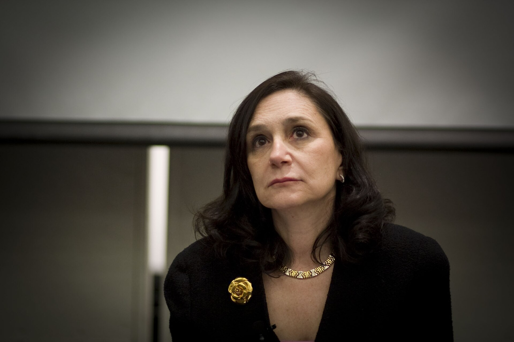{fig-alt="Sherry Turkle speaking at a public event." width="78%"}

::: {.question-box}
Tonight you need the lecture notes from a classmate you barely know. Do you call or text?

If you text, what does the text protect you from?
:::
:::
::::

## Turkle: Digital Conversation Feels Private, but You Are Onstage {.smaller}

- "We are forever elsewhere." In class or at a meeting we attend to what interests us, and when it stops interesting us we reach for our devices
- **Phubbing** — Turkle's example of a new dictionary word: maintaining eye contact while texting. Her students say they do it all the time "and that it's not that hard"
- We exist alongside **digital doubles**, digital representations of ourselves that are "useful to different parties at different times." "The digital self is archived forever"
- Gmail searches your e-mail "for clues for how to best sell to you," yet the experience feels intimate: "You face a glowing screen and you feel alone"
- "This is one of the great paradoxes of digital conversation: It feels private despite the fact that you are onstage." "Online you are under a kind of surveillance"

::: {.takeaway}
Schaefer's reading: social media pervade our interaction but cannot substitute for face-to-face communication, and their very pervasiveness threatens our privacy.
:::

## Choose a Channel: Text, Voice Note, Call, or Face to Face

::: {.board}
For each situation, pick the channel you would actually use: text, voice note, call, or face to face.
:::

1. Telling a friend you cannot come to her graduation dinner
2. Asking a professor for an extension
3. Congratulating a cousin on an engagement
4. Apologizing to a parent after an argument
5. Telling your project group you have not done your part
6. Asking a stranger on Instagram about a car he is selling

::: {.fragment .question-box}
Look at the hardest conversation on the list. Which channel did you choose for it? Were you avoiding the person, or avoiding real time?
:::

<!-- Instructor enrichment applying Turkle's excerpt. -->

## Mass Media and Social Media Defined

- **Mass media** — print and electronic means of communication that carry messages to widespread audiences. Advertising is also a form of mass media
- **Social media** — websites and online applications that enable people to create and share content or to participate in social networking
- The line between the two is not finely drawn: a television channel posts its clips on Instagram, and a single user's video can end up on the evening news
- Through the media we expand our understanding of people and events beyond what we experience in person, and we learn about other cultures, lifestyles, and technologies
- Sociologists ask two key questions: how do the media affect our **social institutions**, and how do they influence our **social behavior**?

## The Social Impact of the Media Shows Up Everywhere

:::: {.columns}
::: {.column width="64%"}
- **TV dinners** were invented for the millions of "couch potatoes" who could not bear to miss their favorite programs. Today you can watch a program whenever and wherever you want, and screen time extends well beyond television to smartphones
- Candidates for political office use social media to reach voters and rely on media consultants to project a winning image
- World leaders use all forms of media for political advantage, whether to gain territory or to bid on hosting the Olympics
- In parts of Africa and Asia, coronavirus public health projects owed much of their success to media campaigns
- Few aspects of society are as central as the media
:::

::: {.column width="36%"}
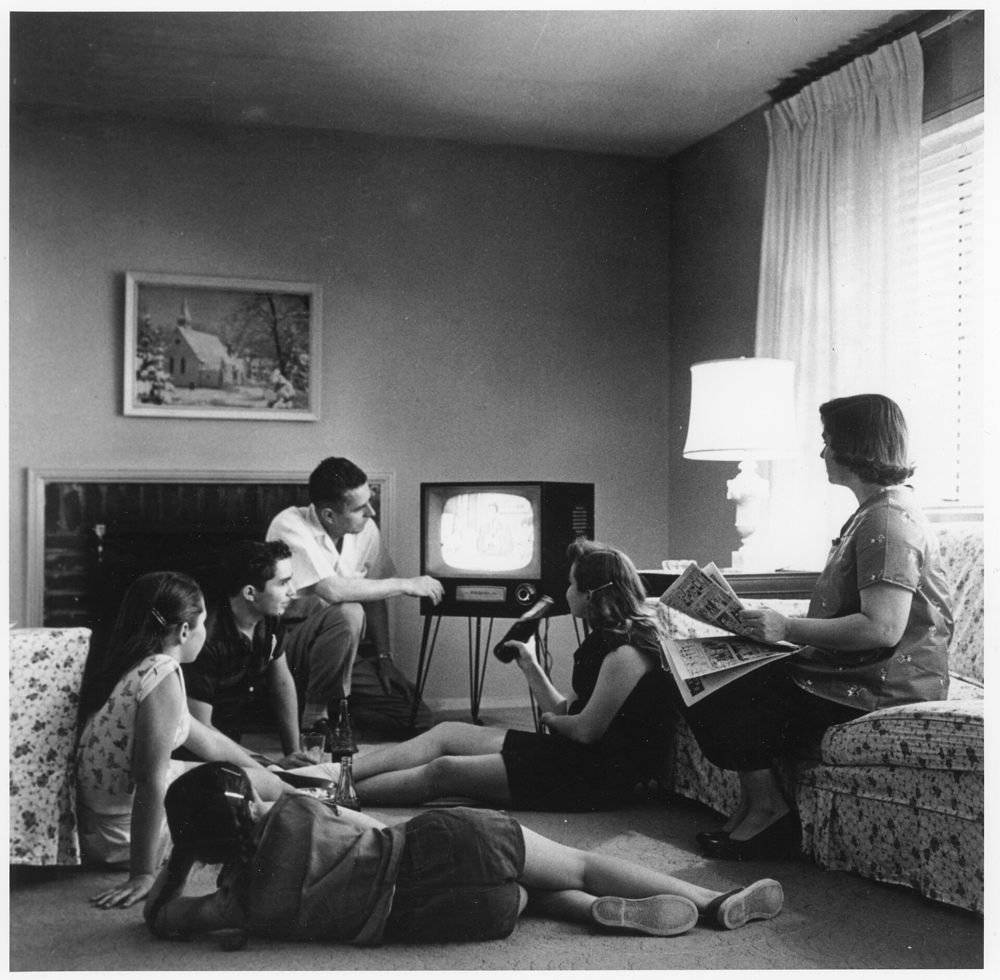{fig-alt="A family gathered around a television in their home in 1958." width="100%"}

::: {.small}
Family watching television, c. 1958. Evert F. Baumgardner/NARA, public domain.
:::
:::
::::

<!-- ## What This Chapter Asks -->

<!-- - Why are the media so **influential**? -->
<!-- - **Who benefits** from media influence, and why? -->
<!-- - How do we maintain cultural and ethical standards in the face of negative media images? -->

<!-- ::: {.small} -->
<!-- Four sociological perspectives on the media (functionalist, conflict, feminist, interactionist), then the audience, the media's global reach, and a social policy section on censorship. -->
<!-- ::: -->

## New Technologies Changed How People Watch and Listen

:::: {.columns}
::: {.column width="66%"}
- People spend a lot of time with the media, and more and more of it on the **Internet**
- Consumers have moved away from television and toward digital images on their computers and portable devices; podcasts and music streaming compete with radio
- We now learn about ordinary people, not only the famous, by viewing their pages or keeping in touch through Instagram or Twitter
- Schaefer uses **four** perspectives to examine how these habits affect social behavior: functionalist, conflict, feminist, and interactionist
:::

::: {.column width="34%"}
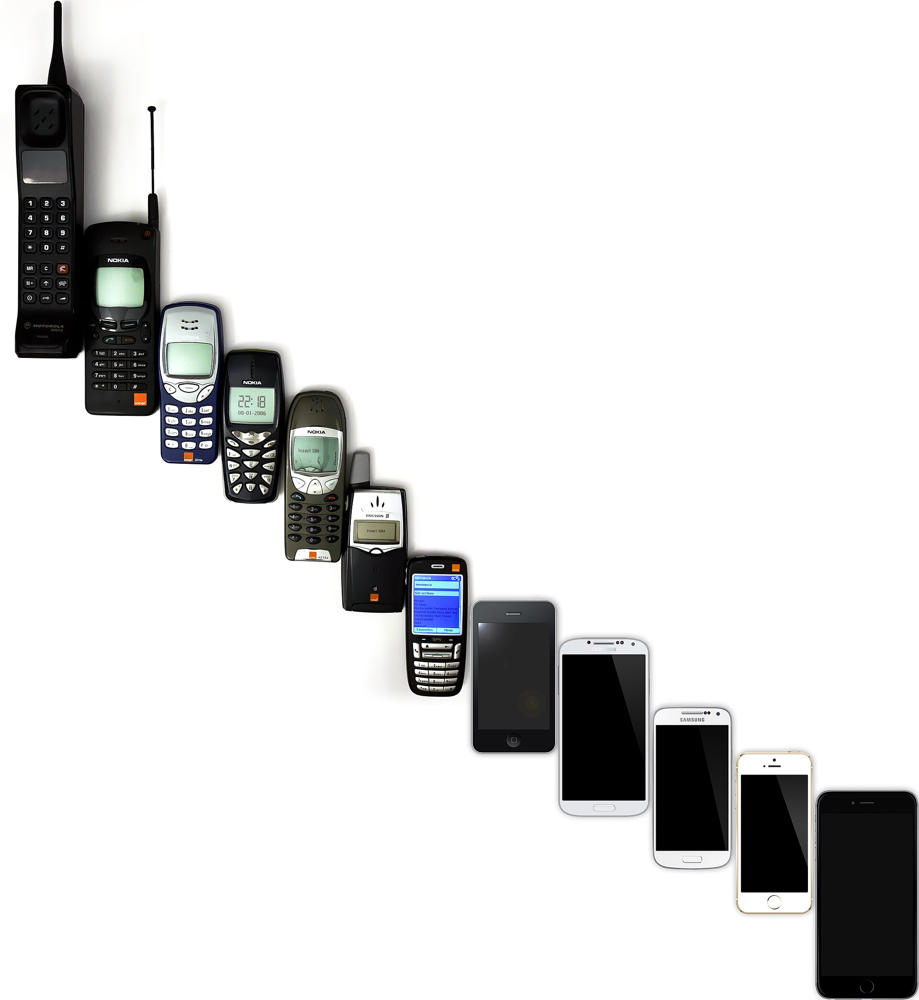{fig-alt="Mobile phones from 1992 through 2014, showing the shift from handsets to smartphones." width="100%"}

::: {.small}
Mobile-phone evolution, 1992–2014. Jojhnjoy, public domain.
:::
:::
::::

::: {.question-box}
Open your phone's screen-time report. How many hours did you spend yesterday, and which app came first? Compare with the person next to you. Did television appear on either list?
:::

# Functionalist Perspective {background-color="#1B2A4A"}

::: {.takeaway}
Functionalists ask what the media do for society. Beyond entertaining us, the media socialize us, enforce norms, confer status, and promote consumption. They can also leave us numb.
:::

## Functionalist View: The Media's Functions and the Narcotizing Dysfunction

::: {.center}
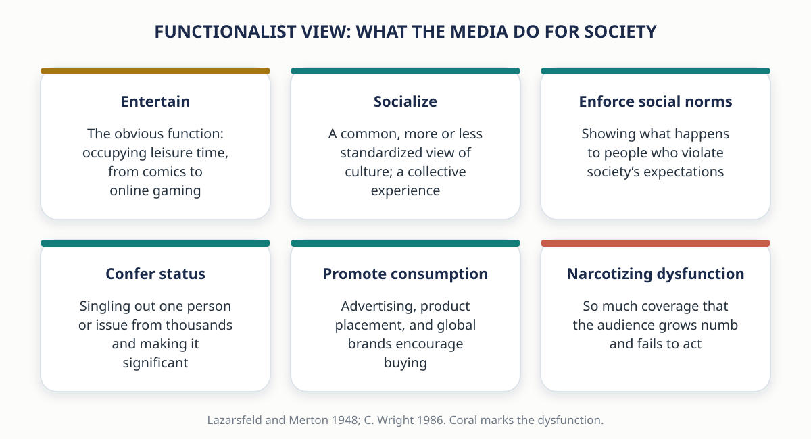{fig-alt="Six cards: entertain, socialize, enforce social norms, confer status, and promote consumption are functions; the narcotizing dysfunction, in which massive coverage leaves the audience numb and inactive, is a dysfunction."}
:::

::: {.small}
Except for clearly identified news or educational programming, we often assume the media exist to occupy our leisure time, from newspaper comics to online gaming and streaming music. They do much more (Lazarsfeld and Merton 1948; C. Wright 1986).
:::

## The Media as an Agent of Socialization {.smaller}

:::: {.columns}
::: {.column width="68%"}
- The media increase **social cohesion** by presenting a common, more or less standardized view of culture through mass communication
- Robert Park (1922) studied how newspapers helped immigrants to the United States adjust to their new environment, changing their customary habits and teaching them the opinions of people in their new home
- The media provide a **collective experience**. Broadcasts of inaugurations, press conferences, parades, state funerals, the Olympics, and disasters bring a community or a whole nation together
<!-- - After September 11, 2001, people in the United States bonded mainly through television, radio, and the telephone, but about half of all Internet users, more than **5 million** people, received some news of the attacks online (D. Miller and Darlington 2002) -->
- Communication keeps moving online. President Donald Trump tweeted about **7** times a day in 2017 and **23** times a day by 2019 (Smear et al. 2019). 
- In 2014 Oscar host Ellen DeGeneres gathered Meryl Streep, Jennifer Lawrence, Bradley Cooper, and other stars into one selfie. The sharing that followed crashed Twitter and locked thousands of users out
:::

::: {.column width="32%"}
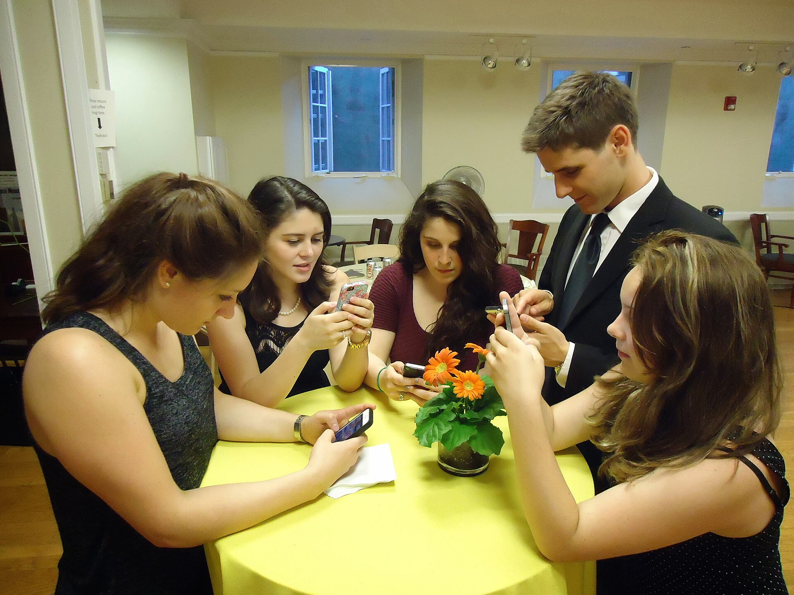{fig-alt="Young people gathered together while using smartphones." width="100%"}

::: {.small}
Young people using smartphones. Tomwsulcer, CC0.
:::
:::
::::

## Worries and Benefits of Media Socialization

- Many people worry about using **television as a babysitter** and about the effect of violent video games on children's behavior
- Some adopt a **blame-the-media** mentality, holding the media accountable for anything that goes wrong, especially with young people
- The media also have positive effects. A new sort of **tribalism** is emerging online, in which communities form around common interests or shared identities (Tyrene Adams and Smith 2008; American Academy of Pediatrics 2020)

::: {.question-box}
Name a media event that almost everyone in Kuwait watched, or talked about, at the same time: a Ramadan series, a national team match, National Day coverage. Does that still happen now that each of us streams on our own schedule?
:::

<!-- Instructor enrichment. Hold the answers; the segmented-audience slide returns to them. -->

## *Blue's Clues* and CoComelon: Two Ways to Design Children's Attention {.smaller}

:::: {.columns}
::: {.column width="50%"}
### *Blue's Clues*

- One story from beginning to end, with clear transitions and a deliberately slow pace
- The camera lingers, and pauses give children time to think and answer
- Each episode took about **one year** to develop
- Researchers, writers, curriculum experts, and outside advisers worked together
- Every episode was tested with preschoolers **three times** and revised after each round
:::

::: {.column width="50%"}
### CoComelon

- Shots typically change every **one to three seconds**
- Search terms, viewing data, thumbnails, and compilation length help shape production
- Researchers have tested when children look away from a program; rapid visual changes reflexively recapture attention
- Former employees described planning matrices designed to make successful formats repeatable and scalable
- The business metric is **time onscreen**, not necessarily how much a child learns
:::
::::

::: {.takeaway}
Children's media do not merely hold attention. Their production systems define what attention is for: time to think and participate, or time kept on the screen.
:::

<!-- Instructor enrichment; not quizzable. Sources: Tolentino 2024; Dhingra et al. on Blue's Clues production and formative research, summarized in Blue's Clues (Wikipedia). CoComelon has methodically engineered for attention, but there is no evidence that the program itself directly causes developmental delays. -->

## The Media Enforce Social Norms {.smaller}

- The media reaffirm proper behavior by showing what happens to people who violate society's expectations: the bad guy gets clobbered in a cartoon or thrown in jail on *CSI*
- The media also sometimes **glorify** disapproved behavior, such as physical violence, disrespect to a teacher, or drug use
<!-- - The media play a critical role in defining norms about sexuality. Programs try to persuade teens not to send explicit images of themselves to friends; such images often go **viral** and may be used to harass teens and their parents. One organization's **"That's not cool"** campaign spells out the norm -->
<!-- - Spreading compromising images that were meant only for close friends is one form of **cyberbullying** (Hinduja and Patchin 2015) -->

::: {.question-box}
Name a series, film, or video in which someone broke a norm and paid for it. Now name one in which someone broke a norm and was rewarded. Which kind do you see more often?
:::

## The Media Confer Status on People and Issues

- The media **confer status** on people, organizations, and public issues. They single out one issue or person from thousands in similar situations and make it significant
- Published lists of the most-searched people and topics confer celebrity status too, and the lists change dramatically: **none** of the Google top 10 people searches were in the top 10 the year before
- Social media confer status around the clock. Kim Kardashian West has over **30 million** "likes" on Facebook and about **175 million** followers on Instagram, and her appearances do not wait for a weekly magazine
- Unlike traditional media, social media let celebrities respond with their own likes, comments, and retweets to keep their status alive and interactive

<!-- OCR gap: the opening sentences of Schaefer's "Conferral of Status" subsection are missing from source_en_ch06.txt. The first bullet follows the Arabic department deck (slide 8); check it against the printed page. -->

## Table 6-1: Celebrity Status as Measured by Global Google Searches

:::: {.columns}
::: {.column width="62%"}
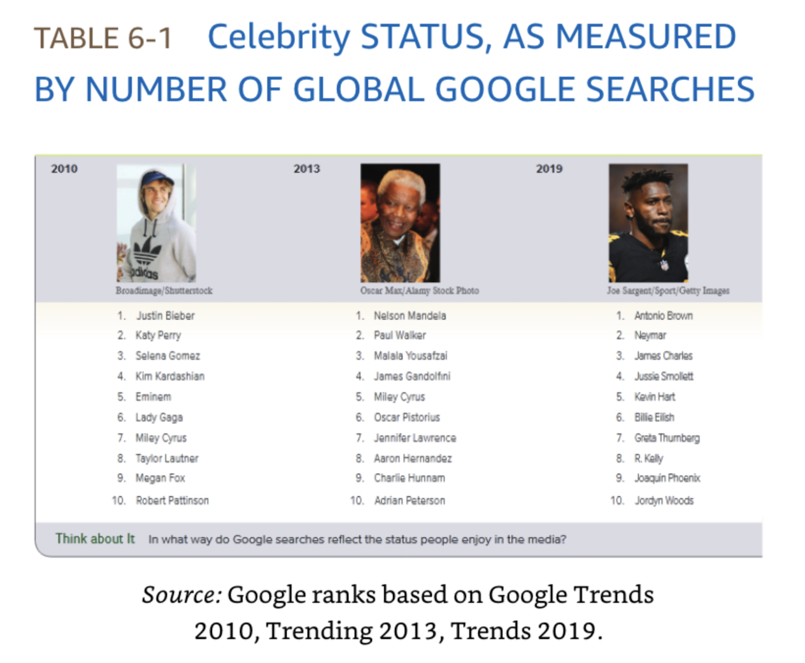{fig-alt="Table 6-1: the top 10 Google people searches in 2010, led by Justin Bieber; in 2013, led by Nelson Mandela; and in 2019, led by Antonio Brown. No name appears on more than one list." width="100%"}
:::

::: {.column width="38%"}
::: {.question-box}
How many names on the 2010 list could you identify today? What happened to their status?
:::

::: {.fragment}
- Schaefer's question: in what way do Google searches reflect the status people enjoy in the media?
- Source: Google Trends 2010, 2013, 2019
:::
:::
::::

## Achieved Status or Media-Conferred Status: Classify the Case

::: {.board}
Chapter 5 defined achieved status as a position attained largely through one's own efforts. For each person, did the media follow an achievement, or did media attention create the status?
:::

- A footballer who scored the winning goal in a final
- An influencer known for daily vlogs of her life
- A scientist interviewed after a discovery
- Someone whose angry video in a restaurant went viral
- A singer who won a televised talent competition

::: {.question-box}
Schaefer asks: when you browse, are you more likely to choose an outlet because of the person featured? What kind of image attracts you?
:::

## Promotion of Consumption: Hyperconsumerism and Product Placement {.smaller}

- **Hyperconsumerism** — Jean Baudrillard's (1929–2007) term for the practice of buying more than we need or want, and often more than we can afford. It characterizes postmodern societies (Chapter 5), and the media promote it
- The average child in the United States watches **20,000** television commercials a year, not counting other media platforms
- Young people cannot escape commercial messages. They appear on high school scoreboards, at concerts, and as banners on web pages
- **Product placement**, or "brand casting," is an increasingly important source of revenue for media and entertainment outlets. 
- It has since become far more common, from Reese's Pieces in *E.T. the Extra-Terrestrial* to AOC, a Taiwanese electronics company, in *The Martian*
- Racecar driver Danica Patrick displays brand logos on her uniform, some of which have little to do with her sport
<!-- - **Product placement**, or "brand casting," is an increasingly important source of revenue for media and entertainment outlets. It is nothing new: in 1951 *The African Queen* prominently displayed Gordon's Gin aboard the boat carrying Katharine Hepburn and Humphrey Bogart -->

## Spot the Product Placement

::: {.board}
Think of the last series, film, or YouTube video you watched. Which brands appeared on screen? Did any of them look like an advertisement?
:::

- How does an influencer's "unboxing" or "PR package" differ from the obvious product placement you find in movies or TV?
- Who pays whom, and does the audience know?
- Which demands more of your attention: a commercial you can skip, or a product placed inside the story?

<!-- Instructor enrichment. -->

## Figure 6-1: Branding the Globe {.smaller}

:::: {.columns}
::: {.column width="55%"}
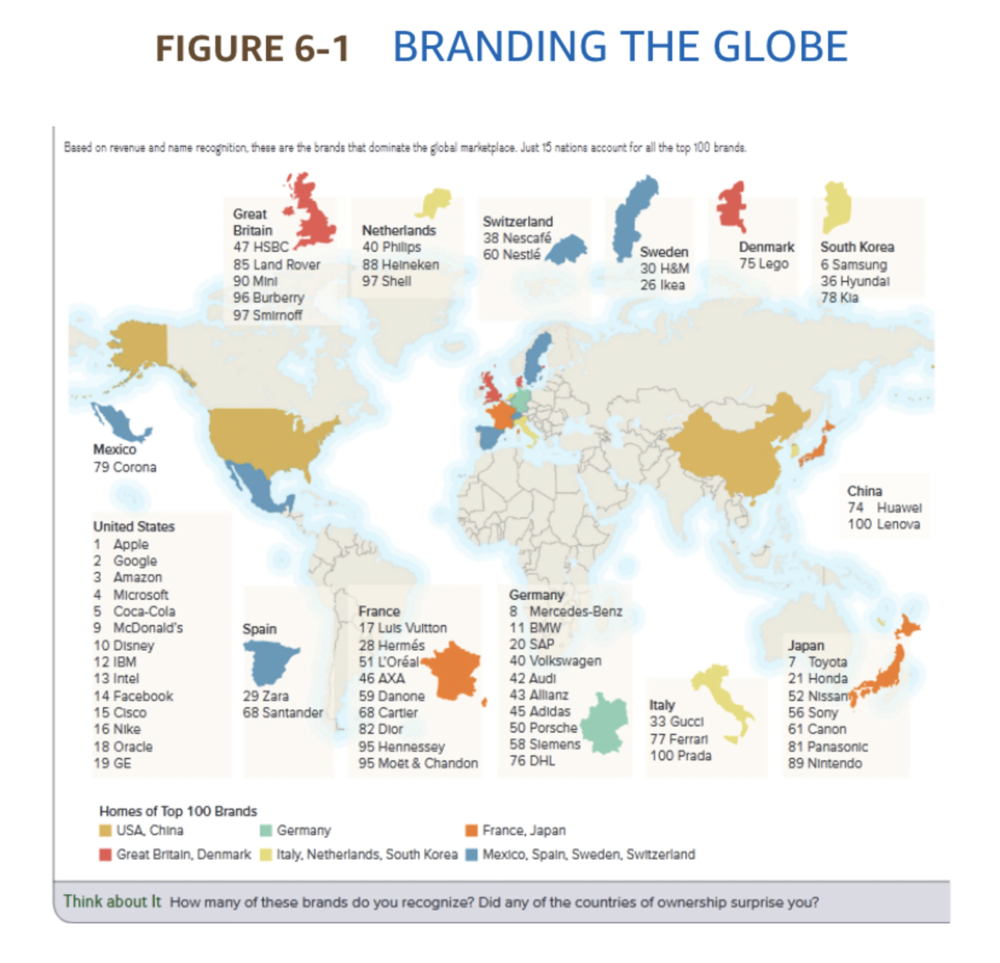{fig-alt="Figure 6-1: world map of the top 100 global brands in 2019 by country of ownership. U.S. brands lead the top 20 (Apple, Google, Amazon, Microsoft, Coca-Cola); other brands come from Germany, France, Japan, Great Britain, South Korea, Italy, Sweden, Switzerland, the Netherlands, Spain, Denmark, Mexico, and China." width="100%"}
:::

::: {.column width="45%"}
- Using advertising to build a brand with global appeal is an especially powerful way to encourage consumption
- Each of these brands earns at least **30 percent** of its income outside its home country
- **48** of the top 100 brands originated in the United States, down from 54 in 2017. The map shows only the U.S. brands in the top 20
- A small number of other nations own all the rest (Interbrand 2019)

::: {.question-box}
How many of these brands do you recognize? Which countries of ownership surprised you? How many could you buy at The Avenues?
:::
:::
::::

<!-- Ambiguity: Schaefer's text says the other 52 brands come from 14 countries (15 in all); the figure note says 14 nations account for the top 100; the figure header says 15. The map shows 14 nations including the United States. The slide gives no count. -->

## Advertising Has Functions and Dysfunctions {.smaller}

| Functions of advertising | Dysfunctions of advertising |
|---|---|
| Supports the economy | Contributes to a consumer culture that creates needs |
| Provides information about products | Raises unrealistic expectations of what it takes to be happy or satisfied |
| Underwrites the cost of the media | Lets advertisers influence media content, because the media depend heavily on advertising revenue |
| Sometimes becomes entertainment: **24 percent** of viewers watch the Super Bowl mainly for the commercials | |

::: {.small}
Marketing Charts 2018
:::

::: {.question-box}
Which ads do you still remember from last Ramadan? Did any of them become part of the entertainment, the way Super Bowl commercials do?
:::

## The Narcotizing Dysfunction: Massive Coverage Can Numb an Audience {.smaller}

- **Narcotizing dysfunction** — Lazarsfeld and Merton's (1948) term for the phenomenon in which the media provide such massive amounts of coverage that the audience becomes numb and fails to act on the information, regardless of how compelling the issue
- Interested citizens may take in the information but make no decision and take no action
- The media often start a great outpouring of support after a natural disaster or a family crisis. As time passes, **viewer fatigue** sets in: the audience grows desensitized to the suffering and may even conclude that the crisis has been solved (Baran and Davis 2015)
- Lazarsfeld and Merton named the dysfunction about 70 years ago, when few homes had television. Today commentators point to addiction to screen time, especially among young people. On overwhelming topics such as street crime, war, and HIV/AIDS, some people feel they have acted, or learned all they need to know, simply through social media

## The Narcotizing Dysfunction in Your Own Feed

::: {.question-box}
Think of a disaster abroad that you followed closely. In which week did you stop opening the stories? Had the crisis ended, or had your attention?
:::

- Does sharing a post count as acting, or does it only give the feeling of having acted?
- What would a news outlet have to do to keep you informed without numbing you?
- Pariser says important issues must be made more engaging. Is that the cure for the narcotizing dysfunction, or part of the cause?

<!-- ::: {.small} -->
<!-- Discussion only. No one needs to name a crisis or say what they did or did not do. -->
<!-- ::: -->

<!-- Instructor enrichment. Sober tone; no humour on this slide. -->

# Conflict Perspective {background-color="#1B2A4A"}

::: {.takeaway}
Conflict theorists argue that the media reflect and even deepen society's divisions. They ask who decides what reaches us, whose version of reality the media transmit, and who is left without access.
:::

## Conflict View: The Media Reflect and Deepen Social Divisions

- Conflict theorists emphasize that the media reflect and even **exacerbate** many divisions in society and the world, including those based on gender, race, ethnicity, and social class
- They point in particular to:
  - **Gatekeeping**: the media's ability to decide what is transmitted
  - **Dominant ideology**: the way powerful groups transmit their view of the world through the media
  - **The digital divide**: the technological gap between the haves and have-nots, which limits access to the Internet
  - **Media monitoring**: interest groups watch what the media publish, and governments increasingly monitor how citizens use social media

<!-- Ambiguity: Table 6-2 lists "media monitoring" as a conflict emphasis, but the 14e text has no subsection on it. The Arabic deck (slide 13) says interest groups monitor media content; the Social Policy section documents government monitoring of social media. The bullet combines the two. -->

## Gatekeeping: A Few People Decide What Reaches the Public {.smaller}

:::: {.columns}
::: {.column width="52%"}
- What story pops up when you turn on your phone? Which film plays on three screens at the cinema, and which is never released? Publishers, editors, and other media moguls make these decisions
- The media are big business, in which **profits** generally matter more than the quality of programming
- **Gatekeeping** — the process by which material must travel through a series of gates, or checkpoints, before reaching the public. A select few decide what images reach a broad audience
- In many countries the **government** plays a gatekeeping role
- A journalism scholar coined the term in the 1940s for the way small-town newspaper editors controlled which events received public attention. C. Wright Mills ([1956] 2000b) observed that the real power of the media is that they control what is presented
:::

::: {.column width="48%"}
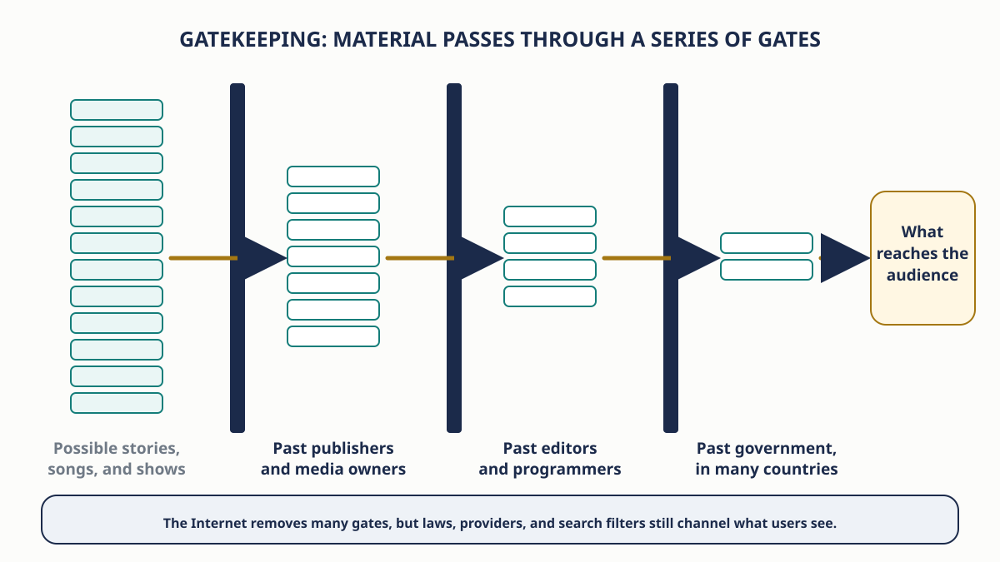{fig-alt="Twelve possible stories narrow to seven past publishers and media owners, four past editors and programmers, and two past government in many countries; the Internet removes many gates, but laws, providers, and search filters still channel what users see."}
:::
::::

## Gatekeeping in Music, Television, and Publishing

- **Recording industry:** gatekeepers may reject a popular local band because it competes with a group already on their label. Even if the band is recorded, radio programmers may reject the music because it does not fit the station's sound
- **Television:** programmers may keep the pilot for a new series off the air because they believe it does not appeal to the target audience, which advertising sponsors sometimes determine
- **Publishing:** gatekeepers make similar decisions about which books reach readers

::: {.question-box}
Schaefer asks: if you follow the news closely, where do you gather your facts: newspapers, magazines, TV newscasts, blogs, or social media? Why that medium? Who are its gatekeepers?
:::

## You Are the Gatekeeper: Choose Tomorrow's Top Three Stories

::: {.board}
You edit the homepage of a Kuwaiti news site. Nine stories arrived tonight, and only three fit at the top.
:::

:::: {.columns}
::: {.column width="50%"}
1. A rainfall warning for the weekend
2. The Ministry moves the date of national exams
3. A new restaurant opens at The Avenues
4. A multi-car accident on the Fifth Ring Road
5. Floods abroad kill hundreds in a country far from the Gulf
:::

::: {.column width="50%"}
6. Egg prices rise at the co-ops
7. A Kuwaiti team wins a regional match
8. A celebrity's wedding photos are released
9. A study finds most university students sleep under six hours a night
:::
::::

::: {.fragment}
- What did your three choices assume about your audience? Which stories would an advertiser want next to its ads?
- Your phone makes this decision for you every morning. Who is your gatekeeper now?
:::

<!-- Instructor enrichment. Hypothetical headlines for the exercise, not reports of real events. -->

## The Internet Has Fewer Gates, but Not None {.smaller}

- Gatekeeping is not as dominant on the **Internet**. You can post virtually any message, podcast, or video, or build a website arguing that the earth is flat. Information, and misinformation, spreads without any significant gatekeeping process
- Still, the Internet is not totally without restrictions:
  - In many nations, laws regulate content on gambling, inappropriate content, and even politics
  - Popular Internet service providers terminate accounts for offensive behavior
  <!-- - After the 2001 terrorist attacks, eBay did not allow people to sell parts of the World Trade Center -->
- Many countries try to control political dissent by restricting access to online comments unfavorable to the government. Authoritarian regimes have temporarily or permanently suspended Internet access to thwart those they saw as undermining the central government
- Political parties and even national militaries may spread false reports. In 2019 Facebook tried to rein in fabricated "news" of Indian and Pakistani atrocities toward each other; the reports were traced to Indian and Pakistani organizations (Goel and Frenkel 2019)
- Despite, or maybe because of, such gatekeeping, growing numbers of people take part in online communities

<!-- Filtered per course rules: the 2015 Charleston church shooting and the retail ban on Confederate flags. -->

## Box 6-1: Personalized Search Puts Users Inside a Filter Bubble {.smaller}

- Search engines are personalized. Google uses as many as **57** sources of information, including location and past searches, to guess which sites a person might like to visit. It has done this since **2009**, and in **2012** it began using information from the websites people "friend" on social media
- Google presents personalization as a service that helps people cut through irrelevant information
- A 2019 analysis found that search engines completed the same query differently. "Immigrants are" might be completed with "law abiding," "increasing taxes," or even "animals." The companies corrected the most troubling results once they were made public, but tens of thousands of problematic filters remain
- Online political activist **Eli Pariser** calls the result a **filter bubble**: when a search engine filters our searches, it encloses us in an invisible bubble that limits what we see to what we already know (*The Filter Bubble*). We rarely discover people, places, and ideas outside our comfort zone, and we may not even realize the bubble is there

<!-- Filtered per course rules: Schaefer's first autocomplete example. -->

## Box 6-1: Why the Filter Bubble Matters {.smaller}

- Most of us go only to restaurants whose food we enjoy. What is wrong with seeing only what we like online?
- Filtering leads many people to miss truly important events. In-depth stories about Afghanistan, world poverty, and the refugee crisis compete in the same search pool with cat pictures and Candy Crush. Pariser's solution: make the truly important issues more engaging and compelling
- Personalization was once seen as directed by the user or done for commercial purposes. The **2016** U.S. presidential election changed that view: Russia covertly placed thousands of political ads, mostly attacking Hillary Clinton or praising Donald Trump, on the Facebook or Twitter accounts of people judged susceptible to their inaccurate messages. The filter bubble was infiltrated for devious political purposes
- Researchers at MIT and Yahoo Labs propose including contrasting or opposing views in online searches, in the hope that the Internet becomes less isolating and more open to different perspectives (Pariser 2011a, 2011b; Graells-Garrido et al. 2016; Shane and Isaac 2017)

<!-- ## Let's Discuss: Search the Same Topic and Compare Your Results -->

<!-- ::: {.board} -->
<!-- Everyone search the same phrase on your own phone, now. Compare your first three results with your neighbor's. -->
<!-- ::: -->

<!-- - Try: "best burger in Kuwait," "is coffee good for you," and "Kuwait weather" -->
<!-- - Then open YouTube or TikTok without searching. How much of your home page overlaps with your neighbor's? -->

<!-- ::: {.question-box} -->
<!-- Schaefer asks: how could you craft a search to get a wider range of facts and opinions on a topic? Did your results differ, and in what way? -->
<!-- ::: -->

<!-- ::: {.small} -->
<!-- Chapter 3 showed language and algorithms creating partly separate online worlds. Box 6-1 asks who builds the filter, and why. -->
<!-- ::: -->

<!-- If search results come back nearly identical, that is a finding too: ask why the home pages differ more than the searches. -->

## Dominant Ideology: The Media Construct What We Regard as Real {.smaller}

- Conflict theorists argue that the mass media maintain the privileges of certain groups, and that powerful groups may limit how the media represent others in order to protect their own interests
- **Dominant ideology** — a set of cultural beliefs and practices that helps to maintain powerful social, economic, and political interests (Chapter 3)
- The media transmit messages that essentially **define** what we regard as the real world, even when those images differ from what the larger society experiences
- Media decision makers are overwhelmingly white, male, and wealthy. The media tend to ignore the lives and ambitions of subordinate groups: working-class people, African Americans, Hispanics, people with disabilities, overweight people, and older people
- Worse, media content may create false images or **stereotypes** of these groups that become accepted as accurate portrayals of reality

<!-- Filtered per course rules: one group omitted from Schaefer's list; the queer-theory paragraph and its film-character statistic are omitted. -->

## Stereotypes on Screen and in Apps {.smaller}

- **Stereotypes** — unreliable generalizations about all members of a group that do not recognize individual differences within the group
- Some broadcasters use stereotypes deliberately, in a desperate bid for attention, with the winking approval of media executives
- Stereotyping has moved online. Some apps force people to choose a racial or gender identity and then steer their online selections, much as search filters do (Wachter-Boettcher 2017)

::: {.question-box}
In real life, about **1 in 4** women is obese. Out of every 100 television characters, how many would you guess are portrayed as obese?
:::

::: {.fragment}
- **3** out of 100. Heavyset characters have fewer romances, eat more often, and are more often the object of ridicule than thin characters (Hellmich 2001; J. Whyte 2010)
- News outlets also alert people to the health implications of obesity, and increasingly frame it as a **structural** problem, involving the way food is processed and sold, not only an individual one (Saguy and Almeling 2008)
:::

## Content Analysis: Count Who Appears on Screen

::: {.board}
Choose one: an episode of a Ramadan series, the ads during one football match, or the first 20 posts on your Explore page. Count who appears, and how.
:::

- **Age:** how many characters are over 60?
- **Bodies:** how many are heavyset, and what do they do in the scene?
- **Work:** who is shown as a doctor, an engineer, a boss, a driver, a cleaner?
- **Voice:** who speaks, and who is the punchline?

::: {.small}
This is content analysis from Chapter 2: coding cultural materials systematically. Whose reality does your sample construct?
:::

<!-- Instructor enrichment. -->

## Dominant Ideology: Whose Culture Travels Abroad? {.smaller}

- U.S. programs are hits around the world. *The Walking Dead* and *Grey's Anatomy* are popular in France, despite its "exception culturelle," which protects French producers from foreign competition. In Japan *Glee* is must-watch TV and *Columbo* reruns still draw viewers. In Latin America, where illicit downloading is common, the favorites include *The X-Factor*, *Breaking Bad*, and *Homeland*. In North Korea, *Desperate Housewives* is a cult hit
- Officials and cultural purists may decry these shows, but U.S. media are still widely watched and imitated. Sociologist Todd Gitlin calls American popular culture something "people love, and love to hate" (2002:177)
- We risk being **ethnocentric** if we overstress U.S. dominance. *Survivor*, *Who Wants to Be a Millionaire*, *Big Brother*, and *Iron Chef* came from Sweden, Britain, the Netherlands, and Japan. *American Idol* began in Britain as *Pop Idol*. The telenovelas of Mexico and other Spanish-speaking countries owe very little to U.S. soap operas
- Television is gradually moving away from U.S. domination and is now more likely to be **locally produced** (Bielby and Harrington 2008; Colucci 2008)

## Television Formats and Foreign Dramas in Kuwait

- The Arabic *Who Wants to Be a Millionaire?*, [من سيربح المليون]{.term-ar}, and *Arab Idol* both adapted British-born formats for Arab audiences
- Turkish and Korean dramas draw large audiences here (Chapter 3)
- Schaefer: audiences are **not passive recipients** of foreign cultural messages. People may watch and enjoy foreign content without accepting values alien to their own (Bielby and Harrington 2008)

::: {.question-box}
Schaefer asks: how do your favorite media reflect U.S. culture? The culture of your local community? The cultures of the rest of the world?

When you watch a Turkish or Korean drama, what do you adopt, such as a phrase, a dish, or a style, and what do you watch without accepting?
:::

<!-- Instructor enrichment. The two Arabic formats are standard reference knowledge (MBC's Man Sayarbah al-Malyoon from 2000; Arab Idol from 2011); verify before teaching them as fact. -->

## Hyper-Local Media Report What Happens Down the Street {.smaller}

- **Hyper-local media** — reporting that is highly local. What has been going on in that vacant lot down the street? Which takeout food is popular in your neighborhood? Why did all those police cars converge on Main Street the night before last?
- Schaefer calls it the most novel media trend of this century
- The term was coined in **1991** for local news on 24-hour cable channels. It now more often refers to social networks such as **Nextdoor** and **Social Street** and to sites such as patch.com
- In 2020 many Americans discovered hyper-local outlets: first during the pandemic, to learn where people practiced social distancing and which businesses offered curbside pickup, and then to follow protest marches in their own towns

::: {.question-box}
Which hyper-local accounts do you follow: accounts that report road closures, co-op offers, new cafés, or what happened in your area last night? Who runs them, and who checks what they post?
:::

## The Two-Way Flow of News Between Industrial and Developing Nations {.smaller}

- Nations that feel a loss of identity may defend against cultural invasion, especially from the economically dominant United States. Yet audiences are not necessarily passive, so research on them must be placed in social context
- Developing nations have long argued for a greatly improved **two-way flow** of news and information. They complain that news from the developing world is scant, and that what news there is reflects unfavorably on them
- Ask most people in the United States about South America and they mention two topics that dominate the news: revolution and drugs. Most know little else about the continent
- In the 1980s **UNESCO** passed a resolution to monitor news and content crossing the borders of developing nations, a step regarded globally as protecting threatened cultures and media markets. The United States has continued to oppose UNESCO's plans; the Trump administration withdrew from UNESCO in 2019
- Opposition to U.S. media is not limited to developing nations. **South Korea** limits the number of days cinemas can show foreign films. The **European Union** has sought to limit Netflix's "cultural dumping," which it sees as a threat to national identity and to the European media industry (Baran 2015; Barbière 2014)

::: {.question-box}
What do you know about Brazil, apart from football? About Kenya, apart from safaris? Where did that knowledge come from, and what did it leave out?
:::

## The Digital Divide: Access to New Technology Is Unequal

- Advances in communications technology are not evenly distributed
- **Digital divide** — the gap in access to the latest technologies: worldwide, low-income groups, racial and ethnic minorities, rural residents, and citizens of developing countries have far less access than others
- Educators and politicians tout the Internet's benefits for the disadvantaged, yet Internet use may be **reinforcing** existing social-class and educational differences
- When marginalized people gain access, they still trail the privileged: dial-up instead of broadband, or broadband instead of wireless. The issue is not merely access but the cost and availability of **high-capacity broadband**
- The pandemic made this plain when millions of students tried to attend virtual classes and complete their schoolwork online (Ingram 2019)

## Figure 6-2: Who Uses Facebook and LinkedIn?

::: {.question-box}
Before the chart: in 2019, what share of U.S. adults with a high school education or less used **Facebook**? What share used **LinkedIn**? Now guess both numbers for college graduates.
:::

::: {.fragment}
::: {.center}
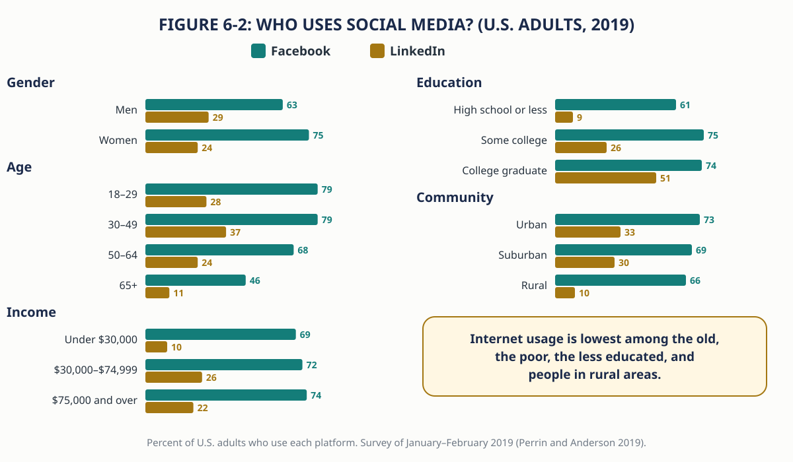{fig-alt="Percent of U.S. adults using Facebook and LinkedIn in 2019, by gender, age, income, education, and community. Facebook use varies little by education (61 to 74 percent); LinkedIn use rises from 9 percent among those with high school or less to 51 percent among college graduates, and is 10 percent in rural areas against 33 percent in urban areas."}
:::
:::

<!-- Data from the Arabic deck's text alternative to Figure 6-2 (Perrin and Anderson 2019). The race panel is omitted. Check the LinkedIn income value for $75,000 and over (22) against the printed figure; it looks low. -->

## Why Does LinkedIn Use Track Education So Closely?

::: {.board}
Facebook use barely changes with education: **61** percent to **74** percent. LinkedIn use rises more than fivefold: **9** percent to **51** percent. Why?
:::

::: {.fragment}
- What is LinkedIn **for**, and which kinds of jobs are found through it?
- Chapter 5: a network transmits information and opportunity to those inside it, and withholds them from those outside
- Rural LinkedIn use is **10** percent, against **33** percent in cities. What does a city supply besides a faster connection?
:::

::: {.fragment .takeaway}
What looks like a personal choice of apps is also a pattern of class, education, and place.
:::

<!-- Instructor enrichment built on Figure 6-2. -->

## Box 6-2: The Global Disconnect {.smaller}

- **Bogdan Ghirda**, a Romanian, is paid 50 cents an hour to play multiplayer games such as *City of Heroes* and *Star Wars* on behalf of someone in an industrialized country who does not want to spend days climbing to the highest levels. U.S.-based services can earn hundreds of dollars for recruiting such a player
- In Africa, resource-poor **Rwanda** is building its economy on information and communications technologies. In 2011, public investment and private competition brought mobile phone and data service to **96 percent** of the country. Challenges remain: expensive energy, a shortage of skilled computer specialists, weak finances. The nation of 12 million has a per capita gross national income of just **$780**
- The **Network Readiness Index** (NRI), created by the World Economic Forum and now tabulated annually by the Portulans Institute, ranks **121** nations by how prepared individuals, businesses, and governments are to benefit from information technologies
- Through the Internet, multinational organizations can function as a single global unit, responding in real time 24 hours a day. Sociologist Manuel Castells calls this a **global economy**. Nations disconnected from it grow slowly, and their educated and skilled citizens emigrate to other labor markets, deepening the impoverishment of nations on the periphery (Castells 2010a; World Bank 2020)

## The Network Readiness Index: Top 10 and Bottom 10 Countries

:::: {.columns}
::: {.column width="55%"}
| Top 10 | Bottom 10 |
|---|---|
| 1. Sweden | 112. Zambia |
| 2. Singapore | 113. Cameroon |
| 3. Netherlands | 114. Eswatini (Swaziland) |
| 4. Norway | 115. Mali |
| 5. Switzerland | 116. Ethiopia |
| 6. Denmark | 117. Malawi |
| 7. Finland | 118. Madagascar |
| 8. United States | 119. Zimbabwe |
| 9. Germany | 120. Mozambique |
| 10. United Kingdom | 121. Yemen |

::: {.small}
Portulans Institute 2019
:::
:::

::: {.column width="45%"}
::: {.question-box}
**Let's discuss.** For nations on the periphery, what specific social and economic consequences might the global disconnect bring?

What factors might complicate efforts to remedy the global disconnect in developing nations?
:::
:::
::::

## The Digital Divide in Augmented Reality: Pokémon GO {.smaller}

- The smartphone game **Pokémon GO**, released in 2016, lets players create an avatar and search in real time to "catch" Pokémon appearing in augmented reality, next to a mailbox or in a park. Players try to collect as many of the more than 250 characters as they can
- Research found that in the United States, African American and Latino neighborhoods were much less likely than white neighborhoods to be sites of **PokéStops**, where the characters can be caught (Juhász and Hochmair 2017)
- The digital divide shaped even where a game placed its imaginary creatures

::: {.question-box}
Schaefer asks: have you ever experienced the digital divide? What other effects might a lack of Internet access cause? Think back to online classes in 2020: what did a household's connection, devices, and quiet space decide?
:::

<!-- ::: {.small} -->
<!-- Discussion in general terms. No one is asked to describe their own household. -->
<!-- ::: -->

# Feminist Perspective {background-color="#1B2A4A"}

::: {.takeaway}
Feminists share the conflict view that the media misrepresent social reality, and they focus on how the media portray women and men and on who gets access to media at all.
:::

## Feminist View: The Media Stereotype Women and Men {.smaller}

:::: {.columns}
::: {.column width="67%"}
- Feminists share the conflict view that the mass media stereotype and misrepresent social reality. The media powerfully influence how we see men and women, communicating **unrealistic, stereotypical, and limiting** images of both
- Women are often shown as shallow and obsessed with beauty. They are more likely than men to be presented in danger, or physically victimized
- When women achieve newsworthy feats in fields traditionally dominated by men, such as professional sports, the media are often slow to recognize their accomplishments
:::

::: {.column width="33%"}
{fig-alt="A 1920 advertisement presenting an electric washing machine as a servant in the home." width="100%"}

::: {.small}
Electric-washer advertisement, 1920. Public domain in the United States.
:::
:::
::::
<!-- - **Pornography** remains a troubling issue for feminists and for society. Feminists strongly support freedom of expression and self-determination, rights denied to women more often than to men. Yet pornography presents women as sex objects, seems to make viewing women that way acceptable, and can project an implicit endorsement of violence against women. The industry is largely unregulated and puts even its own performers at risk -->

## The Gender Digital Divide

- In the United States and many other industrial countries, women are slightly **more** likely than men to use electronic media
- In rural areas of India, China, Indonesia, Mexico, Egypt, and Niger, women fall behind men, largely because owning or using a cell phone is discouraged or even locally prohibited. Media access is seen as giving women **too much freedom**
- An estimated **200 million** women worldwide are denied access to cell phones (Bellman and Malhotra 2017; Concave Brand Tracking 2017)

::: {.question-box}
A phone connects its owner to information, work, banking, health care, and help in an emergency. List what a woman without one is cut off from. Which of those losses would show up in a country's statistics, and which would stay invisible?
:::

## Reverse the Gender Roles in an Advertisement

::: {.board}
Recall a recent ad for a cleaning product, a car, a perfume, or a bank. Swap the gender of everyone in it. Does the reversed ad look normal, funny, or strange?
:::

- If it looks strange, what expectation did the original ad rely on?
- Who is shown deciding, who is shown serving, and who is shown being looked at?
- Which perspective are you using now: feminist, conflict, or both?

<!-- Instructor enrichment. Light humour is fine here, never at the expense of an identity. -->

# Interactionist Perspective {background-color="#1B2A4A"}

::: {.takeaway}
Interactionists study the media at the micro level: how they shape everyday behavior, build networks and social capital, and change what each of us chooses, or is chosen, to see.
:::

## Interactionist View: Social Media Build Social Capital {.smaller}

- Interactionists are especially interested in shared understandings of everyday behavior. Turkle's opening excerpt is an interactionist concern: how social media shape day-to-day social behavior
- Recent research focuses on **social capital** and on **facial recognition software**
- **Social capital** — Pierre Bourdieu's term for the collective benefit of social networks, which are built on reciprocal trust (Bourdieu and Passeron 1990)
- The Internet, and social media in particular, offer almost constant connectivity. They increase our contact with family, friends, and acquaintances, near and far, and help us build new ties and networks (Neves 2013)

::: {.question-box}
Whom did you last ask for help through your phone: a class group, a cousin abroad, a stranger with a skill? What did the request draw on, if not trust?
:::

## Figure 6-3: Social Networks Turn Advertising into a Relationship {.smaller}

:::: {.columns}
::: {.column width="58%"}
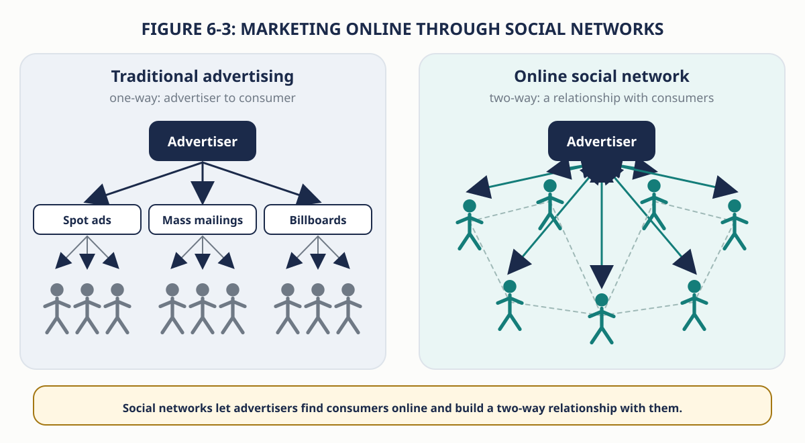{fig-alt="Left: traditional advertising sends one-way messages from the advertiser through spot ads, mass mailings, and billboards to consumers. Right: on an online social network, the advertiser and consumers exchange messages in both directions, and consumers are linked to one another."}
:::

::: {.column width="42%"}
- Advertisers traditionally marketed through one-way spot ads, mass mailings, or billboards. Social networks let them find consumers online and build a **two-way** relationship
- **Burger King** offered a free Whopper on Facebook to anyone who deleted 10 friends. The promotion notified **239,906** users that they had been dropped for a burger, which violated Facebook's policy. Burger King still built a vast network of Whopper fans
- Kraft Foods encouraged people to post photos of its Wienermobile on Flickr
:::
::::

::: {.question-box}
Would you delete 10 friends for a burger? Schaefer asks: how does marketing through social networks differ from traditional marketing, from the advertiser's point of view and from the consumer's?
:::

## Box 6-3: Apps for Global Refugees {.smaller}

:::: {.columns}
::: {.column width="68%"}
- More than **65 million** people fled their homelands in 2017 alone, driven by violence, natural disasters, and grinding poverty. The conflict in Syria was by far the biggest driver
- Governments and aid groups need accurate, timely statistics on who the migrants are and how many are arriving, to allocate resources and to counter misperceptions that delay a response
- There are more than **7 billion** mobile phone subscriptions worldwide, at least **5 billion** of them in developing countries. Every call, online payment, and social media interaction generates data in real time
- Apps for asylum seekers, usually in many languages, offer instant information on services and shelter; health advice linked to local governments; help finding family and telling others where the user is; and **identity protection**, a biometric identity built from fingerprints, iris scans, and photographs, available in 25 nations
- Not all of it helped. When images showed refugees using smartphones, online comments turned hostile: how needy could "these people" be if they were updating Facebook? Some governments tracked refugees' phones to restrict their movements
- The free app **FindHello**, built with support from UNHCR, lists thousands of services for immigrants, asylum seekers, and refugees in the United States (Mancini et al. 2019; UNHCR 2018)
:::

::: {.column width="32%"}
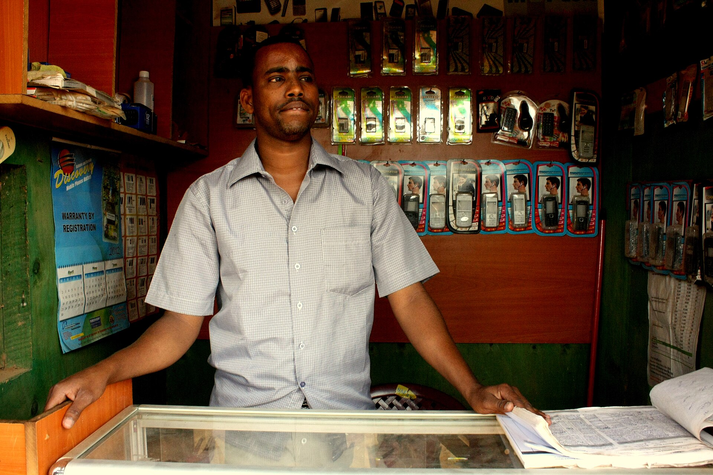{fig-alt="A mobile-phone shop in Dadaab where phones help refugees remain in contact with family members elsewhere." width="100%"}

::: {.small}
Mobile-phone shop in Dadaab. Jo Harrison/Oxfam East Africa, CC BY 2.0.
:::
:::
::::

## Let's Discuss: Are Smartphones Frills or Vital Services in an Emergency?

::: {.board}
Are smartphones and other new technologies frills or vital services during emergencies?
:::

- Have you ever used a smartphone for your own or someone else's safety during an emergency or natural disaster? What changes when you have that technology, or lack it?
- If you worked for an aid agency, how would smartphone technology help you do your job during a refugee crisis?
- Think of a storm, flood, or power cut you lived through in Kuwait. Where did your family's information come from: official channels, the news, or a family group chat?

## Shared Viewing and Online Ties Build Friendship Networks

- Friendship networks can grow out of shared viewing habits or out of fond memories of a past television series
- Families and friends gather for broadcasts of popular events such as the Super Bowl or the Academy Awards
- Television often serves as a babysitter or playmate for children and even infants
- The Internet created new forms of interaction: grandparents keep up with their grandchildren by e-mail or chat with them on Skype, and many people find their lifetime partners through computer dating services

::: {.question-box}
Where do people in Kuwait watch a big match together: at home, at a diwaniya, at a café? What does a shared screen do for the group that watching alone does not?
:::

## Egocasting: Choosing Only the Media We Already Agree With {.smaller}

- The Internet raises troubling questions. What should be done about criminals or extremist groups who use it to exchange messages of hatred or buying weapons? About inappropriate content, and how to protect children from it? Should such material be censored, or should expression be completely free?
- The Internet also gives people greater control over what they see and hear. We can manage our exposure to avoid sounds, images, and ideas we do not enjoy or approve of
- **Egocasting** — legal scholar Cass Sunstein's (2002) term for this personalized approach to gathering news and information
- One consequence may be a **less tolerant** society. If we read, see, and hear only what we know and agree with, we may be much less prepared to meet people from different backgrounds or to converse with those who hold new viewpoints

## Filter Bubble or Egocasting? Decide Who Did the Filtering

::: {.board}
A search engine builds a filter bubble for you (Box 6-1). You build egocasting yourself (Sunstein). Classify each case and say who did the filtering.
:::

:::: {.columns}
::: {.column width="50%"}
1. You mute the words "spoiler" and "final score" before watching a recorded match
2. Your search results for "news" differ from your cousin's in London
3. You unfollow an uncle whose posts annoy you
:::

::: {.column width="50%"}
4. Your TikTok For You page fills with cooking videos after you watched two
5. You read only the newspaper that shares your views
6. An app asks your gender at sign-up and then recommends products accordingly
:::
::::

::: {.fragment .question-box}
Which cases are both? Which filter is harder to notice: the one you chose, or the one chosen for you?
:::

## Facial Recognition Software: Convenience and Hidden Bias {.smaller}

:::: {.columns}
::: {.column width="68%"}
- **Facial recognition software** links a person's image to their name. It unlocks your phone, speeds up passport control lines, and lets parents find their children among photos that summer camp staff post online
- Facial recognition and other AI technologies learn by analyzing vast amounts of image data, usually without people's awareness and often without consent. The images come from old websites, dating platforms, and even academic projects
- Those images carry subtle biases. Someone once tagged an image "cheerleader," "welder," or "college student," or with less neutral words such as "not hired," "depressed," or "loser." The tags can resurface when the software selects the image, so a search for a person may also return a label such as "unsuccessful"
- The software can help, as in locating a missing person, but it can also reinforce layers of **bias, racism, or sexism**
- In 2019 it emerged that at least three U.S. states, among them Utah and Vermont, had given federal immigration officials access to the driver's license photos of undocumented immigrants. No federal regulations govern commercial or government use. Most Americans trust law enforcement to use facial recognition responsibly; they trust advertisers and technology companies less (Collins 2019; Edmonson 2019a, 2019b)

::: {.question-box}
If you were training a face-matching system, where would your images and labels come from, and who would check them?
:::
:::

::: {.column width="32%"}
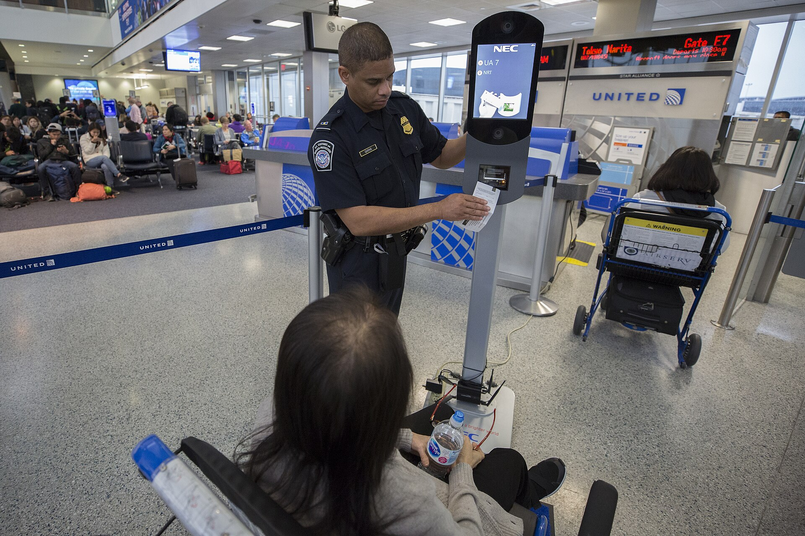{fig-alt="A passenger using biometric facial-recognition equipment before boarding a flight." width="100%"}

::: {.small}
Airport biometric screening. Donna Burton/U.S. Customs and Border Protection, public domain.
:::
:::
::::

## Table 6-2: Sociological Perspectives on the Media

| Theoretical perspective | Emphasis |
|---|---|
| **Functionalist** | Socialization · Enforcement of social norms · Conferral of status · Promotion of consumption · Narcotizing effect (dysfunction) |
| **Conflict** | Gatekeeping · Media monitoring · Construction of reality · Digital divide |
| **Feminist** | Misrepresentation of women · Differential impact on women |
| **Interactionist** | Impact on social behavior · Source of friendship networks · Social capital |

## Thinking Critically: The Media's Most Important Function and Most Troubling Problem

::: {.board}
What is the most important function of the media in our society? Which problem associated with the media troubles you most? Why?
:::

- Write one function and one problem on a slip of paper. We will tally the room
- Which perspective does your chosen function come from? Which perspective names your problem?
- Did the room agree more on the function or on the problem?

# The Audience {background-color="#1B2A4A"}

::: {.takeaway}
The media need an audience. Sociologists study who is in it, how it is divided and targeted, and how audience members influence one another.
:::

## Who Is in the Audience? {.smaller}

- Ever texted everyone you know to vote for a performer on a reality show? Been tempted to reveal the ending of a series to someone watching it on a phone? Found an old CD and tried to remember the last time anyone played one? We are all part of a larger audience
- The media are distinguished from other social institutions by the necessary presence of an **audience**
- An audience can be an identifiable, finite group, such as the audience at a jazz club or a Broadway musical, or a much larger and undefined group, such as viewers of *Black Panther* or readers of the same issue of *USA Today*
- It may be a **secondary group** gathered in a large auditorium or a **primary group**, such as a family watching a Disney video at home (Chapter 5)
- **Micro level:** how audience members interact among themselves and respond to the media, or at live performances influence the performers. **Macro level:** broader social consequences, such as early childhood education delivered through *Sesame Street*
- Even a scattered audience is distinctive in age, gender, income, political party, formal schooling, race, and ethnicity. A ballet audience differs substantially from an alternative music audience

::: {.question-box}
Think about the last time you were part of an audience. How similar to you were the other audience members? What explains the similarities or differences?
:::

## The Segmented Audience: Media Target Particular Groups {.smaller}

- Increasingly the media market themselves to a particular audience. Once an outlet such as a radio station or a website has identified its audience, it **targets** that group
- Advertising drives much of this specialization. Through survey research, media specialists have sharpened their ability to identify target audiences
- Facebook lets advertisers target users by education, field of study, income, net worth, gender, marital status, age, work history, political affiliation, and whether one is Hispanic (Herrman 2018)
- British social psychologist **Sonia Livingstone** (2004) argues that the media have become so segmented that they look almost **individualized**. Has the "mass" gone out of mass media? Not yet: large formal organizations still transmit public messages to sizable, heterogeneous, scattered audiences

::: {.question-box}
Go back to the media event everyone in Kuwait watched at the same time. Is that kind of shared audience shrinking, or has it moved somewhere new?
:::

## Micro-Targeting in Political Campaigns

- Candidates and political action groups place ads in markets where surveys show support. In the past this meant choosing television and radio programs
- Digital strategists now rely on **micro-targeting**, using accumulated voter files to send messages and solicit campaign contributions. Campaigns identify recipients by the hashtags they use on Twitter or the videos and photos they post on Snapchat; on Facebook and Instagram they target by congressional district, interest, gender, age, or any combination
- Online political messaging, including outright false charges about candidates, grew especially intense in the **2016** and **2018** U.S. elections
- Unable to secure the content of hyperpartisan political messages, Twitter took the extraordinary step in **2019** of no longer accepting any paid political ads (Weintraub 2019)

## Build a Target Audience

::: {.board}
Your team has a small ad budget for a new healthy café opening near Kuwait University. Choose **three** targeting variables.
:::

- Education · field of study · income · net worth · gender · marital status · age · work history

::: {.fragment}
- Whom did your three variables leave out entirely?
- Now run a blood-donation campaign instead. Do your variables change?
- The people outside your targeting never see the message. Does that matter for a café? For an election?
:::

<!-- Instructor enrichment using the targeting variables Schaefer lists. -->

## Opinion Leaders and Influencers

:::: {.columns}
::: {.column width="65%"}
- **Opinion leader** — someone who influences the opinions and decisions of others through day-to-day personal contact and communication. A movie or theater critic is an opinion leader
- Sociologist Paul Lazarsfeld and his colleagues (1948) pioneered the study of opinion leaders in their research on voting behavior in the 1940s
- **Influencer** — a social media user who has established credibility in a specific industry, such as fashion, electronics, or toys (Chapter 1)
- We occasionally meet opinion leaders face to face, and their reputations grew over many years. Influencers are relatively new to the scene and churn out content around the clock on YouTube, TikTok, or Instagram (Tiffany 2019)
:::

::: {.column width="35%"}
{fig-alt="A fashion influencer recording social-media content at home." width="100%"}

::: {.small}
Fashion content creator recording a video. Victor Sergeevich, CC0.
:::
:::
::::

## Opinion Leader or Influencer? Classify the Case

::: {.board}
Classify each person. Where does the line blur?
:::

:::: {.columns}
::: {.column width="50%"}
- The uncle everyone calls before buying a car
- A film critic with a weekly newspaper column
- A Kuwaiti makeup creator with two million followers
- The pharmacist your family trusts about supplements
:::

::: {.column width="50%"}
- A diwaniya host whose views on the elections spread through the area
- A tech YouTuber who reviews every new phone in its first week
- A classmate whose restaurant recommendations everyone follows
:::
::::

::: {.question-box}
Which of these people are paid by the products they recommend? Does that change whether you trust them?
:::

## Audiences Are Not Passive, and Fake News Targets Their Biases {.smaller}

- The word "audience" suggests a passive group, but often it is not. Protesters at political rallies and crowds who boo performers, athletes, or speakers are anything but passive
- Opinion leaders may encourage such tactics, which can lead to **collective action** by audience members (Croteau et al. 2012)
- **False news** stories and fictitious events targeted at particular online audiences give the manipulation of audiences new meaning
- Online audiences are increasingly wary, but they often overlook falsehoods created to appeal to their **preferences or biases**. Creators of fake news identify an audience's biases and target them efficiently through its online viewing history (Carey 2017)

::: {.question-box}
Schaefer asks: what audience do the producers of televised professional wrestling target? The creators of an animated film? A rap group? What factors determine who makes up an audience?
:::

# The Media's Global Reach {background-color="#1B2A4A"}

::: {.takeaway}
Distance no longer limits the media. Whether the result is a global village or a global torrent, not every country is equally connected.
:::

## McLuhan's Global Village and Gitlin's Global Torrent {.smaller}

:::: {.columns}
::: {.column width="58%"}
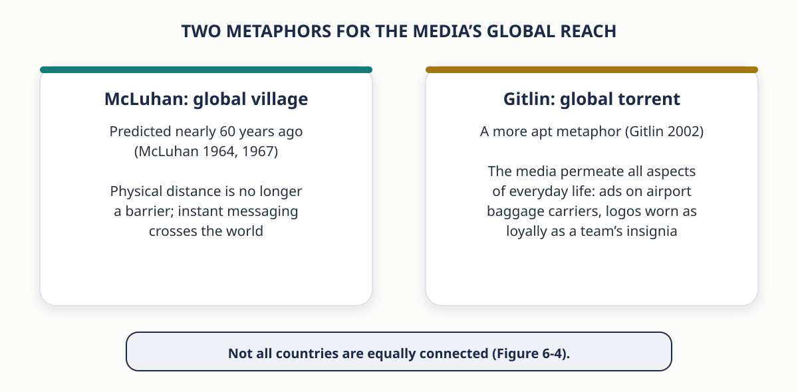{fig-alt="Two cards: McLuhan predicted a global village in which distance is no longer a barrier; Gitlin prefers global torrent, because the media permeate every aspect of everyday life. Not all countries are equally connected."}
:::

::: {.column width="42%"}
- Canadian media theorist **Marshall McLuhan** predicted a **global village** nearly 60 years ago. Voice transmission was just beginning 120 years ago; the progress since has been staggering
- Sociologist **Todd Gitlin** prefers **global torrent**. Consumer goods are marketed worldwide, from airport baggage carriers to imprints on sandy beaches, and people wear a Nike, Coca-Cola, or Harley-Davidson logo as readily as their favorite team's insignia (Gitlin 2002; Klein 1999)
:::
::::

::: {.question-box}
Village or torrent: which word fits your last 24 hours better?
:::

## Figure 6-4: Internet and Social Media Penetration in Selected Countries {.smaller}

:::: {.columns}
::: {.column width="52%"}
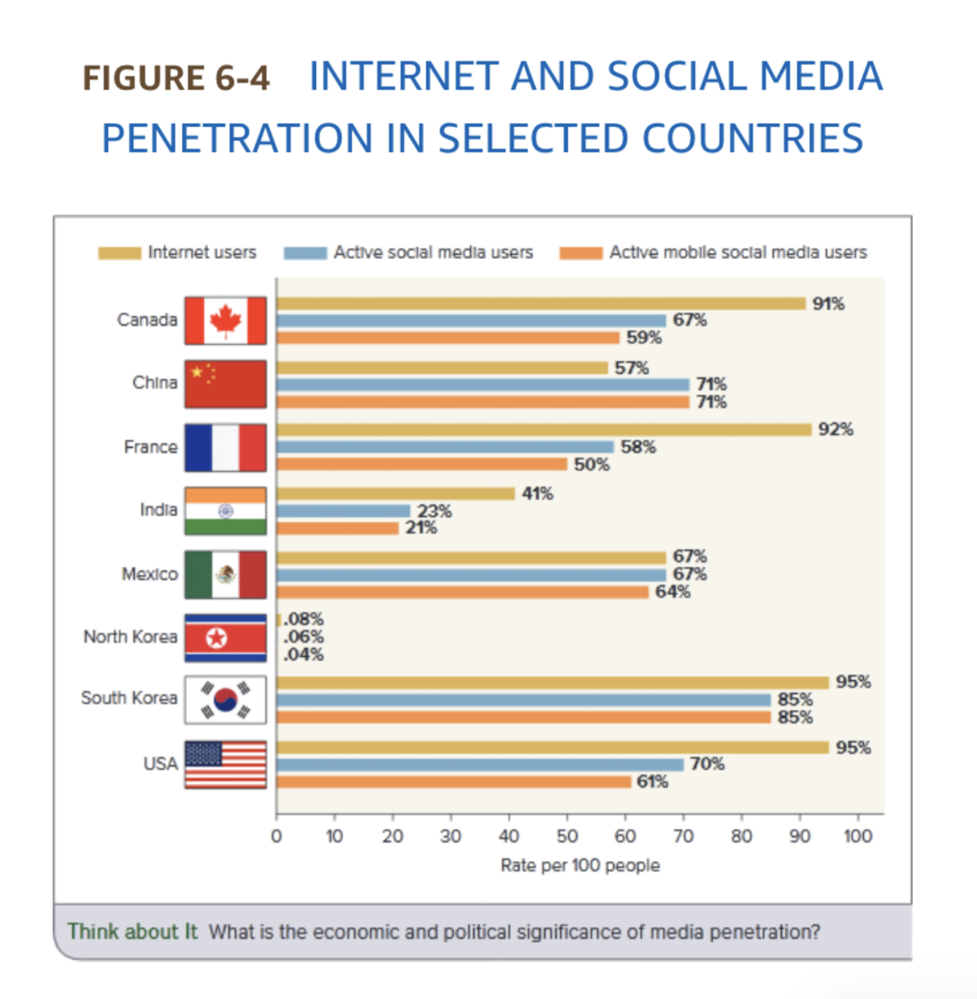{fig-alt="Figure 6-4: Internet users, active social media users, and active mobile social media users per 100 people. Canada 91, 67, 59; China 57, 71, 71; France 92, 58, 50; India 41, 23, 21; Mexico 67, 67, 64; North Korea 0.08, 0.06, 0.04; South Korea 95, 85, 85; United States 95, 70, 61." width="100%"}
:::

::: {.column width="48%"}
- Not all countries are equally connected
- In **South Korea** and the **United States**, 95 percent of people use the Internet. In **India**, 41 percent do. In **North Korea**, 0.08 percent do
- Mobile phone ownership and active use of social media reach high levels of the population in most of the world (Hootsuite and We Are Social 2019)

::: {.question-box}
Schaefer asks: what is the economic and political significance of media penetration? Why might a government want its citizens connected, or not?
:::
:::
::::

## Gurupá, Brazil: Three Televisions Created a New Social Norm {.small}

:::: {.columns}
::: {.column width="62%"}
- In some developing countries, people manage to watch television even though they do not own one
- In 1982 the three wealthiest households in **Gurupá**, a remote Amazon town of about 3,000, bought televisions
- To please the rest of the town, they placed their sets near the window so their neighbors could watch too. The owners proudly displayed their new status symbol, and TV watching became a **community social activity**
- The introduction of a new technology had created a new **social norm** (Kenny 2009; Pace 1993, 1998)
:::

::: {.column width="38%"}
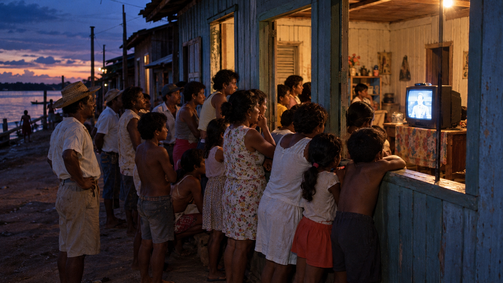{fig-alt="Residents of an Amazonian riverside community gather outside a house and watch television through its open window." width="100%"}
:::
::::

::: {.question-box}
Ask a grandparent where they first watched television, and with whom. What norms grew up around that first screen: who sat closest, who chose the channel, who was allowed to stay up late?
:::

## Cell Phone Data Tracked Malaria in Kenya and COVID-19 {.smaller}

- During a malaria outbreak in **Kenya**, public health researchers monitored the text messages sent on Kenyans' **15 million** cell phones and used them to map the spread of the disease
- Travelers were carrying malaria along **less-traveled regional routes**, not along the busy roads to and from Nairobi
- During the coronavirus pandemic, several countries used telecom data and downloaded apps to track the spread of COVID-19 once infected people were identified. Such information proved vital in concentrating control efforts (Lin and Martin 2020; Wesolowski et al. 2012)
- Where broadband is limited, people can still text. Inexpensive phones with icons, emojis, and voice recognition let people who cannot read communicate, even with people who speak another language (Jennings 2014)

::: {.question-box}
Which apps did you install during the pandemic, and what did they know about you? Schaefer asks: should officials have the right to monitor people's text messages, even to protect public health?
:::

# Social Policy and the Media: Censorship {background-color="#1B2A4A"}

::: {.takeaway}
As sharing information has become easier, governments, companies, and users have all tried harder to control it. Who should decide what counts as false, harmful, or forbidden?
:::

## Looking at the Issue: Should False Information Online Be Censored? {.smaller}

- Schaefer opens with a false claim about U.S. Civil War history. It first appeared in print, then spread online in the late 20th century with convincing images attached
- How should social media handle such misinformation? Ban it? Add a banner warning about false content? Redirect readers to authoritative sites? And **who judges** what is myth and what is fact, about the past or the present?
- President Obama decried "the wild west" of the media and called for some way of filtering for "truthiness." President Trump regularly attacked the spread of "fake news"
- British officials pressured Facebook and Google, unsuccessfully, to take down sites and posts spreading the false claim that vaccines cause autism
- In 2019 **Singapore** passed the Protection from Online Falsehoods and Manipulation Act. The government presented it as an anti-fake news measure; it remains to be seen whether the law will stifle online dissent (*The Economist* 2019d; Roose 2017)

<!-- Filtered per course rules: the content of the Civil War myth is summarized in one sentence, without its U.S. racial-history detail. -->

## Censoring the Internet Is a Problem of Scale

:::: {.columns}
::: {.column width="68%"}
- Censoring the Internet and social media is vastly challenging, even when people agree it is desirable, because of the sheer amount of material
- In the 1930s Hollywood created a code that every film had to meet. Monitors had to review only a few hundred movies a year
:::

::: {.column width="32%"}
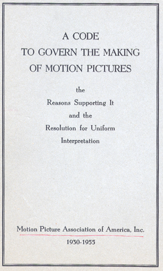{fig-alt="Cover of the Motion Picture Production Code used by the U.S. film industry." width="74%"}

::: {.small}
Motion Picture Production Code. Public domain in the United States.
:::
:::
::::
<!-- - A few years ago the U.S. State Department tried to help Iranians get around their government's censorship without offending the conservative values of the Iranian people. It filtered offensive words out of domain names -->

<!-- ::: {.fragment} -->
<!-- - The filter blocked Iranians' access to **usembassy.state.gov**, the State Department's own portal for its overseas missions (Zittrain 2008) -->
<!-- ::: -->

<!-- ::: {.fragment .question-box} -->
<!-- Why would a filter for offensive words block the U.S. embassy's own website? Read the address slowly. -->
<!-- ::: -->

## Freedom on the Net: More Sharing Has Brought More Censorship {.smaller}

:::: {.columns}
::: {.column width="50%"}
- Ironically, the spread of mass media and social media, which make sharing information easier and faster, has been accompanied by **increased censorship**
- **Freedom House**, a well-regarded nonprofit, has monitored freedom on the Internet since 2009. It weighs obstacles to access, such as infrastructure and control over Internet service providers; limits on content; and violations of user rights through surveillance, privacy, and imprisonment
- As of 2019, **two-thirds** of all Internet users lived in countries where criticism of the government, military, or ruling family was subject to censorship
- Governments increasingly use sophisticated technology to monitor citizens' social media. Mass surveillance once limited to the foremost intelligence agencies has spread to smaller and poorer states that hope to track dissidents and persecute minorities, and arrests of social media users for legitimate online activity are rising (Shahbaz and Funk 2019)
:::

::: {.column width="50%"}
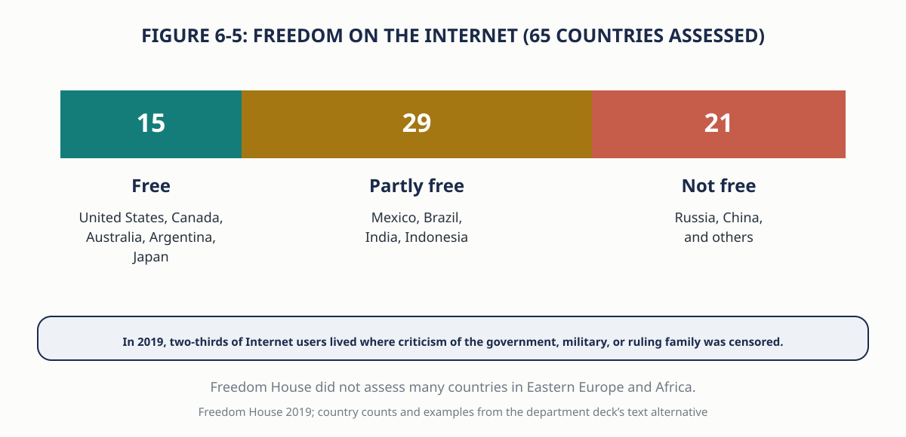{fig-alt="Of 65 countries assessed, 15 are free, including the United States, Canada, Australia, Argentina, and Japan; 29 are partly free, including Mexico, Brazil, India, and Indonesia; 21 are not free, including Russia and China."}
:::
::::

<!-- Figure 6-5 counts and examples come from the Arabic deck's text alternative, which dates the report to 2016 but cites Freedom House 2019. Two "not free" examples listed there are not named on the slide; restore them if you prefer. -->

## Applying Sociology: Culture Lag and Three Perspectives on Censorship {.smaller}

- **Culture lag** (Chapter 3) — a period of maladjustment when the nonmaterial culture is still struggling to adapt to new material conditions. Technology, the material culture, changes faster than the norms for controlling its use. Too often the result is an **anything-goes** approach to new technologies
- **Functionalists** take a generally positive view of the Internet. Its **manifest** function is to facilitate communication; its **latent** function is to empower people with few resources, from hate groups to special-interest organizations, to communicate with the masses
- **Conflict theorists** worry about those with power, whether media companies or governments, controlling what people can read
- **Interactionists** see the debate over media content as an extension of everyday life. Many of us have wondered how to stop someone close to us from antisocial behavior; interactionists ask how mass media and social media influence everyday behavior, for better or worse
- Does government use of facial recognition software threaten everyday social interaction? Reflecting that concern, and abuse by law enforcement agencies, **San Francisco** became the first major city to ban facial recognition surveillance (Conger et al. 2019)

## Initiating Policy: Cyberbullying, Companies, and Users as Censors {.smaller}

- In general, support for censorship is **weak**. 
<!-- Even with pornography, long decried, fewer and fewer people want censorship except of depictions of children (Dugan 2018) -->
- One use of censorship that does receive attention is **cyberbullying**: online harassment intended to do harm, from disparaging rumors to making confidential information public. In a 2018 survey nearly **40 percent** of middle-schoolers and **27 percent** of high-schoolers said they had been bullied. No U.S. federal law applies to bullying unless it is based on race, color, national origin, gender, disability, or religion (McClellan 2019)
- **Private companies** have more latitude. In 2017 PayPal barred users from accepting donations that promote hate, violence, and intolerance, after it emerged that the company had helped raise money for an extremist rally in Charlottesville, Virginia, that turned deadly. PayPal described its task as balancing freedom of expression against closing sites that raise funds for hate (Passache 2017)
- Online, **users** often do the censoring. YouTube and Wikipedia let users flag inappropriate or inaccurate content; Facebook lets people ban certain words from their feed; Twitter lets users remove individual tweets or block an account altogether

## Initiating Policy: Terrorist Content and a Splintering Internet {.smaller}

- Online terrorist threats, and advocacy of harmful acts or ideas associated with terrorists, pose another challenge. In 2019 a mass shooting at a Walmart in El Paso, Texas, killed 20 people and wounded 27. The shooter had taken inspiration from an attack on a New Zealand mosque that left 51 people dead. Online sites offer hints on how to maximize injury in mass shootings
- Existing laws do not make such material illegal. YouTube labels some terrorist propaganda as possibly "inappropriate or offensive to some audiences," yet viewers can click past the warning and receive recommendations for similar material. Many who find the material offensive still argue that society should not censor dissenting viewpoints
- In the United States, censorship, especially by government, is strongly opposed. A basic democratic principle holds that society is governed best when citizens have full access to information, which is partly why the digital divide draws so much attention
- As more nations issue their own restrictions, the Internet **splinters**, and the idea of a single global network that looks the same wherever you are begins to vanish (Baran 2017; *The Economist* 2019d)

<!-- ::: {.small} -->
<!-- Sober tone. The attacks are cited only for the policy question; no discussion of the attacks themselves. -->
<!-- ::: -->

<!-- ## Take the Issue with You: Censorship, Surveillance, and Safety -->

<!-- ::: {.board} -->
<!-- Which do you consider the greatest threat to society: government censorship, cybercrime, or Internet surveillance? Explain. -->
<!-- ::: -->

<!-- - How would you react if you discovered that the government was monitoring your use of media? -->
<!-- - If your safety were in jeopardy, would you be willing to accept censorship? -->

<!-- ::: {.small} -->
<!-- Answer in general terms or on an anonymous slip. No one is asked about their own accounts or posts. -->
<!-- ::: -->

# Media in Your Life and Your Field {background-color="#1B2A4A"}

::: {.takeaway}
What looked like personal habit, which app you open first, whom you believe, what never reaches your screen, follows patterns of ownership, targeting, access, and norms. You now have names for them.
:::

## Turkle's Observations Explained with the Chapter's Concepts {.smaller}

::: {.board}
Use the chapter's vocabulary to explain what Turkle observed.
:::

- "I would rather text than talk": the **interactionist** concern with how media reshape everyday behavior; Goffman's impression management (Chapter 4) is easier when you can edit before you send
- "We are forever elsewhere," and phubbing at the table: the media's **impact on social behavior** (Table 6-2)
- "A tribe of one, loyal to our own party": **egocasting**, reinforced by the **filter bubble**
- Gmail searched "for clues for how to best sell to you": the **segmented audience** and the **promotion of consumption**
- "Digital doubles," "archived forever," "under a kind of surveillance": **media monitoring** and the censorship and surveillance debate in the Social Policy section
- Now argue two ways. **Functionalist:** constant connection builds social capital across distance. **Conflict:** who owns the record of your digital double, and who profits from it?

## Taking Sociology to Work: Lindsey Wallem, Social Media Consultant {.smaller}

- Wallem majored in sociology at DePaul University because she wanted to help people, perhaps as a social worker for a nonprofit
- In her junior year a political science professor offered extra credit for campaign work. At the Obama headquarters in Chicago she joined the **New Media** department, using Facebook and MySpace to reach voters, which was groundbreaking at the time
- After graduating in 2008 she pitched social media services to nonprofits. For a coalition working on affordable housing she live-tweeted city council meetings for supporters who could not attend
- She uses her sociology training daily: statistics to read campaign metrics ("more than just counting the number of 'Likes'"), and a **Visual Sociology** capstone that taught her to tell a story through photography and video
- She also teaches an online social media course to high school students through Northwestern University, starting with sociological theory

::: {.question-box}
Have you ever used social media to take part in an online campaign, by donating, attending an event, or sharing? How might you use social media in your own career?
:::

## Sociology in Your Major

- **Medicine:** media campaigns carried pandemic public health projects, and text messages mapped malaria in Kenya. The narcotizing dysfunction is a health-communication problem too
- **Engineering:** the digital divide is partly infrastructure. Broadband capacity, rural coverage, and energy costs decide who can join the global economy
- **Business:** product placement, global brands, segmented audiences, micro-targeting, and two-way relationship marketing are the vocabulary of your marketing courses
- **Computer science:** search personalization builds filter bubbles, facial recognition inherits the bias in its training labels, and moderation tools decide who does the censoring

<!-- Instructor enrichment. -->

## Before You Leave {.smaller}

- **Mass media** carry messages to widespread audiences; **social media** let people create and share content and join networks. The line between them is not finely drawn
- **Functionalists:** the media entertain, socialize, enforce norms, confer status, and promote consumption. The **narcotizing dysfunction** leaves audiences numb
- **Conflict theorists:** **gatekeeping**, **dominant ideology**, stereotypes, and the **digital divide** reflect and deepen social divisions; search filters can enclose us in a bubble
- **Interactionists:** social media build **social capital** and friendship networks, invite **egocasting**, and bring tools such as facial recognition with new risks of bias
- The **audience** is increasingly **segmented** and targeted; **opinion leaders** and **influencers** shape its choices, and fake news targets its biases
- The media's **global reach** creates a global village, or a global torrent, but connection is unequal
- **Censorship** illustrates **culture lag**: more sharing has brought more control, by governments, companies, and users
<!-- - **Feminists:** media images of the sexes are unrealistic, stereotypical, and limiting, and women face a gender digital divide -->

::: {.small}
Next: Chapter 7, Deviance, Crime, and Social Control.
:::
