# Peter Moskos: A Sociologist in the Baltimore Police {background-color="#1B2A4A"}

::: {.takeaway}
To study crime firsthand, a sociologist joined the police. His patrol raises the questions in this chapter: who breaks rules, who enforces them, and who gets counted.
:::

## What Peter Moskos Learned in 20 Months as a Baltimore Police Officer

:::: {.columns}
::: {.column width="72%"}
- Sociologist **Peter Moskos** entered Baltimore's police academy to study policing. A new commissioner challenged him: "Why don't you want to be a cop for real?" So he became one
- For **20 months** he patrolled the Eastern District, answering everything from disorderly conduct to a 12-person shooting. His book *Cop in the Hood* (2008) is an **ethnographic study** (Chapter 2)
- His central point: "Police don't deal with a random cross-section of society." The people officers meet are not typical of the neighborhood, and "the noncriminal public, the routine, and the working folks all get short shrift"
:::

::: {.column width="28%"}
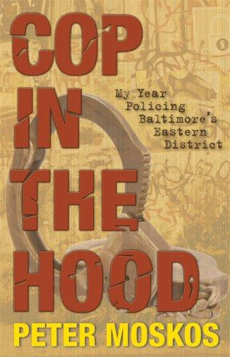{fig-alt="Cover of Cop in the Hood: My Year Policing Baltimore's Eastern District, by Peter Moskos." style="max-height: 420px !important;"}

::: {.small}
Princeton University Press, 2008.
:::
:::
::::

::: {.question-box .smaller}
An officer's picture of a neighborhood comes from the calls the officer answers. What would that picture leave out of your own neighborhood?
:::

<!-- Filtered per course rules: Moskos's list of ethnically identified businesses, and the #BlackLivesMatter survey figures from Schaefer's chapter opener. -->

## Conformity or Deviance Depends on the Reference Group

:::: {.columns}
::: {.column width="62%"}
- **Binge drinking** violates a school's standards and endangers health, so it is **deviant**. To a peer group that expects it, it is **conforming**
- "Conformity" can mean mindless imitation, like executives all in gray suits, or being a cooperative "team player"
- A police officer who uses excessive force may be seen by some colleagues as someone "who has their back," and by others as making public safety harder
:::

::: {.column width="38%"}
{fig-alt="A blue car drifting on a track inside clouds of white and pink tyre smoke." style="max-height: 400px !important;"}

::: {.small}
A car drifting in tyre smoke. Wikimedia Commons, CC0.
:::
:::
::::

::: {.question-box}
A young man drifts a car in an empty lot while his friends film it. To the friends, is he deviant or conforming? To the traffic police? To his mother?
:::

<!-- Instructor enrichment: the drifting (tafheet) question. -->

<!-- ## What This Chapter Asks -->

<!-- - What is **deviance**, and what are its consequences? -->
<!-- - What causes **crime**? -->
<!-- - How does society control people's behavior, convincing us to conform to both unwritten rules and formal **laws**? -->

<!-- ::: {.small} -->
<!-- Deviance and stigma, then conformity and obedience, informal and formal social control, and the law. Next, five perspectives on why deviance happens. Then crime: six types, how it is measured, and how rates compare across countries. The social policy section considers the death penalty. -->
<!-- ::: -->

# What Is Deviance? {background-color="#1B2A4A"}

::: {.takeaway}
Sociologists use *deviance* for any violation of a group's standards. What counts as deviant depends on the group, the era, and who has the power to define it.
:::

## Deviance Is Behavior That Violates a Group's Standards

- **Deviance** — behavior that violates the standards of conduct or expectations of a group or society. To sociologists it does not mean perversion or depravity
- Being late for class is deviant; so is wearing jeans to a formal wedding. By this definition, **we are all deviant from time to time** (Best 2004)
- Deviance goes far beyond crime. An official who takes a bribe and a student who cuts class have both broken norms
- Deviance is **not always negative**:
  - A manager who turns down a relative's *wasta* request and hires the best-qualified applicant is deviating from what the family expects
  - A couple who choose a small, simple wedding when relatives expect a lavish one are deviating from family norms
  - A student who refuses to share answers in the class group chat during an online quiz is deviating from the group's norm
  - A police officer who blows the whistle on corruption or brutality in the department is deviating from its norms too

<!-- Instructor enrichment: the three wasta / wedding / group-chat sub-bullets replace Schaefer's exclusive-club example. Keep one and comment out the other two. The police whistleblower is Schaefer's. -->

<!-- ::: {.question-box} -->
<!-- Schaefer asks: if your friends or teammates violate a social norm, is their behavior deviant? At what point does deviance begin? -->
<!-- ::: -->

## Deviance Is Socially Defined and Changes over Time

:::: {.columns}
::: {.column width="66%"}
- What counts as deviant is set by **social definition**, in a particular society at a particular time
- Usually the people with the most **status and power** decide what is acceptable
- **Smoking:** doctors warned about tobacco from 1964, yet smoking stayed acceptable for decades, partly because of the power of tobacco farmers and manufacturers. A long public health campaign made it more deviant
- **Tattoos:** long banned for U.S. military recruits. The Navy lifted its ban in 2012 and the Army in 2015, with limits on visibility and content
:::

::: {.column width="34%"}
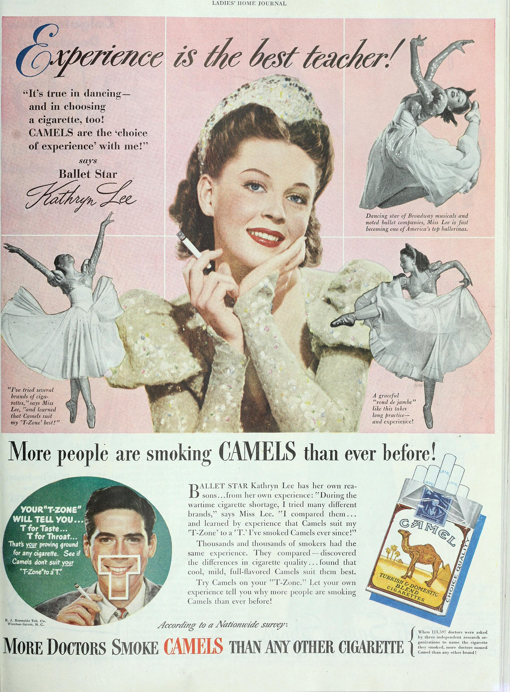{fig-alt="A 1948 magazine advertisement for Camel cigarettes featuring a ballet dancer, with the slogan More doctors smoke Camels than any other cigarette." style="max-height: 640px !important;"}

::: {.small}
Camel advertisement, 1948: "More doctors smoke Camels." Internet Archive Book Images.
:::
:::
::::
<!-- - ***Reefer Madness*** (1936) was made to teach parents that marijuana was "public enemy no. 1." It became a midnight cult classic, and in the 1980s it was shown on college campuses to raise money for initiatives to legalize marijuana (E. Schaefer 1999) -->

## Deviant Where, When, and to Whom? Sort the Cases

::: {.board}
For each act, name a setting where it is ordinary and a setting where it is deviant. Then name who decides.
:::

- Eating a sandwich on a public street at noon, during the daylight hours of Ramadan
- Answering a phone call in a lecture
- Wearing gym clothes to a wedding
- Smoking inside a café in 1995, and today
- Using AI to brainstorm an essay with disclosure, and using AI during an exam
- Disagreeing openly with a senior colleague in a meeting

<!-- ::: {.fragment .question-box} -->
<!-- In which cases did the act stay the same while the rule changed? In which did only the setting change? Who had the authority to apply the label? -->
<!-- ::: -->

<!-- Instructor enrichment. Eating in public during Ramadan fasting hours is a legal offense in Kuwait; verify the current penalty before stating it. The AI case comes from the syllabus project prompts. -->

## Goffman's Concept of Stigma {.smaller}

:::: {.columns}
::: {.column width="74%"}
- Some people are cast in **negative social roles** because of physical or behavioral traits. Once labeled, they struggle to present a positive image and may lose self-esteem
- **Stigma** — Erving Goffman's term for the labels society uses to devalue members of certain social groups, such as "short people" or "redheads" (Goffman 1963)
<!-- - After the 2012 shooting at Sandy Hook Elementary School, rumors that the shooter had an untreated mental disorder led many people to stigmatize **all** people with mental illness as potentially violent -->
<!-- - The evidence shows the opposite. The vast majority of people with psychiatric disorders do not commit violent acts, and only **4 percent** of violent crimes in the United States can be attributed to people with mental illness (Lu and Temple 2019; R. Friedman 2012) -->
- In many families, a visit to a psychiatrist is kept quiet for fear the label will follow the patient, and even the patient's siblings, into marriage proposals. The stigma covers a whole category of people, whatever their condition
- In 2020, people who tested positive for COVID-19, and sometimes their whole families, were avoided even after they recovered. Schaefer lists "COVID-19 survivor" among the labels that can stick to a person
- Which jobs carried a stigma for young Kuwaitis a generation ago, such as barista or shop cashier? Which still do? The work stayed the same; did the label?
:::

::: {.column width="26%"}
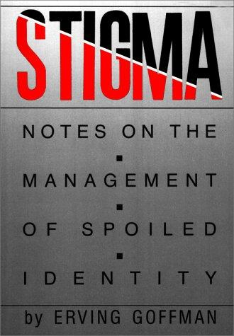{fig-alt="Cover of Stigma: Notes on the Management of Spoiled Identity, by Erving Goffman." style="max-height: 400px !important;"}

::: {.small}
Goffman, *Stigma* (1963).
:::
:::
::::

<!-- Instructor enrichment: the psychiatrist, COVID-19, and jobs bullets replace the Sandy Hook example. Keep one and comment out the other two. Only the "COVID-19 survivor" label is from Schaefer; the other two are general observations, not research findings, so present them as prompts for discussion. -->

<!-- ## Stigma, Appearance, and the Beauty Myth {.smaller} -->

<!-- - In the United States and many other cultures, unrealistic standards of appearance place a huge strain on people, especially women and girls -->
<!-- - **Beauty myth** — journalist Naomi Wolf's (1992) term for an exaggerated ideal of beauty, beyond the reach of all but a few women, which has unfortunate consequences. To shed a "deviant" image, many women and girls become consumed with adjusting their appearance. Yet what is deviant in one culture may be celebrated in another -->
<!-- - People regarded as ugly or obese may not advance as rapidly as their abilities permit. Both overweight and anorexic people are assumed to be weak in character, slaves to their appetites or to media images. Goffman calls this a **"spoiled identity"** -->
<!-- - What counts as disfigurement is a matter of interpretation. Many of the **18 million** cosmetic procedures done each year in the United States are performed on women who would be defined objectively as having a normal appearance -->
<!-- - Men lack confidence in their appearance too: the number of males choosing cosmetic procedures has risen sharply (American Society of Plastic Surgeons 2019) -->

<!-- ::: {.question-box} -->
<!-- Cosmetic clinics advertise heavily on Instagram here, often with before-and-after photos. Whose standard defines a "normal" face or body: family, influencers, the clinics, or the people in the posts? -->
<!-- ::: -->

<!-- Instructor enrichment: the clinic question. Discussion in general terms; no one comments on anyone's appearance. -->

## Prestige Symbols, Stigma Symbols, and Labels That Stick

:::: {.columns}
::: {.column width="64%"}
- Labels such as "ex-convict," "recovering alcoholic," or "ex-mental patient" can stick for life, long after the behavior has stopped
- Goffman: a **prestige symbol** draws attention to a positive part of one's identity, such as a wedding band. A **stigma symbol** discredits it, such as a criminal conviction
- Stigma symbols are not always visible, but they can become public through records or social media
- Some deviance stigmatizes a person; some carries no real penalty
:::

::: {.column width="36%"}
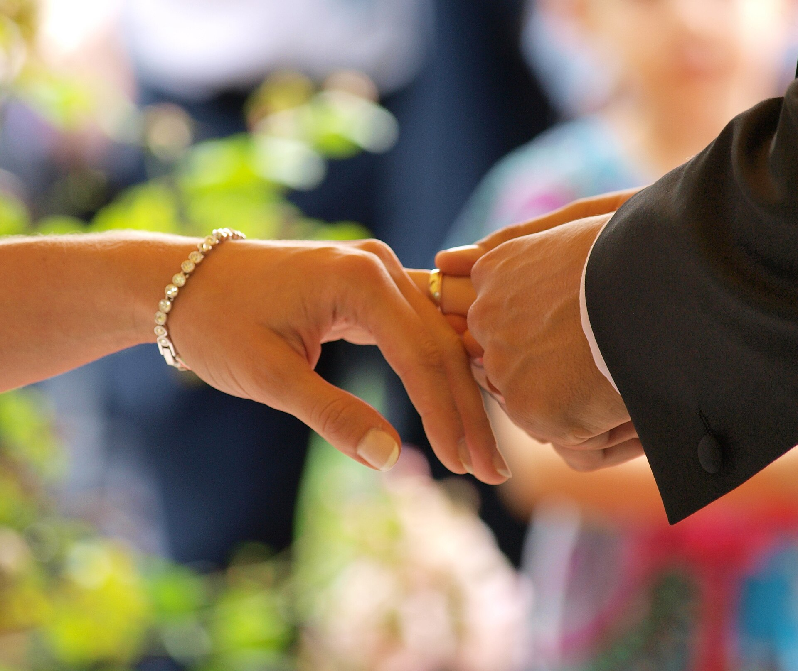{fig-alt="A groom placing a wedding ring on the bride's finger." style="max-height: 460px !important;"}

::: {.small}
A wedding band, Goffman's example of a prestige symbol. Petar Milošević, CC BY-SA 4.0.
:::
:::
::::

<!-- ::: {.question-box} -->
<!-- Prestige symbol or stigma symbol? A white coat; a graduation ring; the criminal record certificate a job application asks for; a hospital wristband; a car plate with a very low number. When could the same item switch sides? -->
<!-- ::: -->

<!-- Instructor enrichment: the classification question. -->

## Technology Redefines the Norms of Online Behavior

- New technology creates situations with no norms yet. Early internet anonymity made harsh comments and chat-room hogging common, and people now call for formal rules (Chapter 6)
- Some deviant uses of technology are crimes, though not everyone sees them that way. Downloading copyrighted music is **widely accepted**, and despite industry campaigns, **no social stigma** attaches to it

::: {.takeaway}
Deviance is a complex concept. Sometimes it is trivial, sometimes profoundly harmful. Sometimes society accepts it, and sometimes society soundly rejects it.
:::

## Which Online Behaviors Carry a Stigma? Rank the Cases

::: {.board}
Rank these from "nobody cares" to "people would cut you off." Then mark the ones that are illegal.
:::

1. Streaming a football match through an unofficial link
2. Sharing a friend's password for a streaming service
3. Screenshotting a private chat and posting it to a group
4. Leaving a family WhatsApp group without a word
5. Posting a fake five-star review for a cousin's restaurant
6. Reading a message and not replying for three days

<!-- ::: {.fragment .question-box} -->
<!-- Does your stigma ranking match your legality ranking? Where they disagree, which one do people follow? -->
<!-- ::: -->

<!-- Instructor enrichment. -->

# Social Control {background-color="#1B2A4A"}

::: {.takeaway}
Every group has ways to keep its members in line, from a raised eyebrow to a prison sentence. Most of the time we comply without noticing.
:::

## Social Control Operates at Every Level of Society

- **Social control** — the techniques and strategies for preventing deviant human behavior in any society
- Laws, dress codes, organizational bylaws, course requirements, and the rules of sports and games all express social norms (Chapter 3)

::: {.center}
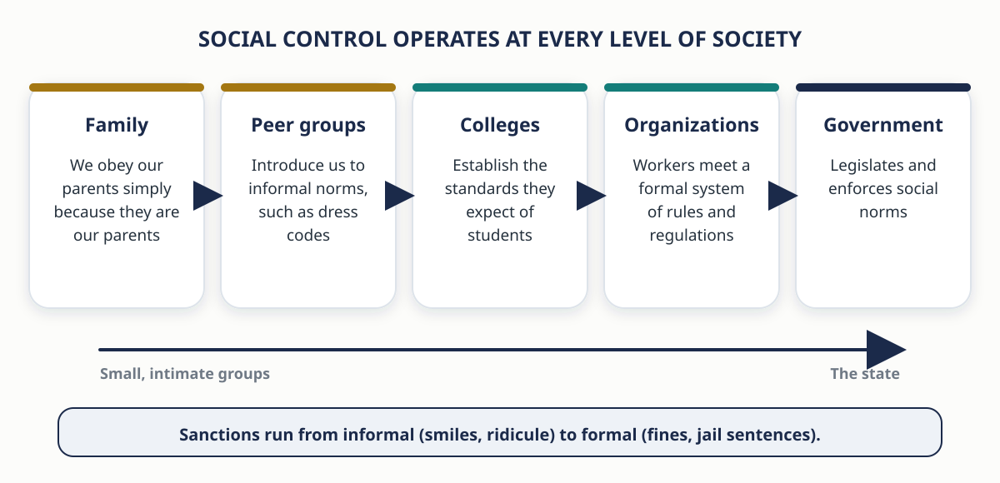{fig-alt="Five cards from small groups to the state: in the family we obey our parents because they are our parents; peer groups introduce informal norms such as dress codes; colleges establish standards for students; organizations impose a formal system of rules and regulations; government legislates and enforces social norms. Sanctions run from informal to formal."}
:::

## Sanctions and Competing Messages About How to Behave

:::: {.columns}
::: {.column width="55%"}
- Most of us follow basic norms without thinking: we obey police officers and move to the back of the elevator. That is effective **socialization**
- **Sanctions** — penalties and rewards for conduct concerning a social norm. They can be **informal**, such as ridicule, or **formal**, such as fines and jail
- People often get **competing messages**: the law says one thing, friends or co-workers encourage another
- The recent changes and increased enforcement of traffic laws in Kuwait.
:::

::: {.column width="45%"}
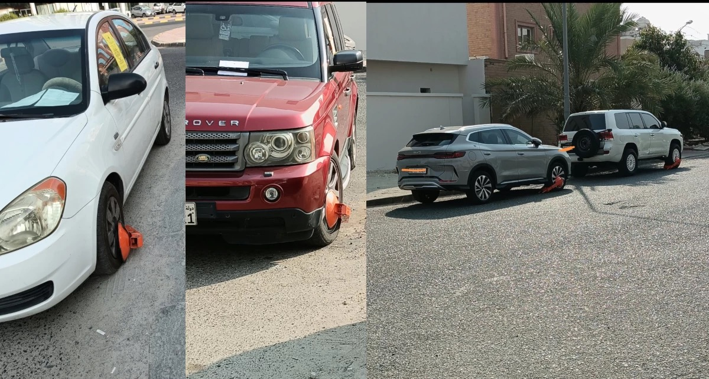{fig-alt="Three photos of cars fitted with orange wheel clamps: a white sedan, a red SUV, and two cars parked along the side of a residential street in Kuwait." style="max-height: 400px !important;"}

::: {.small}
Clamped cars on residential streets in Kuwait, October 2026.
:::
:::
::::

<!-- ::: {.question-box} -->
<!-- The law says no phone while driving. Your group chat expects a reply within two minutes. Which message wins on the Gulf Road at 5 p.m.? -->
<!-- ::: -->

<!-- Filtered per course rules: one category omitted from Schaefer's list of anti-discrimination laws. Instructor enrichment: the driving question. -->

## Functionalist and Conflict Views of Social Control

:::: {.columns}
::: {.column width="55%"}
- **Functionalists:** a society could not function if large numbers of people defied its norms
- **Conflict theorists:** the successful functioning of a society consistently benefits the powerful at others' expense
- Their evidence: in the United States, resisting norms was necessary to win independence, end slavery, win women the vote, and secure civil rights
:::

::: {.column width="45%"}
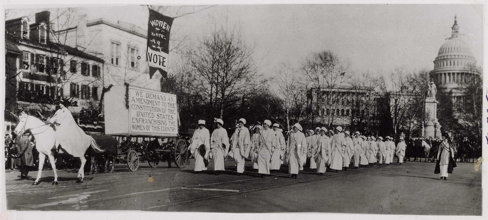{fig-alt="The opening of the 1913 Woman Suffrage Procession in Washington, D.C., with marchers, banners, and a woman on horseback leading the parade." style="max-height: 360px !important;"}

::: {.small}
Woman Suffrage Procession, Washington, D.C., 1913. U.S. National Archives, public domain.
:::
:::
::::

<!-- ::: {.question-box} -->
<!-- Name a change, in Kuwait or anywhere, that began when some people refused to follow a norm. Were they deviant at the time? Are they deviant now? -->
<!-- ::: -->

## Milgram Distinguished Conformity from Obedience

:::: {.columns}
::: {.column width="55%"}
- **Conformity** — going along with peers, people of our own status who have no special right to direct our behavior (Milgram 1975)
- **Obedience** — compliance with higher authorities in a hierarchical structure
- A military recruit **conforms** to other recruits' habits and language, and **obeys** superior officers
:::

::: {.column width="45%"}
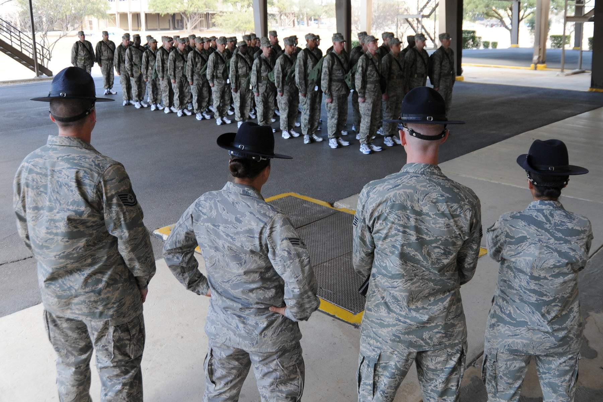{fig-alt="Four training instructors in campaign hats stand facing a formation of recruits." style="max-height: 400px !important;"}

::: {.small}
Recruits in formation facing their instructors. Michael Tolzmann, U.S. Air Force, public domain.
:::
:::
::::

<!-- ::: {.question-box} -->
<!-- A first-year medical student starts talking about patients the way older students do. On rounds, the same student follows a consultant's instruction. Which is conformity, and which is obedience? -->
<!-- ::: -->

<!-- Schaefer's example is "students will conform to the drinking behavior of their peers"; the slide generalizes it. -->

## The Milgram Experiment: Teachers, Learners, and a Shock Generator

:::: {.columns}
::: {.column width="60%"}
- Milgram recruited ordinary people in New Haven, from postal clerks to engineers, for a Yale study of the effects of **punishment on learning**
- An experimenter in a gray technician's coat ran a rigged draw: the real subject was always the "**teacher**," and Milgram's associate played the "**learner**"
- The teacher sat at a "shock generator" with **30** switches from **15** to **450** volts and was told to raise the voltage after every wrong answer
- **The learner received no shocks.** The teacher did not know that
:::

::: {.column width="40%"}
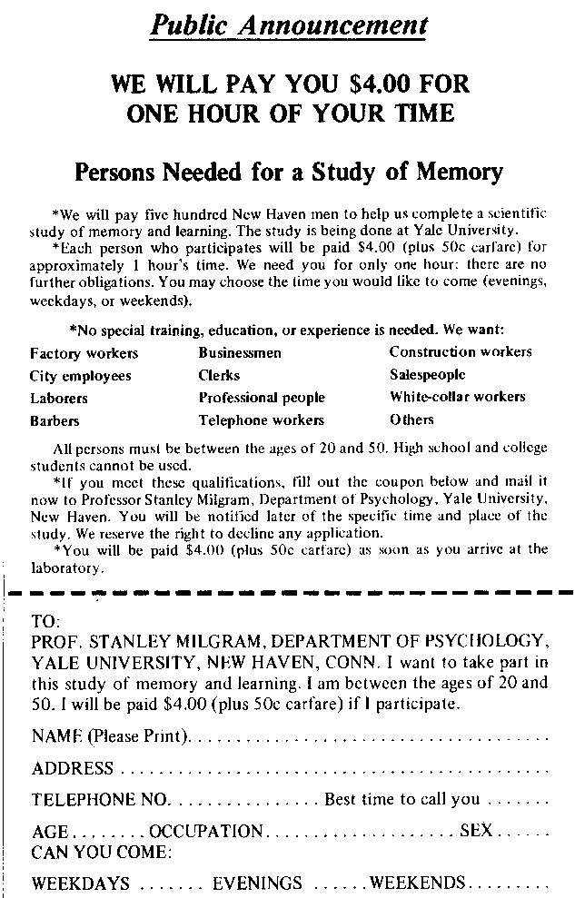{fig-alt="Milgram's newspaper advertisement: We will pay you $4.00 for one hour of your time. Persons needed for a study of memory. It lists factory workers, city employees, laborers, barbers, businessmen, clerks, professional people, telephone workers, construction workers, salespeople, and white-collar workers." style="max-height: 380px !important;"}

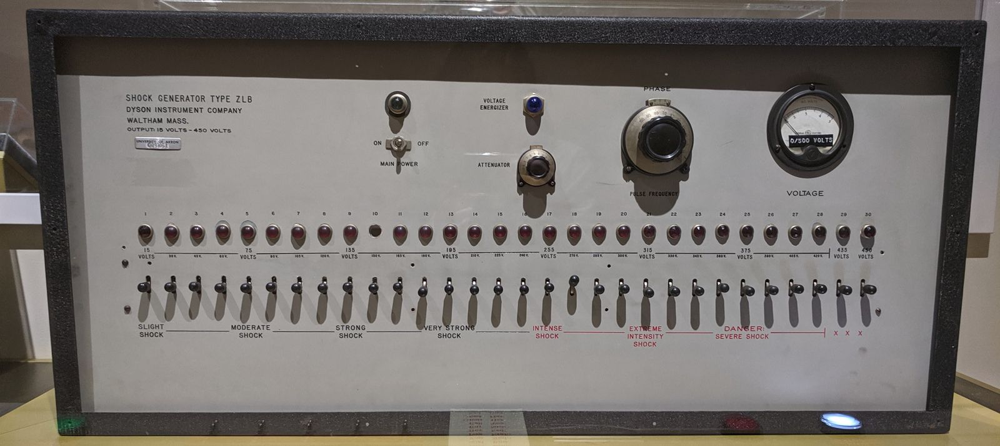{fig-alt="The original shock generator: a gray panel with a row of 30 lever switches labeled from slight shock to danger, severe shock." style="max-height: 200px !important;"}

::: {.small}
Milgram's recruitment ad and the original shock generator.
:::
:::
::::

## Predict: How Many Teachers Obeyed to the End? {.smaller}

::: {.center}
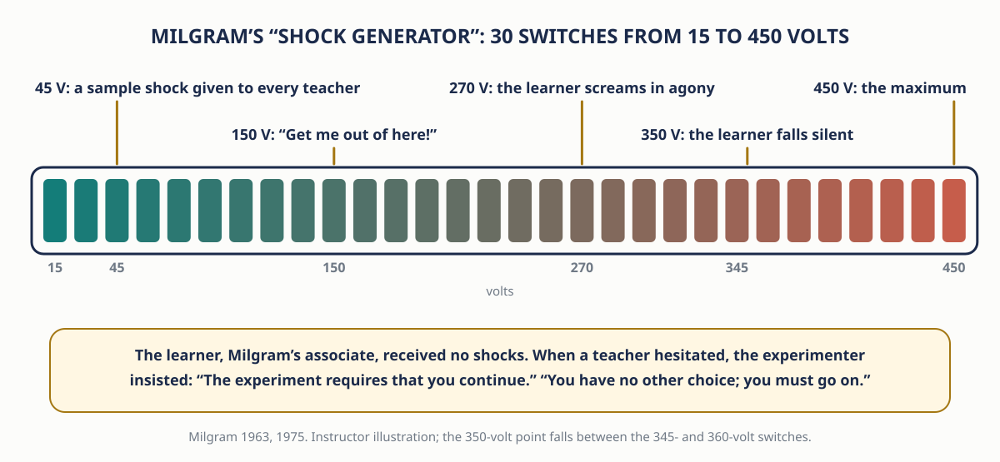{fig-alt="A strip of 30 switches from 15 to 450 volts. At 45 volts every teacher received a sample shock; at 150 volts the learner cried out, Get me out of here; at 270 volts he screamed in agony; at 350 volts he fell silent; 450 volts was the maximum. The learner received no shocks, and the experimenter insisted the teacher continue."}
:::

::: {.question-box}
Out of 100 ordinary people in the teacher's chair, how many would you predict become "obedient subjects"?
:::

::: {.fragment}
- A sample of **psychiatrists** predicted that virtually all subjects would refuse. Only a "pathological fringe" of **less than 2 percent** would continue to the maximum level
- In fact, **almost two-thirds** of participants fell into the category of "obedient subjects" (Milgram 1975:19–23)
:::

## Why Did Milgram's Subjects Obey?

- The subjects were not unusually sadistic. Few seemed to enjoy giving the shocks
- Milgram pointed to the experimenter's **social role**. We are used to obeying **impersonal authority figures** marked by a title (professor, doctor) or a uniform (the technician's coat)
- Subjects **shifted responsibility** to the authority: "If it were up to me, I would not have administered shocks"

::: {.fragment}
- **Would people still obey today?** In 2006 **Jerry Burger** repeated part of the study with undergraduates and found **70 percent** full obedience, not significantly different from Milgram's **82.5 percent** at the same point (Burger 2009, 2014)
- **Virtual reality** versions agree: teachers feel similar stress and still largely obey (Cornet and Van Gelder 2020; Slater et al. 2006)
:::

## The Interactionist Reading: Physical Distance and 15-Volt Steps

:::: {.columns}
::: {.column width="66%"}
- When teachers were moved physically **closer** to the learner, fewer gave shocks
- In one version, the learner refused at 150 volts to touch the shock plate. **40 percent** of teachers stopped; **30 percent** forced his hand onto it
- The voltage rose **15 volts at a time**, so the experimenter was negotiating with the teacher step by step
- Obedience would probably have been far lower had the first order been 450 volts (Allen 1978; Katovich 1987)
:::

::: {.column width="34%"}
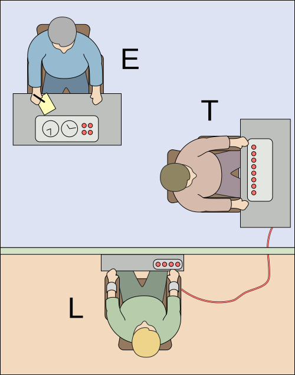{fig-alt="Diagram of the standard setup: the experimenter and the teacher sit in one room; the learner sits in a separate room, out of sight." style="max-height: 420px !important;"}

::: {.small}
Standard setup: experimenter (E) and teacher (T) in one room, learner (L) behind a wall. Fred the Oyster, CC BY-SA 4.0.
:::
:::
::::

<!-- ::: {.question-box} -->
<!-- Where else do small steps take people somewhere they would never go in one jump? Think of a group project that slowly became one person's job. -->
<!-- ::: -->

<!-- ## Milgram's Purpose: Nazi Germany and the Abu Ghraib Photographs -->

<!-- - Milgram launched his study to understand how Germans took part in the annihilation of **6 million Jews** and millions of other people during World War II -->
<!-- - Long after the study, he suggested that if death camps like Nazi Germany's were set up in the United States, "one would be able to find sufficient personnel for those camps in any medium-sized American town" -->
<!-- - Many people questioned the remark. Then, in 2004, photographs from Iraq's **Abu Ghraib** prison showed U.S. military guards humiliating and torturing Iraqi prisoners. They recalled the experiment Milgram had run two generations earlier (Chapter 5 connected the same case to Zimbardo's mock prison) -->
<!-- - Under conducive circumstances, otherwise normal people can and often do treat one another inhumanely (CBS News 1979; Hayden 2004; Zimbardo 2007a) -->

<!-- ## Burger's Replication and Virtual Reality Versions Confirm Milgram {.smaller} -->

<!-- - In **2006**, with additional safeguards for participants' welfare, psychologist **Jerry Burger** repeated part of the experiment with college undergraduates. To avoid bias he screened out students who had heard of Milgram's study -->
<!-- - The results were startlingly similar. At the most comparable point in the two studies, Burger measured **70 percent** full obedience, lower than, but not significantly different from, the **82.5 percent** Milgram measured two generations earlier (Burger 2009, 2014) -->
<!-- - **Virtual reality (VR)** now lets researchers re-create the experiment. Teachers wearing 3D stereo glasses gave "electric shocks" to a "virtual trainee" who made errors. In some versions they only heard the trainee respond; in others they saw the response -->
<!-- - The teachers felt **levels of stress similar** to those Milgram found, and they still largely obeyed, carrying on with a task they clearly found unpleasant -->
<!-- - VR can re-create real-life situations far more dramatically than pencil-and-paper questionnaires about hypothetical situations, so it may serve other studies of social behavior (Cornet and Van Gelder 2020; Slater et al. 2006) -->

## Use Your Sociological Imagination: Would You Have Obeyed?

::: {.board}
If you were a participant in Milgram's research, how far do you think you would go in carrying out orders?
:::

- Schaefer asks: do you see an ethical problem with the experimenter's manipulation of the subjects? Check it against Chapter 2's ethical duties, including informed consent
- Which condition would make you most likely to stop: a victim in the same room, bigger jumps in voltage, or an experimenter without a coat?
- Where in your future field will someone with a title or a uniform tell you to continue?

## Informal and Formal Social Control

- **Informal social control** — used casually to enforce norms: a smile, laughter, a raised eyebrow, ridicule
- Many adults treat spanking or slapping children as proper informal control. Child development specialists say it teaches children to solve problems through violence, and research links it, even alongside warm parenting, to adolescent social conduct disorder
- **Formal social control** — carried out by authorized agents such as police, judges, school administrators, and employers. Often a **last resort** when socialization and informal sanctions fail
- Informal control can **undermine** formal control, encouraging people to break norms

## Informal or Formal? Sort the Sanction

::: {.board}
Classify each sanction as informal or formal.
:::

:::: {.columns}
::: {.column width="50%"}
1. An aunt's comment about your weight at a family lunch
2. A speed-camera fine that appears on your phone
3. The class group chat goes quiet after your message
4. A professor deducts marks for a late assignment
:::

::: {.column width="50%"}
5. "What will people say?" (*kalam al-nas*)
6. A mall security guard asks you to stop filming
7. Friends cheer when you finally quit vaping
8. A diwaniya laughs about someone's new car
:::
::::

<!-- ::: {.fragment .question-box} -->
<!-- A friend offers to "call someone" about your traffic violation. What kind of control is that, and what does it do to the formal kind? -->
<!-- ::: -->

<!-- Instructor enrichment. The last case illustrates Schaefer's point that informal social control can undermine formal social control. Keep it hypothetical. -->

## Formal Social Control: The Death Penalty and Surveillance

:::: {.columns}
::: {.column width="64%"}
- The **death penalty** is meant to deter others as much as to punish. Researchers have not been able to establish what deterrent effect, if any, it has
- After **September 11, 2001**, the United States expanded surveillance at airports and high-rise buildings and asked citizens to report suspicious behavior (Monahan 2011)
- Civil rights advocates warned this would encourage stereotyping of **Muslims and Arab Americans**. There is a clear trade-off between surveillance and **privacy**
:::

::: {.column width="36%"}
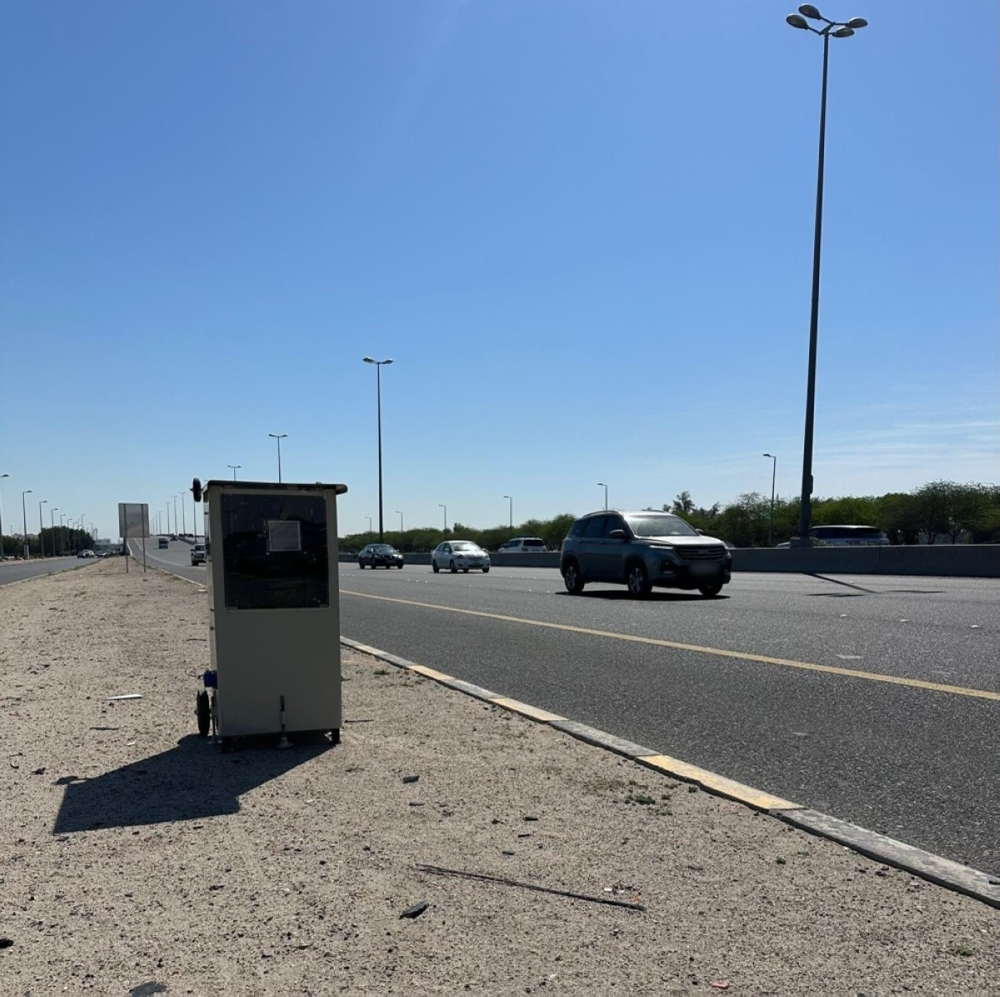{fig-alt="A portable, battery-powered speed camera on the sandy shoulder of a Kuwaiti highway as cars pass." style="max-height: 400px !important;"}

::: {.small}
A portable "Rased" speed camera on a Kuwaiti highway, 2025. *Kuwait Times*.
:::
:::
::::

::: {.question-box}
Speed cameras, mall CCTV, and the location data on your phone: which did you agree to, and which were simply installed?
:::

<!-- Instructor enrichment: the camera question. Cut from Schaefer for length: solitary confinement in U.S. prisons (100,000 inmates in 2016; Obama's 2016 order). -->

<!-- ## Box 7-1: Gun Control in the United States {.smaller} -->

<!-- - About **40 percent** of U.S. households have a firearm, and the Second Amendment guarantees the "right of the people to keep and bear arms." Owning a gun is **not a deviant act** in U.S. society -->
<!-- - Support for stricter control has **declined**: **67 percent** in 2000 put controlling gun ownership ahead of gun rights, **53 percent** in 2019. In 2013, the year after Sandy Hook, states enacted **109** gun laws; **70** loosened restrictions and **39** tightened them. No federal funds supported firearms research from **1996 until 2020** -->
<!-- - **Conflict view:** powerful groups can dominate lawmaking against the will of the majority. The NRA (founded 1871) has over **4 million** members, with 4 to 5 million more in state rifle associations; the Brady Campaign to Prevent Gun Violence has **50,000** -->
<!-- - **Interactionist view:** gun rights groups frame the issue for their members as **civil rights**, not safety or crime -->
<!-- - **Public health view:** about **40,000** Americans die each year from gun violence, by suicide, homicide, or accident. Researchers propose safer guns: a loaded indicator, a magazine latch, or a user code -->
<!-- - After a 2018 school shooting in Parkland, Florida, left 17 dead, students organized lobbying and walkouts in the **#MarchForOurLives** movement -->

<!-- ::: {.question-box} -->
<!-- Schaefer asks: what research should sociologists carry out on gun ownership, and what questions should they pose? -->
<!-- ::: -->

# Law and Society {background-color="#1B2A4A"}

::: {.takeaway}
Some norms matter so much that a society writes them into law. Sociologists study lawmaking as a social process that shows whose values prevail.
:::

## Law Is Governmental Social Control

:::: {.columns}
::: {.column width="58%"}
- **Law** — governmental social control (Black 1995). Some laws apply to everyone, such as the ban on murder; others apply to particular groups or institutions
- Sociologists treat lawmaking as a **social process** that reflects changing standards of right and wrong (Schur 1968)
- The legal order reflects the values of **those in authority**, so making a law means choosing among competing values
- Laws without public support behind them are **hard to enforce**
:::

::: {.column width="42%"}
{fig-alt="Members of Kuwait's National Assembly seated at the presidium table during an early session in 1963." style="max-height: 360px !important;"}

::: {.small}
Kuwait's National Assembly in session, 1963. Hassan Hamdy Wahidy, public domain.
:::
:::
::::

<!-- ::: {.question-box} -->
<!-- Name one law in Kuwait that applies to everyone, one that applies to a particular category of people, and one that governs an institution. -->
<!-- ::: -->

<!-- Instructor enrichment: the Kuwait question. -->

<!-- - **Marijuana:** most U.S. adults polled support its legal use for medical purposes, yet the federal government treats all use as illegal, a position the Supreme Court upheld in 2005. States have moved anyway (Figure 7-1): -->

<!-- | Status of state law on marijuana (Figure 7-1) | Number | -->
<!-- |---|---| -->
<!-- | Personal possession and consumption by adults allowed | 11 states and the District of Columbia | -->
<!-- | Use authorized for a wide range of medical purposes | 22 states | -->
<!-- | No provision for legal medical use | 17 states | -->

<!-- Filtered per course rules: one example omitted from Schaefer's list of contested laws. Figure 7-1 counts are from the Arabic deck's text alternative and match Schaefer's text. -->

## Which Laws Are Likely to Change Next?

::: {.board}
Schaefer: law reflects changing standards of right and wrong. Which laws do you think are likely to change soon because social standards are changing?
:::

:::: {.columns}
::: {.column width="66%"}
- Start with technology that arrived faster than its rules: e-scooters, drones, delivery-bike riders, deepfake images, AI in coursework
- Which rule in daily life here is widely ignored because few people support it? What would it take to enforce it: more cameras, higher fines, or a change in opinion?
- Schaefer also asks: should some illegal drugs be decriminalized? Why or why not?
:::

::: {.column width="34%"}
{fig-alt="A muddy rental e-scooter, missing its rear wheel, propped against a riverside railing after being pulled out of the river." style="max-height: 440px !important;"}

::: {.small}
A rental e-scooter recovered from the river Main, Frankfurt, 2021. Matti Blume, CC BY-SA 4.0.
:::
:::
::::

<!-- Instructor enrichment: the first two prompts. Filtered per course rules: one of Schaefer's two examples of recent legal change. -->

## Socialization and Hirschi's Control Theory

- **Socialization** is the main source of conformity. We have **internalized** norms, and we want to be seen as loyal, cooperative, and responsible
- **Control theory** — our connection to members of society leads us to systematically conform. For **Travis Hirschi**, bonds to family, friends, and peers keep us following norms (Hirschi 1969)
- The media focus on crime, but **most members of most societies conform** to basic norms (Schmalleger 2020)

::: {.question-box}
Think, privately, of a rule you were tempted to break this week: skipping a lecture, or running an empty red light at 3 a.m. What stopped you: the fine, or the thought of who would find out?
:::

<!-- ## Box 7-2: Debtors' Jails: Who Waits in Jail Before Trial -->

<!-- - Being in jail means you have committed a crime, right? Most likely not. About **two-thirds** of people in U.S. jails have not been convicted of a crime. They cannot pay the bail that would free them during the long wait for trial -->
<!-- - Lack of money and jail time have a long history. When Charles Dickens was 12, creditors forced his father into a **debtors' prison**. As was the custom, the family joined him there; Charles, at 12, was considered old enough to support himself. A relative's death finally left enough money to cover the debts -->
<!-- - The Eighth Amendment states that "Excessive bail shall not be required." Yet in 1990, three of every five felony defendants released before trial were let go without bail; by 2015, **three of five** had to post bail -->

<!-- Ambiguity: Schaefer says Dickens's mother and the children "joined him there" and then that Charles, at 12, was old enough to support himself. The slide keeps both statements without saying where Charles lived. -->

<!-- ## Box 7-2: Bail, Flight Risk, and Reform in New York and New Jersey {.smaller} -->

<!-- - Defendants who cannot make bail, whatever the accused crime, are **four times** more likely to be sentenced to prison. Jail disrupts their lives and families and makes it harder to mount a defense -->
<!-- - Those held in jail plead guilty **92 percent** of the time, against **40 percent** for those awaiting trial at home -->
<!-- - Legally, the government must show that a person is a **flight risk**, likely to flee to avoid prosecution, before demanding bail. In practice that assumption trumps the **presumption of innocence**. Courts increasingly also ask whether the person poses a danger to the community -->
<!-- - Yet from 1995 to 2010, misconduct by people out on bail dropped to about **17 percent**, mostly technical violations about court appearances. Fewer than **2 percent** fail to appear for trial -->
<!-- - **New York** eliminated cash bail for many nonviolent defendants in 2020. Several high-profile assaults followed within days, and much of the public questioned the reform. Data from **New Jersey**, which changed its system in 2017, show no surge in crime and unchanged court-appearance rates -->
<!-- - New York did not give judges discretion to weigh a threat to public safety, so many commentators embrace the reform but feel further changes are needed -->

<!-- ## Let's Discuss: Why Do Poverty and Jail Time Go Together? -->

<!-- ::: {.board} -->
<!-- Schaefer asks: do you agree that "lack of money and jail time have a long history"? Why do the two seem to go together? -->
<!-- ::: -->

<!-- - What are some possible solutions to the problem of poverty and jail time? -->
<!-- - The department's Arabic title for this box is [سجون الغارمين]{.term-ar}, "debtors' prisons." In Kuwait, charities run campaigns, often in Ramadan, to settle the debts of *al-gharimeen*. Is paying a stranger's debt a form of social control? If so, who is being controlled, and by whom? -->

<!-- Instructor enrichment: the gharimeen prompt. Verify the current campaigns and the legal consequences of unpaid debt before stating details. -->

# Sociological Perspectives on Deviance {background-color="#1B2A4A"}

::: {.takeaway}
If sanctions are everywhere, why does deviance happen at all? Each perspective answers a different part of the question: why rules are broken, how people learn to break them, and who gets labeled for it.
:::

## Early Explanations Blamed the Supernatural and Biology

:::: {.columns}
::: {.column width="64%"}
- Early explanations blamed supernatural forces or "bad blood." Nineteenth-century research on biological causes of crime was **discredited** in the 20th century
- Some biochemists now look for genes linked to traits such as **aggression**. But aggression also brings success in business and sports, and criminality is hardly a personality trait
- Sociologists are generally critical of genetic explanations and look to social ones (Cohen 2011)
:::

::: {.column width="36%"}
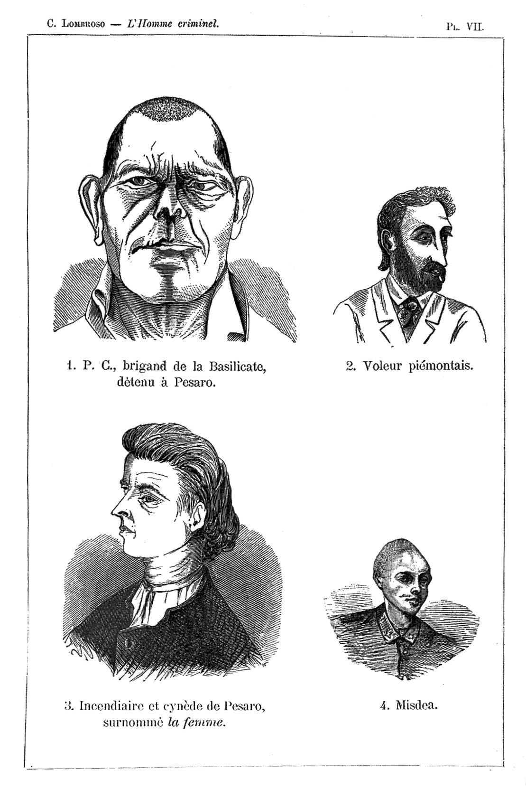{fig-alt="A plate of four engraved faces from Lombroso's L'Homme criminel, each captioned with a crime, such as brigand and thief, as if the face revealed the criminal." style="max-height: 560px !important;"}

::: {.small}
"Criminal types" from Cesare Lombroso's *L'Homme criminel*. Wellcome Collection, CC BY 4.0.
:::
:::
::::

<!-- Instructor enrichment: the Lombroso plate. Schaefer refers only to "nineteenth-century research on biological causes of crime"; Lombroso is the best-known example. -->

## Functionalist View: Deviance Defines the Limits of Proper Behavior

:::: {.columns}
::: {.column width="72%"}
- Functionalists see deviance as a normal part of social life, with **positive as well as negative** consequences for stability
- **Émile Durkheim** ([1895] 1964): punishments show everyone where the line is. Without them, people might stretch their standards of conduct
- A child who sees one parent scold the other for belching at dinner learns the rule. So does a student penalized for a paper handed in weeks late
:::

::: {.column width="28%"}
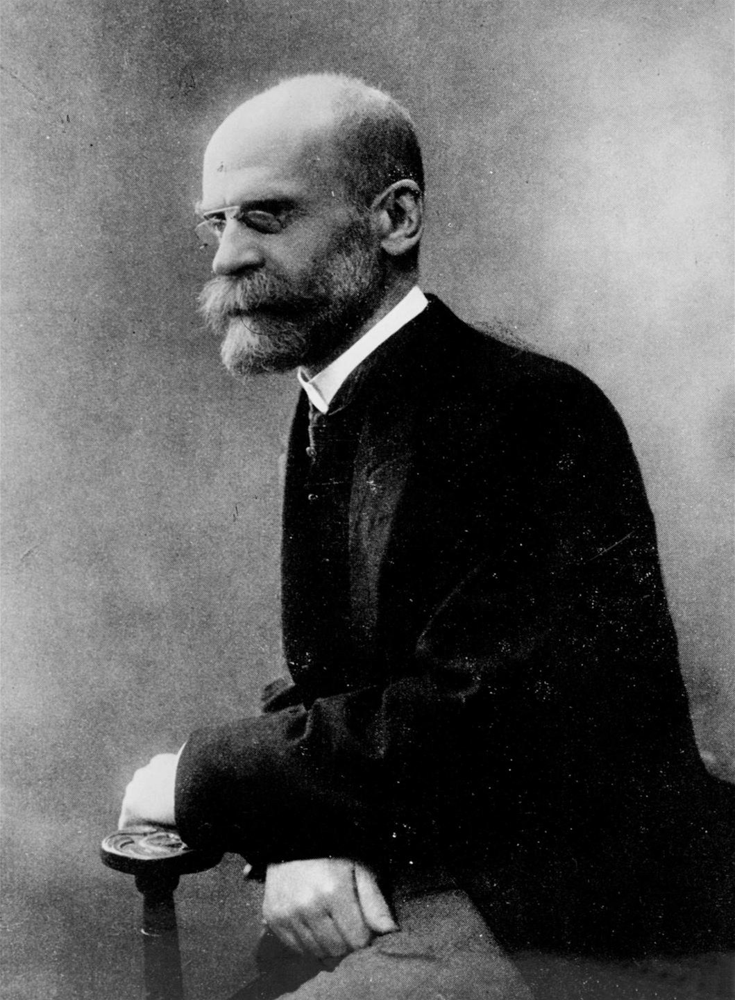{fig-alt="Portrait of Émile Durkheim." style="max-height: 380px !important;"}

::: {.small}
Émile Durkheim. Public domain.
:::
:::
::::

::: {.question-box}
A student in a 200-seat course is penalized for plagiarism. What do the other 199 students learn?
:::

<!-- ## Erikson's Puritans: Punishment Maintains Community Boundaries -->

<!-- - Sociologist **Kai Erikson** (1966) illustrated the **boundary-maintenance** function of deviance in his study of the Puritans of 17th-century New England -->
<!-- - By today's standards the Puritans placed tremendous emphasis on conventional morals. Their persecution and execution of women as **witches** was a continuing attempt to define and redefine the boundaries of their community -->
<!-- - In effect, their changing norms **created crime waves**: people whose behavior had been acceptable suddenly faced punishment as deviants (R. Schaefer and Zellner 2015) -->

<!-- ::: {.question-box} -->
<!-- A university adopts a new AI policy, and the next semester records more academic-integrity cases than ever. Did the students change, or did the boundary move? -->
<!-- ::: -->

<!-- Instructor enrichment: the AI-policy question is hypothetical. -->

## Durkheim's Anomie: Normlessness During Profound Change

:::: {.columns}
::: {.column width="70%"}
- **Anomie** — Durkheim's ([1897] 1951) term for the loss of direction felt in a society when social control of individual behavior has become ineffective
- It typically appears during revolution, sudden prosperity, or economic collapse. People agree less on proper behavior, and rates of **violent crime and suicide** rise (Chapter 1)
:::

::: {.column width="30%"}
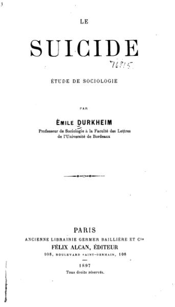{fig-alt="Title page of Émile Durkheim's Le Suicide: étude de sociologie, Paris, 1897." style="max-height: 440px !important;"}

::: {.small}
Title page of *Le Suicide* (1897). Internet Archive, public domain.
:::
:::
::::

<!-- ::: {.question-box} -->
<!-- Kuwait has known both sudden prosperity, with oil, and sudden collapse, with the 1982 Souk al-Manakh stock market crash. Which norms would you expect to weaken in each case, and which would hold? -->
<!-- ::: -->

<!-- Instructor enrichment: the Kuwait question. Sober tone; this slide mentions suicide. -->

## Merton: Cultural Goals and Institutional Means

:::: {.columns}
::: {.column width="72%"}
- What do a mugger and a teacher have in common? Both are "working" for money to buy the things they want
- **Robert Merton** (1968): U.S. culture sets **success**, measured largely in money, as a goal, and approves certain **means** of reaching it: school, hard work, persistence
- People can accept or reject the goals, the means, or both. Merton's **anomie theory of deviance** names five ways of adapting
:::

::: {.column width="28%"}
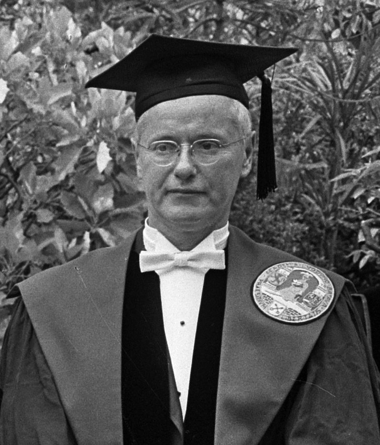{fig-alt="Robert K. Merton in academic cap and gown, 1965." style="max-height: 400px !important;"}

::: {.small}
Robert K. Merton, 1965. Eric Koch / Anefo, CC0.
:::
:::
::::

<!-- ## Table 7-1: Merton's Deviance Theory -->

<!-- :::: {.columns} -->
<!-- ::: {.column width="64%"} -->
<!-- {fig-alt="Table 7-1, Merton's deviance theory. Conformity accepts both the goals of society, such as acquisition of wealth, and the acceptable means, such as hard work. Retreatism rejects both. Innovation accepts the goals and rejects the means. Ritualism rejects the goals and accepts the means. Rebellion both rejects and replaces the goals and the means." width="100%"} -->
<!-- ::: -->

<!-- ::: {.column width="36%"} -->
<!-- | Mode | Goals | Means | -->
<!-- |---|---|---| -->
<!-- | Conformity | Accept | Accept | -->
<!-- | Retreatism | Reject | Reject | -->
<!-- | Innovation | Accept | Reject | -->
<!-- | Ritualism | Reject | Accept | -->
<!-- | Rebellion | Reject and replace | Reject and replace | -->

<!-- ::: {.small} -->
<!-- Only conformity is nondeviant. Adapted by Schaefer from Merton 1968, "Social Structure and Anomie." -->
<!-- ::: -->
<!-- ::: -->
<!-- :::: -->

## Merton's Five Modes of Adaptation {.smaller}

- **Goal** — what society tells you to want: success, measured largely in money
- **Means** — the approved ways to get it: school, a job, hard work

| Mode | Still wants success? | Still uses the approved ways? | Example |
|---|---|---|---|
| **Conformity** | Yes | Yes | An employee works long hours to earn a promotion and a raise. The only nondeviant mode |
| **Innovation** | Yes | No: finds a shortcut | A hacker steals money for consumer goods and vacations |
| **Ritualism** | No: has given up on it | Yes: follows the rules for their own sake | A caseworker refuses to help a homeless family because their last apartment was in another district |
| **Retreatism** | No | No: drops out of both | In the United States, drug addicts and vagrants are typically portrayed this way |
| **Rebellion** | No: wants different goals | No: wants a different system | Members of a revolutionary political organization |

- Merton's insight: innovators and ritualists **share a great deal with conformists**. Deviance is **socially created**, not a momentary pathological impulse
- The weakness: the theory has **not been applied systematically** to real-world crime

<!-- Instructor enrichment: the conformity example (the employee seeking a promotion). The other four examples are Schaefer's. -->

<!-- OCR gap: Schaefer's paragraph on the conformist is missing from source_en_ch07.txt (the text jumps from Table 7-1 to "The other four types"). The conformist definition follows the Arabic deck (slide 23) and Table 7-1. Check the printed page; it may also call conformity the most common adaptation. -->

## Merton's Five Modes at University and Work

::: {.board}
Schaefer asks for an example of each of Merton's five modes from work or college life. Start by classifying these.
:::

1. A student buys a finished project online to protect a high GPA
2. A student studies every night to win a place in medical school
3. A ministry clerk rejects a form because it was signed in blue ink instead of black
4. A student has stopped caring about grades or a degree, and has stopped coming
5. An engineer lists a certificate on her CV that she never earned
6. A graduate rejects the degree-to-job path and founds a cooperative where pay does not depend on credentials

::: {.fragment .question-box}
Which case did the room disagree about most? What would you need to know about the person's goals to decide?
:::

<!-- Instructor enrichment: the cases. -->

## Box 7-3: Does Crime Pay? Predict the Gang Leaders' Earnings

:::: {.columns}
::: {.column width="76%"}
- Sociologist **Sudhir Venkatesh** observed a **Chicago street gang** and collected detailed data on its drug trade. Economist **Steven Levitt**, coauthor of *Freakonomics*, helped him analyze the business

::: {.question-box}
What share of the gang's **leaders** do you think earned $100,000 a year? What did the rank and file earn?
:::
:::

::: {.column width="24%"}
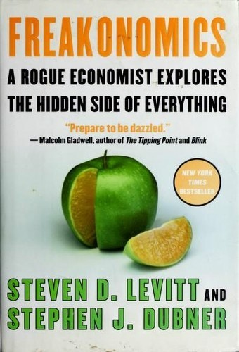{fig-alt="Cover of Freakonomics by Steven D. Levitt and Stephen J. Dubner, showing an apple cut open to reveal orange segments inside." style="max-height: 330px !important;"}

::: {.small}
Levitt and Dubner, *Freakonomics* (2005).
:::
:::
::::

::: {.fragment}
- **Less than 5 percent** of even the gang leaders earned $100,000 a year. Almost all the rank and file earned **less than the minimum wage**, and most were unpaid, hoping to move up
- Levitt's chapter title: "Why Do Drug Dealers Still Live with Their Moms?" Like most corporations, the top **2 percent** take home most of the money
- So why does the trade persist? Demand for illegal drugs is high, and legitimate jobs for young people in poor areas are scarce
:::

<!-- ## Box 7-3: Why Does Unprofitable Crime Persist? {.smaller} -->

<!-- - A driver who speeds to reach a job interview on time and a financially strapped parent who shoplifts goods her family needs are **innovators** in Merton's terms. From their own short-term perspective their actions are functional. Carried far enough, innovation becomes a career -->
<!-- - Asking whether crime pays is itself controversial, since it may seem to tolerate rule violation. Society in general does not admire these innovators -->
<!-- - Why does the trade persist when **one in four** members of drug-oriented street gangs is eventually killed? The public's almost insatiable demand for illegal drugs, and the scarcity of legitimate jobs for young adults in poverty-stricken areas, urban or rural. Functionally, these youths contribute to their household incomes -->
<!-- - Merton's theory does not easily answer why some disadvantaged groups have **lower** rates of reported crime than others, or why many people in adverse circumstances **reject** crime as an alternative -->
<!-- - A significant exception to "crime does not pay": in high-end professional crime, such as **antitrust** and **insider trading** violations, perpetrators may still profit after paying penalties, since jail time is rarely assigned. We return to this under white-collar crime -->

<!-- ::: {.question-box} -->
<!-- Schaefer asks: profit is the difference between revenues and costs. What are the economic and social costs of the illegal drug trade? Is this economic activity profitable for society? -->
<!-- ::: -->

## Interactionist View: Sutherland's Cultural Transmission and Differential Association {.smaller}

:::: {.columns}
::: {.column width="78%"}
- Functionalists explain why rule-breaking persists. Interactionists explain how a **particular person** comes to break rules
- **Edwin Sutherland**: we learn deviant behavior through the **same socialization** that teaches conforming behavior
- **Cultural transmission** — one learns criminal behavior by interacting with others: the **techniques** of lawbreaking and the **motives and rationalizations** for it
- **Differential association** — the process through which exposure to attitudes favorable to criminal acts leads to the violation of rules. An outgoing, athletic boy in a high-delinquency area may join peers who vandalize; in another neighborhood, he joins a soccer team
- **Critics:** it fits graffiti crews and delinquent gangs, but not the first-time impulsive shoplifter or someone who steals out of need (Sutherland et al. 1992)
:::

::: {.column width="22%"}
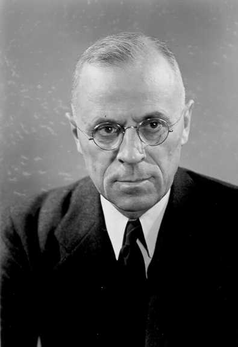{fig-alt="Portrait of Edwin H. Sutherland." style="max-height: 360px !important;"}

::: {.small}
Edwin H. Sutherland. Wikimedia Commons, CC BY-SA 4.0.
:::
:::
::::

<!-- Filtered per course rules: one item omitted from Schaefer's list of noncriminal deviant acts. Cut for length: Susan Phillips's study of Los Angeles gang graffiti. -->

## Who Taught the Technique, and Who Taught the Excuse?

::: {.board}
Pick a minor rule-breaking you have seen among people your age: vaping in a car, cutting a bakery line, slipping a phone into an exam, drifting in an empty lot.
:::

- Who taught the **technique**? Where did people learn to do it without getting caught?
- Who taught the **rationalization**: "everyone does it," "the rule is pointless," "nobody gets hurt"?
- Sutherland's outgoing boy joins a soccer team in one neighborhood and a vandal crew in another. What plays the soccer team's role for young people here?

<!-- ::: {.small} -->
<!-- Describe what you have seen, not what you have done. -->
<!-- ::: -->

<!-- Instructor enrichment. -->

## Predict: What Happened to Zimbardo's Two Abandoned Cars?

:::: {.columns}
::: {.column width="76%"}
- Philip Zimbardo, author of Chapter 5's mock prison experiment, **abandoned a car** in each of two neighborhoods. He left each car's hood up, removed its hubcaps, and set up a remote video camera to record what people did

::: {.question-box}
What happened to each car, and how quickly?
:::
:::

::: {.column width="24%"}
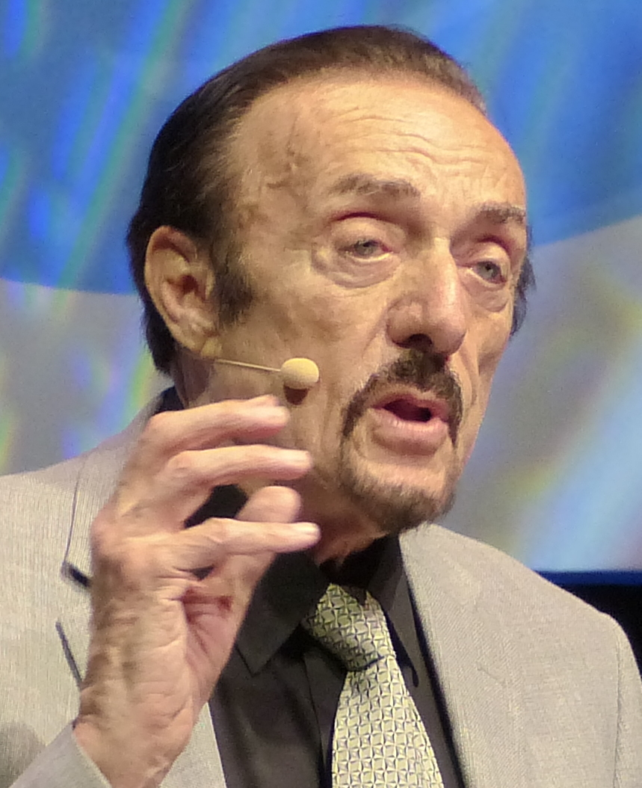{fig-alt="Philip Zimbardo speaking at a conference, 2017." style="max-height: 320px !important;"}

::: {.small}
Philip Zimbardo, 2017. Elekes Andor, CC BY-SA 4.0.
:::
:::
::::

::: {.fragment}
- In one neighborhood, people started stripping the car for parts **before Zimbardo had finished setting up** the camera
- In the other, **weeks** passed without anyone touching the car, except a pedestrian who stopped to **close the hood** during a rainstorm (Zimbardo 2007a)
:::

::: {.fragment .question-box}
The cars were identical. What was different about the two neighborhoods?
:::

## Social Disorganization Theory: Shaw and McKay Mapped Chicago

- **Social disorganization theory** — crime and deviance rise when communal relationships and institutions, such as family, school, church, and local government, break down
- **Clifford Shaw and Henry McKay** mapped Chicago's social problems. Rates were high where buildings had deteriorated and population had declined, and the patterns **persisted** as the residents' ethnic makeup changed (Shaw and McKay 1942)
- **Critics:** the theory can "blame the victim" and ignore larger forces, such as a lack of jobs or good schools

::: {.question-box}
Which institutions hold an area in Kuwait together: the co-op, the mosque, the diwaniya, the school? What would you expect to change if one of them closed?
:::

<!-- Instructor enrichment: the Kuwait question. -->

## The Saints and the Roughnecks: Same Behavior, Different Outcomes {.smaller}

::: {.board}
Two groups of high school males engaged constantly in excessive drinking, reckless driving, truancy, petty theft, and vandalism.
:::

:::: {.columns}
::: {.column width="50%"}
### The Saints

None was ever arrested.
:::

::: {.column width="50%"}
### The Roughnecks

Every one was frequently in trouble with the police and townspeople.
:::
::::

::: {.question-box}
Why the disparity?
:::

::: {.fragment}
- Sociologist **William Chambliss** (1973; Chambliss and Haas 2012) observed their high school and concluded that **social class** mattered
- The Saints came from "good families," got good grades, and planned to attend college. Their acts were seen as "sowing wild oats"
- The Roughnecks drove beat-up cars, did poorly in school, and aroused suspicion no matter what they did
:::

## Labeling Theory: Deviant Behavior Is Behavior That People So Label

:::: {.columns}
::: {.column width="74%"}
- Labeling theory asks why some people, like the Roughnecks, are labeled deviant while others who act the same, like the Saints, are not
- **Howard Becker**: "Deviant behavior is behavior that people so label" (1963:9). This is the **societal-reaction approach**: the **response** to an act, not the act itself, determines deviance
- Labels come from **agents of social control**: police, judges, teachers, psychiatrists, employers. Their power to label ties this theory to the **conflict** perspective
- **Racial profiling** — any arbitrary action initiated by an authority based on race, ethnicity, or national origin rather than on a person's behavior (Chapter 10)
:::

::: {.column width="26%"}
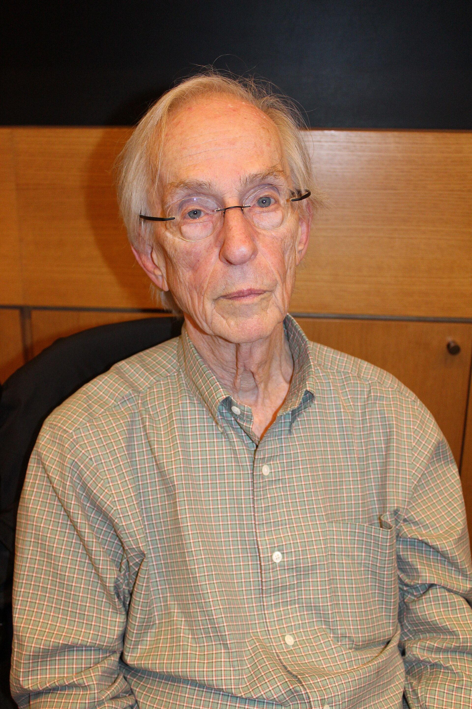{fig-alt="Howard S. Becker seated, 2012." style="max-height: 400px !important;"}

::: {.small}
Howard S. Becker, 2012. Thierry Caro, CC BY-SA 3.0.
:::
:::
::::

<!-- Filtered per course rules: the 2020 protests and campaign discussion are summarized out. Cut for length: Schaefer's U.S. traffic-stop finding and the learning-disabled labeling example (Grattet 2011). -->

## Social Constructionism: How a Behavior Becomes a Social Problem

:::: {.columns}
::: {.column width="70%"}
- **Social constructionism** — deviance is the product of the culture we live in. It studies the decisions that turn a behavior into a recognized problem
- "Child abductors" and "spree killers" have always existed, but **intensive media coverage** can suddenly make them a priority for policymakers
- **Smoking** went from a gentlemanly habit to a health hazard. Concern now extends to **thirdhand smoke** that clings to clothes, cars, and elevators (Winickoff et al. 2009)
:::

::: {.column width="30%"}
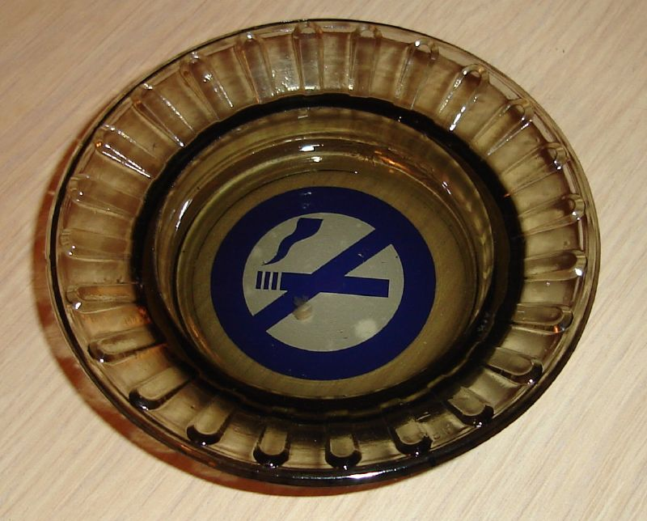{fig-alt="A glass ashtray with a no-smoking symbol printed in the bottom." style="max-height: 320px !important;"}

::: {.small}
An ashtray printed with a no-smoking sign. rcooper, CC BY-SA 2.0.
:::
:::
::::

::: {.question-box}
Vaping was first marketed as a safer alternative to cigarettes. How is it described in the news and at home now? Who did the redefining?
:::

<!-- Filtered per course rules: one item omitted from Schaefer's list of constructed concerns. -->

## You Are the Teacher: Which Labels Would You Attach?

::: {.board}
Schaefer asks: you are a teacher. What labels, freely used in education, might you attach to your students?
:::

- List the labels you heard at school: "gifted," "lazy," "the clever one," "the troublemaker," "the back row." Who applied them, and when?
- A child is labeled a troublemaker in Grade 3. What does labeling theory predict by Grade 10? What would Chambliss want to know about the child's family?
- The same direct comment in a meeting: when is it called "confident," and when "aggressive"? Who decides?

<!-- Instructor enrichment: the follow-up prompts. The last one comes from the syllabus project prompts. -->

## Banksy's *Flower Thrower*: Vandalism, Artwork, or Political Protest?

:::: {.columns}
::: {.column width="50%"}
- In 2003 the English street artist **Banksy** painted a work often titled *Rage, the Flower Thrower* in Jerusalem, on the West Bank barrier wall separating Israel from its occupied territories
- The image shows a protester hurling a bouquet of colorful flowers, not a Molotov cocktail
- It was one of many controversial works Banksy made to support **Palestinian rights**
:::

::: {.column width="50%"}
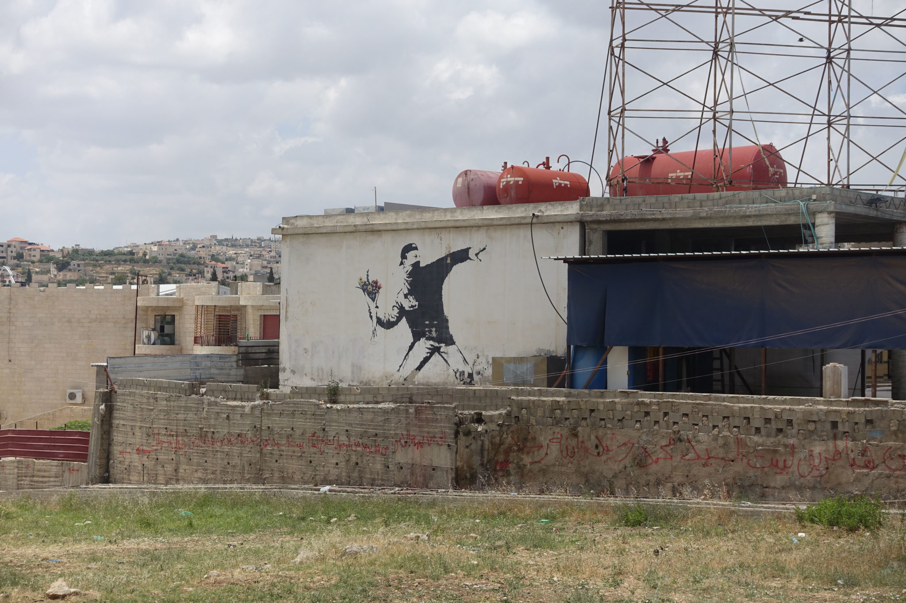{fig-alt="Banksy's Flower Thrower stencil, a masked man throwing a bouquet of flowers, painted on the white side wall of a garage beside a road, with water tanks on the roof." style="max-height: 380px !important;"}

::: {.small}
The mural near Bethlehem. Photo: Jennifer Simon, CC BY 2.0; artwork © Banksy.
:::
:::
::::

::: {.question-box .smaller}
How do we label people's behavior? Is this vandalism? Artwork? Political protest?

Who has the authority to apply each label: the owner of the wall, the police, a museum, or the people who walk past it every day?
:::

<!-- Location follows Schaefer's photo caption. The mural is usually located in Beit Sahour, near Bethlehem; check before stating the location aloud. The photograph's source captions it "Ash Salon Street, Bethlehem." -->

## Conflict View: Quinney Argues That the Powerful Define Crime

:::: {.columns}
::: {.column width="62%"}
- Conflict theorists: people with power **define deviance to suit their needs**
- **Richard Quinney**: crime is a definition created by legislators and law enforcement, and lawmaking is often an attempt by the powerful to **coerce others into their morality** (Quinney 1970)
- Criminal law reflects competing interests. U.S. law bans marijuana for its alleged harm, while cigarettes and alcohol, both harmful, are sold legally almost everywhere
:::

::: {.column width="38%"}
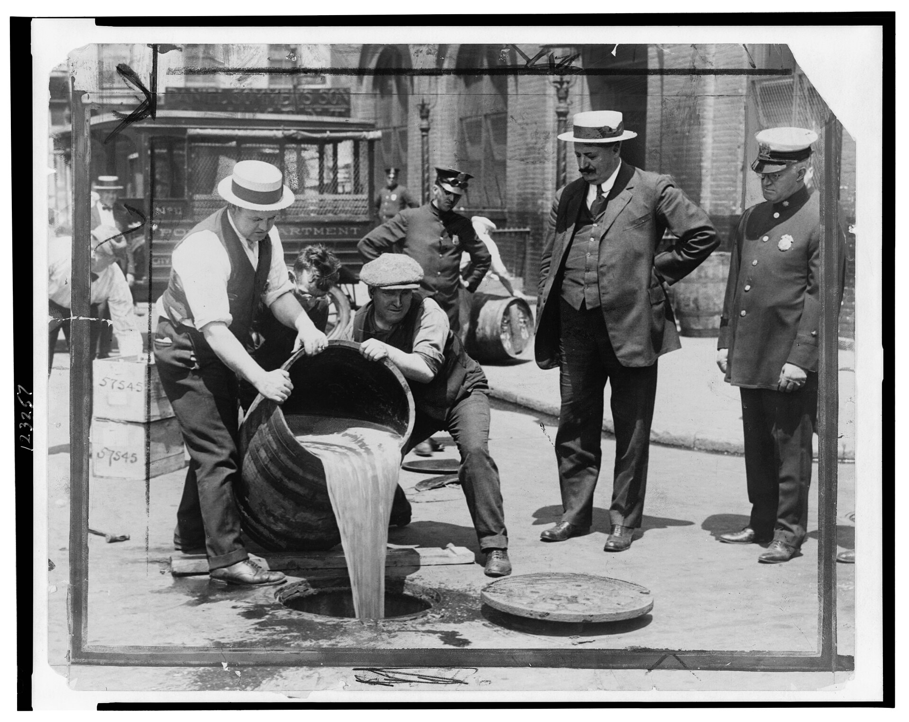{fig-alt="Agents pour liquor from a barrel into a street sewer while a police commissioner and uniformed officers watch, New York, during Prohibition." style="max-height: 400px !important;"}

::: {.small}
New York agents pour liquor into a sewer during U.S. Prohibition (1920–1933). Library of Congress, public domain.
:::
:::
::::

::: {.question-box}
In Kuwait, alcohol is illegal and tobacco is legal. In the United States, alcohol and tobacco are legal while marijuana is federally illegal. Does Quinney's argument fit both cases equally well? How would a functionalist explain Kuwait's law?
:::

<!-- Instructor enrichment: the Kuwait comparison and the Prohibition photograph. The United States banned alcohol from 1920 to 1933, so the same product moved from legal to criminal and back. -->

## Differential Justice: Discretion at Every Stage

:::: {.columns}
::: {.column width="64%"}
- **Differential justice** — differences in the way social control is exercised over different groups
- Officials use **discretion** at every stage: to press or drop charges, set bail, grant or deny parole. Conflict theorists find these decisions disadvantage some racial, ethnic, and social-class groups (Yusef et al. 2019)
- Powerful groups are unlikely to label as "deviant" the executive whose decisions lead to large-scale environmental pollution
:::

::: {.column width="36%"}
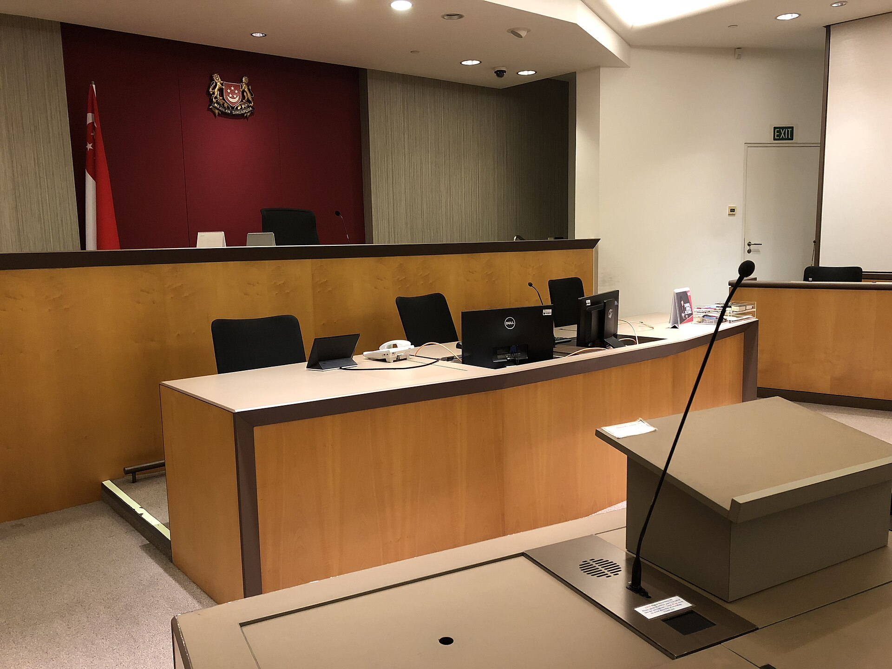{fig-alt="An empty modern courtroom: the judge's bench on a raised platform, with clerks' desks and a lawyer's lectern below." style="max-height: 380px !important;"}

::: {.small}
A courtroom of the Supreme Court of Singapore. Sgconlaw, CC BY-SA 4.0.
:::
:::
::::

::: {.question-box}
List the decisions between an arrest and a sentence where someone uses discretion. At which one could money, a family name, or a phone call make the biggest difference?
:::

<!-- ## Feminist View: Theories of Crime Were Built with Men in Mind -->

<!-- - **Freda Adler** (1996) and **Meda Chesney-Lind** (2017): most theories of deviance and crime were developed with **only men** in mind -->
<!-- - For years U.S. law did not count forced intercourse within marriage as rape, a definition written by overwhelmingly male legislatures. Feminist protests changed the law (Pauly 2019) -->
<!-- - About **80 to 95 percent** of campus sexual assaults against women students are not reported to college officials (Spencer et al. 2017) -->

<!--  Sober tone; no humour and no discussion prompt on this slide. --> 

## Table 7-2, Part 1: Anomie, Cultural Transmission, and Social Disorganization {.smaller}

Each approach answers a different question about deviance. Schaefer's one-line summary of each is in bold.

| Approach | The question it answers | What it says | Example from this chapter |
|---|---|---|---|
| **Anomie** Functionalist *Durkheim, Merton* | Why do people break rules at all? | **Adaptation to societal norms.** Society tells everyone to want success but does not give everyone an approved way to reach it, so some people adapt by breaking rules. Norms also weaken during sudden change | Merton's innovator: a hacker steals money for vacations. In an economic collapse, violent crime and suicide rise |
| **Cultural transmission / Differential association** Interactionist *Sutherland* | How does a person learn to break rules? | **Patterns learned through others.** Deviance is learned the same way conformity is, from friends and family, who teach both the techniques and the excuses | The outgoing, athletic boy who joins vandals in one neighborhood and a soccer team in another |
| **Social disorganization** Interactionist *Shaw, McKay* | Why is crime higher in some places? | **Communal relationships.** Crime rises where the institutions that hold a community together (e.g., family, school, club, local gov) have broken down | Shaw and McKay's maps of Chicago: problems stayed in the same run-down areas even as the residents changed |

## Table 7-2, Part 2: Labeling and Conflict Theory {.smaller}

| Approach | The question it answers | What it says | Example from this chapter |
|---|---|---|---|
| **Labeling / Social constructionist** Interactionist *Becker, Chambliss* | Why are some people called deviant and others not? | **Societal response to acts.** An act becomes deviant when people with authority label it so. Who gets labeled can matter more than what they did | A child labeled "the troublemaker" in Grade 3; smoking redefined from a gentlemanly habit to a health hazard |
| **Conflict** Conflict *Quinney* | Who decides what counts as a crime? | **Dominance by authorized agents; discretionary justice.** People with power write the laws, and police, prosecutors, and judges use discretion over charges, bail, and parole in ways that favor some groups over others | U.S. law bans marijuana for its alleged harm, while alcohol and tobacco are sold legally |

<!-- | **Feminist** Conflict/Feminist *Adler, Chesney-Lind* | Do theories of crime fit women's lives? | **Role of gender; women as victims and perpetrators.** Most theories were built with only men in mind | Laws on rape written by all-male legislatures | -->

::: {.question-box}
Schaefer asks: which sociological perspective is most useful in analyzing white-collar crime? Vandalism? Cocaine use?
:::

## Which Perspective Explains the Case Best?

::: {.board}
Match each case to the approach in Table 7-2 that explains it best.
:::

:::: {.columns}
::: {.column width="50%"}
1. The Saints and the Roughnecks
2. A graffiti crew that trains its new members
3. A student who buys a finished project to protect a high GPA
:::

::: {.column width="50%"}
4. One car stripped in minutes, another left untouched
5. Embezzlement punished more lightly than petty theft
:::
::::

::: {.fragment .question-box}
Which cases needed two approaches? What does each approach leave unexplained?
:::

# Crime: A Sociological Approach {background-color="#1B2A4A"}

::: {.takeaway}
Crime is deviance that the state punishes. Sociologists sort it by how it is committed and how society views it, and the sorting shows who gets punished harshly and who rarely does.
:::

<!-- ## Box 7-4: Packing Firearms on Campus {.smaller} -->

<!-- - College campuses are generally very safe, but high-profile campus shootings have changed laws on concealed firearms -->
<!-- - After the 2007 Virginia Tech shooting (Chapter 5), officials were reluctant to limit students' freedom of movement. They improved emergency communications instead, replacing e-mail with **instant alerts** sent to cell phones: technology as social control -->
<!-- - Far more controversial were calls to allow **concealed weapons** on campus. All states allow concealed-weapons permits, but until recently every provision banned weapons in schools at any level. As of 2018, **11** states had campus carry laws, **16** banned concealed weapons, and **23** left the decision to university systems or individual schools -->
<!-- - Research shows that campus carry bills were not driven by shooting incidents in educational settings but were associated with shootings **anywhere in a state**. In several states legislators introduced bills to prohibit concealed weapons on campus; none passed -->
<!-- - **Supporters** cite a constitutional right, which courts frequently affirm, and safety from shooters and other criminals. **Opponents**, usually administrators, faculty, and campus police, say more firearms will increase the risk of dangerous situations -->

<!-- ::: {.question-box} -->
<!-- Schaefer asks: is allowing guns on campus an example of social control? Why or why not? Which technologies of social control did you pass on your way to this room? -->
<!-- ::: -->

## Crime Defined: Six Types That Sociologists Distinguish

- **Crime** — a violation of criminal law for which some governmental authority applies formal penalties
- Sociologists classify crimes by **how they are committed** and **how society views them**

::: {.center}
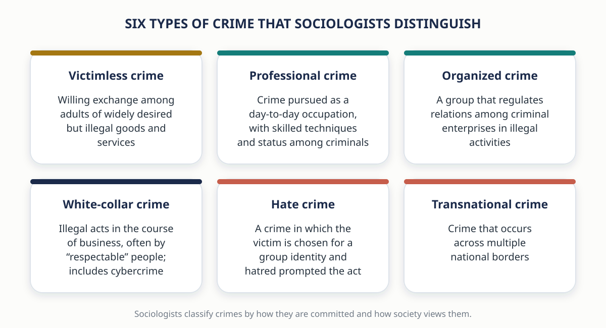{fig-alt="Six cards: victimless crime, the willing exchange among adults of widely desired but illegal goods and services; professional crime, pursued as a day-to-day occupation; organized crime, a group that regulates relations among criminal enterprises; white-collar crime, illegal acts in the course of business, including cybercrime; hate crime, a victim chosen for a group identity; transnational crime, across multiple national borders."}
:::

## Victimless Crime and the Debate over Decriminalization

- **Victimless crime** — the willing exchange among adults of widely desired but illegal goods and services, such as drugs
- **For decriminalization:** these acts are impossible to prevent, and police and courts should focus on crimes with obvious victims
- **Against:** compulsive gambling, drug use, and heavy drinking harm families and can lead to theft and abuse. 
- Underneath the debate: who has the power to label an act a "crime," or "victimless"?
- **In Kuwait:** a 2025 drug law allows the death penalty for trafficking. Families also file **addiction complaints** with the Public Prosecution against their own sons and daughters: **970** in 2025

::: {.question-box}
Someone bets on football through an illegal app. Who else might pay besides the bettor?
:::

<!-- Filtered per course rules: pornography omitted from the feminist critique. Instructor enrichment: the betting question and the Kuwait bullet. Sources: KUNA, 26 Nov 2025 (drug law; death or life imprisonment for trafficking, death for organizing international trafficking); Public Prosecution Annual Report 2025, p. 6 (970 addiction complaints); Al-Jarida, May 2025 (993 complaints in 2024 "filed by parents and families against their sons and daughters"). Verify the law's number before saying it aloud: KUNA calls it Decree-Law No. 59 of 2025, the law firm HFW calls it No. 159 of 2025; it took effect 15 December 2025. The complaints show informal control (the family) turning to formal control. -->

## Professional and Organized Crime

- **Professional criminal** — a person who pursues crime as a day-to-day occupation, developing skilled techniques and enjoying status among other criminals. Like other workers, they form a **subculture** and trade tips (Sutherland 1937)
- **Organized crime** — the work of a group that regulates relations among criminal enterprises, such as gambling and drug smuggling. It allocates territory, sets prices, settles disputes, and "taxes" merchants for "protection"
- Organized crime has served as a route of **upward mobility**. Daniel Bell (1953) called the passing of leadership from one immigrant group to the next **ethnic succession**

<!-- Shortened per course rules: Schaefer's list of six present-day national-origin groups in organized crime is not reproduced. Restore it if you want the full list for the exam. -->

## White-Collar and Corporate Crime

- **White-collar crime** — illegal acts committed in the course of business activities, often by affluent, "respectable" people: tax evasion, fraud, bribery, embezzlement. **Edwin Sutherland** coined the term
- Sutherland built on **W. E. B. Du Bois**'s ([1899] 1995) observation that courts **favor the rich**: embezzlement is treated more leniently than petty theft
- **Corporate crime** — any act by a corporation that is punishable by the government, from pollution to unsafe products to accounting fraud (Simpson 2019)
- A white-collar conviction harms a career far less than a street-crime conviction. **Conflict theorists** expect this: the justice system focuses on the crimes of the poor (Simpson 2013)

## White-Collar Crime in Kuwait: Recorded Bribery Cases and Perceived Corruption

- Kuwait's Public Prosecution registered between **6 and 18** cases of bribery and influence-peddling a year from 2020 to 2025. In 2025 there were **13**
- Forgery of bank documents rose from **1,078** cases in 2020 to **3,822** in 2025

::: {.small}
The index is built from expert and business assessments of the public sector. It measures perceived corruption, not cases.
:::

::: {.question-box}
Does "13 bribery cases" tell us how much bribery happens, or how often a bribe is reported and proven? Who would report a bribe they paid themselves?
:::

<!-- Instructor enrichment. Sources: Public Prosecution Annual Report 2025 (published March 2026), pp. 9 and 13; Transparency International, CPI 2025 (Kuwait 46/100, 65th of 182, unchanged from 2024; global average 42). Sutherland's point: white-collar crime rarely enters the statistics. -->

## Cybercrime and Identity Theft

- **Cybercrime** — illegal activity conducted primarily through computer hardware or software, including **cyberespionage** and **cyberterrorism**
- Its global cost was projected to reach **$6 trillion** by 2021, double the 2015 figure (Juniper Research 2015; Morgan 2017)
- **Identity theft:** about **7 percent** of adults each year find their personal information misused for crime (Harrel 2015). Cooley and Goffman wrote about the self without imagining that anyone could steal one
- **In Kuwait:** the Ministry of Interior's cybercrime department received about **3,000** reports in 2024. The most common scams were fake messages from banks and government bodies, fake chalet-rental ads, and fake payment links

::: {.question-box}
A text says your parcel is held at customs and asks for KD 1.5 through a payment link. What is the sender really collecting?
:::

<!-- Instructor enrichment: the payment-link scenario is hypothetical; the Kuwait bullet is from KUNA, 1 July 2025 (Lt. Col. Ammar Al-Sarraf, cybercrime department). The same interview says a coordination unit set up in 2023 has closed 2,300 scam sites and cut off 2,200 fake WhatsApp numbers; the governing law is Law No. 63 of 2015 on combating information technology crimes. -->

<!-- ## You Edit the Homepage: Embezzlement or a Stolen Phone? -->

<!-- ::: {.board} -->
<!-- Schaefer asks: as the editor of an online news service, how might you treat stories on corporate or white-collar crime differently from those on violent crime? -->
<!-- ::: -->

<!-- :::: {.columns} -->
<!-- ::: {.column width="50%"} -->
<!-- ::: {.example-box} -->
<!-- **Story A.** A company manager is convicted of embezzling KD 3 million over six years. -->
<!-- ::: -->
<!-- ::: -->

<!-- ::: {.column width="50%"} -->
<!-- ::: {.example-box} -->
<!-- **Story B.** A man is arrested for snatching a phone at a mall food court. -->
<!-- ::: -->
<!-- ::: -->
<!-- :::: -->

<!-- - Which story runs a photo of the accused? Is it a police photo or a headshot from the company website? -->
<!-- - Who were the victims of Story A? Would readers know their names? -->
<!-- - Which story would readers share more, and which did more harm? -->

<!-- ::: {.small} -->
<!-- Hypothetical stories for the exercise, not reports of real events. -->
<!-- ::: -->

## Hate Crimes Are Defined by the Offender's Motive

- A **hate crime** (or **bias crime**) is an ordinary crime in which the offender chooses the victim because of race, religion, ethnic group, national origin, or another protected characteristic, and evidence shows **hatred** prompted it
- Hate crimes send a **message beyond the victim**. Vandalizing a mosque or a Church warns every Muslim or Christian that they are not wanted
- So many jurisdictions punish them more heavily, and the U.S. Supreme Court upheld tougher sanctions in 1993
- **In Kuwait:** We have the **2012 National Unity Law**, which bans inciting hatred or contempt of any group in society, stirring sectarian or tribal strife, or promoting the superiority of any race, color, origin, religious sect, sex, or lineage, including online. Penalties reach seven years in prison

<!-- ::: {.question-box}
Schaefer's hate crime is an ordinary crime made worse by its motive. Kuwait's law makes the incitement itself the crime. What does each approach try to prevent?
::: -->

<!-- Instructor enrichment: the Kuwait bullet and question. Source: Decree-Law No. 19 of 2012 on the Protection of National Unity, Articles 1–2 (prison up to seven years and a fine of KD 10,000–100,000, or either; doubled for repeat offenses). Article 1's full list: race, group, color, origin, religious sect, sex (جنس), or lineage. -->
<!-- - In 2018 U.S. agencies reported **7,120** hate crimes. Race was the apparent motive in about **58 percent** of reports, religion in **18 percent** -->

<!-- Filtered per course rules: sexual orientation is named in Schaefer's definition and is 17 percent of Figure 7-2; both are summarized as "other protected characteristics." The religion figure (18 percent) is from the Arabic deck's text alternative to Figure 7-2. Cut for length: the Hate Crimes Statistics Act, state-by-state coverage (Figure 7-3), and the Mitchell v. Wisconsin case name (more commonly cited as Wisconsin v. Mitchell). Filtered per course rules: the Ku Klux Klan comparison and the anti-white incident statistic. -->

## Transnational Crime Crosses National Borders

:::: {.columns}
::: {.column width="50%"}
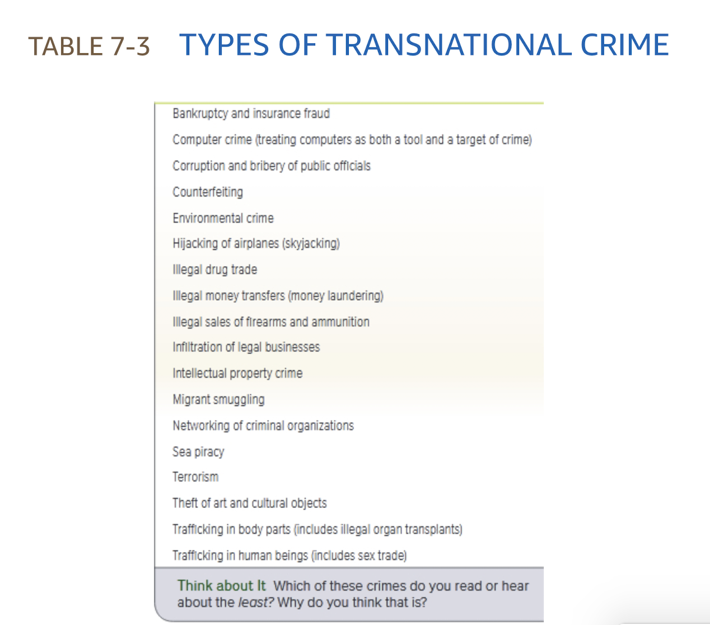{fig-alt="Table 7-3, types of transnational crime: bankruptcy and insurance fraud; computer crime; corruption and bribery of public officials; counterfeiting; environmental crime; hijacking of airplanes; illegal drug trade; money laundering; illegal sales of firearms and ammunition; infiltration of legal businesses; intellectual property crime; migrant smuggling; networking of criminal organizations; sea piracy; terrorism; theft of art and cultural objects; trafficking in body parts; trafficking in human beings." width="100%"}
:::

::: {.column width="50%"}
- **Transnational crime** — crime that occurs across multiple national borders
- Historically the most dreadful example was **slavery**. Today it includes trafficking in people, drugs, endangered species, and stolen art
- The United Nations began categorizing these crimes in the 1990s (Table 7-3)

::: {.question-box}
During the 1990 invasion, collections from Kuwait's museums were taken to Iraq, and much was returned after liberation. Which row of the table describes that?
:::
:::
::::

<!-- Instructor enrichment: the museum question. Verify the details of the 1990 removal and return before teaching them as fact. Cut for length: Schaefer's question "which of these crimes do you read or hear about the least?" and the 2019 26-country survey on cyberattacks (Poushter and Huang 2019). -->

<!-- ## Interpol and the Limits of International Cooperation -->

<!-- - Bilateral cooperation in pursuing border criminals such as smugglers has been common for many years -->
<!-- - The first global effort to control international crime was the **International Criminal Police Organization (Interpol)**, a cooperative network of European police forces founded to stem the movement of political revolutionaries across borders -->
<!-- - Such efforts are complicated by sensitive **legal and security** issues. Most nations that have signed protocols issued by the United Nations, including the United States, worry about encroachments on their national judicial systems and their national security, so they are reluctant to share certain intelligence -->
<!-- - The investigation into Russian involvement in disrupting the 2016 U.S. presidential campaigns and election renewed interest in safeguarding online information -->

## Classify the Crime: Which of the Six Types?

::: {.board}
Name the type of crime. Some cases fit more than one.
:::

1. A crew of pickpockets works crowded malls before Eid and shares tips on where the guards stand
2. A payment link texted to thousands of phones copies card details
3. A company hides a known defect in a car part to avoid a recall
4. A network smuggles endangered falcons across three borders
5. A group controls an underground betting market and "taxes" shopkeepers for protection
6. Insults are spray-painted on a place of worship
7. A manager pays a bribe to win a government contract

::: {.fragment .question-box}
Which of these would appear in the crime statistics we discuss next, and which would almost never be counted?
:::

<!-- Instructor enrichment. Hypothetical cases. -->

# Crime Statistics {background-color="#1B2A4A"}

::: {.takeaway}
Crime statistics tell us a great deal about police activity and something about crime. Reading them well means asking what they leave out.
:::

## Crime Statistics Indicate Police Activity, Not the Exact Level of Crime

- Crime statistics are often cited as if they were completely reliable. They are not
- They are an indicator of **police activity** and a rough guide to the level of certain crimes, not an exact count

::: {.question-box}
Recall Moskos: police "don't deal with a random cross-section of society." If police records are your only data, which neighborhoods and which crimes will look most common?
:::

## Kuwait's 2020 Domestic Violence Law and the Rise in Recorded Cases

:::: {.columns}
::: {.column width="40%"}
| Year | Domestic violence cases |
|---|---|
| 2020 | 263 |
| 2021 | 1,292 |
| 2022 | 2,223 |
| 2023 | 2,498 |
| 2024 | 2,405 |
| 2025 | 2,010 |

::: {.small}
Cases registered with Kuwait's Public Prosecution.
:::
:::

::: {.column width="60%"}
- **Law No. 16 of 2020** on protection from domestic violence took effect in **September 2020**
- It created protection centers, shelters, and protection orders, and it requires anyone who witnesses domestic violence to report it
- Recorded cases rose almost **tenfold** in three years
:::
::::

::: {.question-box}
Did violence inside families rise tenfold between 2020 and 2023? What else could change the count?
:::

<!-- Instructor enrichment. Sober tone; no humor, and no one is asked about their own household. Sources: Public Prosecution Annual Report 2025, p. 14 (the six-year series); Law No. 16 of 2020, issued 13 September and in force on publication, 20 September 2020 (Article 10: duty to report; Article 17: urgent protection orders); Human Rights Watch, 29 September 2020 (shelters, hotline, protection orders). The point is Schaefer's: statistics measure reporting and enforcement as well as behavior. 2020 was also a pandemic year, which may have lowered every count. Human Rights Watch notes that the law did not make domestic violence a separate crime with its own penalty; the cases are recorded under existing offenses. -->

## Index Crimes: The FBI's Eight Types and Their Limits

:::: {.columns}
::: {.column width="48%"}
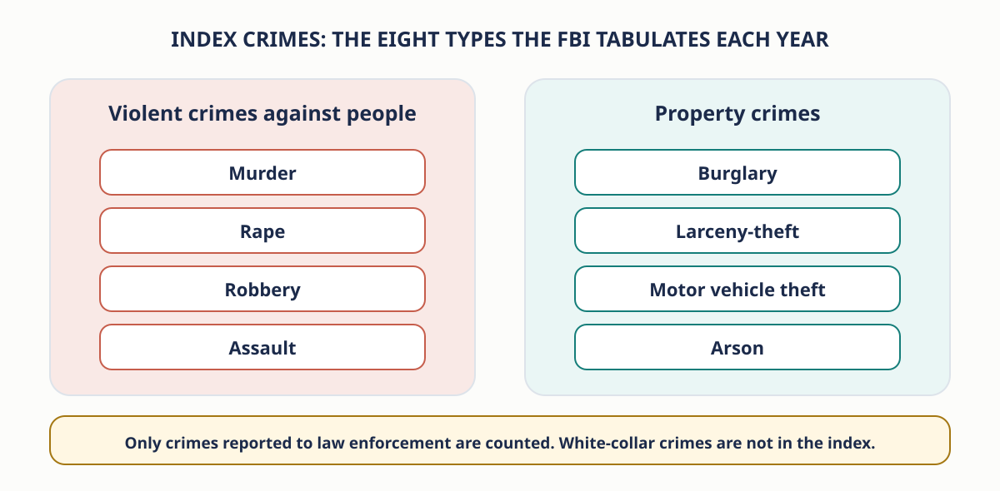{fig-alt="Two panels. Violent crimes against people: murder, rape, robbery, and assault. Property crimes: burglary, larceny-theft, motor vehicle theft, and arson. Only crimes reported to law enforcement are counted, and white-collar crimes are not in the index." width="100%"}
:::

::: {.column width="52%"}
- **Index crimes** — the eight types of crime tabulated each year by the FBI
- **White-collar crimes** are left out
- The index leans toward **property** crimes, while people worry more about **violent** ones
- **The biggest limit:** it counts only crimes **reported** to police. People who distrust the police may not call them, and many women do not report rape or spousal abuse for fear of being blamed
:::
::::

## Kuwait's Crime Figures: The Public Prosecution's Annual Report

- The most detailed recent crime figures for Kuwait come from the **Public Prosecution's annual report**. It counts **cases registered with prosecutors**, not reports to police
- Its list of "prominent crimes" ([أبرز الجرائم]{.term-ar}) includes murder, theft, and drugs
- It also tracks **bribery**, failure to submit **financial disclosure** statements, officials who refuse to carry out **court rulings**, and **medical malpractice**: white-collar crimes the FBI index leaves out

::: {.question-box}
Before a crime reaches this report, it passes several filters. 
:::

<!-- Instructor enrichment. Source: Public Prosecution Annual Report 2025, pp. 7–16, which charts 2020–2025 counts for state security cases, murder and attempted murder, suicide and attempted suicide, felony theft, bribery and influence-peddling, failure to submit financial disclosure, officials refusing to execute judicial rulings, forgery of official documents, money laundering, misuse of public funds, drugs, press/media/IT crimes, juvenile crimes, bank-document forgery, cheques, domestic violence, medical malpractice, human trafficking, and complaints against lawyers. Verify before teaching: under Kuwait's Code of Criminal Procedure, most misdemeanors are investigated by the Ministry of Interior's investigators rather than the Public Prosecution, so the report may undercount minor offenses. The Central Statistical Bureau's Annual Statistical Abstract also has a justice and security chapter, not checked here. The report also breaks defendants down by nationality; per course rules this is left off the slide. -->

## Victimization Surveys Ask Ordinary People

- **Victimization survey** — a survey that questions ordinary people, not police officers, to learn whether they have been victims of crime. The U.S. National Crime Victimization Survey began in **1972**
- Its limits: victims must **understand** what happened to them and be **willing to tell** an interviewer. Fraud and blackmail rarely appear
- **In Kuwait:** Gallup's World Poll asks similar questions. In 2023, **4 percent** of adults said they had been assaulted or mugged in the past year, and **1 percent** that money or property had been stolen from their household (Gallup 2024)

::: {.small}
Gallup interviews about 1,000 adults in Kuwait by phone, in Arabic, English, Bengali, or Hindi. 
:::

::: {.question-box}
Why is it useful to sociologists to have victimization surveys in addition to reported crime data?
:::

<!-- Instructor enrichment: the Kuwait bullet and note. Source: Gallup, 2024 Global Safety Report (2023 data), section on the Law and Order Index: "the low experiences with assault (4%) and theft (1%). Kuwaiti residents are not asked about their confidence in the police." Sample: 1,071 interviews by landline and mobile in Arabic, Bengali, English, and Hindi (Kuwait Times, Sept. 2024, reporting Gallup). A follow-up prompt: which residents of Kuwait would a phone survey in those four languages miss? Keep it general; no one discloses their own nationality. -->

<!-- ## Reported, Surveyed, or Invisible? Trace Each Crime -->

<!-- ::: {.board} -->
<!-- Would each crime appear in police records, in a victimization survey, in both, or in neither? -->
<!-- ::: -->

<!-- 1. A car stolen from outside a house -->
<!-- 2. A phone snatched at a mall; the owner says, "the police won't find it anyway" -->
<!-- 3. KD 40 lost to a fake online shop -->
<!-- 4. A bribe paid to speed up a permit -->
<!-- 5. A shop owner blackmailed by a former employee -->
<!-- 6. Violence inside a home that no one discusses outside the family -->

<!-- ::: {.fragment .question-box} -->
<!-- Which kinds of crime does each source undercount? Whose experiences end up missing from both? -->
<!-- ::: -->

<!-- Instructor enrichment. Income tax evasion is not used because Kuwait has no personal income tax. Sober tone on case 6; no one is asked about their own household. -->

## Crime Trends: The Long Decline in U.S. Crime

- U.S. violent crime has **declined significantly**. The 2017 crime rate was comparable to that of **1963**
- Murders fell from **24,700** in 1991 to **15,498** in 2018. Violent and property crime each dropped about **20 percent** in ten years (Table 7-4)
- The pandemic scrambled the pattern: street robberies and home burglaries plummeted as people stayed home, while retail burglaries rose (Sawyer 2020)

<!-- Source gap: neither source file contains the data for Table 7-4 (U.S. crime rates and percentage change) or Figure 7-4 (victimization rates, 1993–2018). The slide uses only the figures Schaefer states in the text. Add images of both if you have them. -->

## Crime Trends in Kuwait, 2020–2025: Cases at the Public Prosecution {.smaller}

| Cases registered | 2020 | 2021 | 2022 | 2023 | 2024 | 2025 |
|---|---|---|---|---|---|---|
| **All cases** | 22,803 | 30,094 | 39,795 | 46,566 | 46,250 | 49,763 |
| Murder and attempted murder | 87 | 97 | 71 | 100 | 65 | 69 |
| Felony theft | 1,720 | 1,664 | 1,591 | 1,593 | 1,360 | 1,313 |
| Drugs and psychotropic substances | 1,777 | 2,363 | 2,687 | 2,666 | 3,149 | 3,066 |
| Press, media, and IT crimes | 1,949 | 2,205 | 3,086 | 3,747 | 4,059 | 5,323 |
| Forgery of bank documents | 1,078 | 1,086 | 1,460 | 2,532 | 2,651 | 3,822 |

- Total cases **more than doubled**, while felony theft **fell by about a quarter**
- Homicide is rare by international standards: about **0.8** per 100,000 people in Kuwait (2022), against **5.8** in the United States (2023) (UNODC)

::: {.question-box}
Is crime in Kuwait rising? Which row would a news story choose to say yes? Which row would it choose to say no?
:::

<!-- Instructor enrichment. Sources: Public Prosecution Annual Report 2025, pp. 5, 7, 8, 12, 13; UNODC intentional homicide data (Kuwait 0.784 in 2022; United States 5.763 in 2023; for the Gulf: Saudi Arabia 0.801 in 2024, UAE 0.517 in 2023, Bahrain 0.196 in 2022, Oman 0.139 in 2023, Qatar 0.069 in 2022). Ambiguity: the 2024 annual report gave different 2024 figures for some rows (drugs 3,374 in press coverage; juvenile crimes 5,870, against 3,853 in the 2025 report). The slide uses the 2025 report's series throughout. One news site reported "10" murders in 2024; the report's chart shows 65. 2020 was a pandemic year, which may have lowered that year's counts. Small counts swing sharply: the World Bank series puts Kuwait's homicide rate at 0.25 in 2020. -->

<!-- ## Predict: Do People Think Crime Is Rising or Falling? -->

<!-- ::: {.question-box} -->
<!-- U.S. crime fell for most of the past three decades. In how many of the last 50 years do you think most Americans said there was **more** crime than the year before? -->
<!-- ::: -->

<!-- ::: {.fragment} -->
<!-- - In **each** of the last 50 years, most people surveyed believed there was more crime than the year before (Gallup 2020b) -->
<!-- - News media emphasize **violent crimes in the local area**. Nationally, we are bombarded by coverage of highly publicized shootings at schools, workplaces, concerts, and places of worship -->
<!-- ::: -->

<!-- ::: {.fragment .question-box} -->
<!-- Which Chapter 6 concept helps explain the gap: gatekeeping, conferral of status, or the narcotizing dysfunction? What would your own feed suggest about crime in Kuwait this year? -->
<!-- ::: -->

## Gallup's Global Safety Report: How Safe Kuwait Residents Feel at Night

::: {.question-box}
Gallup asks adults in more than 140 countries: "Do you feel safe walking alone at night in the city or area where you live?" What share of Kuwait's residents do you think said yes?
:::

::: {.fragment}
- **2023: 99 percent**, the highest of 140 countries. Kuwait also had the highest score on Gallup's Law and Order Index, **98 out of 100**
- **2024: 91 percent**. Singapore (98), Tajikistan (95), China and Oman (94), and Saudi Arabia (93) ranked above Kuwait (91)
- Worldwide, **73 percent** said yes in 2024
:::

::: {.fragment .question-box}
Did Kuwait become less safe in one year, or is something else moving the number? Each year's sample is about 1,000 people.
:::

<!-- Instructor enrichment. Sources: Gallup, 2024 Global Safety Report (2023 data: Kuwait 99 percent, Law and Order Index 98); Gallup, 2025 Global Safety Report (2024 data: Kuwait 91 percent, Law and Order Index 88; world 73 percent). Gallup gives a margin of error of about plus or minus 4 points for the 2024 Kuwait sample, so part of the change may be sampling error. Gallup notes that high perceived safety in the Gulf is "likely driven by more than just low crime rates," citing strong public order and visible state presence. -->

<!-- ## Six Possible Explanations for the Decline in Crime -->

<!-- - Community-oriented policing and crime prevention programs -->
<!-- - A massive increase in the prison population, which at least prevents inmates from committing crimes outside prison -->
<!-- - New surveillance technologies -->
<!-- - Better residential and business security -->
<!-- - The decline of the crack cocaine epidemic, which soared in the late 1980s -->
<!-- - The aging of the population, as the number of people in their 50s increased and the number in their 20s decreased -->

<!-- ::: {.small} -->
<!-- No single explanation could account for such a marked change. Taken together, changes in public policy, public health, technology, and demographics may well explain it (Tonry 2014). -->
<!-- ::: -->

<!-- ::: {.question-box} -->
<!-- Pick one explanation. What data would you need to show that it caused part of the decline, and did not simply happen at the same time? (Chapter 2: correlation and causation) -->
<!-- ::: -->

## Kuwait's 2025 Traffic Law and the Fall in Traffic Deaths

- Kuwait's amended traffic law took effect on **22 April 2025**. Fines rose sharply: using a phone while driving went from **KD 5 to KD 75**
- The Ministry of Interior credits stricter enforcement, more monitoring cameras, and awareness campaigns

| January–June | 2024 | 2025 | Change |
|---|---|---|---|
| Traffic violations | 1,968,733 | 1,659,448 | −16% |
| Traffic accidents | 2,511 | 1,383 | −45% |
| Traffic deaths | 143 | 94 | −34% |

::: {.question-box}
Higher fines, more cameras, and awareness campaigns all arrived together. What data would you need to tell which one saved lives? Could fewer recorded violations mean anything other than better driving?
:::

<!-- Instructor enrichment. Sources: Ministry of Interior, General Traffic Department, first-half statistics (moi.gov.kw/gdt/traffic-news/details/53634; Arab Times, 12 Aug 2025); Kuwait Times (fine increases under Decree-Law No. 5 of 2025, amending Decree-Law No. 67 of 1976). The ministry also reported that camera-recorded speeding and red-light violations fell 83 percent in May 2025 against May 2024 (168,208 to 28,464). Links back to the traffic enforcement slide in the social control section. -->

<!-- ## Feminist Scholars Point to a Countertrend in Women's Crime -->

<!-- - The **proportion** of major crimes committed by **women** has increased -->
<!-- - But **violent** crimes committed by women, which have never been common, have **declined** -->
<!-- - Despite "mean girls" references in popular culture, every reliable measure shows that among women, fights, weapons possession, assaults, and violent injuries have plunged over the last decade (Federal Bureau of Investigation 2020; Males and Chesney-Lind 2010) -->

<!-- ::: {.question-box} -->
<!-- How can women's share of major crimes rise while their violent crime falls? Work it out with two made-up numbers. -->
<!-- ::: -->

<!-- ## International Crime Rates and Currie's Explanation for the United States {.smaller} -->

<!-- - Cross-national comparisons are hard, but since the 1980s violent crime has been far more common in the **United States** than in **western Europe**. Car theft, though, is higher in England, Ireland, Denmark, and New Zealand -->
<!-- - Homicide has risen fast in countries that supply drugs to wealthy markets: **Mexico**'s rate is about twice the U.S. rate (Luhnow 2014) -->
<!-- - **Elliot Currie** (1985, 1998): U.S. society stresses **individual economic achievement**, has long tolerated violence, and has sharp inequality, unemployment, and drug abuse. Together these produce a climate conducive to crime -->

<!-- ::: {.question-box} -->
<!-- Currie's first factor sounds like Merton. Which of Merton's modes would an emphasis on individual economic achievement push people toward? -->

<!-- Before comparing Kuwait's crime rate with another country's, what would you need to know about how each country defines, reports, and records crime? -->
<!-- ::: -->

<!-- Cut for length: the World Population Review ranking (Venezuela highest; Switzerland, Denmark, Norway, Japan, New Zealand lowest) and the Central American homicide comparison. -->

<!-- # Social Policy: The Death Penalty {background-color="#1B2A4A"} -->

<!-- ::: {.takeaway} -->
<!-- Sociologists study the death penalty as a form of social control. They ask what it is meant to do, what it costs, and who receives it. -->
<!-- ::: -->

<!-- ## Looking at the Issue -->

<!-- - About **20** nations still carry out executions.  -->
<!-- - Questions scholars and politicians think about: How can the government avoid executing the innocent? Is life in prison enough punishment for a truly heinous crime? -->

<!-- <!-- Schaefer describes McVeigh as having killed "hundreds"; the Oklahoma City bombing killed 168 people. -->

<!-- <!-- ## Figure 7-5: Executions by State Since 1976 -->

<!-- <!-- ::: {.center} -->
<!-- <!-- 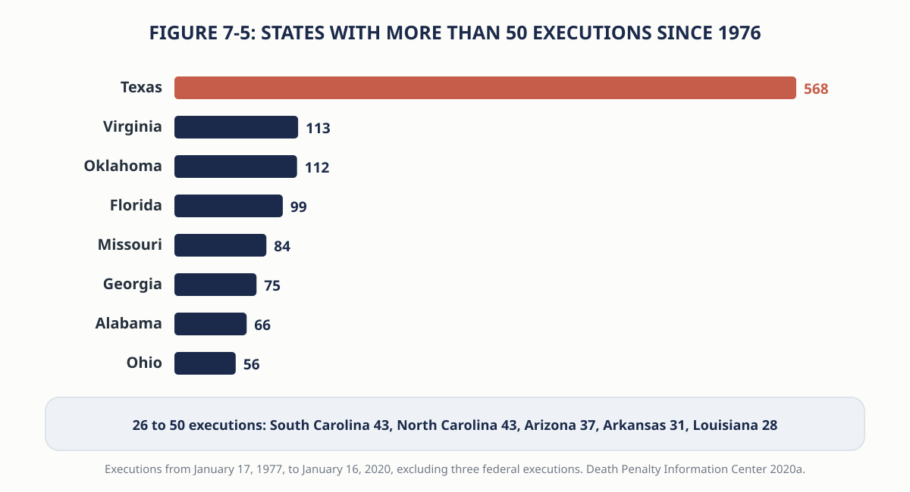{fig-alt="Horizontal bars of executions by state since 1976: Texas 568, Virginia 113, Oklahoma 112, Florida 99, Missouri 84, Georgia 75, Alabama 66, Ohio 56. States with 26 to 50: South Carolina 43, North Carolina 43, Arizona 37, Arkansas 31, Louisiana 28."} -->
<!-- <!-- ::: -->

<!-- <!-- ::: {.small} -->
<!-- <!-- The federal government had 61 people on death row and the military 4. Connecticut, Maryland, and New Mexico abolished the death penalty for future cases but still have people on death row; California, Oregon, and Pennsylvania keep it, but their governors imposed moratoriums (Death Penalty Information Center 2020a). -->
<!-- <!-- ::: -->

<!-- <!-- Data from the Arabic deck's text alternative to Figure 7-5. Only states with more than 25 executions are drawn; the alternative's list of states without the death penalty repeats New Mexico, so the slide gives no count. -->

<!-- ## Applying Sociology: The Functionalist View of the Death Penalty -->

<!-- - **Durkheim:** sanctions reinforce society's standards. Supporters say fear of execution deters some serious crimes, and that the worst criminals deserve to die regardless -->
<!-- - **Dysfunction, cost:** in Oklahoma, death penalty cases cost **3.2 times** as much to prosecute as cases seeking life without parole (Death Penalty Information Center 2020a) -->
<!-- - **Changing methods:** hanging gave way to electrocution (1890), then to lethal injection in the 1970s. Each was introduced as more humane, and lethal injection is now itself questioned -->

<!-- ## Applying Sociology: The Conflict View of the Death Penalty -->

<!-- - Poor defendants rely on overworked, underpaid **court-appointed lawyers**. Unequal legal resources can mean the difference between life and death -->
<!-- - As of 2020, **166** death row inmates had been **exonerated** (Death Penalty Information Center 2020b) -->
<!-- <!-- - Studies show defendants are more likely to be sentenced to death if their victims were white rather than Black (Petrie and Coverdill 2010) -->

<!-- <!-- ## Initiating Policy: Death Penalty Policy Is Moving in Two Directions -->

<!-- <!-- - U.S. support stood at **56 percent** in 2019, about where it was when a national survey first asked in **1937** (Gallup 2020a) -->
<!-- <!-- - **Broadening:** some states are considering more capital offenses, such as child molestation without murder, and certain repeat offenses -->
<!-- <!-- - **Narrowing:** legal challenges to **lethal injection** question whether an execution can be carried out humanely. Only about **20 to 40** death sentences follow the more than **14,000** murders reported each year -->

<!-- ## Take the Issue with You: What Evidence Would Answer the Deterrence Question? -->

<!-- ::: {.board} -->
<!-- Does the death penalty deter crime? If so, why are crime rates in the United States high compared with those in other nations? -->
<!-- ::: -->

<!-- - Design the study, using Chapter 2. Would you compare states with and without the death penalty, or one state before and after a change? Which control variables would you need? -->
<!-- - Schaefer also asks: should youths convicted of violent crimes be subject to the death penalty? What is your position on the death penalty, and what is your reasoning? -->
<!-- - Which evidence from this chapter, on cost, exonerations, or access to lawyers, would matter most to someone deciding the question? -->

<!-- <!-- Keep the discussion on the evidence Schaefer presents. No one is asked to defend or reject a religious position. --> 

# Deviance in Your Life and Your Field {background-color="#1B2A4A"}

::: {.takeaway}
What looked like individual character, a bad kid, a respectable executive, an obedient volunteer, follows patterns of labels, groups, opportunity, and power. You now have names for them.
:::

## Moskos's Patrol Explained with the Chapter's Concepts

::: {.board}
Use the chapter's vocabulary to explain what Moskos saw in Baltimore.
:::

- "Police don't deal with a random cross-section of society": **crime statistics** measure **police activity**, not all crime
- A fellow officer who "has their back": **conformity** to peers, alongside **obedience** to commanders
- Police deciding whom to stop and whom to arrest: **labeling theory**, **agents of social control**, and **differential justice**
- Argue it two ways. **Functionalist:** enforcement marks the limits of proper behavior. **Conflict:** who decides which neighborhoods get the most patrols, and which crimes get the least attention?

<!-- ## Taking Sociology to Work: Stephanie Vezzani, U.S. Secret Service {.smaller} -->

<!-- - Vezzani entered the University of Akron unsure of her major but sure she wanted a career fighting crime. She began in accounting and switched to sociology when she found the department offered a concentration in law enforcement -->
<!-- - The Secret Service protects high-ranking officials and their families, and investigates financial crimes, including counterfeiting, identity theft, and computer-based attacks on the financial, banking, and telecommunications industries. She has done both -->
<!-- - Travel is one of the most exciting parts of the job: Russia, Turkey, Jordan, Vietnam, and South Korea, and the 2002 Winter Olympics in Salt Lake City, where she protected athletes in the Olympic Village -->
<!-- - She uses sociology daily when she interviews suspects, witnesses, and victims: "It is critical in the field of law enforcement to have an understanding of people's relationships and the beliefs and value systems that contribute to their decision making" -->

<!-- ::: {.question-box} -->
<!-- Schaefer asks: besides an awareness of different beliefs, values, and cultures, what else might sociology offer those who serve in law enforcement? Law enforcement is a relatively new career option for women. What special strengths might a woman bring to police work? -->
<!-- ::: -->

## Sociology in Your Major

- **Medicine:** Goffman's stigma affects who seeks care and who hides a diagnosis. Milgram's teachers obeyed a man in a technician's coat; hospitals run on white coats and orders
- **Engineering:** speed bumps and traffic cameras are social control built into the road
- **Business:** white-collar and corporate crime, embezzlement punished more lightly than petty theft, and Merton's ritualist in every bureaucracy
- **Computer science:** cybercrime, identity theft, music piracy that carries no stigma, and virtual reality replications of Milgram

<!-- Instructor enrichment. -->

## Before You Leave

- **Deviance** violates a group's standards. It is socially defined, changes over time, and may carry a **stigma** (Goffman)
- **Social control** runs from informal to formal sanctions. Milgram separated **conformity** to peers from **obedience** to authority, and almost two-thirds of his subjects obeyed
- **Law** is governmental social control. **Control theory** (Hirschi): our bonds to others keep most of us conforming
- **Perspectives:** functionalist (Durkheim, Merton), interactionist (Sutherland, Shaw and McKay, Becker, Chambliss), conflict (Quinney)
- **Crime** comes in six types. **Statistics** undercount it, and most people think crime is rising even when it falls
- The **death penalty** debate turns on deterrence, cost, unequal legal defense, and wrongful convictions

::: {.small}
Next: Chapter 8, Stratification and Social Mobility.
:::
