# Jerome Powell on Inequality and the Middle Class {background-color="#1B2A4A"}

::: {.takeaway}
In 2019 the head of the U.S. central bank warned that the middle class was losing ground. His speech raises this chapter's questions: who gets what, why, and how easily people move up or down.
:::

## Predict: How Many Middle-Class Children Out-Earn Their Parents?

:::: {.columns}
::: {.column width="72%"}
- **Jerome Powell** became chair of the U.S. Federal Reserve on February 5, 2018. The Federal Reserve regulates the banking system and helps keep the economy on track
- In May 2019 he spoke to researchers and policymakers at a Chicago Federal Reserve conference about the future of the middle class
:::

::: {.column width="28%"}
::: {.center}
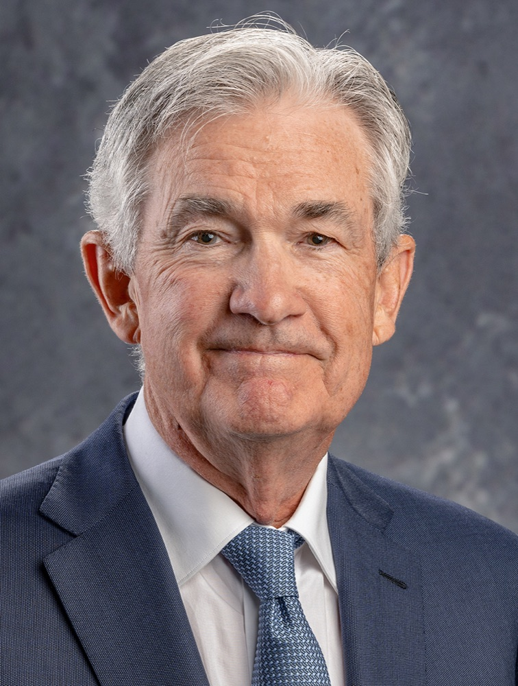{fig-alt="Official portrait of Jerome H. Powell, chair of the U.S. Federal Reserve." style="max-height: 300px !important;"}
:::

::: {.small .center}
Jerome Powell. Federal Reserve, public domain.
:::
:::
::::

::: {.question-box}
In the 1950s, what share of U.S. children born into middle-class households grew up to earn more than their parents? What share do today?
:::

::: {.fragment}
- In the 1950s, **better than 80 percent**. More recently, **only around half** (Powell 2019)
- "The kind of generational improvements in living standards that were long the hallmark of the American middle class have steadily diminished"
:::

## Powell's Three Observations About the U.S. Middle Class {.smaller}

1. **Income growth and upward mobility have slowed for the middle.** Since the 1970s, middle-class incomes have grown more slowly than high incomes, so income inequality has widened. Slower productivity growth also played a part
2. **The gap between college graduates and everyone else is widening.** From 1967 to 2017, employment fell among working-age men at every level of education, and it fell furthest for men without a college degree
3. **Moving up depends on more than effort and talent.** It depends on your family, the neighborhood you grow up in, and the quality of your primary and secondary schools. Children from higher-income households are much more likely to attend college, and that advantage has grown since the 1980s

## Powell: Employment Among U.S. Working-Age Men by Education, 1967 and 2017

::: {.center}
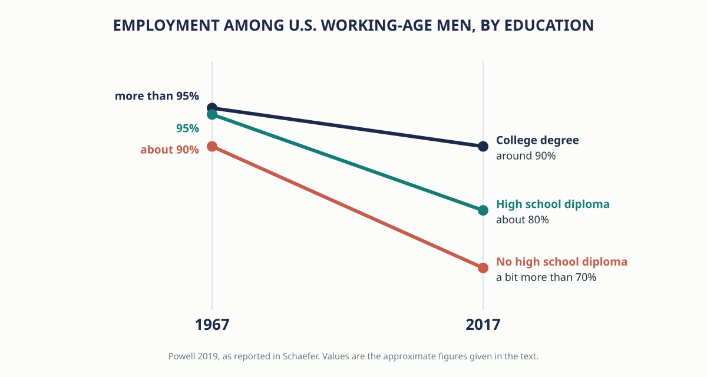{fig-alt="A slope chart with three lines. Men with a college degree: employment fell from more than 95 percent in 1967 to around 90 percent in 2017. Men with a high school diploma: from 95 percent to about 80 percent. Men without a high school diploma: from about 90 percent to a bit more than 70 percent. The less education, the steeper the fall."}
:::

<!-- ::: {.question-box} -->
<!-- Look at Powell's third observation. Which of those three factors did you choose for yourself: your family, your neighborhood, or your school? -->
<!-- ::: -->

<!-- ## Inherited Wealth and Earned Wealth: Which Do People Call Deserved? -->

<!-- ::: {.board} -->
<!-- Picture two very wealthy people. One inherited a fortune from a property-owning family. The other started with nothing and built a business. Which one deserves the wealth? -->
<!-- ::: -->

<!-- - Take a quick vote. Now ask: would your grandparents have voted the same way? -->
<!-- - The sociologically interesting part is not your answer. It is that **different societies, in different times and places, answer differently** -->
<!-- - What counts as deserving wealth, success, or power is itself a question about **stratification**, the subject of this chapter -->

<!-- Instructor enrichment, adapted from Crash Course Sociology, "Social Stratification". Crash Course's further point, that "if people didn't believe the system was right, it wouldn't last," returns on the dominant ideology slide. -->

# Systems of Stratification {background-color="#1B2A4A"}

::: {.takeaway}
Every society ranks its members. Sociologists ask how rigid the ranking is: whether your position is fixed at birth or can change through what you do.
:::

## Social Inequality and Stratification Defined

- **Social inequality** — a condition in which members of society have differing amounts of wealth, prestige, or power. All societies show some degree of social inequality
- **Stratification** — a structured ranking of entire groups of people that perpetuates unequal economic rewards and power in a society
- Stratification is how **one generation passes social inequalities on to the next**, producing groups ranked from low to high
- It results inevitably in social inequality: certain groups stand higher, control scarce resources, wield power, and receive special treatment
- The unequal rewards appear in the distribution of wealth and income, and even in the **mortality rates** of impoverished communities

::: {.takeaway}
Inequality describes differences between individuals. Stratification describes a ranking of whole groups that lasts across generations.
:::

## Income and Wealth Are Not the Same Thing

- **Income** — salaries and wages, interest on savings, stock dividends, and rental income
- **Wealth** — all of a person's material assets, including land, stocks, and other types of property

::: {.center}
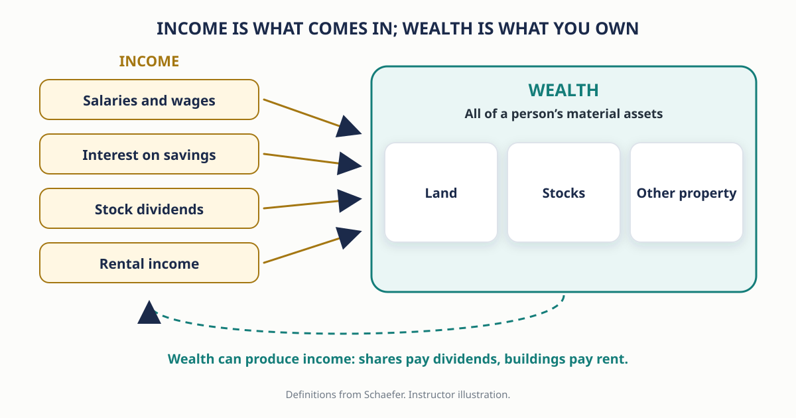{fig-alt="Four income sources on the left: salaries and wages, interest on savings, stock dividends, and rental income. Arrows lead to a large box labelled wealth, all of a person's material assets, containing land, stocks, and other property. A dashed arrow returns from wealth to income: wealth can produce income, as shares pay dividends and buildings pay rent." style="max-height: 500px !important;"}
:::
<!-- - The gaps are large even within one country. In some U.S. states, the median household income is **75 percent higher** than in others, and the poverty rate in many states is **twice** that of others (Figure 8-1; national median $61,937, national poverty rate 13.1 percent, 2018) -->

<!-- ::: {.question-box} -->
<!-- Income is a flow: money that comes in. Wealth is a stock: what you own. Which one would carry a family through a year without a salary? -->
<!-- ::: -->

<!-- Figure 8-1's state maps are not in source_en_ch08.txt. The slide uses only the figures in the text and the figure note. -->

## Income or Wealth? Sort the Items

::: {.board}
Classify each item as income or wealth. Some items produce the other.
:::

:::: {.columns}
::: {.column width="50%"}
1. A monthly salary from a ministry
2. Rent collected from an investment building
3. A chalet in Khiran
4. Shares in a Kuwaiti bank
:::

::: {.column width="50%"}
5. The yearly dividend on those shares
6. A plot of land inherited from a grandfather
7. Interest on a savings account
8. Gold jewelry received at a wedding
:::
::::

::: {.fragment .question-box}
Two employees earn the same salary. One also inherited a building. Who is safer if both lose their jobs tomorrow? Whose children start further ahead?
:::

<!-- Instructor enrichment. -->

## Ascribed and Achieved Status Shape Every System of Stratification

- **Ascribed status** — a social position assigned to a person by society without regard for the person's unique talents or characteristics (Chapter 5)
- **Achieved status** — a social position a person attains largely through his or her own efforts
- The two are closely linked. The most affluent families generally **inherit** wealth and status, while many members of racial and ethnic minorities inherit **disadvantaged** status. Age and gender are ascribed statuses that also influence wealth and social position
- Schaefer describes **four systems of stratification**: slavery, castes, estates, and social classes. Treat them as **ideal types** (Chapter 1). Any real system may include elements of more than one

## Four Systems of Stratification, from Closed to Open

::: {.center}
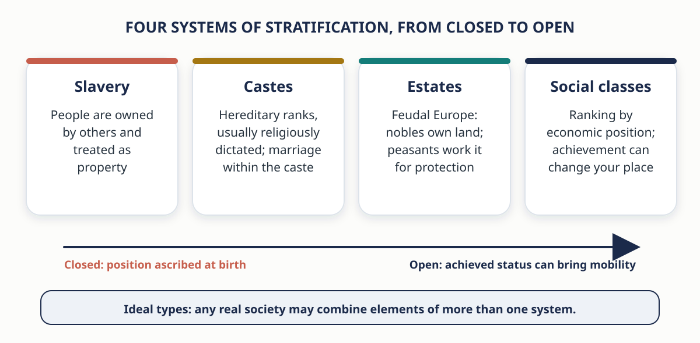{fig-alt="Four cards arranged from closed to open. Slavery: people are owned by others and treated as property. Castes: hereditary ranks, usually religiously dictated, with marriage within the caste. Estates: in feudal Europe, nobles owned land and peasants worked it in exchange for protection. Social classes: a ranking based on economic position in which achievement can change one's place. An arrow runs from closed systems, where position is ascribed at birth, to open systems, where achieved status can bring mobility."}
:::

::: {.small}
Before the U.S. Civil War, for example, the southern states had both social classes dividing white people from one another and the institutionalized enslavement of Black people.
:::

## Slavery: The Most Extreme Form of Legalized Inequality {.smaller}

- **Slavery** — a system in which enslaved individuals are **owned by other people**, who treat them as property, just as if they were household pets or appliances
- **Ancient Greece:** enslaved people came mainly from piracy and captives of war. Children could inherit the status, but it was not necessarily permanent. A person's status might change depending on which city-state won a war
- **The United States and Latin America:** slavery was an **ascribed** status, and racial and legal barriers prevented the freeing of enslaved people
- In both Europe and the New World, the rise of slavery was **essential to the growth of capitalism** in the 19th century (Desmond 2019)
- The **Universal Declaration of Human Rights**, binding on all UN members, prohibits slavery in all its forms. Yet **more people are enslaved today** than at any point in world history: over **40 million** at any given time (Walk Free Foundation 2019)
- Today's forms include **bonded laborers** held in virtual lifetime employment, and guest workers and undocumented workers in Europe and the United States forced to labor for years to pay off debts or to avoid being turned over to immigration authorities. Both involve the transnational crime of **trafficking in humans** (Chapter 7)

<!-- ## Human Trafficking and the U.S. Trafficking Victims Protection Act -->

<!-- - Data on trafficking and slavery are hard to assess, because **no government will voluntarily and publicly disclose** such numbers. Faith-based groups organize under the banner "Abolition Now" to fight trafficking -->
<!-- - In **2000**, the U.S. Congress passed the **Trafficking Victims Protection Act**, which set minimum standards for eliminating human trafficking -->
<!-- - The State Department monitors other countries' efforts to investigate, prosecute, and convict traffickers, including government officials, and reports its findings each year (Table 8-1): -->

<!-- | Tier | What it means | -->
<!-- |---|---| -->
<!-- | **Tier 1 and Tier 2** | Largely in compliance with the act | -->
<!-- | **Tier 2 Watch** | Making efforts to comply, though trafficking remains a significant concern | -->
<!-- | **Tier 3** | Not compliant and not making significant efforts to comply | -->

<!-- Source gap: Table 8-1's country lists are not in source_en_ch08.txt; the slide gives only the tier definitions from the text. Kuwait's own tier is deliberately not added (course rule on nationality-based inequality in the Gulf). --> 

## Castes: Hereditary Ranks That Are Hard to Leave {.smaller}

- **Castes** — hereditary ranks that are usually religiously dictated and tend to be fixed and immobile. Children automatically take their parents' position, and members are expected to **marry within their caste**
- The caste system is generally associated with **Hinduism in India**. There are four major castes, called **varnas**
- A fifth category of outcastes, the **untouchables**, makes up **16 percent** of the population. They are considered so lowly and unclean as to have no place within the system
- To avoid perpetuating the stigma, the government now calls them **scheduled castes**. They themselves prefer **Dalit** ("the repressed"), a term that expresses their desire to overcome their disadvantaged status
- In **1950**, after independence from Great Britain, India's new constitution **formally outlawed** the caste system
- Over the past decade or two, **urbanization and technology** have changed the caste system more than government or politics has in half a century. The anonymity of city life lets Dalit pass unrecognized in temples, schools, and workplaces, and the globalization of high technology has opened new opportunities
- The term applies beyond India: the southern United States from the end of the Civil War through the 1960s, and South Africa under **apartheid** (1948 through the 1990s). In both, race defined a person's place (Wilkerson 2020)

## Discuss: How City Anonymity Weakens Caste Boundaries

::: {.board}
India outlawed caste in 1950. Yet Schaefer says city life and technology have done more to change the system in the last few decades than the law did in half a century.
:::

:::: {.columns}
::: {.column width="60%"}
- What does a stranger in a crowded city know about you? What did your neighbors in a village know?
- Which settings still let people learn your family background quickly: a wedding, a job interview, a diwaniya, a WhatsApp group?
- What does this suggest about where ascribed status matters most: in law, or in everyday interaction?
:::

::: {.column width="40%"}
::: {.center}
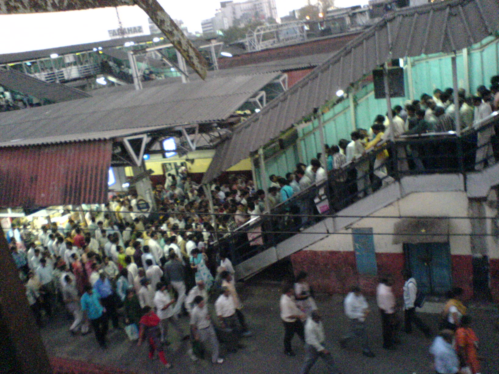{fig-alt="An evening crowd of commuters pours across the platforms and footbridge of Bandra railway station in Mumbai." style="max-height: 380px !important;"}
:::

::: {.small .center}
Evening commuters at Bandra station, Mumbai, 2006. Rakesh from Bangalore, CC BY-SA 2.0.
:::
:::
::::

<!-- Instructor enrichment. Keep the Kuwaiti settings general; no one is asked about their own family name or background. -->

## Estates: Nobles, Peasants, and Land in Feudal Europe {.smaller}

:::: {.columns}
::: {.column width="70%"}
- **Estate system** (feudalism) — peasants worked land leased to them by nobles in exchange for military protection and other services. It was associated with feudal societies during the Middle Ages
- The nobles' **ownership of land** was the basis of their superior and privileged status
- As in slavery and caste, **inheritance** largely defined a person's position. Nobles inherited titles and property; peasants were born into a subservient position in an agrarian society
- By the **12th century**, a priesthood had emerged in most of Europe, along with classes of **merchants and artisans**. For the first time, some groups had wealth that did not depend on land or agriculture
- This economic change ended the estate system, and a **class system** of stratification came into existence
:::

::: {.column width="30%"}
::: {.center}
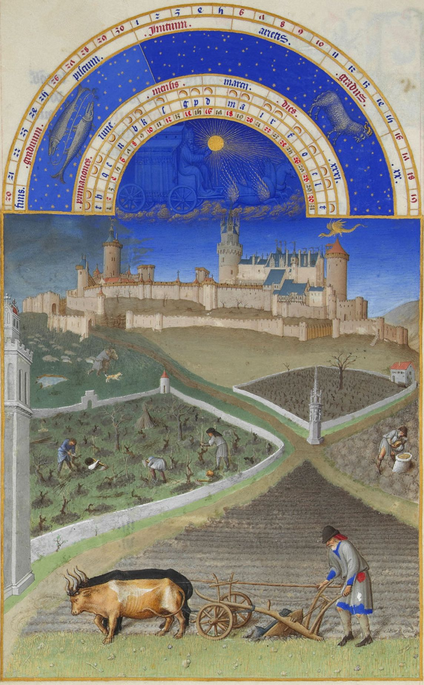{fig-alt="A medieval calendar painting: a walled castle with towers stands on a hill while peasants below plough the fields with oxen, prune vines, and sow seed." style="max-height: 600px !important;"}
:::

::: {.small .center}
Peasants work the fields below the lord's castle. Limbourg brothers, *Très Riches Heures du Duc de Berry*, "March," c. 1412–1416. Public domain.
:::
:::
::::

<!-- Instructor enrichment: the Limbourg image. -->

<!-- ## Slavery and Caste Compared: Thinking Critically -->

<!-- ::: {.board} -->
<!-- Schaefer asks: what are the differences between slavery and caste systems? What are the similarities? -->
<!-- ::: -->

<!-- :::: {.columns} -->
<!-- ::: {.column width="50%"} -->
<!-- ### Compare them on -->

<!-- - How a person enters the position -->
<!-- - What justifies the ranking -->
<!-- - Whether a person can ever leave it -->
<!-- - Whom a person may marry -->
<!-- ::: -->

<!-- ::: {.column width="50%"} -->
<!-- ::: {.fragment} -->
<!-- ### Hints from the chapter -->

<!-- - Both are **closed** systems based on **ascribed** status -->
<!-- - Slavery rests on **ownership** of people; caste rests on hereditary, usually **religious** rank -->
<!-- - In ancient Greece slavery was **not necessarily permanent**; caste membership is fixed at birth -->
<!-- ::: -->
<!-- ::: -->
<!-- :::: -->

## Social Classes: A Ranking by Economic Position

- **Class system** — a social ranking based primarily on economic position in which **achieved characteristics can influence social mobility**
- Unlike slavery and caste, the boundaries between classes are **imprecisely defined**, and people can move from one stratum, or level, to another
- Class systems still maintain stable hierarchies and are marked by unequal distribution of wealth and power
- Class standing, though achieved, is **heavily dependent on family** and on ascribed factors such as ethnicity
- Sociologist **Daniel Rossides** (1997) uses a **five-class model** of the United States. Its lines are not as sharp as caste divisions, but the five classes differ in more than income

## Rossides's Five-Class Model of the United States

::: {.center}
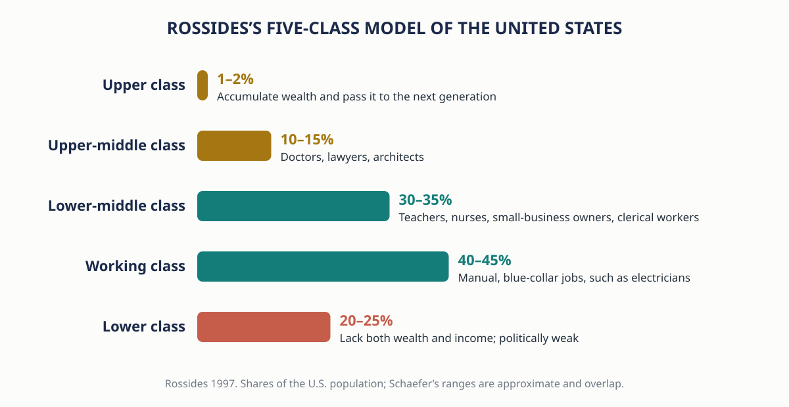{fig-alt="Five horizontal bars sized by share of the U.S. population. Upper class, 1 to 2 percent: accumulate wealth and pass it to the next generation. Upper-middle class, 10 to 15 percent: doctors, lawyers, architects. Lower-middle class, 30 to 35 percent: teachers, nurses, small-business owners, clerical workers. Working class, 40 to 45 percent: manual, blue-collar jobs such as electricians. Lower class, 20 to 25 percent: lack both wealth and income and are politically weak."}
:::

<!-- ## The Upper and Lower Classes {.smaller} -->

<!-- :::: {.columns} -->
<!-- ::: {.column width="50%"} -->
<!-- ### Upper class: about 1 to 2 percent -->

<!-- - They accumulate wealth and pass it on to the next generation -->
<!-- - Economist John Kenneth Galbraith: "Of all classes the rich are the most noticed and the least studied" (1977:44). Since he wrote that, the **residential separation** of the rich has grown -->
<!-- - In 2019, over **173,000** U.S. households were worth more than **$25 million** each -->
<!-- ::: -->

<!-- ::: {.column width="50%"} -->
<!-- ### Lower class: about 20 to 25 percent -->

<!-- - Lacks both wealth and income and is too weak politically to exercise significant power -->
<!-- - Disproportionately includes racial and ethnic minorities, single mothers with dependent children, and people who cannot find regular work or must make do with low-paying work (Killewald et al. 2017) -->
<!-- - **People with disabilities** are especially vulnerable to unemployment and low pay. Whatever their performance, they are stigmatized as "not earning their keep," an effect of ascribed status -->
<!-- ::: -->
<!-- :::: -->

<!-- Condensed per course rules: Schaefer names Blacks and Hispanics in the lower-class description; the slide uses "racial and ethnic minorities." Restore the wording if you want it verbatim for the exam. -->

<!-- ## Predict: How Much of the Richest Households' Wealth Was Inherited? -->

<!-- ::: {.question-box} -->
<!-- Think of the U.S. households worth more than $25 million each. What share of their wealth do you think they inherited? -->
<!-- ::: -->

<!-- ::: {.fragment} -->
<!-- - Just **17 percent**. Fewer than 25 percent of these people inherited even a tenth of their money, and very few are celebrities -->
<!-- - Today's truly rich have largely made their money in **finance, insurance, and health care** (Bothwell 2017; Spectrum Group 2019; Wolff 2017) -->
<!-- - Contrary to conventional wisdom, the nation's richest families are **not living off inherited wealth** -->
<!-- ::: -->

<!-- ::: {.fragment .question-box} -->
<!-- Does this finding mean birth no longer matters? What would you need to know about these people's parents, schools, and first jobs before you decided? -->
<!-- ::: -->

<!-- ## The Middle and Working Classes -->

<!-- - **Upper-middle class** (about **10 to 15 percent**): professionals such as doctors, lawyers, and architects. They participate extensively in politics and take leadership roles in voluntary associations -->
<!-- - **Lower-middle class** (about **30 to 35 percent**): less affluent professionals such as elementary school teachers and nurses, owners of small businesses, and many clerical workers. Not all hold college degrees, but they share the goal of **sending their children to college** -->
<!-- - **Working class** (about **40 to 45 percent**): people with regular manual or blue-collar jobs. Some, such as electricians, earn more than the lower-middle class, yet they tend to identify with manual workers and the U.S. labor movement -->
<!-- - The working class is **declining** noticeably, as service and technical jobs replace jobs in manufacturing and transportation -->

<!-- ## The U.S. Middle Class Is Shrinking -->

<!-- - A widely accepted definition: a **middle-class household** has an income between **two-thirds and twice** the nation's median household income, between **$42,000 and $126,000** -->
<!-- - By that definition, about **40 percent** of U.S. households were middle class in **2018**, compared with **57 percent** in **1967** (Semega et al. 2019) -->
<!-- - This is the trend Powell warned about. The growth of **precarious work** adds to the strain (Box 8-1) -->

<!-- ::: {.question-box} -->
<!-- What does "middle class" mean in Kuwait: owning a house, a new car, summer travel, private school fees? Who would call themselves middle class here, and who would others put there? -->
<!-- ::: -->

<!-- Instructor enrichment: the Kuwait question. -->

<!-- ## Box 8-1: Precarious Work Is Poorly Paid, Insecure, and Unprotected {.smaller} -->

<!-- - On-call workers, consultants who have never held a full-time job, sharing-economy entrepreneurs, gig workers, independent contractors: millions of Americans do **precarious work** -->
<!-- - **Precarious work** — employment that is poorly paid and, from the worker's perspective, insecure and unprotected. People who do it often cannot support a household and are vulnerable to falling into poverty -->
<!-- - In his presidential address to the American Sociological Association, **Arne L. Kalleberg** offered five social indicators that precarious work was rising, even while the unemployment rate stayed steady: -->

<!-- 1. A **decline** in the average time workers stay with an employer, especially noticeable among older white men, who in the past were protected by employers -->
<!-- 2. An **increase in long-term unemployment**: more workers stayed unemployed after six months in the 2000s, as manufacturing jobs shrank -->
<!-- 3. A **decrease in job security**: workers grew less sure they could replace a lost job -->
<!-- 4. An **increase in outsourcing and temporary work**: today virtually any job can be outsourced, including accounting, legal, and military services -->
<!-- 5. A **shift in risk** from employers to employees: few companies offer traditional pensions, and workers carry more of the cost and risk of retirement and health insurance -->

<!-- ## Box 8-1: Who Does Precarious Work, and What Denmark Does About It -->

<!-- - People differ in their vulnerability. Members of **racial and ethnic minorities** and **immigrants**, including legal immigrants, are more likely to be precariously employed. Around the world, **women** are much more likely than men to do precarious work -->
<!-- - The **coronavirus pandemic** showed how fragile these jobs are. Precarious workers were typically the first to lose their jobs and had the most difficulty finding new ones -->
<!-- - **Denmark** cannot make jobs more secure, but it gives significant help to the unemployed: help finding a job, **90 percent of the previous wage for one year** without conditions, and subsidized education and training (Kalleberg 2009; Kalleberg and Vallas 2018) -->

<!-- ::: {.question-box} -->
<!-- Schaefer asks: looking forward to your own career, can you think of a strategy for avoiding precarious work, frequent job loss, and long-term unemployment? -->
<!-- ::: -->

<!-- ## Precarious or Secure? Rate the Job -->

<!-- ::: {.board} -->
<!-- Rate each job from "secure" to "precarious." Which of Kalleberg's five indicators does each one show? -->
<!-- ::: -->

<!-- :::: {.columns} -->
<!-- ::: {.column width="50%"} -->
<!-- 1. A delivery-app rider paid per order -->
<!-- 2. A graphic designer who finds clients through Instagram -->
<!-- 3. A permanent employee in a ministry -->
<!-- 4. An engineer on a two-year project contract -->
<!-- ::: -->

<!-- ::: {.column width="50%"} -->
<!-- 5. A content creator paid through brand deals -->
<!-- 6. A lecturer hired one semester at a time -->
<!-- 7. A software developer at a start-up that may close next year -->
<!-- 8. A nurse in a public hospital -->
<!-- ::: -->
<!-- :::: -->

<!-- ::: {.fragment .question-box} -->
<!-- Which of these jobs did your parents' generation consider "a real job"? Which ones are your classmates applying for? -->
<!-- ::: -->

<!-- Instructor enrichment. Keep the discussion on job features, not on who holds these jobs in Kuwait. -->

<!-- ## Box 8-2: Taxing the Rich: "Class Warfare" in U.S. Politics {.smaller} -->

<!-- - No one likes taxes, but U.S. policymakers differ sharply on how people at different levels of the stratification system should be taxed -->
<!-- - President **Donald Trump's** 2017 tax overhaul dropped the top income tax rate from about **40** to **37** percent. Senator **Bernie Sanders** proposed raising it to **52** percent -->
<!-- - Trump doubled the estate (inheritance) tax exemption from **$5.5 million to $11 million**. Sanders proposed lowering it to **$3.5 million** -->
<!-- - The public is evenly divided on whether the federal taxes they pay are about right or unfair. Only **9 percent** of the richest feel they pay too much, unchanged after Trump's tax changes -->
<!-- - Most Americans (**61 percent**) think there is too much economic inequality, and about half say addressing it requires significant changes to the economic system. Even so, most say some inequality is acceptable -->
<!-- - About **four in ten** say reducing inequality should be a top federal priority. Yet the public does not rank inequality among the country's biggest problems (Gallup 2019; Horowitz et al. 2020) -->

<!-- ::: {.question-box} -->
<!-- Schaefer asks: what is the relationship between social class structure and power? Kuwait has no personal income tax. What other tools could a state use to shift resources between groups? -->
<!-- ::: -->

<!-- Box number: the text says "the tax structure, as discussed in Box 8-2"; the OCR places this "Class Warfare" box after the working-class section. Instructor enrichment: the Kuwait question. -->

# Sociological Perspectives on Stratification {background-color="#1B2A4A"}

::: {.takeaway}
Marx saw economic class as the key to all inequality. Weber saw three separate rankings. Interactionists watch how class shows up in what people buy and display.
:::

## Marx: Who Controls the Means of Production? {.smaller}

:::: {.columns}
::: {.column width="76%"}
- **Karl Marx** studied stratification in every type of society, from early agricultural tribes through feudalism, but focused on the effects of economic inequality in **19th-century Europe**. The plight of the working class made him feel that the class structure had to change
- Social relations in any period depend on **who controls the primary mode of economic production**, such as land or factories. Under feudalism the nobility owned the land, and peasants had little choice but to work on the owners' terms
- **Capitalism** — an economic system in which the means of production are held largely in private hands and the main incentive for economic activity is the accumulation of profits
- **Bourgeoisie** — the capitalist class, which owns the means of production, such as factories and machinery. **Proletariat** — the working class
- The bourgeoisie maximize profit in competition with other firms, and in the process **exploit workers**, who must exchange their labor for subsistence wages
- Each class shares a distinctive culture. Marx was most interested in the proletariat's, but he also examined the **ideology of the bourgeoisie**, through which it justifies its dominance over workers
:::

::: {.column width="24%"}
::: {.center}
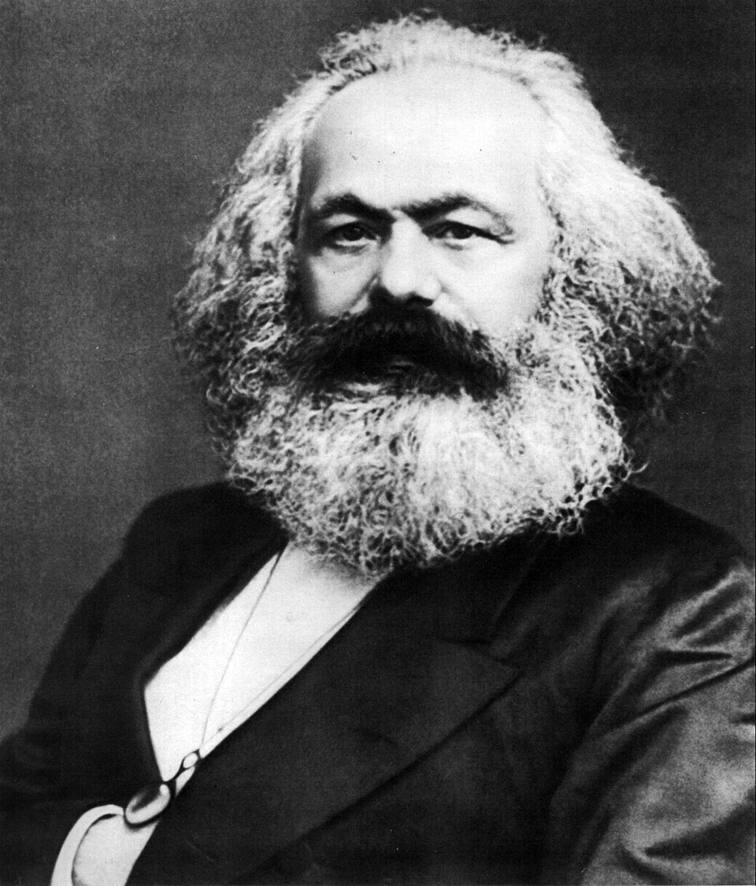{fig-alt="Portrait photograph of Karl Marx with a full white beard." style="max-height: 360px !important;"}
:::

::: {.small .center}
Karl Marx (1818–1883). John Jabez Edwin Mayall, public domain.
:::
:::
::::

<!-- ::: {.small} -->
<!-- Schaefer's photo example: fracking operators who extract oil or gas from deep underground cover their own expenses and work in desolate locations, exposed to chemicals. Marx would identify them as members of the proletariat. -->
<!-- ::: -->

## Marx: Class Consciousness and False Consciousness {.smaller}

- Marx predicted that exploitation would **inevitably** lead workers to revolt and destroy capitalism
- First, workers must develop **class consciousness** — a subjective awareness of common vested interests and the need for collective political action to bring about social change
- Often they must overcome **false consciousness** — an attitude held by members of a class that does not accurately reflect their objective position

::: {.center}
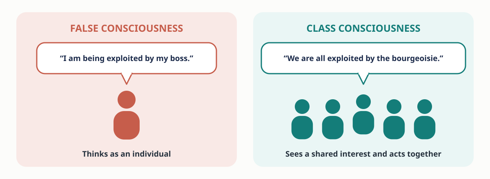{fig-alt="Two panels. False consciousness: a single worker says, I am being exploited by my boss, and thinks as an individual. Class consciousness: a group of workers say, we are all exploited by the bourgeoisie, and see a shared interest and act together." style="max-height: 340px !important;"}
:::

- The class-conscious worker sees that **all workers** are exploited by the bourgeoisie and share a stake in revolution. Marx expected revolutionary leaders to guide the proletariat to overthrow the bourgeoisie and the government, which he saw as representing capitalists, and to end private ownership of the means of production. In his rather **utopian** view, classes and oppression would then cease to exist

## False Consciousness or Class Consciousness? Classify the Statement

::: {.board}
How would Marx classify each statement?
:::

1. "My manager is unfair. I'll move to a better company."
2. "If I work harder than everyone else on the team, I'll make partner."
3. "Every junior engineer here is paid less each year while the partners' bonuses grow. We should negotiate together."
4. "The owner deserves the profits. He took the risk."
5. "Every nurse on this ward is overworked. Let's write one letter, signed by all of us."

<!-- ::: {.fragment .question-box} -->
<!-- Schaefer asks: have you ever been unaware of your true position in society, that is, experienced false consciousness? What would Marx say about the word "I" in the first two statements? -->
<!-- ::: -->

<!-- Instructor enrichment: the statements. -->

## How Accurate Were Marx's Predictions?

- He failed to anticipate **labor unions**, whose collective bargaining weakens the stranglehold that capitalists hold over workers
- He did not foresee how far **political liberties and relative prosperity** could contribute to false consciousness. Many workers see themselves as individuals striving for improvement in free societies with substantial mobility, not as members of a class facing a collective fate
- Even today, "class warfare" refers more to **diminished individual expectations** than to a collective identity
- He did not predict that Communist Party rule would be established, and later **overthrown**, in the former Soviet Union and throughout Eastern Europe
- **Still useful:** the Marxist approach stresses stratification as a determinant of social behavior and the fundamental separation in many societies between the **rich and the poor**

## Weber: Class, Status Group, and Power

:::: {.columns}
::: {.column width="22%"}
::: {.center}
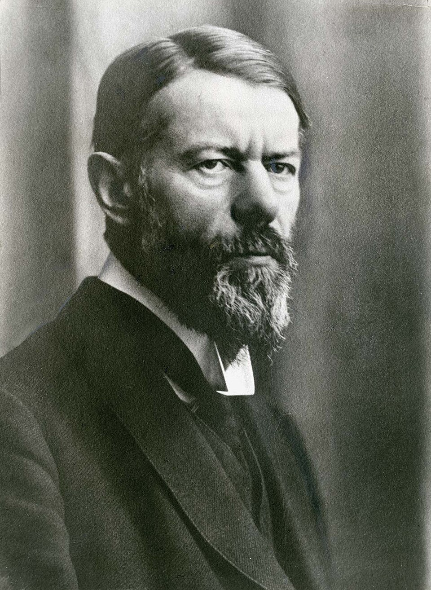{fig-alt="Portrait photograph of Max Weber in 1918." style="max-height: 380px !important;"}
:::

::: {.small .center}
Max Weber (1864–1920), 1918. Ernst Gottmann, public domain.
:::
:::

::: {.column width="78%"}
::: {.center}
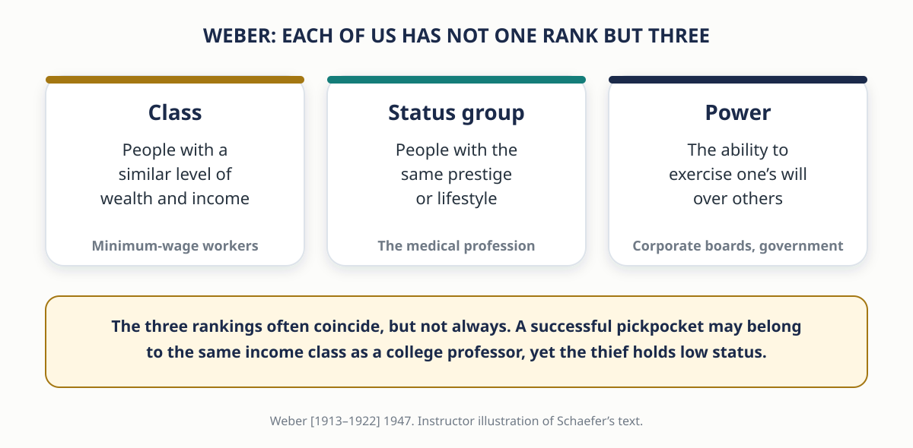{fig-alt="Three cards. Class: people with a similar level of wealth and income, for example minimum-wage workers. Status group: people with the same prestige or lifestyle, for example the medical profession. Power: the ability to exercise one's will over others, for example corporate boards and government bodies. A banner notes that the three rankings often coincide but not always: a successful pickpocket may share an income class with a college professor, yet the thief holds low status."}
:::
:::
::::

## Weber: No Single Characteristic Defines Your Position {.smaller}

- **Max Weber**, writing in 1916, insisted that no single characteristic, such as class, totally defines a person's position. He agreed that the economic dimension matters but argued that it cannot explain everything
- **Class** — a group of people with a similar level of wealth and income. Workers trying to support families on minimum-wage jobs form a class, because they share the same economic position and fate
- **Status group** — people who have the same prestige or lifestyle. You gain status through membership in a desirable group, such as the medical profession
- **Power** — the ability to exercise one's will over others. In the United States it stems from membership in influential groups: corporate boards, government bodies, interest groups. Conflict theorists note that **big business and government** are closely interrelated: corporate heads move into government posts, and former government and military leaders take key roles in corporations
- Each of us has **not one rank but three**. Each influences the others, and they often coincide. **John F. Kennedy** came from an extremely wealthy family, attended exclusive preparatory schools, graduated from Harvard, and became president

## Weber's Three Rankings Do Not Always Match: Rate Each Person

::: {.board}
Rate each person high, medium, or low on class (wealth and income), status (prestige), and power.
:::

:::: {.columns}
::: {.column width="50%"}
1. An influencer with three million followers
2. A university professor
3. A member of the National Assembly
4. A first-year medical resident
:::

::: {.column width="50%"}
5. A wealthy merchant's heir who avoids public life
6. A ministry undersecretary
7. A successful pickpocket
8. A respected elder who hosts a large diwaniya
:::
::::

::: {.fragment .question-box}
Where did the three ratings disagree most? Would Marx say the disagreement matters, or that money eventually decides the other two?
:::

<!-- Instructor enrichment: the cases. The pickpocket is Schaefer's. -->

## Interactionists: Veblen's Conspicuous Consumption {.smaller}

:::: {.columns}
::: {.column width="78%"}
- Marx and Weber worked at the **macro** level, studying whole societies or the global economy. Marx did point toward the micro level when he asked how individuals develop class consciousness
- Interactionists, and economists, study how social class shapes a person's **lifestyle**
- **Conspicuous consumption** — Thorstein Veblen's (1857–1929) term for buying goods not to survive but to **flaunt** superior wealth and social standing: more cars than one can reasonably use, homes with more rooms than one can possibly occupy
- **Conspicuous leisure** — jetting to a remote destination just long enough to have dinner or watch a sunset over a historic site (Veblen [1899] 1964). Schaefer reports that the rich now spend **$275,000 to $400,000** on their children's playhouses and tree houses
- Social media created a new outlet. Seeing friends' vacations and new cars online can provoke **Facebook envy**. Studies in the United States and Germany show that even otherwise happy people can suffer envy and distress from digitally shared conspicuous consumption (Taylor and Strutton 2016)
:::

::: {.column width="22%"}
::: {.center}
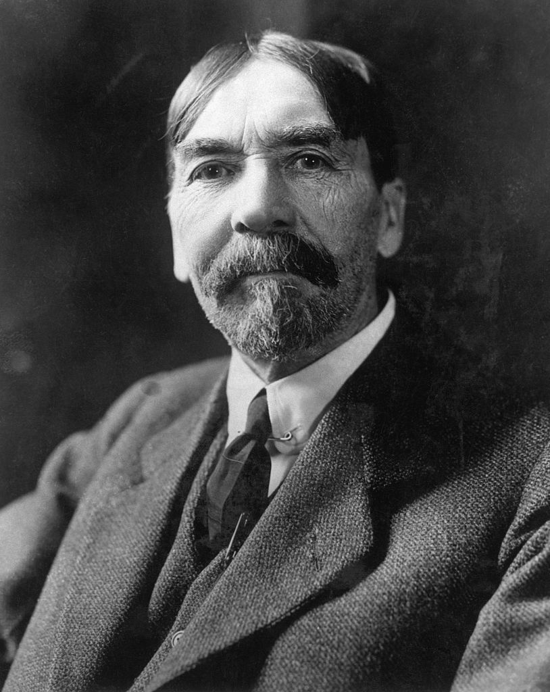{fig-alt="Portrait photograph of Thorstein Veblen, an older man with a moustache and goatee." style="max-height: 340px !important;"}
:::

::: {.small .center}
Thorstein Veblen. Public domain.
:::
:::
::::

<!-- OCR check: the photo caption reads "$275,00 to $400,000"; the slide assumes $275,000. -->

## Interactionists: Lower-Class Lifestyles Are Ridiculed and Even Restricted {.smaller}

:::: {.columns}
::: {.column width="58%"}
- Behavior judged typical of the lower class faces not only **ridicule** but even **legal action**
- Some U.S. communities have banned trailers from front yards and sofas from front porches. In some it is illegal to leave a pickup truck in front of the house overnight
- Street vendors who sell fruit, flowers, and water face restrictions meant not to serve the public but to **protect their storefront competitors**
- During the **coronavirus pandemic**, interactionists observed that the poor could not keep their distance in the jobs they held or in their housing, from high-density public housing in U.S. cities to the tightly packed slums of Rio de Janeiro (Bassett 2020)
:::

::: {.column width="42%"}
::: {.center}
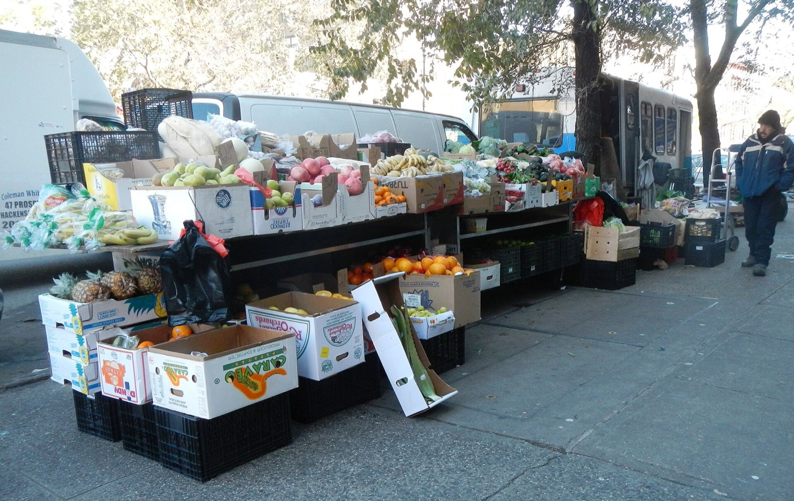{fig-alt="A sidewalk fruit and vegetable stand in New York City: cardboard boxes of oranges, apples, bananas, and pineapples stacked on crates beside parked vans." style="max-height: 400px !important;"}
:::

::: {.small .center}
A sidewalk fruit stand in East Harlem, New York, 2012. Jim Henderson, CC0.
:::
:::
::::

<!-- ::: {.question-box} -->
<!-- Which rules or comments in your city target a lifestyle rather than a harm? Who makes the rule, and whose lifestyle does it protect? -->
<!-- ::: -->

<!-- ## Conspicuous Consumption in Kuwait: What Does Each Item Signal? -->

<!-- ::: {.board} -->
<!-- Schaefer asks for examples of conspicuous consumption around us. Which are obvious, and which are subtle? -->
<!-- ::: -->

<!-- :::: {.columns} -->
<!-- ::: {.column width="50%"} -->
<!-- ### Obvious -->

<!-- - A luxury car in the university parking lot -->
<!-- - A designer bag placed on the café table, then photographed -->
<!-- - A wedding in a hotel ballroom for 800 guests -->
<!-- ::: -->

<!-- ::: {.column width="50%"} -->
<!-- ### Subtle -->

<!-- - The music playing in your car when you give someone a ride -->
<!-- - The way you pronounce a brand name -->
<!-- - Which coffee shop you study in -->
<!-- - Daily stories from a summer trip abroad -->
<!-- ::: -->
<!-- :::: -->

<!-- ::: {.fragment .question-box} -->
<!-- For a subtle signal to work, other people must know how to read it. Where did you learn to read these signals, and who never learned? -->
<!-- ::: -->

<!-- Instructor enrichment. The music-in-the-car example adapts Crash Course Sociology, "Why Is There Social Stratification?" (objects as "sign vehicles"). Keep the discussion general; no one comments on a classmate's belongings. -->

# Is Stratification Universal? {background-color="#1B2A4A"}

::: {.takeaway}
Every known society ranks its members in some way. Functionalists say the ranking does a job for society. Conflict theorists say it serves the people at the top.
:::

## Landtman and the Kiwai Papuans: "A Little More High" {.smaller}

- Utopian socialists, religious minorities, and recent countercultures have all tried to build communities that would abolish inequality
- Anthropologist **Gunnar Landtman** ([1938] 1968) studied the **Kiwai Papuans** of New Guinea. At first he noticed little differentiation: every man did the same work and lived in similar housing. On closer inspection, he found a ranking:

::: {.center}
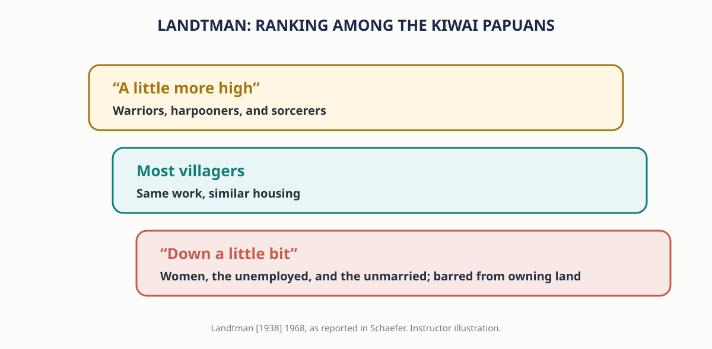{fig-alt="Three stacked bands, each set slightly lower than the one above. Top: a little more high, warriors, harpooners, and sorcerers. Middle: most villagers, who did the same work and lived in similar housing. Bottom: down a little bit, women, the unemployed, and the unmarried, who were barred from owning land." style="max-height: 440px !important;"}
:::

- Stratification is **universal**: all societies maintain some form of social inequality. Depending on its values, a society may rank people by religious knowledge, hunting skill, physical attractiveness, trading expertise, or the ability to provide health care

<!-- ::: {.question-box} -->
<!-- Suppose this course gave no grades at all. Would ranking disappear from the room? What would people rank each other by instead? -->
<!-- ::: -->

## Functionalist View: Davis and Moore on Unequal Rewards {.smaller}

- Would people go to school for many years to become physicians if they could make as much money and gain as much respect as street cleaners? Functionalists say no
- **Kingsley Davis and Wilbert Moore** (1945): society must fill its positions, and fill them with people who have the right talents. Rewards, including money and prestige, depend on a position's **importance** and the **scarcity** of qualified people
- So stratification is universal, and inequality is **necessary** to motivate people to fill functionally important positions
- **Critics:** unequal rewards are not the only motivator. Personal pleasure, intrinsic satisfaction, and values also lead people into careers
- Functionalists reply that society still needs some reward to draw people into unpleasant or dangerous jobs and into professions with long training
- **Remaining problems:** the theory devalues work done by women at home or in women's occupations, and low-status work in fast-food outlets. It does not address systems in which status is **inherited**, such as slavery or caste. And it does not explain the **wide disparity** between the rich and the poor (R. Collins 1975; Kerbo 2012)

<!-- ## Test Davis and Moore: Rank Jobs by Importance, Then by Pay -->

<!-- ::: {.board} -->
<!-- Rank these jobs twice: first by how important they are to society, then by how much they pay. -->
<!-- ::: -->

<!-- :::: {.columns} -->
<!-- ::: {.column width="50%"} -->
<!-- 1. Emergency physician -->
<!-- 2. Garbage collector -->
<!-- 3. Primary school teacher -->
<!-- 4. Professional footballer -->
<!-- ::: -->

<!-- ::: {.column width="50%"} -->
<!-- 5. Nurse -->
<!-- 6. Petroleum engineer -->
<!-- 7. Fashion influencer -->
<!-- 8. Bank CEO -->
<!-- ::: -->
<!-- :::: -->

<!-- ::: {.fragment .question-box} -->
<!-- Where do your two rankings disagree? Which of the critiques on the previous slide does each disagreement support? -->
<!-- ::: -->

<!-- Instructor enrichment, adapted from Crash Course Sociology, "Why Is There Social Stratification?" (garbage collectors; a high school teacher versus a famous actor). -->

## Conflict View: Marx, Dahrendorf, and Authority {.smaller}

- Marx viewed history as a continuous struggle between oppressors and oppressed, ending in an egalitarian, classless society. Under capitalism, he argued, the bourgeoisie manipulates the economic and political systems to control the proletariat
- Marx did not believe stratification was inevitable, but he saw inequality and oppression as **inherent in capitalism** (E. O. Wright 2015)
- Contemporary conflict theorists agree that people are prone to conflict over scarce resources such as wealth, status, and power. They extend the analysis beyond class to **gender, race, age**, and other dimensions
- British sociologist **Ralf Dahrendorf** (1929–2009) adapted Marx to modern capitalist societies. For him, social classes are groups who share common interests resulting from their **authority relationships** (1959)
- The most powerful groups include not only owners but also **managers of industry, legislators, the judiciary, and heads of the government bureaucracy**. Dahrendorf merged Marx's emphasis on class conflict with Weber's recognition that **power** matters (Cuff et al. 1990)

## Conflict View: Dominant Ideology and Limited Reforms {.smaller}

:::: {.columns}
::: {.column width="64%"}
- The powerful want society to run smoothly so they can enjoy their privileged positions. Because the status quo suits them, they have a clear interest in **preventing or controlling conflict**
- **Dominant ideology** — a set of cultural beliefs and practices that helps to maintain powerful social, economic, and political interests
- Conflict theorists believe the powerful control not only wealth and property but also the means of producing beliefs about reality, through **religion, education, and the media** (Knowles and Castro 2019)
- They also believe that the powerful use **limited social reforms** to buy off the oppressed. Minimum-wage laws and unemployment compensation give real help, but they also pacify people who might otherwise rebel
- Conflict theorists reject Davis and Moore: stratification is a major source of **tension**, and it will inevitably lead to **instability and social change** (R. Collins 1975; L. Coser 1977)
:::

::: {.column width="36%"}
::: {.center}
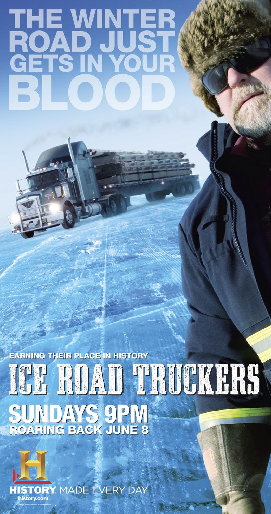{fig-alt="Poster for Ice Road Truckers: a truck loaded with timber drives across a frozen lake beside a bearded driver in a fur hat. The text reads: The winter road just gets in your blood. Earning their place in history." style="max-height: 340px !important;"}
:::

::: {.small .center}
*Ice Road Truckers* poster. History channel.
:::

::: {.example-box}
**Schaefer's example.** The reality series *Ice Road Truckers* ran for 11 seasons, until 2017, and showed long-haul truck drivers taking pride in a low-prestige job. In the conflict view, beliefs such as the trucker-as-hero image help the wealthy keep power at the expense of the lower classes.
:::
:::
::::

## Dominant Ideology in Everyday Sayings: Classify the Statement

::: {.board}
Dominant ideology works best when it sounds like common sense. Which of these sayings make inequality sound natural or deserved?
:::

- "Work hard and you will get there."
- "He deserves it. He comes from a good family."
- "That job is beneath someone with your degree."
- "Rich people earned it; poor people made bad choices."
- "Everyone is middle class, really."

::: {.fragment .question-box}
Who benefits if everyone believes each saying? 
:::

<!-- Instructor enrichment. Crash Course Sociology, "Why Is There Social Stratification?": inequality lasts partly because people believe the system is fair. -->

## Lenski: Surplus Makes a Class System Possible

- Sociologist **Gerhard Lenski**, in his sociocultural evolution approach (Chapter 5), described how economic systems change as **technology** grows more complex, from hunting and gathering to industrial society
- In **hunting-and-gathering** societies, people focus on survival. Some inequality exists, but no class system emerges, because there is **no real wealth** to claim
- Technological advances produce a **surplus** of goods, which greatly expands the possibilities for inequality in status, influence, and power. A well-defined, rigid class system can develop
- To minimize strikes, slowdowns, and industrial sabotage, elites may share **part** of the surplus with the lower classes, but not enough to reduce their own power and privilege
- That reward system may once have served society, as functionalists contend. But in contemporary industrial society, inequality **far exceeds** what is needed to provide goods and services (Lenski 1966; Nolan and Lenski 2015)

<!-- ::: {.question-box} -->
<!-- Within one lifetime, Kuwait moved from a pearling and trading economy to a large oil surplus (Chapter 5). By Lenski's logic, what should have happened to the possibilities for inequality? What would you measure to find out? -->
<!-- ::: -->

<!-- Instructor enrichment: the Kuwait question. Make no claim about the answer; it is a design question. -->

## Functionalist, Conflict, and Interactionist Views of Stratification {.smaller}

| | **Functionalist** | **Conflict** | **Interactionist** |
|---|---|---|---|
| **Key thinkers** | Davis and Moore | Marx, Dahrendorf | Veblen |
| **Why stratification exists** | Unequal rewards motivate people to fill important positions | The powerful control scarce resources and want to keep them | Class shapes lifestyles, which people display and read in everyday life |
| **Is it necessary?** | Yes, in some form | No; it is inherent in capitalism (Marx) and serves those on top | Not the main question; it asks how class shows up in interaction |
| **Its effect on society** | A source of stability | A source of tension, instability, and change | Conspicuous consumption, envy, and ridicule of lower-class lifestyles |
| **Key concepts** | Importance, scarcity, rewards | Class consciousness, false consciousness, dominant ideology | Conspicuous consumption, conspicuous leisure |

<!-- Source gap: Table 8-2 is not in source_en_ch08.txt. This comparison is built from the chapter text; replace it with the printed table if you want Schaefer's exact wording. -->

# Stratification by Social Class {background-color="#1B2A4A"}

::: {.takeaway}
We judge people's class constantly, from their cars, homes, and clothes. Sociologists need a measure that does not depend on guesswork.
:::

## The Objective Method of Measuring Social Class

- It is harder to place a person in a class system than in a slavery or caste system. To determine someone's class, sociologists generally rely on the **objective method**
- **Objective method** — class is treated largely as a statistical category. Researchers assign individuals to classes using criteria such as **occupation, education, income, and place of residence**
- The **researcher**, not the person being classified, identifies the individual's class position
- The first step is deciding which indicators to measure. The **prestige ranking of occupations** has proved especially useful, partly because it is much easier to determine accurately than income or wealth

## Prestige and Esteem

- **Prestige** — the respect and admiration that an occupation holds in a society. "My daughter, the physicist" means something very different from "my daughter, the waitress"
- Prestige belongs to the **job**, not to the person who holds it
- **Esteem** — the reputation that a specific person has earned within an occupation
- The presidency of the United States has high prestige, though the people who held it earned varying degrees of esteem. A hair stylist may have the esteem of his clients but lacks the prestige of a corporate executive
- During the pandemic, front-line occupations gained renewed respect. Nurses and EMTs (moderate prestige), and grocery clerks and delivery people (modest prestige), were even called "**heroes**"

<!-- ::: {.question-box} -->
<!-- Think of a mechanic your whole family trusts, and a surgeon you have never heard of. Which one has prestige, and which one has esteem? -->
<!-- ::: -->

## Predict the Prestige Scores: Teacher, Police Officer, Lawyer, Bank Teller

- In a series of national surveys, sociologists assigned prestige scores to about **500 occupations**, from surgeon to panhandler, on a scale from **0** to **100** (Table 8-3)

::: {.question-box}
Rank these four from highest to lowest prestige, and guess each score: elementary school teacher, police officer, lawyer, bank teller.
:::

::: {.fragment}
- **Lawyer 76** · **Elementary school teacher 60** · **Police officer 60** · **Bank teller 50**
- The most highly regarded occupations are **physician, college professor, lawyer, dentist, and banker**
- Rankings have stayed **stable from 1925 to the present**, and similar studies in other countries have produced useful rankings too (Connelly et al. 2017)
:::

<!-- ::: {.fragment .question-box} -->
<!-- Would a survey in Kuwait rank these jobs the same way? Which job would move the most, and why? -->
<!-- ::: -->

<!-- Instructor enrichment: the Kuwait question. -->

## Table 8-3: Prestige Rankings of Occupations

::: {style="font-size: 0.48em;"}
:::: {.columns}
::: {.column width="50%"}
| Occupation | Score |
|---|---|
| Physician | 86 |
| College professor | 78 |
| Lawyer | 76 |
| Dentist | 74 |
| Banker | 72 |
| Architect | 71 |
| Airline pilot | 70 |
| Clergy | 69 |
| Registered nurse | 66 |
| High school teacher | 63 |
| Pharmacist | 61 |
| Elementary school teacher | 60 |
| Veterinarian | 60 |
| Police officer or detective | 60 |
| Prekindergarten teacher | 60 |
| Accountant | 57 |
| Librarian | 55 |
| Firefighter | 53 |
| Funeral director | 52 |
| Social worker | 52 |
:::

::: {.column width="50%"}
| Occupation | Score |
|---|---|
| Bank teller | 50 |
| Electrician | 49 |
| Farm manager | 48 |
| Insurance agent | 47 |
| Mail carrier | 42 |
| Farmer | 41 |
| Correctional officer | 40 |
| Carpenter | 40 |
| Barber | 38 |
| Child care worker | 36 |
| Hotel clerk | 32 |
| Bus driver | 32 |
| Truck driver | 30 |
| Salesworker (shoes) | 28 |
| Waiter and waitress | 28 |
| Cook (short-order) | 28 |
| Garbage collector | 17 |
| Janitor | 16 |
| Newspaper vendor | 15 |
:::
::::
:::

::: {.small style="font-size: 0.45em;"}
100 is the highest and 0 the lowest possible prestige score. Source: T. Smith et al. 2019:3260–3266.
:::

<!-- ::: {.fragment .question-box style="font-size: 0.62em;"} -->
<!-- Schaefer asks: can you name two more high-prestige occupations and two more low-prestige occupations? Explain why you consider those jobs high or low in prestige. -->
<!-- ::: -->

<!-- Table 8-3 transcribed from the printed page supplied by the instructor. Omitted for the Kuwaiti classroom: Bartender, 25. -->

## Prestige and Your Choice of Major

::: {.board}
Schaefer asks: how are students motivated by prestige in choosing their future occupations? What are the advantages and disadvantages of including prestige in career decisions?
:::

- Think about: When you told relatives your major, what did they say? Did the reaction depend on the field?
- Which majors carry prestige here before a student has earned any esteem at all?
- What does a student lose by choosing for prestige? What might a student lose by ignoring it?

<!-- ## Gender and Occupational Prestige: Counting Women's Paid and Unpaid Work {.smaller} -->

<!-- - For years, studies of social class **neglected women's occupations and incomes**. With more than half of all married women working outside the home, that approach is outmoded. How should we judge the class of a dual-career family? -->
<!-- - Feminist sociologists, particularly in Great Britain, classify a woman by **her own occupational status** rather than her spouse's (Mandel 2016; McCall 2008) -->
<!-- - Organizations, including some affiliated with the United Nations, have sought to give a **monetary value to women's unpaid work** -->
<!-- - Globally, women spend on average **4.5 hours a day** on unpaid work; men spend about half that. The gap is smaller in richer countries, but **nowhere** do men do as much unpaid work as women -->
<!-- - In **Norway**, often regarded as a gender-equal society, women spend about **an hour more** a day on unpaid work than men. In **India**, women spend almost **six hours**, men **less than one** (Oxfam 2020) -->

<!-- ::: {.question-box} -->
<!-- Think of the work that keeps a household running during Ramadan: planning iftars, hosting relatives, keeping track of everyone's schedules. Would any of it appear in an income statistic? -->
<!-- ::: -->

<!-- Instructor enrichment: the Ramadan question. Discuss households in general; no one describes their own. -->

## Multiple Measures: Socioeconomic Status

- **Socioeconomic status (SES)** — a measure of social class based on **income, education, and occupation**
- Statistical methods and computers have multiplied the factors sociologists use to define class: the value of homes, sources of income, assets, years in present occupations, neighborhoods, and dual careers
- Adding these variables does not necessarily change the picture of class differences, but it measures class in a more **complex and multidimensional** way
- For a young person, such as a college student under 25, researchers use the **parents'** income, education, and occupation
- Whatever the technique, the study of stratification is a **study of inequality**: real and often dramatic differences in power, privilege, and opportunity

<!-- ::: {.question-box} -->
<!-- By this definition, a student's SES is the parents' SES. What does that say about the idea of a "self-made" university student? -->
<!-- ::: -->

<!-- # Income and Wealth {background-color="#1B2A4A"} -->

<!-- ::: {.takeaway} -->
<!-- By all measures, income in the United States is distributed unevenly, and wealth even more so. The biggest winners of recent decades have been the affluent. -->
<!-- ::: -->

<!-- ## Predict: How High Would Samuelson's Income Pyramid Reach? -->

<!-- ::: {.question-box} -->
<!-- Nobel Prize–winning economist **Paul Samuelson** imagined an income pyramid made of building blocks, with each layer standing for **$500** of income. How high would the peak be? Where would most people stand? -->
<!-- ::: -->

<!-- ::: {.fragment} -->
<!-- ::: {.takeaway} -->
<!-- "The peak would be far higher than Mount Everest, but most people would be within a few feet of the ground." -->
<!-- ::: -->

<!-- ::: {.small} -->
<!-- Samuelson and Nordhaus 2010:324 -->
<!-- ::: -->
<!-- ::: -->

<!-- ## Income Quintiles in the United States -->

<!-- - In 2016 the **median** household income in the United States was **$59,039**: half of all households earned more, and half earned less. The median alone hides the disparities -->
<!-- - One common way to see them: line up all income-earning households from low to high and split them into **quintiles**, or fifths. With about **126 million** households, each quintile holds about **25 million** -->
<!-- - The **mean** income of households in the **lowest** quintile is **$13,775**. In the **top** quintile it is **$233,895** -->
<!-- - The **top 5 percent** of taxpayers have mean incomes of **$416,520** a year (Semega et al. 2019) -->

<!-- Ambiguity: the OCR text says the top 5 percent of taxpayers number "about 13,000 households," which cannot be 5 percent of 126 million households. The slide omits the household count. Figure 8-2's middle-quintile values are not in the source. -->

<!-- ## Income Shares by Quintile: Divide 100 Dates Across Five Rows -->

<!-- ::: {.board} -->
<!-- Imagine all U.S. household income as **100 dates**, shared among five rows of students. Each row is one quintile, with the same number of households. How many dates does each row get? -->
<!-- ::: -->

<!-- ::: {.fragment} -->
<!-- - **Top row:** about **50** dates -->
<!-- - **Bottom row:** about **3** -->
<!-- - **The three middle rows** share the remaining **47** or so -->

<!-- ::: {.small} -->
<!-- U.S. Census Bureau figures for 2015, as reported in Crash Course Sociology, "Social Stratification in the US". Instructor enrichment, not from Schaefer. -->
<!-- ::: -->
<!-- ::: -->

<!-- ::: {.fragment .question-box} -->
<!-- Now share **wealth** the same way among **100 students**. Schaefer: **1 percent** of U.S. families control about **32 percent** of the nation's wealth. One student holds 32 dates. How do the other 99 split 68? -->
<!-- ::: -->

<!-- Instructor enrichment: the dates activity. Crash Course Sociology, "Social Stratification in the US": top quintile about 50 percent of income, bottom quintile 3.4 percent (2015). The wealth figure is Schaefer's (2016 Federal Reserve study; Figure 8-3). -->

<!-- ## Income Inequality Has Grown Since the 1970s {.smaller} -->

<!-- - **1929 to 1970:** government economic and tax policies shifted some income **to the poor** -->
<!-- - **The past four decades**, especially the 1980s and 2001–2010: federal tax policies **favored the affluent**. Salaries of highly skilled workers and professionals kept rising, while less skilled workers' wages fell after adjusting for inflation -->
<!-- - During one **25-year** period, the after-tax incomes of the **top 1 percent** rose **228 percent**, against **21 percent** for households in the middle quintile. "Little wonder that the middle class is shrinking" (Billitteri 2009; A. Sherman 2007) -->
<!-- - **Globalization** is often blamed, because less skilled workers compete with lower-paid foreign workers. Yet the number of displaced workers who find similar or better-paid jobs roughly equals the number whose earnings drop -->
<!-- - **1970 to 2015:** incomes of both the upper and lower classes rose, while the **middle class's share declined**. Gains in net worth went decidedly to the wealthiest (Pew Research Center 2015d) -->

<!-- ## Wealth Is Distributed More Unevenly Than Income -->

<!-- - A 2016 Federal Reserve study: **1 percent** of U.S. families control about **32 percent** of the nation's wealth (Figure 8-3) -->
<!-- - Researchers also find **dramatic gaps in wealth by race and ethnicity** that have persisted for decades. A significant number of households have **zero or negative net worth** -->
<!-- - The coronavirus pandemic greatly affected household income and wealth, but the **patterns of inequality remained** (Dettling et al. 2017; Thomas et al. 2020) -->

<!-- ::: {.question-box} -->
<!-- Schaefer asks: what does the pattern of income distribution tell you about your own future income? How much can you expect it to grow over the years? -->
<!-- ::: -->

<!-- Condensed per course rules. Schaefer's text gives the shares of U.S. wealth held by white non-Hispanic (91.3%), African American (4.6%), and Hispanic (3.5%) families; reports that in 2019 the 100 wealthiest white families owned as much wealth as all African Americans combined; and that nearly 20 percent of Black households and 9 percent of white households have zero or negative net worth. Restore them if you want them for the exam. Figure 8-3 itself is not in the source. -->

# Poverty {background-color="#1B2A4A"}

::: {.takeaway}
Most people see poverty as someone else's problem. The evidence says it is far more common, and far less fixed, than the stereotype suggests.
:::

<!-- ## Poverty in the United States: The Basic Numbers -->

<!-- - About **13 percent** of people in the United States live below the poverty line set by the federal government. In **2019**, more than **40 million** people lived in poverty -->
<!-- - Despite very low unemployment, the economy passed these people by. **One in six** households cannot meet basic needs, from paying the utility bills to buying dinner (Meyer et al. 2019; Semega et al. 2019) -->
<!-- - Sociologists have studied substandard work since **Marx, Durkheim, and Weber**. Their interest grew after the global economic decline that began in **2008** -->

<!-- ::: {.question-box} -->
<!-- Predict before the next slide: between the ages of 20 and 75, what share of Americans spend at least one year in poverty? -->
<!-- ::: -->

<!-- ## Box 8-3: Calculating Your Risk of Poverty {.smaller} -->

<!-- - Between ages 20 and 75, **nearly 60 percent** of Americans experience **at least one year** in poverty. In 2020, poverty for a single person meant an income below **$12,780** -->
<!-- - Social work professor **Mark Rank** and sociologist **Thomas A. Hirschl** built a **poverty risk calculator**. Risk depends on age, gender, race and ethnicity, marital status, region, urban or rural residence, and disability -->
<!-- - For a single white person aged 20 to 24, the chance of falling below the poverty line in the next **five years** is: -->

<!-- | Education and gender | Risk in the next 5 years | -->
<!-- |---|---| -->
<!-- | High school diploma and continuing education (man or woman) | **20.4 percent** | -->
<!-- | Man, no schooling beyond high school | **24.5 percent** | -->
<!-- | Woman, no schooling beyond high school | **38.8 percent** | -->

<!-- - For nonwhite men and women the risks are higher, reaching **69.9 percent** for a nonwhite woman with no schooling beyond high school -->

<!-- The OCR text spells the coauthor "Hirschi"; he is Thomas A. Hirschl (not Travis Hirschi of Chapter 7). Condensed per course rules: Schaefer's full figures for nonwhite people are 53.9 percent (man, no schooling beyond high school), 45.3 percent (man, more than a high school diploma), 69.9 percent (woman, no schooling beyond high school), and 43.8 percent (woman, more than a high school diploma). -->

<!-- ## Box 8-3: Why People Underestimate Their Risk of Poverty -->

<!-- - The estimates come from the **Panel Study of Income Dynamics (PSID)**, the longest-running **longitudinal** data set in the world. Begun in **1968** with a representative sample of U.S. households, it has followed the same people ever since -->
<!-- - Following the same individuals over time shows what happens to them after job loss, illness, or divorce -->
<!-- - The longer the period, the higher the risk. Over **15 years**, a lost job, a health emergency, or a divorce has more chances to strike. Over **55 years**, a **majority** of Americans experience poverty -->
<!-- - Most people do not think in such long periods, so they **underestimate** the probability of an adverse event. That is partly why so many believe poverty will never happen to them, and why the divide between "us" and "them" feels so wide -->

<!-- ::: {.question-box} -->
<!-- Schaefer asks: estimate the likelihood that you will experience poverty at some point in your life. What is your estimate based on: personal or family experience, or actual statistics? -->
<!-- ::: -->

<!-- ## Do the Math: Can Full-Time Minimum Wage Lift a Family Above the Poverty Line? -->

<!-- ::: {.board} -->
<!-- The U.S. federal minimum wage is **$7.25** an hour. A full-time worker works 40 hours a week, 52 weeks a year. The 2020 poverty line for a family of four was **$26,200**. Does the worker clear it? -->
<!-- ::: -->

<!-- ::: {.fragment} -->
<!-- - $7.25 × 40 × 52 = **$15,080** a year, before taxes: about **$11,000 short** of the line for a family of four -->
<!-- - The minimum wage rose from **75 cents** in **1950** to **$7.25** in **2009** (Figure 8-4). Adjusted for inflation, its real value today is **lower than at any time from 1950 to 1994** -->
<!-- - The pandemic pushed reported unemployment from under **5 percent** to **15–20 percent**, and the gaps between groups held steady (Bureau of Labor Statistics 2020f, 2020g) -->
<!-- ::: -->

<!-- ::: {.fragment .question-box} -->
<!-- Schaefer asks: have you ever worked for the minimum wage? Who paid your basic living expenses? Could you have survived on that wage alone? -->
<!-- ::: -->

<!-- Instructor enrichment: the calculation, adapted from Crash Course Sociology, "Social Class and Poverty in the US". Figure 8-4's year-by-year values are not in the source. Condensed per course rules: Schaefer notes that white unemployment stayed lower than Black and Hispanic unemployment. -->

## Absolute Poverty and Relative Poverty {.smaller}

- Defining poverty is hard, and government programs conceive of it in either absolute or relative terms
- **Absolute poverty** — a minimum level of subsistence that no family should be expected to live below
- The United States measures absolute poverty with a federal **poverty line**: a specific income level, adjusted each year for family size and composition. In **2020**, a family of four with **$26,200** or less fell below it. The line decides who is eligible for certain government benefits
- **Kuwait has no official poverty line.** The Central Statistical Bureau reports instead against the World Bank's international extreme poverty line of **$1.90 a day** per person, the measure used to track the UN's Sustainable Development Goals. By that line, **0 percent** of Kuwait's population was poor in every year from 2012 to 2025
- A line designed for the world's poorest countries says little about hardship in a high-income country. That is why sociologists also measure poverty in relative terms
- **Relative poverty** — a floating standard of deprivation by which people at the bottom of a society, whatever their lifestyles, are judged disadvantaged **in comparison with the nation as a whole**
- So even if the poor of 2020 are better off in absolute terms than the poor of the 1930s or 1960s, they are still seen as deserving special assistance

<!-- Instructor enrichment: the Kuwait bullets. Source: Central Statistical Bureau, SDG indicator 1.1.1 (sdg.csb.gov.kw). The World Bank raised its extreme poverty line to $2.15 (2017 prices) in 2022 and to $3.00 (2021 prices) in 2025; the bureau still reports against $1.90. Optional follow-up: ESCWA, Poverty in the GCC Countries: 2010–2021 (2023), estimates a line of KWD 917 per household per month for Kuwait in 2021 and a poverty rate of about 1.4 percent among Kuwaiti nationals (nationals only). Removed from Schaefer's text: the claim that U.S. poverty exceeds that of many other industrial nations (Figure 8-5). -->

<!-- ## Debating the Official Poverty Measure -->

<!-- - The federal measure has stayed largely **unchanged since 1963** -->
<!-- - Counting **noncash benefits** (Medicare, Medicaid, tax credits, food stamps or SNAP, public housing, employer-provided benefits) would **lower** the reported poverty rate -->
<!-- - Counting **out-of-pocket medical expenses** and required work expenses for transportation and child care would **raise** it -->
<!-- - The measure ignores **location**, whether an expensive city like New York or a cheaper rural area, and whether a household pays rent or a mortgage or lives with someone else -->
<!-- - In **2010** the government launched the **Supplemental Poverty Measure (SPM)**, a relative measure based on a broad range of changing household resources and expenses. It was first calculated in late 2011 but does **not replace** the poverty line for benefit eligibility (Pearce 2014) -->

<!-- ## Draw a Poverty Line: Which Items Are Necessities? -->

<!-- ::: {.board} -->
<!-- Your team must decide what a household in Kuwait needs in order not to count as poor. Sort each item: **necessity everywhere**, **necessity here and now**, or **not a necessity**. -->
<!-- ::: -->

<!-- :::: {.columns} -->
<!-- ::: {.column width="50%"} -->
<!-- - Food and clean water -->
<!-- - Air-conditioning in August -->
<!-- - A car -->
<!-- - A smartphone with a data plan -->
<!-- ::: -->

<!-- ::: {.column width="50%"} -->
<!-- - Home internet for school assignments -->
<!-- - New clothes for Eid -->
<!-- - A gift for a cousin's wedding -->
<!-- - Private tutoring before secondary school exams -->
<!-- ::: -->
<!-- :::: -->

<!-- ::: {.fragment .question-box} -->
<!-- Which of your choices reflect absolute poverty, and which relative poverty? Would your list have looked the same in 1960? -->
<!-- ::: -->

<!-- Instructor enrichment. Keep it at the level of a hypothetical household; no one is asked about their own family's budget. -->

## Who Are the Poor? Stereotypes and Evidence {.smaller}

- The poor defy any simple definition, and they **counter common stereotypes**. Many people in the United States believe the poor are able to work but will not. Yet about **37 percent** of poor U.S. adults aged 18–64 work outside the home, compared with **53 percent** of all adults (Semega et al. 2019:50)
- In Kuwait, the **Public Assistance Law** (Law 12 of 2011) defines who qualifies for monthly state aid. The categories include widows, divorced women, orphans, people over 60 with no income, people whose illness prevents them from working, and the families of prisoners
- Most of these categories describe a household that has **lost its provider** or a person who **cannot work**. In 2023 the Minister of Social Affairs reported that nearly **50,000 families** were receiving this aid. Receiving aid is not the same as being poor: the law counts who the state supports, not everyone in need
- The poor are **not a static social class**. People near the edge of poverty move above it after a year or two, while others slip below. Still, hundreds of thousands stay poor for many years at a time (Goetz et al. 2019; Jäntti 2009)

<!-- Ambiguity: the OCR text reads "about 37 percent of poor adults age 18-64 do work outside the home-33 percent of them full-time-compared to 53 percent of all adults." It is unclear whether 33 percent refers to poor adults working full-time or to a share of the 37 percent. The slide omits the 33 percent until it is checked against the printed page. Table 8-4 is not in the source. Condensed per course rules: Schaefer adds that Blacks and Latinos are more likely than whites to be persistently poor. Removed: Schaefer's bullets on U.S. rural poverty (a majority of the poor live outside urban slums; rural poverty about 3 percentage points higher than urban; Appalachia, Native American lands, the "Black Belt," the Mississippi Delta, the Rio Grande Valley). -->

<!-- Instructor enrichment: the Kuwait bullets. Categories: Ministry of Social Affairs, Family Care Department director, interview in Al-Anba, August 22, 2022, which lists 13 categories, including also married students, released prisoners, the financially incapable, unmarried women without a provider, Kuwaiti women married to non-Kuwaitis in specified circumstances, and married Kuwaiti women aged 55 or over without a fixed income. Count: Minister of Social Affairs Al-Huwailah, reported by Times Kuwait and Al-Jarida: more than 49,915 families and 56,834 individual cases in 2023. Press reports of official statements, not an official statistical table; check the categories against the law before using them in an exam item. -->

<!-- ## The Feminization of Poverty -->

<!-- - Since World War II, a growing proportion of poor people in the United States have been **women**, many of them divorced or never-married mothers -->
<!-- - In **1959**, female householders accounted for **26 percent** of the nation's poor. By **2018**, **50 percent** (Table 8-4). This trend, the **feminization of poverty**, appears around the world -->
<!-- - About **half** of women living in poverty are in **transition**, coping with an economic crisis caused by the departure, disability, or death of a husband. The other half tend to depend on welfare or on friends and relatives nearby -->
<!-- - A major factor is the increase in families headed by **single women** -->
<!-- - Conflict theorists trace women's higher poverty rates to three factors: the difficulty of finding **affordable child care**, **sexual harassment**, and **sex discrimination** in the labor market (Burns 2010) -->

<!-- ## The Underclass: William Julius Wilson -->

<!-- - More than **1 in 6** people in U.S. urban areas are poor. Many observers say the urban poor face a worsening mix of **inadequate education** and **limited employment prospects**, as industrial jobs close to the unskilled poor and past and present discrimination add to the problem -->
<!-- - Sociologist **William Julius Wilson** and his colleagues use the term **underclass** for the **long-term poor who lack training and skills** (Wilson 1996, 2012a, 2012b) -->
<!-- - A 2019 analysis of the 50 largest metropolitan areas: **12 million** people in central cities and **24 million** in suburbs live in areas of **concentrated low incomes**. People of color are disproportionately likely to live in economically declining areas -->

<!-- Condensed per course rules: Schaefer's detail on African American and Hispanic residence in declining areas, and the comparison of highly affluent neighborhoods (88 percent white non-Hispanic) with highly concentrated poverty areas (16 percent). -->

## Who Benefits from Poverty? Gans's Five Functions

::: {.board}
Why does poverty persist, even in countries with vast wealth? Sociologist **Herbert Gans** (1995) asked: what does poverty do for people who are **not** poor? 
:::

::: {.fragment}
1. Society's **dirty work**, physically dirty or dangerous, dead-end, underpaid, and menial, gets done at low cost
2. Poverty **creates jobs** for those who serve the poor: legal ones (public health experts, welfare caseworkers) and illegal ones (drug dealers, numbers runners)
3. Identifying and punishing the poor as **deviants** upholds mainstream norms of hard work, thrift, and honesty
4. The poor **guarantee the higher status** of the rich. Psychologist **William Ryan** (1976) noted that the affluent may justify inequality by **blaming the victims** of poverty
<!-- 5. Lacking political power, the poor **absorb the costs of social change**: released mental patients and halfway houses for drug abusers end up in low-income neighborhoods -->
:::

## Gans's Functions Show Who Would Lose If Poverty Ended

- In Gans's view, poverty and the poor satisfy **positive functions** for many nonpoor groups in the United States
- Gans is not saying poverty is good. He is showing **who would lose something** if poverty ended, and so who might resist ending it
- Function 4 connects back to Chapter 7: labeling the poor as deviant protects the reputation of everyone else

<!-- ::: {.question-box} -->
<!-- Schaefer asks: how do you identify areas of poverty in your community? Do you consider residents' achieved or ascribed characteristics? Then pick one of Gans's five functions and ask: who in a city benefits from it without ever noticing? -->
<!-- ::: -->

# Life Chances {background-color="#1B2A4A"}

::: {.takeaway}
Class shapes more than what people can buy. It shapes how long they live and how well they come through disasters and epidemics.
:::

## Weber's Life Chances: Housing, Education, and Health

- **Life chances** — Weber's term for people's opportunities to provide themselves with **material goods, positive living conditions, and favorable life experiences** (Gerth and Mills 1958)
- Life chances show up in measures such as **housing, education, and health**
- A higher social class improves life chances and brings greater access to social rewards. People in lower classes must spend a larger share of their limited resources on the **necessities of life**
- Sometimes life chances are a matter of **life and death**. Despite advances in medicine, the longevity gap between the affluent and the poor remains and is **widening**: a man in the **top tenth** of earners can expect to live **14 years longer** than a man in the bottom tenth (Tavernise 2016)

## Predict: Who Survived the Titanic?

::: {.question-box}
In 1912 the "unsinkable" British liner *Titanic* hit an iceberg. It did not carry enough lifeboats for everyone, and the evacuation plans covered only first- and second-class passengers. What share of first-class passengers survived? What share of third-class passengers?
:::

::: {.fragment}
::: {.center}
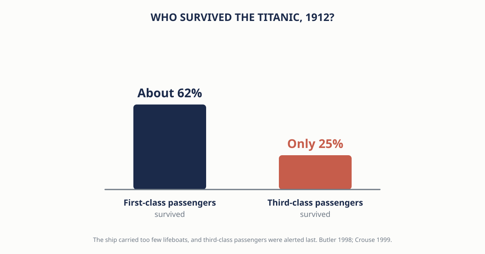{fig-alt="Two bars. About 62 percent of first-class passengers survived; only 25 percent of third-class passengers survived." style="max-height: 420px !important;"}
:::
:::

## The Titanic: Survival Rates and Warnings by Class

- About **62 percent** of first-class passengers survived. Despite the rule that women and children would go first, about **a third** of them were men
- Only **25 percent** of third-class passengers survived. The first attempt to alert them came **well after** other passengers had been notified

::: {.center}
{fig-alt="Black-and-white photograph of the Titanic, with its four funnels, steaming out of Southampton harbour." style="max-height: 430px !important;"}
:::

::: {.small .center}
The *Titanic* leaves Southampton, April 10, 1912. Francis Godolphin Osbourne Stuart, public domain.
:::
<!-- - In an ironic demonstration of continuing inequality, a luxury travel company called **Bluefish** charges passengers **$100,000** each to view the Titanic's remains from a deep-sea submersible (Butler 1998; Crouse 1999; Prestwich 2017) -->

<!-- ::: {.takeaway} -->
<!-- Class position affects people's vulnerability to disasters: who is warned first, and who has a place in a lifeboat. -->
<!-- ::: -->

## Class and the Coronavirus Pandemic

:::: {.columns}
::: {.column width="72%"}
- The pandemic affected most people, but **affluent households** coped better. They had more and better health care options and could better withstand the economic fallout
- They could **work remotely**, have supplies and food delivered, and isolate if required. Their jobs usually offered **sick days**, and absence rarely cost them their jobs
- Their children had the latest **electronics** to keep studying when classes moved online
- **Precarious workers**, such as same-day deliverers and warehouse workers, had to keep working in public, exposed to the virus, or lose vital income if quarantined (Warzel 2020)
:::

::: {.column width="28%"}
::: {.center}
{fig-alt="A masked delivery rider in an orange jacket, blurred by motion, cycles across a bridge in front of Frankfurt's bank towers." style="max-height: 520px !important;"}
:::

::: {.small .center}
A delivery rider in Frankfurt, November 2020. CoronaBrowser.com, CC BY 4.0.
:::
:::
::::

<!-- ::: {.question-box} -->
<!-- Think of spring 2020 in Kuwait: curfews and online classes. Which households found online school easiest? What did a quiet room, a laptop for each child, and a fast connection depend on? -->
<!-- ::: -->

<!-- Discussion in general terms; no one describes their own household. -->

<!-- ## Life Chances and the Promise of Mobility -->

<!-- - Wealth, status, and power may not ensure happiness, but they provide **more ways of coping** with problems and disappointments -->
<!-- - That is why the opportunity for advancement, **social mobility**, matters most to people at the bottom of society -->
<!-- - One strategy is **financial aid** for college students from low-income families, on the theory that education lifts people out of poverty. Schaefer reports that such programs are **not having as great an effect** as their authors once hoped (Box 8-4) -->

<!-- Source gap: Box 8-4 is referred to in the text but its content is not in source_en_ch08.txt. Add it from the printed chapter if it is assigned. -->

# Social Mobility {background-color="#1B2A4A"}

::: {.takeaway}
Everyone loves a rags-to-riches story. Sociologists ask how often people actually move up or down, and what makes each more likely.
:::

## Social Mobility Defined: Open and Closed Systems

- In the movie *Maid in Manhattan*, Jennifer Lopez rises from hotel chambermaid to company supervisor and the girlfriend of a well-to-do politician
- **Social mobility** — the movement of individuals or groups from one position in a society's stratification system to another
- **Open system** — a system in which each individual's position is influenced by his or her **achieved** status. It encourages competition. Despite widening inequality, **60 percent** of Americans in 2019 believed people can get ahead if they are willing to work (Horowitz et al. 2020)
- **Closed system** — a system that allows little or no possibility of individual social mobility. **Slavery and caste** are examples. Placement rests on **ascribed** statuses, such as race or family background, which cannot be changed

## Horizontal and Vertical Mobility

::: {.center}
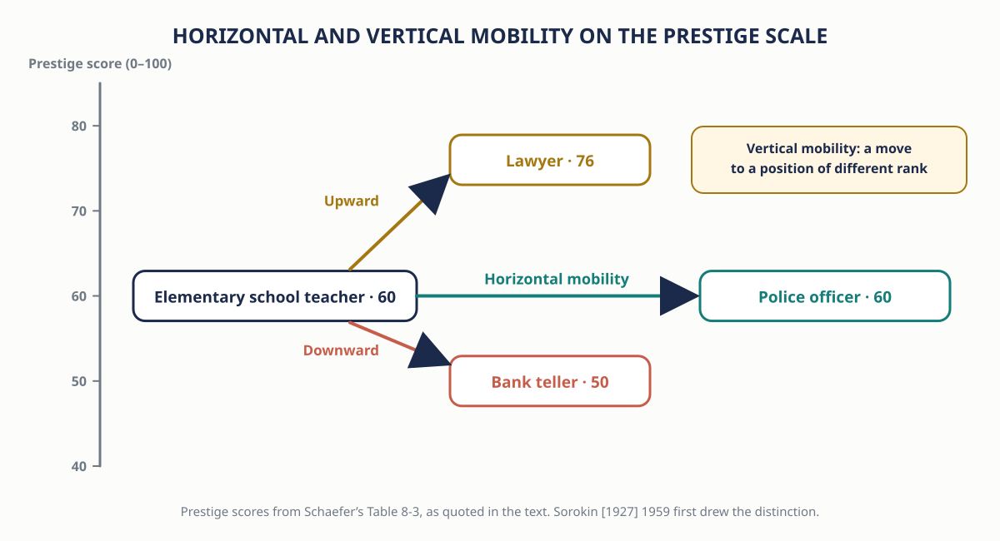{fig-alt="A vertical prestige scale. An elementary school teacher scores 60. Moving to police officer, also 60, is horizontal mobility. Moving to lawyer, 76, is upward vertical mobility. Moving to bank teller, 50, is downward vertical mobility." style="max-height: 470px !important;"}
:::

- **Horizontal mobility** — movement from one social position to another of the **same rank**
- **Vertical mobility** — movement from one social position to another of a **different rank**, upward or downward. **Pitirim Sorokin** ([1927] 1959) first drew the distinction. Most sociological analysis focuses on vertical mobility

## Intergenerational and Intragenerational Mobility

:::: {.columns}
::: {.column width="50%"}
### Intergenerational

- **Changes in the social position of children relative to their parents**
- A plumber whose father was a physician: **downward**
- Leonardo DiCaprio, raised by a single mother in a neighborhood frequented by drug dealers: **upward**
- Because education drives upward mobility, any barrier to advanced degrees limits intergenerational mobility
:::

::: {.column width="50%"}
### Intragenerational

- **Changes in social position within a person's adult life**
- A teacher's aide who becomes superintendent of the school district: **upward**
- An accountant who drives a taxi after his firm goes bankrupt: **downward**
:::
::::

<!-- ::: {.example-box} -->
<!-- Schaefer's photo example: a lawyer who is the daughter of a car mechanic illustrates intergenerational mobility. If she began as a paralegal and worked her way up, her career illustrates intragenerational mobility. -->
<!-- ::: -->

## Name the Type of Mobility

::: {.board}
For each case: intergenerational or intragenerational? Upward, downward, or horizontal?
:::

:::: {.columns}
::: {.column width="66%"}
1. A grandfather worked on pearling ships; his granddaughter is a petroleum engineer
2. A staff nurse becomes director of nursing at the same hospital
3. A schoolteacher leaves teaching to join the police
4. A bank manager laid off at 45 now drives for a ride-hailing app
5. A doctor's son runs a small car-repair shop
6. A junior accountant becomes chief financial officer of the same company
:::

::: {.column width="34%"}
::: {.center}
{fig-alt="Black-and-white photograph of a pearl diver surfacing beside a dhow, gripping a rope as he draws breath." style="max-height: 300px !important;"}
:::

::: {.small .center}
A diver with the Kuwaiti pearling fleet surfaces for breath, 1939. Alan Villiers, © National Maritime Museum, Greenwich.
:::
:::
::::

<!-- ::: {.fragment .question-box} -->
<!-- Look at case 1. Did the granddaughter rise through her own effort, or did the whole economy rise under her? Schaefer notes that U.S. mobility in earlier generations "resulted largely from economic growth." -->
<!-- ::: -->

<!-- Instructor enrichment: the cases. Case 1 is a structural-mobility puzzle about the oil-era transformation; the term "structural mobility" is not in Schaefer, so the slide does not use it. -->

## Figure 8-6: Intergenerational Income Mobility

::: {.question-box}
A national survey followed about **6,000** young people from 1978–1980 to 1997–2003. Of those whose parents were in the **bottom fifth** of incomes, what share were still in the bottom fifth as adults?
:::

::: {.fragment}
::: {.center}
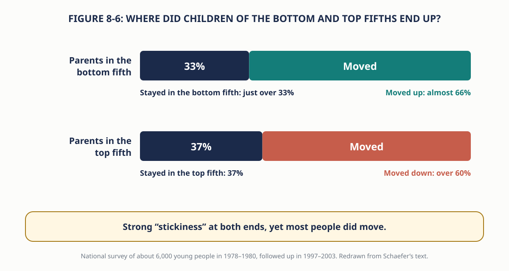{fig-alt="Two stacked bars. Of children whose parents were in the bottom income fifth, just over 33 percent stayed in the bottom fifth as adults and almost 66 percent moved up. Of children whose parents were in the top fifth, 37 percent stayed in the top fifth and over 60 percent moved down." style="max-height: 470px !important;"}
:::
:::

<!-- Figure 8-6 is redrawn from the percentages in Schaefer's text; the publisher's figure is not in the source. -->

<!-- ## Upward Mobility Has Slowed in the United States {.smaller} -->

<!-- - Among men born in the 1960s, mobility came largely from **economic growth**. That has changed. Family incomes are slightly higher than a generation ago only because **women joined the paid labor force**. With few women left to join, most families are content to pay their bills rather than move up (Currier 2017; Sawhill and Haskins 2009) -->
<!-- - **Millennials** (born 1980–1994) may be the first U.S. generation to experience **as much downward as upward** mobility, though they are still young. Among Americans born in the late 1980s, **44 percent** hold jobs of higher socioeconomic status than their parents', **49 percent** lower, and **5 percent** the same -->
<!-- - Sons born after **1940** (Baby Boomers, Gen Xers, Millennials) are significantly less likely to surpass their fathers than earlier generations were. "Fewer janitors' sons are becoming doctors today." Daughters entering the labor force from the 1980s found new opportunities, but their upward mobility has leveled off (Hout 2019) -->
<!-- - Children's class stays **closely tied** to their parents'. Affluent families in the **top 1 percent** spend **$1.3 million more** on each child than middle-class families do, on education and enrichment such as tutoring in the fine arts and athletics (Markovits 2019) -->

<!-- Ambiguity: the OCR text reads "Intragenerational mobility is now common, as there is a relatively close association between the social class of children and that of their parents." The reasoning fits intergenerational stability, not intragenerational mobility. The slide states only the close association and the spending figure; check the printed page. -->

## Occupational Mobility and the Impact of Education

- **Occupational mobility:** People usually rise or fall **one or two** of eight occupational levels. A laborer's child may become an artisan or technician, but is less likely to become a manager or professional. The odds against reaching the top are extremely high unless one starts from a privileged position
- **Education:** formal schooling affects adult status **even more than family background** does, though family background shapes who gets higher education. A person born poor who graduates from college has a **one in five** chance of reaching the top fifth of earners (Isaacs et al. 2008)
- Education's impact has **diminished** somewhat. A bachelor's degree guarantees less, because more job seekers hold one. And today's college students are increasingly likely to have **college-educated parents** (Greenstone et al. 2013; Sawhill and Morton 2007)

::: {.question-box}
If almost everyone in your cohort holds a bachelor's degree, what will employers use to choose among you? Who has the easiest access to internships, the right contacts?
:::

<!-- ## Race, Ethnicity, and Mobility in the United States -->

<!-- - Sociologists have long found that the U.S. class system is **more rigid for African Americans**. The **cumulative disadvantage of discrimination**, lower household wealth, and less financial support from parents limit mobility. Black Americans are more likely to stay at the bottom and to fall from the middle (Raj et al. 2020) -->
<!-- - **Latino** mobility is mixed. Children of immigrants are substantially better off than their parents. **Immigrants** themselves often work in jobs of **lower prestige** than the ones they left, even when their incomes are higher. The Latino **wealth** picture is bleaker (Nieves and Asante-Muhammad 2018; Rodriguez 2017) -->

<!-- Condensed per course rules. Schaefer's details: African American men with good jobs are less likely than white men to see their adult children reach the same status; young African American couples are much more likely than young white couples to be helping their parents; the majority of Black adults raised at the bottom stay there, against a third of whites; the median wealth of white non-Hispanic households is 42 times that of Hispanic households; the wealthiest 10 percent of Latino households have a third of the net worth of the top 5 percent of white households. Restore any of these for the exam. -->

<!-- ## Gender and Social Mobility {.smaller} -->

<!-- :::: {.columns} -->
<!-- ::: {.column width="66%"} -->
<!-- - Mobility studies have traditionally **ignored gender** -->
<!-- - Women are more likely than men to do **precarious work**, which offers little upward mobility, modest income, and little health insurance or pension protection (Howell and Kalleberg 2019) -->
<!-- - Women whose skills far exceed the jobs offered to them are more likely than men to **withdraw** from the paid labor force. That violates a common assumption of mobility studies: that most people seek upward mobility -->
<!-- - Many **clerical** jobs are open to women, but their modest pay and limited advancement restrict mobility. **Self-employment**, an important road up for men, is harder for women, who find financing harder to secure. Sons commonly follow their fathers; women rarely move into their fathers' positions -->
<!-- - **On the positive side**, women's earnings have risen faster than their mothers' did at the same age. The glaring exception is **daughters of low-income parents**, whose care for children and relatives severely restricts their mobility (Beller 2009) -->
<!-- ::: -->

<!-- ::: {.column width="34%"} -->
<!-- ::: {.example-box} -->
<!-- **Mary Barra** began at General Motors in 1980 as a **plant engineer** and became its CEO in 2014. As of December 2019, women ran just **33** of the Fortune 500 companies; men ran the other **467**. -->
<!-- ::: -->
<!-- ::: -->
<!-- :::: -->

<!-- ::: {.question-box} -->
<!-- Schaefer asks: which factor, occupation, education, race and ethnicity, or gender, do you expect will most affect your own mobility? Answer privately. -->
<!-- ::: -->

## Before You Leave {.smaller}

- **Stratification** is a structured ranking of whole groups that passes inequality from one generation to the next. **Income** is what comes in; **wealth** is what you own
- Four systems run from closed to open: **slavery**, **castes**, **estates**, and **social classes**. Rossides divides the U.S. class system into five classes, and the middle is shrinking
- **Marx:** class rests on control of the means of production; workers need **class consciousness** to overcome **false consciousness**. **Weber:** **class, status group, and power** are three separate rankings. **Veblen:** **conspicuous consumption**
- Stratification is **universal**. **Davis and Moore** say unequal rewards fill important positions; **conflict theorists** point to **dominant ideology**; **Lenski** ties inequality to surplus
- Sociologists measure class with the **objective method**, **prestige**, and **SES**. **Absolute** and **relative** poverty are measured differently; **Gans** shows who benefits from poverty
- **Life chances** differ by class, from the Titanic to the pandemic. **Mobility** can be horizontal or vertical, intergenerational or intragenerational, and is shaped by education, race and ethnicity, and gender

::: {.small}
Next: Chapter 9, Global Inequality.
:::
