# The United Nations on Global Poverty {background-color="#1B2A4A"}

::: {.takeaway}
Global poverty rates have fallen by more than half since 2000, yet about one person in ten still lives in extreme poverty. This chapter asks why some nations are rich and others poor, and how inequality plays out inside each nation.
:::

## Predict: Could You Live on $1.90 a Day?

::: {.question-box}
The international poverty line is **US$1.90 a day** per person. That has to cover food, water, transport, and rent or housing. What could you buy with it in Kuwait today?
:::

::: {.fragment}
- $1.90 is about **580 fils** a day, or about **17.5 dinars** for a whole month
- One in ten people in developing regions lives below this line, and millions of others live on slightly more (United Nations 2018)
:::

<!-- ::: {.fragment .question-box} -->
<!-- Look at your own spending today. What would you give up first? What could you never afford at all? -->
<!-- ::: -->

<!-- Instructor enrichment: the dinar conversion, at roughly 0.31 dinars per dollar. Check the current exchange rate before class. Schaefer's opening question is "Could you live on less than $2 a day, including your rent or campus housing?" -->

## The UN's Poverty Facts and Figures {.smaller}

::: {.center}
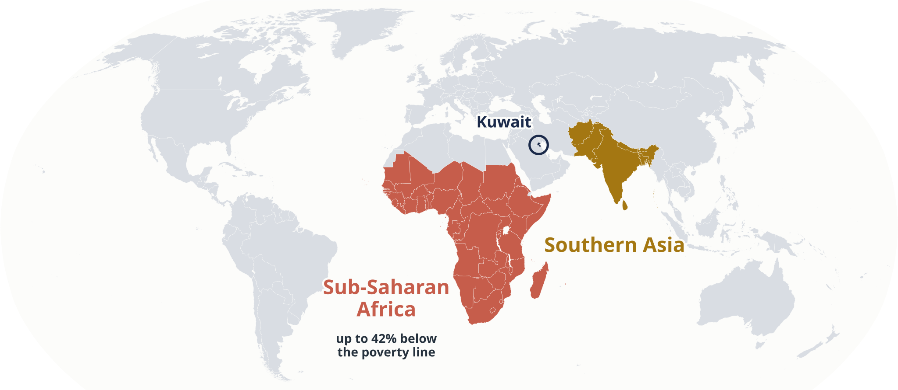{fig-alt="World map with two regions highlighted: sub-Saharan Africa in coral, labelled up to 42 percent below the poverty line, and southern Asia in gold. Kuwait is circled for reference. All other countries are grey." style="max-height: 300px !important; box-shadow: none;"}
:::

<!-- ::: {.small .center} -->
<!-- Sub-Saharan Africa and southern Asia, using the World Bank's regions. Kuwait circled for reference. Base map: Canuckguy and others, public domain, [Wikimedia Commons](https://commons.wikimedia.org/wiki/File:BlankMap-World.svg). -->
<!-- ::: -->

- About **10 percent** of the world's population lives in **extreme poverty**, struggling to meet basic needs such as food, clean water, and access to education
<!-- - **736 million** people lived below the international poverty line of US$1.90 a day in **2015**. In **2018**, almost **8 percent** of the world's workers and their families lived on less than $1.90 per person per day -->
<!-- - Most of them live in two regions: **southern Asia** and **sub-Saharan Africa**. In sub-Saharan Africa, up to **42 percent** of the population lives below the line. High poverty rates are often found in small, fragile, and conflict-affected countries -->
- Most of them live in two regions: **southern Asia** and **sub-Saharan Africa**. In sub-Saharan Africa, up to **42 percent** of the population lives below the line
<!-- - As of 2018, **55 percent** of the world's population had no access to even one social protection cash benefit -->
<!-- - Poverty affects men and women unequally: for every **100 men** aged 25 to 34 who live in poverty, there are **122 women**. By 2030, more than **160 million children** will still be at risk of extreme poverty -->
- Poverty affects men and women unequally: for every **100 men** aged 25 to 34 who live in poverty, there are **122 women**

::: {.takeaway}
Poverty means more than a lack of income. It means hunger, malnutrition, lack of education, lack of basic government services, discrimination, exclusion from opportunities, and lack of agency.
:::

<!-- ## The United Nations Makes Global Poverty a Central Goal -->

<!-- - The United Nations was conceived in **1941** in the multination **Atlantic Charter**, to defend life, liberty, independence, and religious freedom and to preserve human rights and justice worldwide -->
<!-- - Peacekeeping remains its major objective. But as developing nations, many of them former colonies of the founding countries, took leadership roles, the needs of the **global poor** became more central to its daily work -->
<!-- - In **2000** the UN launched the **Millennium Project**. One objective: halve extreme poverty by 2015 -->
<!-- - The General Assembly proclaimed the **Third United Nations Decade for the Eradication of Poverty (2018–2027)**, focused on the poverty goals within the **Sustainable Development Goals** -->

<!-- ::: {.question-box} -->
<!-- The chapter's questions: What economic and political conditions explain the divide between rich and poor nations? Inside developing nations, how are wealth and income distributed, and how much chance does the average worker have to move up? -->
<!-- ::: -->

# The Global Divide {background-color="#1B2A4A"}

::: {.takeaway}
A few centuries ago, almost everyone in the world was poor. Today the gap is so wide that the poorest people in a rich country live like the typical person in a poor one.
:::

## Coping Mechanisms: How the Desperately Poor Control Their Hunger {.smaller}

:::: {.columns}
::: {.column width="56%"}
- People who have dedicated their lives to fighting starvation speak of **"coping mechanisms"**: ways in which the desperately poor try to control their hunger
- **Eritrean** women strap flat stones to their stomachs to lessen their hunger pangs
- In **Mozambique**, people eat the grasshoppers that destroyed their crops, calling them "flying shrimp"
- Among the well-fed, eating dirt is a pathological condition called **pica**. The world's poor eat dirt to add minerals to their diet
- In many countries, mothers boil stones in water to convince their hungry children that supper is almost ready, hoping the children will fall asleep (McNeil 2004)
:::

::: {.column width="44%"}
::: {.center}
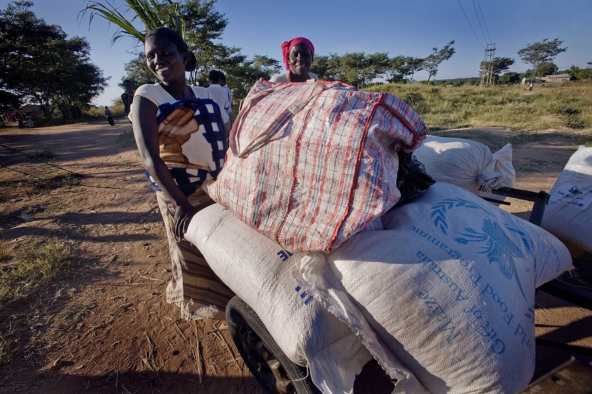{fig-alt="Two women stand beside a cart loaded with large sacks of food aid marked World Food Programme, on a dirt road lined with trees." style="max-height: 400px !important;"}
:::

::: {.small .center}
Women carry their village's food aid from a World Food Programme distribution point in Epworth, Harare, Zimbabwe, April 2009. Kate Holt/AusAID, CC BY 2.0, [Wikimedia Commons](https://commons.wikimedia.org/wiki/File:Africa_Humanitarian_Food_Aid_21_(10665202905).jpg).
:::
:::
::::

::: {.takeaway}
Inequality is a significant determinant of human behavior. It opens doors of opportunity to some and closes them to others.
:::

<!-- Instructor enrichment: the photo. It shows food aid in Zimbabwe, not the specific practices Schaefer describes. -->

<!-- Schaefer adds that disparities in life chances are so extreme that the poorest of the poor may not be aware of them: Western media images have circled the globe, but in extremely depressed rural areas, those at the bottom are not likely to see them. -->

## The Industrial Revolution Opened the Global Divide {.smaller}

:::: {.columns}
::: {.column width="55%"}
- A few centuries ago, such vast divides in global wealth **did not exist**. Except for a very few rulers and landowners, everyone in the world was poor. Life in much of Europe was as difficult as it was in Asia or South America
- The **Industrial Revolution** and rising agricultural productivity produced explosive economic growth. The rise in living standards was **not evenly distributed** across the world
:::

::: {.column width="45%"}
::: {.center}
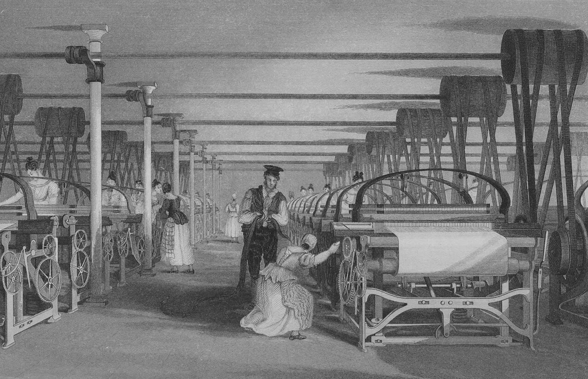{fig-alt="Engraving of a long factory hall filled with mechanical power looms driven by overhead belts, with women tending the machines and a male supervisor in the aisle." style="max-height: 300px !important;"}
:::

::: {.small .center}
Power-loom weaving in an English cotton mill, 1835. Engraving by J. Tingle after T. Allom, public domain, [Wikimedia Commons](https://commons.wikimedia.org/wiki/File:Powerloom_weaving_in_1835.jpg).
:::
:::
::::

- Researchers compared four measures: life expectancy, the chance that a baby survives its first year, and the rates of homicide and incarceration. In every case, the **poorest of the poor in the United States** matched the experience of people in the **poorest countries**
<!-- - U.S. cities with a poverty rate above **25 percent** have homicide rates comparable to **Colombia** and the **Dominican Republic**. U.S. cities with low poverty rates resemble the **Netherlands, Japan, and Sweden** -->
- The typical person in a low-income country lives like the poorest of the poor in the United States (Shaefer et al. 2018)

<!-- Spelling: the citation is "Shaefer et al. 2018" (H. Luke Shaefer and colleagues), a different author from the textbook's Schaefer. -->

## Predict: Where Do the Terms "First World" and "Third World" Come From?

::: {.question-box}
People joke online about "First World problems": a cracked phone screen, the wrong coffee order. Where did the labels First, Second, and Third World come from?
:::

::: {.fragment}
:::: {.columns}
::: {.column width="58%"}
::: {.smaller}
- They date from the **Cold War**. Western policymakers called Western capitalist countries the **First World**, the Soviet Union and its allies the **Second World**, and everyone else, the nonaligned countries, the **Third World**
- After the Cold War, the Second World disappeared, but "First" and "Third" stuck and came to mean rich and poor
- The labels are outdated and inaccurate. "Third World" lumped together more than 100 very different countries: average income per person in **Botswana** is about **nine times** that of **Rwanda**
- Sociologists now group countries by their **economic productivity**
:::
:::

::: {.column width="42%"}
::: {.center}
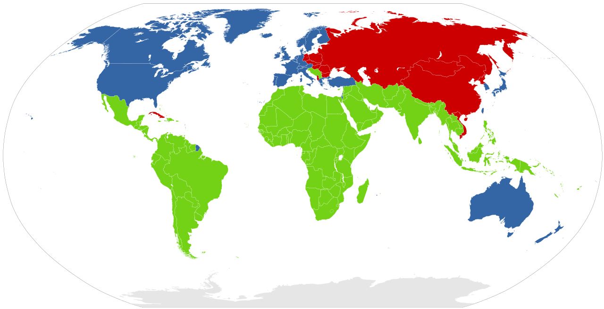{fig-alt="World map in three colours during the Cold War: the First World in blue (North America, Western Europe, Japan, Australia), the Second World in red (the Soviet Union, China, and their allies), and the Third World in green (Latin America, Africa, the Middle East, and South and Southeast Asia)." style="max-height: 300px !important; box-shadow: none;"}
:::

::: {.small .center}
The First (blue), Second (red), and Third (green) Worlds during the Cold War.
:::
:::
::::
:::

<!-- ::: {.small} -->
<!-- Crash Course Sociology, "Global Stratification and Poverty." Schaefer uses *industrialized* and *developing nations*, and Wallerstein's *core*, *semiperiphery*, and *periphery*. -->
<!-- ::: -->

<!-- Instructor enrichment, not from Schaefer. -->

<!-- ## Four Income Groups of Countries {.smaller} -->

<!-- | Group | Income per person | Examples | Features | -->
<!-- |---|---|---|---| -->
<!-- | **High income** | Above about $12,500 | United States, United Kingdom, Germany, Chile, Saudi Arabia, Singapore | 81 percent urban; most of the world's industry, money, and technology | -->
<!-- | **Upper-middle income** | About $4,000–$12,500 | China, Mexico, Russia, Argentina | Heavily urban; manufacturing and high tech; public education and health care | -->
<!-- | **Lower-middle income** | About $1,000–$4,000 | Ukraine, India, Guatemala, Zambia | 40 percent urban; good health care and education mainly for the well-off; maternal mortality five times the upper-middle rate | -->
<!-- | **Low income** | Below about $1,000 | 31 countries | Mainly rural and agricultural; 8 percent of children die before age five | -->

<!-- - Poverty worldwide is mostly **rural**: agricultural societies produce less than industrialized ones -->
<!-- - Recall **absolute** and **relative poverty** (Chapter 8). Relative poverty exists in every society. Absolute poverty, in the poorest countries, is **life-threatening** -->

<!-- Trimmed: Crash Course enrichment, not in Schaefer, and it overlaps "A Continuum of Nations." -->

<!-- ::: {.small} -->
<!-- Crash Course Sociology, "Global Stratification and Poverty," based on World Bank groupings. Kuwait is a high-income country. -->
<!-- ::: -->

<!-- Instructor enrichment, not from Schaefer. Crash Course's thresholds are rounded and date from about 2017; the World Bank revises them every July. The World Bank classifies Kuwait as high income. -->

<!-- ## Discuss: Lenski's Sociocultural Evolution and the Global Divide -->

<!-- ::: {.board} -->
<!-- Schaefer asks: relate Durkheim's, Tönnies's, and Lenski's theories of social structure (Chapter 5) to the global divide that exists today. Could sociocultural evolution have something to do with it? -->
<!-- ::: -->

<!-- - **Durkheim:** mechanical and organic solidarity -->
<!-- - **Tönnies:** *Gemeinschaft* and *Gesellschaft* -->
<!-- - **Lenski:** as technology grows more complex, it produces a **surplus**, and a surplus makes greater inequality possible (Chapter 8) -->

<!-- ::: {.fragment .question-box} -->
<!-- If technology drives development, why did the Industrial Revolution not spread evenly? Hold on to your answer. The rest of the chapter offers competing explanations. -->
<!-- ::: -->

# Stratification in the World System {background-color="#1B2A4A"}

::: {.takeaway}
Sociologists see a continuum of nations, from the richest to the poorest. Three forces keep a few nations on top: the legacy of colonialism, multinational corporations, and modernization.
:::

## A Continuum of Nations: Gross National Income per Person {.smaller}

- The divide between industrialized and developing nations is sharp, but sociologists recognize a **continuum** of nations, from the richest of the rich to the poorest of the poor
- **Per capita gross national income** is the average value of goods and services produced per citizen

::: {.question-box}
In 2019, per capita gross national income in the United States, the Netherlands, Switzerland, Ireland, and Norway was more than **$62,000**. In at least 23 poorer countries it was **$2,000 or less**. How many times larger is the first figure?
:::

::: {.fragment}
- **More than 31 times.** Most countries fall somewhere between those extremes (Figure 9-1; World Bank 2019c)
<!-- - The World Bank (2020b) found that the **pandemic's** global downturn was more severe and widespread than any since at least **1870**. Poorer countries will suffer most: investment, aid, and tourism from rich nations will stay lower, as developed nations take care of their own economies first -->
:::

<!-- Source gap: Figure 9-1 (the world map of gross national income per capita) is not in the chapter folder. -->

## Colonialism Defined: Rule by Outsiders {.smaller}

- **Colonialism** — occurs when a foreign power maintains **political, social, economic, and cultural domination** over a people for an extended period. In simple terms, it is **rule by outsiders**
- The British Empire ruled much of North America, parts of Africa, and India. France ruled Algeria, Tunisia, and other parts of North Africa
- The relationship between a colonial nation and a colonized people resembles the one Marx described between the **capitalist class** and the **proletariat** (Chapter 8)
- By the **1980s**, colonialism had largely disappeared. Most nations that were colonies before World War I had achieved political independence and established their own governments

::: {.center}
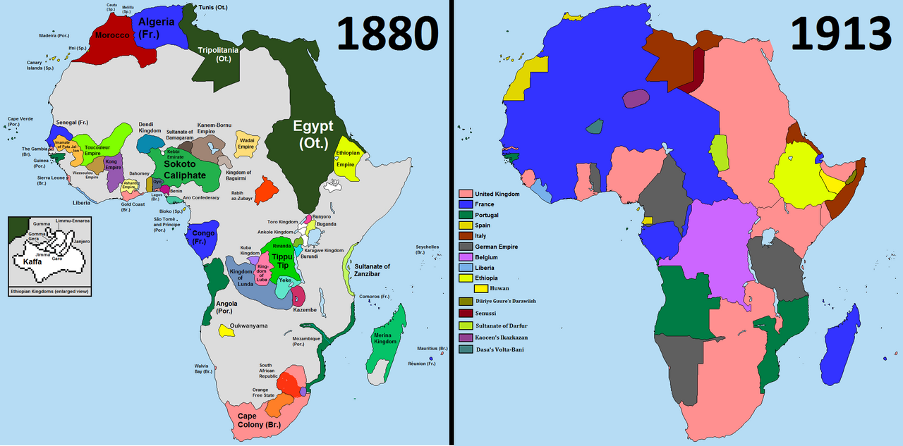{fig-alt="Two maps of Africa side by side. In 1880, most of the continent is shown as independent kingdoms and empires, with European colonies only on the coasts. In 1913, almost the entire continent is divided among Britain, France, Portugal, Spain, Italy, Germany, and Belgium; only Ethiopia and Liberia remain independent." style="max-height: 330px !important;"}
:::

::: {.small .center}
Africa in 1880 and 1913, before and after the European "Scramble for Africa."
:::

<!-- ::: {.question-box} -->
<!-- Kuwait was a British protectorate from 1899 to 1961. Britain handled its foreign relations; the ruling family governed internal affairs. Does that meet each part of Schaefer's definition: political, social, economic, and cultural domination? -->
<!-- ::: -->

<!-- Instructor enrichment: the Kuwait question and the map. The point of the question is to test the four parts of the definition, not to settle a historical verdict. -->

## Neocolonialism: Dependence Continued After Independence

::: {.center}
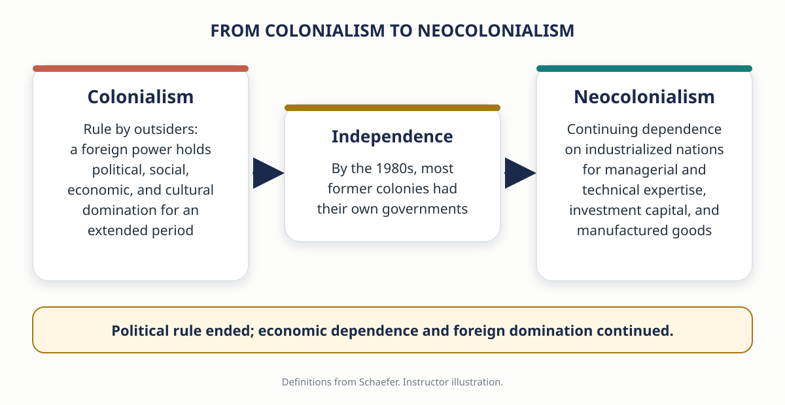{fig-alt="Three cards linked by arrows. Colonialism: rule by outsiders, in which a foreign power holds political, social, economic, and cultural domination for an extended period. Independence: by the 1980s most former colonies had their own governments. Neocolonialism: continuing dependence on industrialized nations for managerial and technical expertise, investment capital, and manufactured goods. A banner reads: political rule ended; economic dependence and foreign domination continued." style="max-height: 440px !important;"}
:::

- For many former colonies, the transition to genuine self-rule was **not complete**. Colonial domination had set up patterns of economic exploitation that continued after independence, partly because former colonies could not develop their own **industry and technology**
- **Neocolonialism** — continuing dependence on and foreign domination by more industrialized nations, including former colonial masters

## Wallerstein's World Systems Analysis {.smaller}

:::: {.columns}
::: {.column width="76%"}
- Drawing on the **conflict perspective**, sociologist **Immanuel Wallerstein** saw the global economic system as divided between nations that **control wealth** and nations from which **resources are taken**
- **World systems analysis** — an interdependent global economy resting on **unequal economic and political relationships**
- Nations by themselves have never been whole systems. They exist within a larger, **global** social context
- **Core:** industrialized nations, among them the United States, Japan, and Germany, and their global corporations. Unlike other nations, they are relatively **independent of outside control**
- **Semiperiphery:** countries with marginal economic status, such as Ireland and South Korea
- **Periphery:** the poor developing countries of Asia, Africa, and Latin America
- The key is the **exploitative relationship** of core nations toward noncore nations. Core nations and their corporations control and exploit noncore nations' economies (Chase-Dunn and Grimes 1995; G. Williams 2013)
:::

::: {.column width="24%"}
::: {.center}
{fig-alt="Portrait photograph of Immanuel Wallerstein, an older man with white hair and glasses, smiling slightly." style="max-height: 400px !important;"}
:::

::: {.small .center}
Immanuel Wallerstein (1930–2019) in St. Petersburg, 2008. Alexei Kouprianov, CC BY-SA 3.0, [Wikimedia Commons](https://commons.wikimedia.org/wiki/File:Immanuel_Wallerstein.2008.jpg).
:::
:::
::::

## Figure 9-2: World Systems Analysis

::: {.center}
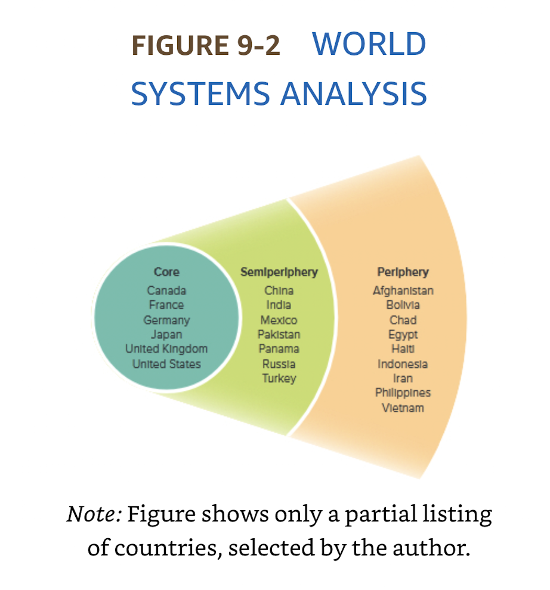{fig-alt="Figure 9-2, world systems analysis, drawn as three nested zones. Core: Canada, France, Germany, Japan, United Kingdom, United States. Semiperiphery: China, India, Mexico, Pakistan, Panama, Russia, Turkey. Periphery: Afghanistan, Bolivia, Chad, Egypt, Haiti, Indonesia, Iran, Philippines, Vietnam. The figure shows only a partial listing of countries, selected by the author." style="max-height: 700px !important;"}
:::

## The Core–Periphery Division Is Remarkably Stable

- A study by the **International Monetary Fund** (2000; Alvaredo 2011) found **little change over 125 years** among more than 24 economies
- The only changes: **Japan** moved up into the core, and **China** moved down toward the margins of the semiperiphery
<!-- - Yet Wallerstein (2012) speculated that the world system may soon undergo **unpredictable changes**: -->
<!--   - The world is becoming more **urbanized**, which is gradually eliminating the large pools of low-cost workers in rural areas. Core nations will have to find other ways to reduce labor costs -->
<!--   - The **exhaustion of land and water** through clear-cutting and pollution is driving up the costs of production -->

## Puzzle: Where Does Kuwait Fit in Wallerstein's World System? {.smaller}

::: {.board}
Kuwait does not appear in Figure 9-2. Weigh the evidence: core, semiperiphery, or periphery?
:::

:::: {.columns}
::: {.column width="50%"}
### Looks like the core

- High income per person: the World Bank classifies Kuwait as high income
- Invests abroad through the Kuwait Investment Authority, one of the oldest sovereign wealth funds in the world, with roots in 1953
:::

::: {.column width="50%"}
### Looks like the periphery

- Exports mainly one raw material: crude oil
- Imports most manufactured goods, from cars and phones to medical equipment, along with much technical expertise
:::
::::

::: {.fragment .question-box}
Schaefer places Ireland, with income above $62,000 per person, in the **semiperiphery**. If Wallerstein's categories do not follow income, what do they follow?
:::

::: {.fragment .takeaway}
World systems analysis ranks nations by their place in relationships of **control and dependence**, not by income alone.
:::

<!-- Instructor enrichment. Make no claim about the "right" placement; scholars disagree about the Gulf oil exporters. Facts used: the World Bank's high-income classification; the Kuwait Investment Authority traces to the Kuwait Investment Board of 1953; crude oil dominates Kuwait's exports. The Ireland pairing is Schaefer's: the text lists Ireland among the countries above $62,000 and also in the semiperiphery. -->

## Dependency Theory: Developing Nations Remain Subservient

- Wallerstein's world systems analysis is the most widely used version of **dependency theory**
- **Dependency theory** — a macro-level theory: even as developing countries make economic advances, they remain **weak and subservient** to core nations and corporations in an increasingly intertwined global economy
- This interdependency allows industrialized nations to keep exploiting developing countries. Dependency theory applies the **conflict perspective on a global scale**
- In this view, a growing share of developing countries' **human and natural resources** is redistributed to the core industrialized nations

## Dependency Theory: How Debt Deepens Dependence

::: {.center}
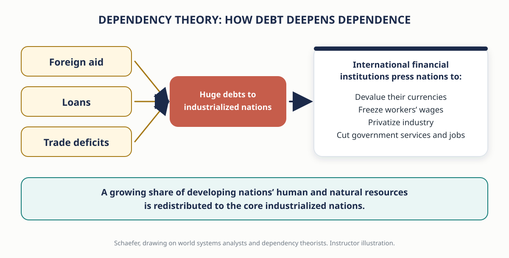{fig-alt="Foreign aid, loans, and trade deficits lead to huge debts owed to industrialized nations. International financial institutions then press indebted nations to devalue their currencies, freeze workers' wages, privatize industry, and cut government services and employment. A banner reads: a growing share of developing nations' human and natural resources is redistributed to the core industrialized nations." style="max-height: 560px !important;"}
:::

- The **global debt crisis** has intensified the Third World dependency that began under colonialism, neocolonialism, and multinational investment. International financial institutions press indebted countries to take severe measures to meet their **interest payments**

## Globalization Defined: The Role of the World Bank and the IMF {.smaller}

:::: {.columns}
::: {.column width="64%"}
- **Globalization** — the worldwide integration of government policies, cultures, social movements, and financial markets through **trade and the exchange of ideas**
- World financial markets reach beyond the control of any one nation-state. So international organizations such as the **World Bank** and the **International Monetary Fund** have become major players in the global economy
- Their function is to encourage trade and development and to keep international financial markets running smoothly. Because **core nations** fund and influence them heavily, critics see them as promoters of globalization and defenders mainly of core nations' interests
- Some observers see globalization as the natural result of advances in **communications technology**, especially the Internet and worldwide mass media. Others see it as a process that lets **multinational corporations** expand unchecked (Chase-Dunn et al. 2000; Guenther and Kasi 2015)
:::

::: {.column width="36%"}
::: {.center}
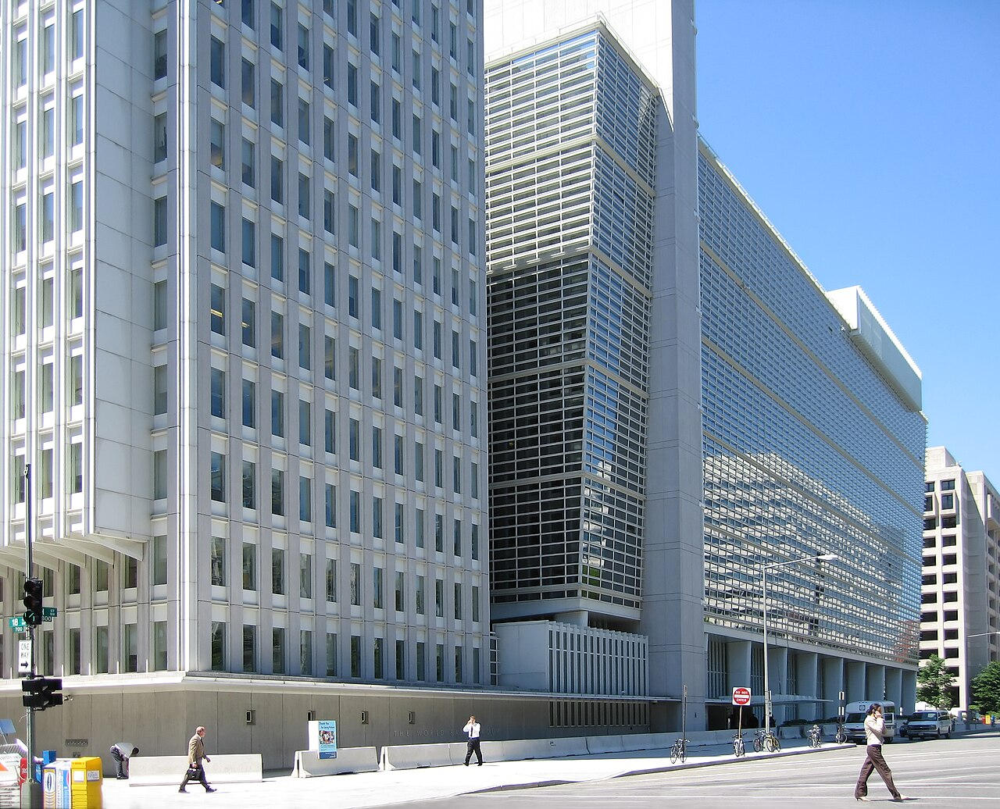{fig-alt="The World Bank headquarters in Washington, D.C., a large modern office building of glass and white stone on a city street corner." style="max-height: 250px !important;"}
:::

::: {.small .center}
World Bank headquarters, Washington, D.C., 2004. Shiny Things, CC BY 2.0, [Wikimedia Commons](https://commons.wikimedia.org/wiki/File:World_Bank_building_at_Washington.jpg).
:::

::: {.center}
{fig-alt="The International Monetary Fund headquarters in Washington, D.C., a large pale stone office building with rows of deep-set windows." style="max-height: 250px !important;"}
:::

::: {.small .center}
IMF headquarters, Washington, D.C. International Monetary Fund, public domain, [Wikimedia Commons](https://commons.wikimedia.org/wiki/File:IMF_building_HR.jpg).
:::
:::
::::

## Critics of Globalization: Workers, the Environment, and Cultural Identity

- Critics point to **violations of workers' rights**, **destruction of the environment**, **loss of cultural identity**, and **discrimination against minority groups** in periphery nations
- Globalization appears most problematic for developing countries in **Latin America and Africa**
- Developing nations in **Asia** seem to do better: foreign investment there involves the **high-tech sector**, which produces more sustainable growth
- Even in Asia, globalization has **not reduced income disparities**, between nations or within them (Kerbo 2006)
<!-- - Schaefer's photo shows Chinese workers assembling toys for export to the United States. Globalization limits employment opportunities at home and worsens working conditions abroad -->

<!-- ::: {.question-box} -->
<!-- Schaefer asks: you are traveling through a developing country. What evidence of neocolonialism and globalization do you see? Now reverse it: what would a visitor to Kuwait notice? -->
<!-- ::: -->

<!-- ## Box 9-1: International Students in the United States {.smaller} -->

<!-- - Nearly **900,000** international students attend U.S. colleges, nearly **6 percent** of total enrollment. The number has **doubled** over ten years and kept rising even after 9/11 -->
<!-- - Their nations of origin change over time, generally because of **travel restrictions** imposed by the United States or the sending nation -->
<!-- - Their costs are paid by their **families or home governments**, so they make a major economic contribution. Schaefer notes that student visas prohibit them from taking jobs -->
<!-- - They give American students the chance to enrich their education by interacting with students from many nations -->
<!-- - Common problems: **financial stress, culture shock, discrimination or racism, homesickness, and language difficulties** -->
<!-- - Exchange is a two-way street. For every **three** foreign students in the United States, **one** American studies abroad, most likely in **Western Europe**, and rarely for a whole degree (Institute of International Education 2019) -->

<!-- Source gap: the box's figure on students' nations of origin is not in source_en_ch09.txt. Accuracy note: "student visas prohibit them from taking jobs" is Schaefer's wording; U.S. student visas in fact allow limited on-campus work. -->

<!-- ## Discuss: Studying Abroad from Kuwait -->

<!-- ::: {.board} -->
<!-- Many Kuwaiti students study abroad on government scholarships. Schaefer asks: what are the benefits of an education in the United States, and do they differ for students from core and periphery nations? -->
<!-- ::: -->

<!-- - What does a degree from the United States or the United Kingdom bring back to Kuwait? Who pays, and who gains? -->
<!-- - Which of Box 9-1's problems would hit a Kuwaiti student hardest: financial stress, culture shock, discrimination, homesickness, or language? -->
<!-- - Why might a student from a periphery nation be less likely than a Kuwaiti scholarship student to return home? -->

<!-- Instructor enrichment. Keep the discussion general; no one is asked about their own nationality or family plans. -->

# Poverty Worldwide {background-color="#1B2A4A"}

::: {.takeaway}
In 2000 the United Nations set out to halve extreme poverty. The world came close, but mostly through growth in a few emerging economies rather than through foreign aid.
:::

<!-- ## Where the World's Poorest People Live -->

<!-- - In developing countries, any decline in the well-being of those least well off **threatens their very survival** -->
<!-- - By U.S. standards, even those who are well-off in the developing world are poor. Those who are poor are **truly destitute** -->
<!-- - Large concentrations of impoverished people remain in two types of areas: -->
<!--   - **Very fragile areas**, such as sub-Saharan Africa and the West Bank and Gaza -->
<!--   - **Relatively isolated areas** of China and India -->
<!-- - Developing nations account for most of the world's population and most of its births. They also bear most of its **poverty, disease, and childhood deaths** -->

<!-- Trimmed: repeats the regions already shown on "The UN's Poverty Facts and Figures." -->

<!-- ## The Millennium Development Goals -->

<!-- ::: {.center} -->
<!-- 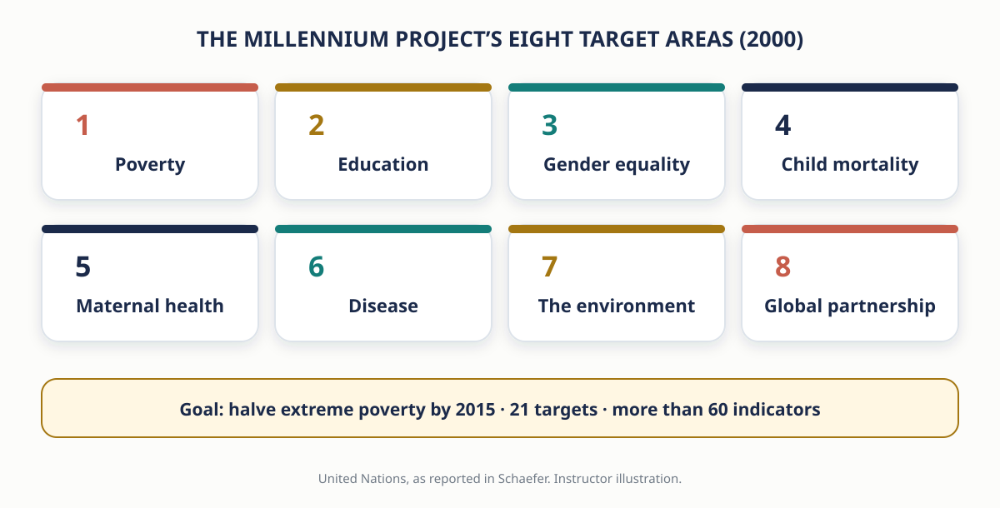{fig-alt="Eight numbered cards: poverty, education, gender equality, child mortality, maternal health, disease, the environment, and global partnership. A banner reads: goal, halve extreme poverty by 2015; 21 targets and more than 60 indicators." style="max-height: 560px !important;"} -->
<!-- ::: -->

<!-- - In **2000** the United Nations launched the **Millennium Project** to halve extreme poverty worldwide by **2015**. Each of the eight goals was supported by **21** specific targets and more than **60** indicators -->

<!-- Trimmed: a list of UN goals rather than a sociological argument. The section takeaway and the Foreign Aid slide now introduce the Millennium Project. -->

## Foreign Aid: Total Dollars or Share of National Income?

::: {.question-box}
Which country is more generous: the one that gives the most dollars, or the one that gives the largest share of its national income?
:::

<!-- - When the Millennium Project began, only **five** countries gave foreign aid at the target rate: **Denmark, Luxembourg, Great Britain, Norway, and Sweden** -->
- When the UN launched the **Millennium Project** in **2000** to halve extreme poverty by 2015, only **five** countries gave foreign aid at the target rate: **Denmark, Luxembourg, Great Britain, Norway, and Sweden**
- In dollar terms, the **U.S. government** gives far more aid than any other nation. As a **percentage of gross national income**, its contribution is among the **lowest** of the 23 most advanced industrialized countries, on a par with **South Korea's** 
- The **pandemic** led developed nations to refocus on economic and social needs at home

<!-- ::: {.fragment .question-box} -->
<!-- The Kuwait Fund for Arab Economic Development, founded in 1961, was the first development aid agency in the Middle East. How would you measure Kuwait's aid: in dinars, as a share of income, or by what the projects achieved? -->
<!-- ::: -->

<!-- Source gap: Figure 9-3 is not in the chapter folder. Instructor enrichment: Schaefer does not state the target rate; the UN target is 0.7 percent of gross national income. The Kuwait Fund was established on December 31, 1961. -->

## Predict: How Far Did Extreme Poverty Fall Between 1990 and 2015?

::: {.question-box}
In 1990, **1.9 billion** people lived on less than $1.25 a day. How many did in 2015? Which single country accounted for almost half of the decline?
:::

::: {.fragment}
::: {.center}
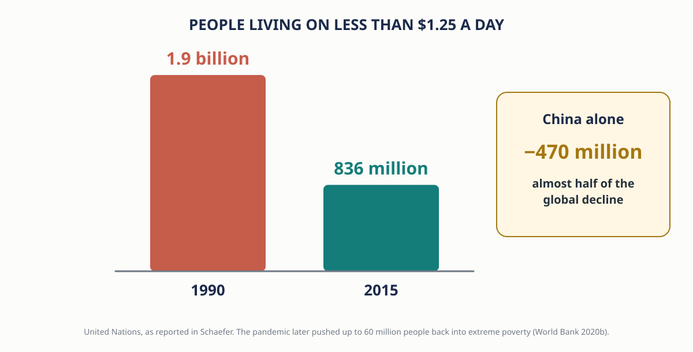{fig-alt="Two bars. In 1990, 1.9 billion people lived on less than $1.25 a day; in 2015, 836 million. A side panel notes that China alone saw a drop of 470 million, almost half of the global decline. A note adds that the pandemic later pushed up to 60 million people back into extreme poverty." style="max-height: 540px !important;"}
:::
:::

<!-- ## Why Extreme Poverty Fell, and How the Pandemic Reversed the Trend {.smaller} -->

<!-- :::: {.columns} -->
<!-- ::: {.column width="78%"} -->
<!-- - In 1990, experts assumed that these advances would need a **huge increase in aid** from industrial countries. For the most part, that increase **did not occur** -->
<!-- - Instead, selected developing countries benefited from **significantly higher commodity prices**, sustained by the rapid **industrialization and urbanization** of emerging economies -->
<!-- - **China** was the stellar example: a drop of **470 million** people living below $1.25 a day, almost **half** of the global decline. Even so, hundreds of millions remain in poverty, spending $2 a day or less -->
<!-- - The world narrowly missed its target. The **pandemic** reversed the trend: the World Bank (2020b) estimated that up to **60 million** people on their way out of poverty were pushed back into extreme poverty -->
<!-- - The pandemic threatens progress in two ways. It directly hits countries with **large proportions of poor people**, and it makes affluent nations **more reluctant to give foreign aid** while their own budgets suffer -->
<!-- - UN Secretary General **António Guterres** (2020): "we must tackle the devastating social and economic dimensions of this crisis," especially in developing nations and among people in **conflict settings** -->
<!-- ::: -->

<!-- ::: {.column width="22%"} -->
<!-- ::: {.center} -->
<!-- 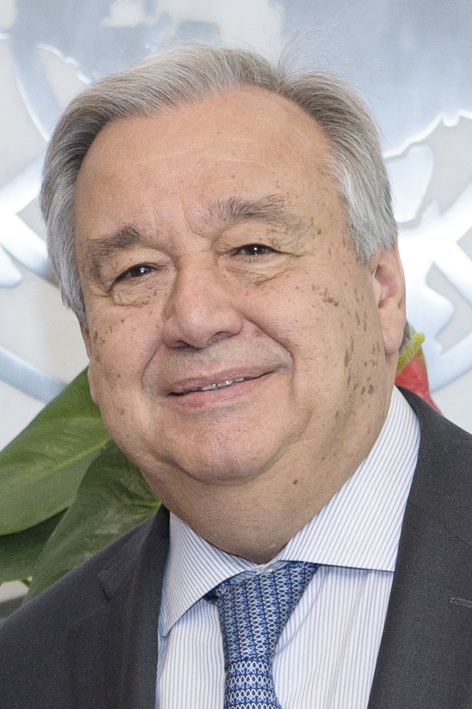{fig-alt="Portrait photograph of António Guterres, UN Secretary General, a grey-haired man in glasses and a dark suit." style="max-height: 420px !important;"} -->
<!-- ::: -->

<!-- ::: {.small .center} -->
<!-- António Guterres, UN Secretary General, 2019. Cancillería Argentina, CC BY 2.0, [Wikimedia Commons](https://commons.wikimedia.org/wiki/File:Ant%C3%B3nio_Guterres_-_2019_(48132270313)_(cropped).jpg). -->
<!-- ::: -->
<!-- ::: -->
<!-- :::: -->

<!-- Ambiguity: Schaefer's opening uses the $1.90 line (2015); this section uses the older $1.25 line. The text also says the world was "narrowly missing the ambitious target of halving the proportion of people suffering from hunger," while elsewhere it says extreme poverty "dropped by more than half between 1990 and 2015." The slide says only that the target was narrowly missed. -->

<!-- ## The UN Argues That Inequality Is Not Inevitable -->

<!-- - The Development Goals were expanded to include **significantly reducing income inequality within countries by 2030** -->
<!-- - As poverty **declined** worldwide, income inequality **rose** -->
<!-- - The UN argues that inequality is **not inevitable**. Two changes would greatly reduce poverty (United Nations Department of Economic and Social Affairs 2016): -->
<!--   1. **Tax policies** that benefit the nonaffluent -->
<!--   2. Letting **overseas workers** send their wages to family in the homeland with **little or no extra cost** -->

<!-- ::: {.question-box} -->
<!-- Schaefer asks: do you agree that inequality is not inevitable? In Chapter 8, Landtman found some ranking in every society, and Lenski argued that today's inequality far exceeds what society needs. Is *some* inequality the same as *this much* inequality? -->
<!-- ::: -->

<!-- Optional, and only if students raise it: workers in Kuwait send part of their wages to families abroad every month through exchange companies. Why would the fee on each transfer matter to global poverty? Keep the question on the fee, not on who sends money. -->

# Multinational Corporations {background-color="#1B2A4A"}

::: {.takeaway}
Some companies now earn as much as entire nations produce. Functionalists say they bring jobs and new technology; conflict theorists say they exploit workers and deepen inequality.
:::

## Multinational Corporations Defined: Global Factories and the Global Office {.smaller}

:::: {.columns}
::: {.column width="62%"}
- **Multinational corporations** — commercial organizations that are **headquartered in one country** but do business **throughout the world**
<!-- - Such trade is not new: merchants have traded gems, spices, and garments abroad for hundreds of years. Today's giants do more than buy and sell overseas. They **produce goods all over the world** (Wallerstein 1974) -->
- **Global factories** — factories throughout the developing world run by multinational corporations
- The **global office** may soon sit alongside them. Multinationals based in core countries are setting up reservation services and centers for processing data and insurance claims in **periphery nations**, because low overseas costs more than offset the cost of sending information around the world
- Worldwide, corporate giants play a key role in **neocolonialism**
:::

::: {.column width="38%"}
::: {.center}
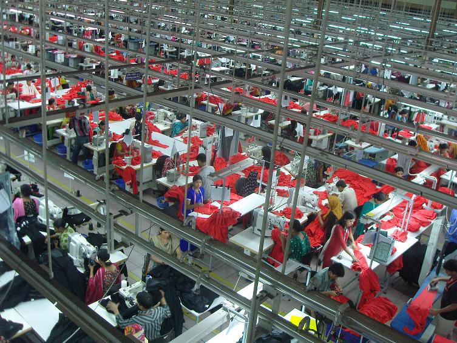{fig-alt="View from above of a large garment factory floor in Bangladesh, with rows of workers at sewing machines surrounded by piles of red fabric." style="max-height: 260px !important;"}
:::

::: {.small .center}
A global factory: a garment factory in Bangladesh, 2012. Fahad Faisal, CC BY-SA 3.0, [Wikimedia Commons](https://commons.wikimedia.org/wiki/File:Garments_Factory_in_Bangladesh.JPG).
:::

::: {.center}
{fig-alt="Young employees wearing headsets work at cubicles in an Indian call center." style="max-height: 260px !important;"}
:::

::: {.small .center}
A global office: a call center in India, 2006. Sonamsaxena, public domain, [Wikimedia Commons](https://commons.wikimedia.org/wiki/File:An_Indian_call_center.jpg).
:::
:::
::::

## Predict: Which Companies Earn as Much as Entire Nations?

::: {.board}
Match each company's yearly revenue to the country with a similar gross domestic product.
:::

:::: {.columns}
::: {.column width="50%"}
### Companies

1. Royal Dutch Shell (Britain and the Netherlands)
2. Saudi Aramco (Saudi Arabia)
3. Toyota (Japan)
4. Amazon (United States)
5. CVS Health (United States)
:::

::: {.column width="50%"}
### Countries

- Qatar
- Bangladesh
- Nigeria
- Romania
- Malaysia
:::
::::

<!-- Answers from Figure 9-4: Shell 397 and Nigeria 397; Saudi Aramco 356 and Malaysia 359; Toyota 273 and Bangladesh 274; Amazon 233 and Romania 240; CVS Health 195 and Qatar 191 (billions of dollars). -->

## Figure 9-4: Multinational Corporations Compared to Nations {.smaller}

:::: {.columns}
::: {.column width="56%"}
::: {.center}
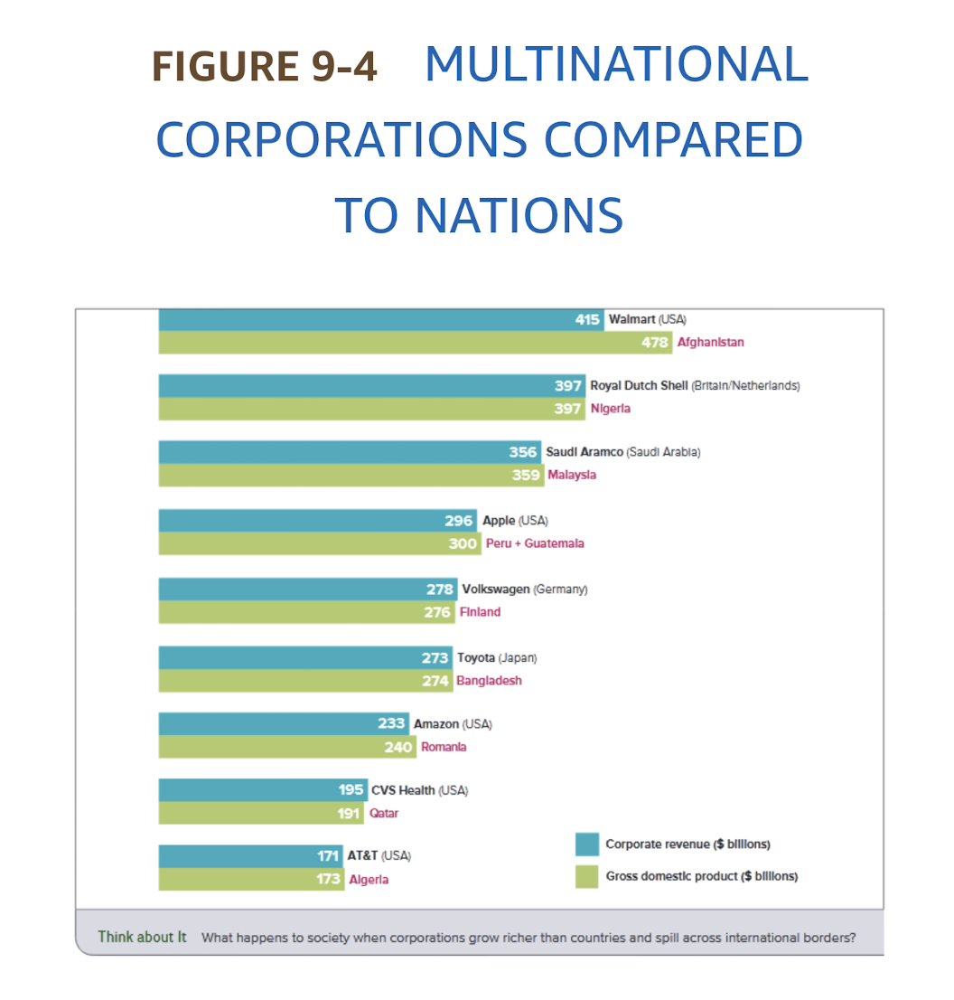{fig-alt="Figure 9-4, corporate revenue compared with national gross domestic product, in billions of dollars: Walmart 415 and Afghanistan 478; Royal Dutch Shell 397 and Nigeria 397; Saudi Aramco 356 and Malaysia 359; Apple 296 and Peru plus Guatemala 300; Volkswagen 278 and Finland 276; Toyota 273 and Bangladesh 274; Amazon 233 and Romania 240; CVS Health 195 and Qatar 191; AT&T 171 and Algeria 173." style="max-height: 780px !important;"}
:::
:::

::: {.column width="44%"}
- Do not underestimate their size: the revenues of multinationals are **on a par with** the total value of goods and services in entire nations
- Foreign sales are an important source of profit, so multinationals constantly seek to expand into other countries, often **developing nations**
<!-- - Since the United States began reducing trade restrictions in **1984**, international trade has grown faster than the economy. Since 2011, trade accounts for about **15 percent** of all U.S. goods and services (OECD 2020a) -->

::: {.question-box}
What happens to society when corporations grow richer than countries and spill across international borders?
:::
:::
::::

::: {.small}
Corporate revenue for 2019; GDP for 2018 (World Bank 2020a). The Afghanistan value appears to be a misprint: World Bank data put Afghanistan's 2018 GDP near $18 billion.
:::

<!-- Accuracy note, instructor check: every pairing in Figure 9-4 matches World Bank 2018 GDP except Afghanistan, whose GDP was about $18 billion, not $478 billion. The match activity above leaves it out. -->

## Functionalist View: Multinationals Can Help Developing Nations

- Multinationals bring **jobs and industry** to areas where **subsistence agriculture** was once the only means of survival
- They promote rapid development through the **diffusion of inventions and innovations** from industrialized nations
- The combination of skilled technology and management from multinationals with the relatively **cheap labor** of developing nations is ideal for a global enterprise. Multinationals use technology fully while reducing costs and boosting profits
- Their international ties make nations more **interdependent**, which may keep disputes from becoming serious conflict. A country cannot afford to cut diplomatic relations or go to war with the nation that is home to its main suppliers or a key market for its exports

## Conflict View: Multinationals Exploit Workers to Maximize Profits {.smaller}

- Conflict theorists stress that multinationals **exploit local workers** to maximize profits. The pool of cheap labor in the developing world prompts them to move factories **out of core countries**
<!-- - The developing world also discourages **strong trade unions**. In industrialized countries, organized labor insists on decent wages and humane working conditions -->
<!-- - Governments seeking to attract or keep multinationals may create a **"climate for investment"** that includes repressive antilabor laws restricting union activity and collective bargaining -->
- The developing world also discourages **strong trade unions**. Governments seeking to attract or keep multinationals may create a **"climate for investment"** that includes repressive antilabor laws restricting union activity and collective bargaining
- If labor's demands become too threatening, the firm simply **moves its plant**, leaving unemployment behind. **Nike** moved its factories from the United States to **Korea** to **Indonesia** to **Vietnam** in search of the lowest labor costs
- Conflict theorists conclude that, on the whole, multinationals have a **negative social impact on workers** in both industrialized and developing nations

::: {.example-box}
UNICEF's "Where am I wearing?" poster reminds affluent consumers that brand-name jeans may be made in sweatshops by nonunion workers, some of them children, who work long hours for very low wages, even if those wages are relatively high for the countries where they live.
:::

## Foreign Investment Increases Inequality Within Developing Nations

- Several sociologists who surveyed the effects of foreign investment conclude that it may at first add to a host nation's wealth, but **eventually increases economic inequality** within developing nations, in both **income** and **land ownership**
- The **upper and middle classes** benefit most from economic expansion; the **lower classes** benefit least
- Multinationals invest in **limited economic sectors** and **restricted regions** of a nation. Sectors such as hotels and expensive restaurants expand, and their expansion appears to slow growth in **agriculture** and other sectors
- Multinationals often **buy out or force out local entrepreneurs** and companies, increasing economic and cultural dependence (Chase-Dunn and Grimes 1995; Kerbo 2012; Wallerstein 1979b)

## Functionalist or Conflict? Classify the Claim About Multinationals

::: {.board}
Which perspective would make each claim?
:::

1. "The new factory gave our village its first paid jobs."
2. "The company left for a cheaper country as soon as workers asked for a raise."
3. "Engineers trained by the foreign firm later started their own companies."
4. "Two countries that trade this much will think twice before going to war."
5. "The new beach hotels are booming, but farm incomes have not moved."
6. "The government banned strikes to keep the investors happy."

<!-- Answers: functionalist 1, 3, 4; conflict 2, 5, 6. Instructor enrichment: the statements. -->

## Functionalist and Conflict Views of Multinational Corporations Compared

::: {.center}
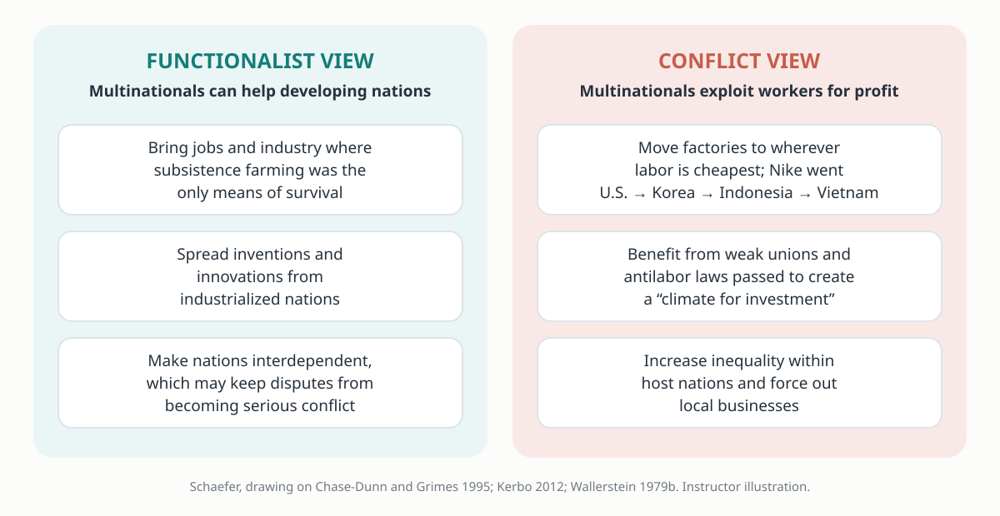{fig-alt="Two panels. Functionalist view, multinationals can help developing nations: they bring jobs and industry where subsistence farming was the only means of survival; they spread inventions and innovations from industrialized nations; they make nations interdependent, which may keep disputes from becoming serious conflict. Conflict view, multinationals exploit workers for profit: they move factories to wherever labor is cheapest, as Nike moved from the United States to Korea to Indonesia to Vietnam; they benefit from weak unions and antilabor laws passed to create a climate for investment; they increase inequality within host nations and force out local businesses." style="max-height: 640px !important;"}
:::

<!-- Trimmed: repeats the two preceding "view" slides and the classify activity. -->

<!-- ## Trace a Purchase: Who Made It, and Who Profits? -->

<!-- ::: {.board} -->
<!-- Schaefer asks: think of something you bought recently that was made by a multinational corporation. How do you know the maker was a multinational? -->
<!-- ::: -->

<!-- - Check the label on your phone, shoes, or hoodie. Where was it **made**? Where is the company **headquartered**? -->
<!-- - Walk through The Avenues in your mind. Which shops are local brands? Which are foreign brands run by a **Kuwaiti franchise company**? -->
<!-- - Schaefer notes that in developing nations, **local elites work hand in hand** with multinational corporations and prosper from these alliances. Where does a franchise holder fit in Wallerstein's system? -->

<!-- ::: {.fragment .question-box} -->
<!-- Who earns the most from your purchase: the worker who made it, the local franchise holder, or the headquarters abroad? What would you need to know to find out? -->
<!-- ::: -->

<!-- Instructor enrichment. Keep companies unnamed on the slide; the discussion is about the chain of production, not about any local business. -->

# Modernization {background-color="#1B2A4A"}

::: {.takeaway}
Modernization theory says poor nations will develop by following the rich. Its critics ask who decides what counts as "modern" in the first place.
:::

## Modernization Defined: Wendell Bell's Traits of Modern Societies {.smaller}

- Globalization and multinational corporations have changed developing countries **culturally**, not only economically
- **Modernization** — the far-reaching process through which **periphery nations** move from traditional or less developed institutions to those characteristic of more developed societies
- Sociologist **Wendell Bell** (1981), whose definition Schaefer uses, notes that modern societies tend to be **urban, literate, and industrial**. Members must shift their allegiance from traditional authorities to newer ones

::: {.center}
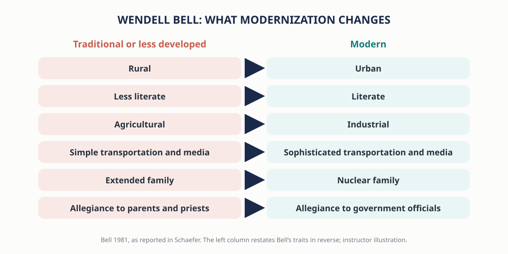{fig-alt="Six rows, each with an arrow from a traditional trait to a modern one: rural to urban; less literate to literate; agricultural to industrial; simple to sophisticated transportation and media; extended family to nuclear family; allegiance to parents and priests to allegiance to government officials." style="max-height: 500px !important;"}
:::

## Is "Modernization" an Ethnocentric Term?

- Many sociologists note that terms such as *modernization* and even *development* carry an **ethnocentric bias** (Chapter 3)
- The unstated assumption: "they," people in developing nations, are struggling to become more like **"us,"** people in core industrialized nations
- From a **conflict perspective**, these terms perpetuate the **dominant ideology** of capitalist societies (Chapter 8)
- *Modernization* also suggests **positive change**. Yet change, if it comes, often comes slowly, and it tends to serve the **affluent segments** of industrialized nations. The spread of the latest electronic technologies to the developing world follows this pattern

::: {.question-box}
Who decides what counts as "modern"?
:::

## Modernization Theory and Its Critics

- **Modernization theory** — a **functionalist** approach that proposes that modernization and development will gradually **improve the lives** of people in developing nations
- Nations develop at uneven rates, but the development of peripheral nations will be assisted by **innovations transferred** from the industrialized world
- Critics, including **dependency theorists**, counter that such technology transfer only **increases the dominance** of core nations and facilitates further exploitation
- Current modernization studies take a **convergence perspective**: using social indicators, researchers study how societies are **moving closer together**, despite traditional differences
<!-- - From a **conflict perspective**, modernization often perpetuates developing nations' dependence on and exploitation by industrialized nations. Conflict theorists view this continuing dependence as **contemporary neocolonialism** -->

## Social Indicators of Modernization and the Persistence of Tradition {.smaller}

:::: {.columns}
::: {.column width="64%"}
- When Coca-Cola and Apple signs go up in developing nations, it is easy to assume that economic change brings cultural change. Researchers note that it **does not always**
- Distinctive cultural traditions, such as a particular **religious orientation** or a **nationalistic identity**, often **persist** and can soften the impact of modernization
- Some contemporary sociologists stress that **both** industrialized and developing countries are "modern"
- Researchers increasingly gauge modernization with **social indicators**: degree of **urbanization, energy use, literacy, political democracy, and use of birth control**
- Some indicators are **subjective**. Even in industrialized nations, not everyone would agree that wider use of birth control is an example of progress (Armer and Katsillis 1992; Hedley 1992; Inglehart and Baker 2000)
:::

::: {.column width="36%"}
::: {.center}
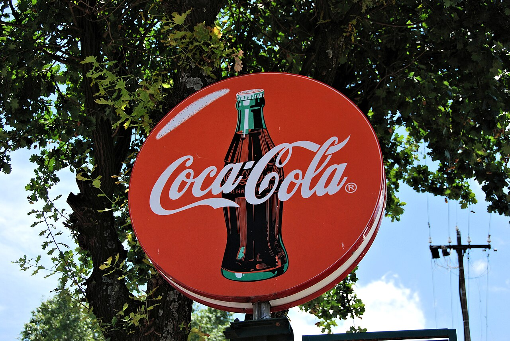{fig-alt="A round red Coca-Cola sign with a bottle on it, mounted on a pole in front of a large leafy tree." style="max-height: 330px !important;"}
:::

::: {.small .center}
A Coca-Cola sign in Parys, South Africa, 2009. Ossewa, CC BY 4.0, [Wikimedia Commons](https://commons.wikimedia.org/wiki/File:Coca-Cola_sign_in_Parys.jpg).
:::
:::
::::

<!-- ## Apply Bell's Traits to Kuwait: What Changed and What Persisted? {.smaller} -->

<!-- ::: {.board} -->
<!-- Kuwait changed quickly after oil (Chapter 5). Rate Kuwait on each of Bell's traits, around 1950 and today. -->
<!-- ::: -->

<!-- :::: {.columns} -->
<!-- ::: {.column width="30%"} -->
<!-- ### Bell's traits -->

<!-- - Urban -->
<!-- - Literate -->
<!-- - Industrial -->
<!-- - Sophisticated transportation and media -->
<!-- - Nuclear rather than extended family -->
<!-- - Allegiance to government officials over traditional authorities -->
<!-- ::: -->

<!-- ::: {.column width="28%"} -->
<!-- ### Traditions to check -->

<!-- - The diwaniya -->
<!-- - Friday gatherings at the grandparents' house -->
<!-- - Ramadan visits and gergean -->
<!-- - The family's role in choosing a spouse -->
<!-- - Wasta -->
<!-- ::: -->

<!-- ::: {.column width="42%"} -->
<!-- ::: {.center} -->
<!-- 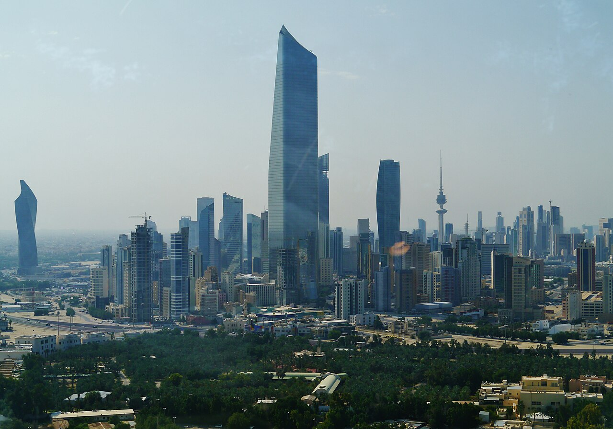{fig-alt="Kuwait City skyline seen from the Kuwait Towers: the tall curved Al Hamra Tower and other skyscrapers rise above a wide band of green trees." style="max-height: 340px !important;"} -->
<!-- ::: -->

<!-- ::: {.small .center} -->
<!-- Kuwait City from the Kuwait Towers, with the Al Hamra Tower, 2022. Zairon, CC BY 4.0, [Wikimedia Commons](https://commons.wikimedia.org/wiki/File:Kuwait_City_Kuwait_Towers_View_to_the_al-Hamra_Tower.jpg). -->
<!-- ::: -->
<!-- ::: -->
<!-- :::: -->

<!-- ::: {.fragment .question-box} -->
<!-- Kuwait scores high on urbanization, literacy, and media, yet extended family ties remain strong. Does Kuwait support Bell's prediction, or Schaefer's point that traditions often persist? -->
<!-- ::: -->

<!-- Instructor enrichment. Let students do the rating; make no claim about the answer. -->

<!-- ## Rostow's Four Stages of Modernization {.smaller} -->

<!-- :::: {.columns} -->
<!-- ::: {.column width="55%"} -->
<!-- American economist **Walt Rostow** argued that the West modernized in four stages: -->

<!-- 1. **Traditional stage** — small local communities; production in family settings; most time spent producing food; what your parents did is what you will do -->
<!-- 2. **Take-off stage** — people use individual talents to produce beyond necessities; new markets for trade; status tied more closely to wealth -->
<!-- 3. **Drive to technological maturity** — population growth, less absolute poverty, more diverse jobs, basic schooling for everyone, more democratic politics -->
<!-- 4. **High mass consumption** — production serves wants more than needs; social support systems cover basic necessities -->
<!-- ::: -->

<!-- ::: {.column width="45%"} -->
<!-- ### Critics say Rostow's model -->

<!-- - Ignores that the United States and the United Kingdom industrialized from a position of **global strength**, when slavery was legal and no one worried about using up natural resources -->
<!-- - Is **Eurocentric**, treating economic growth as the only standard -->
<!-- - **Blames the victim** (Chapter 8): poor countries are faulted for their traditions, not for outside forces holding them back -->
<!-- ::: -->
<!-- :::: -->

<!-- ::: {.small} -->
<!-- Crash Course Sociology, "Theories of Global Stratification." Rostow does not appear in Schaefer. -->
<!-- ::: -->

<!-- Instructor enrichment, not from Schaefer. Comment out this slide to keep the deck to the textbook. -->

<!-- ## Does Foreign Investment Help or Hurt Poor Nations? {.smaller} -->

<!-- ::: {.board} -->
<!-- Some scholars would argue that foreign investment by richer nations helps, not hurts, poorer countries. Others argue that foreign investment may at first add to a nation's wealth but eventually increases economic inequality within developing nations. Can both be right? -->
<!-- ::: -->

<!-- ### Critiques of dependency theory -->

<!-- - The world economy is not **zero-sum**: one country getting richer does not make another poorer, and innovation can spill over to other nations -->
<!-- - Colonialism left scars but cannot explain today's gaps alone. **Ethiopia** escaped long-term colonial rule and is among the poorest countries; **Singapore**, a former colony, is now wealthy -->
<!-- - Dependency theory blames the capitalist market alone and **ignores culture and political regimes** -->

<!-- ::: {.fragment .takeaway} -->
<!-- Both can be true. A nation can grow richer while the gap inside it widens. Schaefer: "As poverty declined worldwide, income inequality rose." -->
<!-- ::: -->

<!-- Instructor enrichment: the Crash Course critiques, from "Theories of Global Stratification." Crash Course also lists Sri Lanka as a flourishing former colony; the slide omits it after Sri Lanka's 2022 economic crisis. -->

## Table 9-1: Sociological Perspectives on Global Inequality

| Approach | Sociological perspective | Explanation |
|---|---|---|
| **World systems analysis** | Functionalist and conflict | Unequal economic and political relationships maintain sharp divisions between nations |
| **Dependency theory** | Conflict | Industrialized nations exploit developing nations through colonialism and multinational corporations |
| **Modernization theory** | Functionalist | Developing nations move away from traditional cultures and toward the cultures of industrialized nations |

::: {.small}
Schaefer's text says Wallerstein drew on the conflict perspective; Table 9-1 lists world systems analysis under both perspectives.
:::

<!-- ## Classify the Claim: World Systems, Dependency, or Modernization? -->

<!-- ::: {.board} -->
<!-- Which approach would make each claim? -->
<!-- ::: -->

<!-- 1. "Give poor countries better seeds, fertilizer, and mobile banking, and they will catch up." -->
<!-- 2. "A country's chances depend on its place in a global economy of core, semiperiphery, and periphery." -->
<!-- 3. "Poor countries owe so much that they must freeze wages and cut services to pay the interest." -->
<!-- 4. "As families move to cities and learn to read, they will adopt the habits of industrialized nations." -->
<!-- 5. "Independence ended colonial rule but not foreign domination." -->
<!-- 6. "In 125 years, almost no country has changed its position." -->

<!-- ::: {.fragment .question-box} -->
<!-- Schaefer asks: relate modernization theory to dependency theory. Do you agree with critics that modernization will increase the dominance of core nations? Why or why not? -->
<!-- ::: -->

<!-- Answers: modernization 1, 4; world systems 2, 6; dependency 3, 5 (statement 5 describes neocolonialism, which dependency theorists stress). Instructor enrichment: the statements. Statement 1's examples come from Crash Course Sociology, "Global Stratification and Poverty." -->

# Stratification Within Nations {background-color="#1B2A4A"}

::: {.takeaway}
The gap between rich and poor is widening between nations and within them. Every nation in Schaefer's comparison shows significant income inequality.
:::

## Local Elites, Multinationals, and Inequality Inside Developing Nations {.smaller}

:::: {.columns}
::: {.column width="52%"}
- As the gap between rich and poor **nations** widens, so does the gap between rich and poor **citizens within nations**
- Stratification in developing nations is closely tied to their **weak and dependent position** in the global economy
- **Local elites** work hand in hand with multinational corporations and prosper from these alliances. The economic system creates and perpetuates the exploitation of **industrial and agricultural workers**
<!-- - That is why foreign investment in developing countries tends to **increase** economic inequality -->
- Schaefer's chapter opens with a photo of **Paraisópolis**, a shantytown in São Paulo, Brazil, with high-rise apartment buildings right behind it
:::

::: {.column width="48%"}
::: {.center}
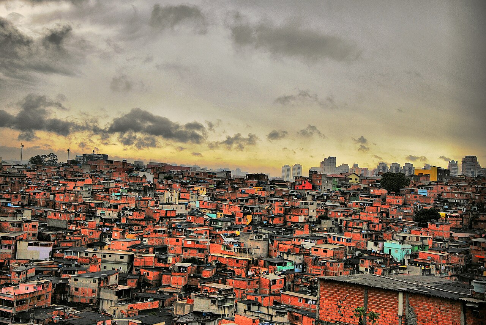{fig-alt="Hundreds of small red-brick houses of the Paraisópolis favela fill the foreground, with tall apartment towers on the horizon under a cloudy sky." style="max-height: 420px !important;"}
:::

::: {.small .center}
Paraisópolis, São Paulo, with apartment towers on the horizon, 2014. Roberto Rocco (TU Delft), CC BY-SA 4.0, [Wikimedia Commons](https://commons.wikimedia.org/wiki/File:Favela_Paraisopolis_Sao_Paulo_2014_A.jpg).
:::
:::
::::

<!-- ## Predict: How Many Staff Does It Take to Run One Family's Home? -->

<!-- ::: {.question-box} -->
<!-- In Mumbai, India, billionaire **Mukesh Ambani** built a **27-story** home for his wife and three children. It has three helicopter pads and a garage for 160 vehicles. How many staff run it? -->
<!-- ::: -->

<!-- ::: {.fragment} -->
<!-- :::: {.columns} -->
<!-- ::: {.column width="62%"} -->
<!-- - **600** (Schaefer) -->
<!-- - Open displays of social inequality are apparent in **every nation** -->

<!-- ::: {.question-box} -->
<!-- India appears in the semiperiphery of Figure 9-2. What does Ambani's home tell you about the limits of ranking whole nations? -->
<!-- ::: -->
<!-- ::: -->

<!-- ::: {.column width="38%"} -->
<!-- ::: {.center} -->
<!-- {fig-alt="Antilia, the Ambani family's 27-story home in Mumbai: a tall tower of stacked, irregular floors and open terraces against a blue sky." style="max-height: 480px !important;"} -->
<!-- ::: -->

<!-- ::: {.small .center} -->
<!-- Antilia, Mumbai, 2016. A. Savin, Free Art License, [Wikimedia Commons](https://commons.wikimedia.org/wiki/File:Mumbai_03-2016_19_Antilia_Tower.jpg). -->
<!-- ::: -->
<!-- ::: -->
<!-- :::: -->
<!-- ::: -->

## Predict: How Many Billionaires Equal Half the World?

::: {.question-box}
How many of the world's wealthiest individuals would it take to match the combined wealth of the **poorer half of the world's population**?
:::

::: {.fragment}
- **26.** The world's 26 wealthiest individuals have accumulated wealth equal to that of **more than half** of the world's population
- Just as a few corporations have amassed great sums of money, so have a very few individuals
<!-- - The inequality across the world is replicated **within countries**, including the United States, which has the **largest number of billionaires** -->
- The inequality across the world is replicated **within countries**
:::

## Predict: Which Nation Has the Widest Income Gap?

::: {.question-box}
Figure 9-5 compares the share of income received by the richest fifth and the poorest fifth of the population in nine nations: Brazil, the Czech Republic, Great Britain, Hungary, Ireland, Mexico, Russia, Sweden, and the United States. Which has the widest gap? Which has the narrowest?
:::

::: {.fragment}
::: {.center}
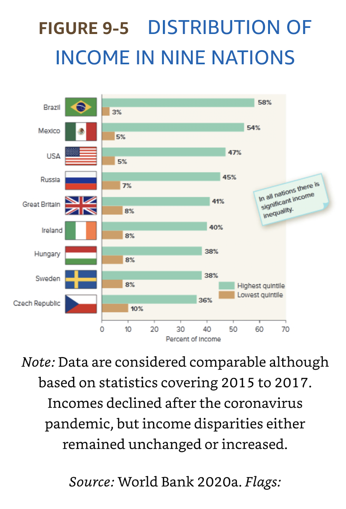{fig-alt="Figure 9-5, distribution of income in nine nations, showing the share of income received by the highest and lowest quintiles. Brazil 58 and 3 percent; Mexico 54 and 5; USA 47 and 5; Russia 45 and 7; Great Britain 41 and 8; Ireland 40 and 8; Hungary 38 and 8; Sweden 38 and 8; Czech Republic 36 and 10. A note reads: in all nations there is significant income inequality." style="max-height: 560px !important;"}
:::
:::

<!-- ## Figure 9-5: Reading the Income Gap -->

<!-- - In **Brazil**, the richest fifth receives **58 percent** of all income and the poorest fifth **3 percent**: the top receives about **19 times** as much as the bottom -->
<!-- - In the **Czech Republic**, the richest fifth receives **36 percent** and the poorest fifth **10 percent**: under **4 times** as much -->
<!-- - **In all nations there is significant income inequality** -->
<!-- - Data cover 2015 to 2017. Incomes declined after the pandemic, but income disparities remained unchanged or increased (World Bank 2020a) -->

<!-- ::: {.question-box} -->
<!-- Schaefer asks: imagine your country borders a nation where new college graduates start at **$200,000** a year. What is life like in your country? Who leaves, who stays, and what happens to its hospitals and universities? -->
<!-- ::: -->

<!-- The ratios are instructor arithmetic from Figure 9-5's percentages. -->

<!-- ## Box 9-2: Social Stratification in Japan {.smaller} -->

<!-- :::: {.columns} -->
<!-- ::: {.column width="68%"} -->
<!-- - From the 1960s, when postwar recovery was largely complete, until recently, **90 percent** of Japanese households identified as **middle class**, compared with **44 percent** in U.S. national surveys -->
<!-- - Broad upward mobility after World War II led to a general belief that everyone was doing well. The media spoke of **"the 100 million general middle class"** -->
<!-- - Japanese culture lacks the practice of **conspicuous consumption** (Veblen, Chapter 8). Mansions, yachts, and private jets are largely absent -->
<!-- - By the **1980s** upward mobility slowed, and recognition of inequality grew. Sociologists in Japan call this **"the quiet transformation"** -->
<!-- - The bottom **40 percent** of Japanese receive only **20 percent** of income (United States: **15 percent**). The richest tenth receive **25 percent** (United States: **31 percent**) -->
<!-- - Japan has begun to recognize the limited opportunities for **women** and the discrimination faced by its relatively small population of **immigrants and racial minorities** -->
<!-- ::: -->

<!-- ::: {.column width="32%"} -->
<!-- ::: {.center} -->
<!-- {fig-alt="Commuters in dark coats wait on a dim train platform of the Yamanote Line at Shinjuku Station in Tokyo; a man in a suit walks along the platform edge." style="max-height: 280px !important;"} -->
<!-- ::: -->

<!-- ::: {.small .center} -->
<!-- Commuters at Shinjuku Station, Tokyo, 2016. Redd Angelo, CC0, [Wikimedia Commons](https://commons.wikimedia.org/wiki/File:People_waiting_for_the_train_(Unsplash).jpg). -->
<!-- ::: -->
<!-- ::: -->
<!-- :::: -->

<!-- ::: {.question-box} -->
<!-- Schaefer asks: what does it mean for a society if all its people think of themselves as belonging to the same social class? How might it affect social interaction? Would most families in Kuwait call themselves middle class? -->
<!-- ::: -->

# Social Mobility in Global Perspective {background-color="#1B2A4A"}

::: {.takeaway}
In rich nations, sociologists track people moving between occupations. In developing nations, the mobility that matters most is the move out of poverty.
:::

## Mobility in Industrial Nations: Three Patterns {.smaller}

- Studies of **intergenerational mobility** in industrialized nations find:
  1. **Substantial similarities** in the ways parents' positions in the stratification system are passed to their children
  2. Mobility is influenced by **structural factors**, such as labor market changes that raise or lower an occupational group in the social hierarchy
  3. **Immigration** continues to shape a society's level of intergenerational mobility
- Cross-cultural studies suggest that intergenerational mobility has **increased** over the past 50 years in most but not all countries, with a common movement **away from agriculture-based occupations**
- Growth in mobility does **not** necessarily bring growth in equality. The gap between rich and poor has **grown**, and poverty levels in the 30 largest industrial economies have stayed relatively constant for 30 years (Eurostat 2015; OECD 2008)

## Mobility in Developing Nations: From Village to City, and Out of Poverty {.smaller}

:::: {.columns}
::: {.column width="66%"}
- In developing nations, **macro-level** social and economic changes often overshadow **micro-level** movement from one occupation to another
- A large **wage gap between rural and urban areas** leads to high levels of migration to the cities. Yet urban industrial sectors generally cannot provide enough jobs for everyone seeking work
- In large developing nations, the most socially significant mobility is the **movement out of poverty**. It is hard to measure, because economic trends differ from one area of a country to another
<!-- - **China:** large numbers have moved out of poverty, but rural residents are basically **shut out** of the gains in centers of skilled labor and technology. **India**, 1990s through 2015: poverty declined in urban areas but stayed static at best in rural areas -->
- **Downward mobility** is dramatically influenced by catastrophes such as **crop failure and warfare**
- Not all is bleak. At the start of the 21st century, millions entered the **middle class** in China, India, Russia, Brazil, and Mexico, through **entrepreneurship, microfinancing, merchandising**, and in some countries a growing, relatively **well-paid government sector** (Beddoes 2012)
:::

::: {.column width="34%"}
::: {.center}
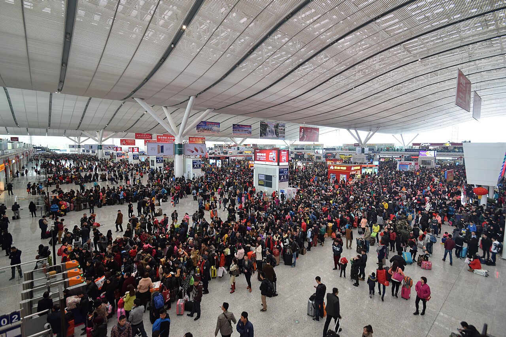{fig-alt="A huge crowd of travelers with suitcases fills the concourse of Shenzhen North Railway Station under a curved white roof." style="max-height: 300px !important;"}
:::

::: {.small .center}
Shenzhen North station during Chunyun, the Lunar New Year travel rush, when millions of migrant workers return to their home villages, 2016. Baycrest, CC BY-SA 2.5, [Wikimedia Commons](https://commons.wikimedia.org/wiki/File:Shenzhen_North_Railway_Station_Concourse_2016_Chunyun.jpg).
:::
:::
::::

::: {.question-box}
Schaefer lists a well-paid government sector as one route into the middle class. Where have you seen that route at work?
:::

## Predict: Will Children Grow Up to Be Better Off Than Their Parents?

::: {.question-box}
Quick vote: do you expect to be financially better off than your parents? Then predict: in a 27-nation survey, which countries were most optimistic about their children's future: France, Japan, the United States, Mexico, Brazil, Russia, India, or the Philippines?
:::

::: {.fragment}
::: {.center}
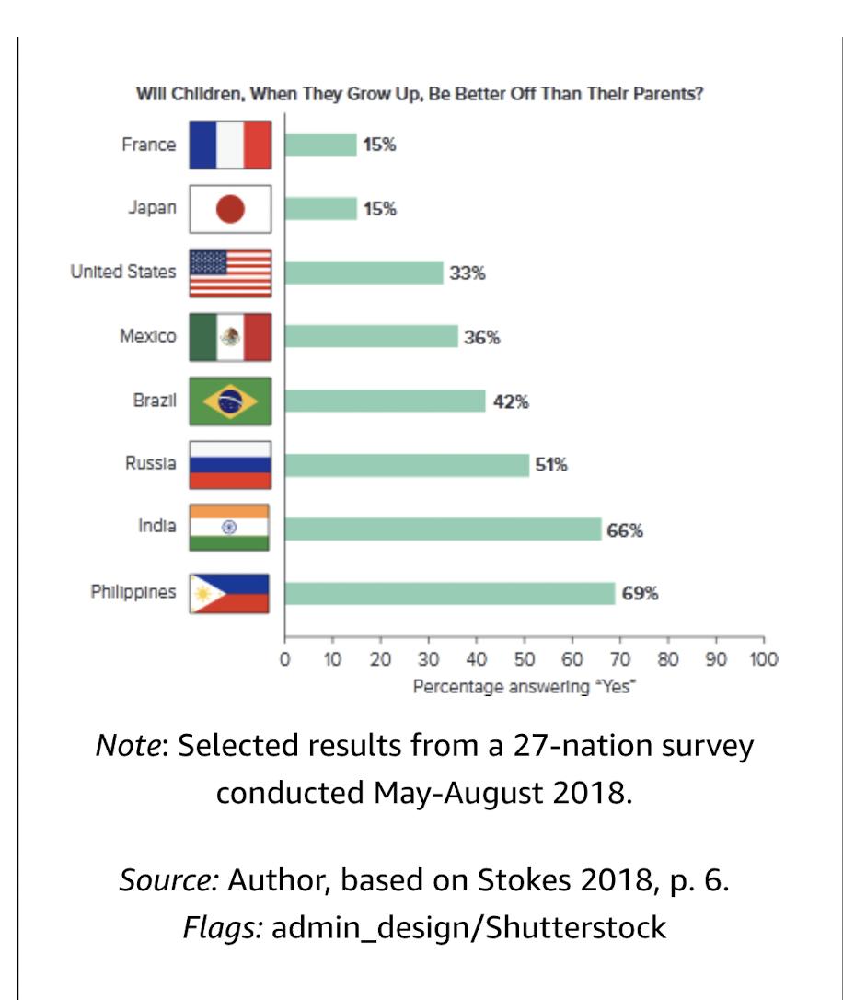{fig-alt="Box 9-3 figure: percentage answering yes to the question, will children, when they grow up, be better off than their parents? France 15, Japan 15, United States 33, Mexico 36, Brazil 42, Russia 51, India 66, Philippines 69. Selected results from a 27-nation survey conducted May to August 2018." style="max-height: 580px !important;"}
:::
:::

## Box 9-3: Getting Ahead Globally {.smaller}

- In surveys across **27 nations**, a majority in every country believes that **a good education and hard work** are key to getting ahead. Majorities also agree that the **gap between rich and poor** is a problem
- Generally, the **poorer the country**, the more optimistic people are that their children will be better off. Adults in **industrial countries** are more cautious
- Yet many see more opportunity abroad: **23 percent** of Mexicans and **42 percent** of Senegalese recommend that young people move abroad for "a good life"
<!-- - Even in nations facing massive social challenges, **staying home** is heavily favored: **53 percent** of parents in the Palestinian Territory and **66 percent** in Pakistan recommend that their children stay -->
<!-- - Parents who advise going abroad usually mean **industrial countries**, though they know about the great gap between rich and poor there -->
- Economic optimism seems greatest when the **parents' own status is the most marginal**. So discussions of mobility must be framed within the context of a **particular society**

::: {.question-box}
Schaefer asks: why are people in poor countries more optimistic about their children's futures than people in rich ones? Recall Powell in Chapter 8: only about half of U.S. middle-class children now out-earn their parents.
:::

<!-- Ambiguity: the box text cites Banyan 2014 and Pew Research Center 2014b, while the figure note cites a 2018 survey (Stokes 2018). The slide gives the figure its own date. -->

## Gender Differences in Mobility in Developing Nations {.smaller}

:::: {.columns}
::: {.column width="62%"}
- The challenges that women and girls face in developing countries are not limited to any one continent
- Anthropologist **Karuna Chanana Ahmed** calls women **the most exploited of oppressed people**. From birth, girls are commonly **fed less** than boys, **denied educational opportunities**, and often **hospitalized only when critically ill**
- Inside or outside the home, women's work is **devalued**. When economies fail, as in Asian countries in the late 1990s, women are **the first to be laid off** (J. Anderson and Moore 1993; Kristof 1998)
- Surveys show a significant degree of **female infanticide**, the killing of baby girls, in China and rural India
- In **Pakistan**, only one-third of the sexually segregated schools are for girls, and one-third of those have no buildings
<!-- - In **Kenya and Tanzania**, Schaefer reports, it is illegal for a woman to own a house -->
:::

::: {.column width="38%"}
::: {.center}
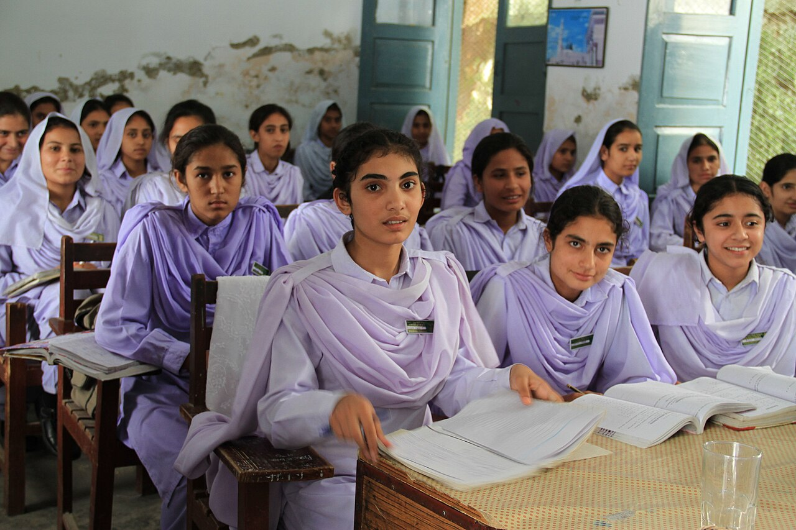{fig-alt="Teenage girls in lilac school uniforms and headscarves sit at wooden desks with open books in a classroom in Pakistan." style="max-height: 340px !important;"}
:::

::: {.small .center}
Girls in school in Khyber Pakhtunkhwa, Pakistan, 2011. UK Department for International Development, CC BY-SA 2.0, [Wikimedia Commons](https://commons.wikimedia.org/wiki/File:Girls_in_school_in_Khyber_Pakhtunkhwa,_Pakistan_(7295675962).jpg).
:::
:::
::::

<!-- Removed per course rules and for accuracy: Schaefer's sentence "In Saudi Arabia, women are prohibited from inheriting as much as their brothers do, walking alone in public, and socializing with men outside their families." Inheritance shares follow Islamic law, which also governs inheritance in Kuwait, and Saudi Arabia's 2017–2019 reforms changed several of the other rules. Restore it if you want it verbatim for the exam. OCR check: the text reads "one-third of those schools have nodeveloping buildings"; the slide assumes "no buildings." Accuracy note: the Kenya and Tanzania claim is dated (Kenya's 2010 constitution guarantees women's property rights); the slide attributes it to Schaefer. -->

## How Development Can Weaken Women's Standing {.smaller}

:::: {.columns}
::: {.column width="58%"}
- Only recently have researchers begun to study how **gender** shapes mobility in developing nations
- Modernization in rural areas and **rural-to-urban migration** may lead people to modify or abandon traditional cultural practices and even **marital systems**. The effects on women's standing are **not necessarily positive**
- As a country develops, women's vital role in **food production** deteriorates, jeopardizing their **autonomy and material well-being**
- Moving to the city weakens women's ties to **relatives** who can provide food, financial help, and social support (Lawson 2008; United Nations Secretary General 2014)
:::

::: {.column width="42%"}
::: {.center}
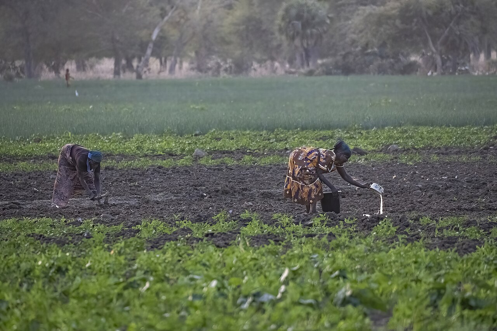{fig-alt="Two women in patterned dresses bend over to plant and water rows of seedlings in a dark, freshly tilled field in Chad." style="max-height: 340px !important;"}
:::

::: {.small .center}
Women planting a field in Chad, 2025. MilanGIZ, CC BY-SA 4.0, [Wikimedia Commons](https://commons.wikimedia.org/wiki/File:2025_Chad_Women_working_on_agricultural_land.jpg).
:::
:::
::::

::: {.question-box}
Bell predicted that modern families become nuclear. What does a woman lose when her extended family no longer lives nearby? Who would care for her children while she works?
:::

## The Pan-Cordillera Women's Network in the Philippines {.smaller}

:::: {.columns}
::: {.column width="58%"}
- In the **Philippines**, women have moved to the forefront of indigenous peoples' struggle to protect their **ancestral land** from exploitation by outsiders
- Having won the right to the land's minerals and forests, indigenous groups began to **feud among themselves** over how to develop them
- Aided by the United Nations Partners in Development Programme, women volunteers founded the **Pan-Cordillera Women's Network for Peace and Development**
- The women mapped boundaries, prepared development plans, and negotiated **more than 2,000 peace pacts**. They also ran in elections, campaigned against social problems, and organized residents to work for the common good (United Nations Development Programme 2000)
:::

::: {.column width="42%"}
::: {.center}
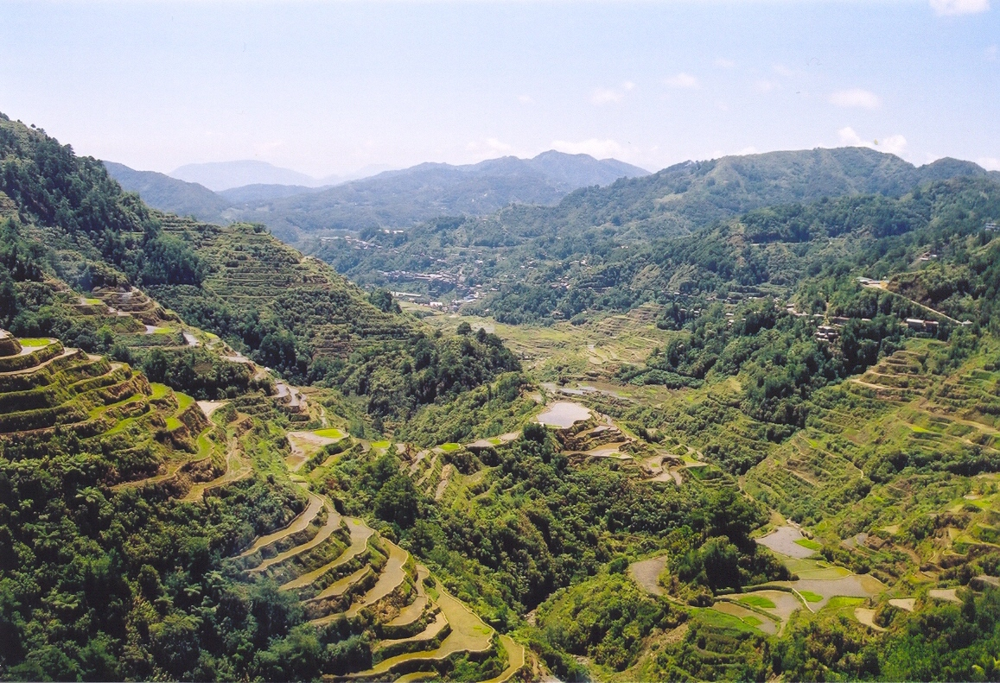{fig-alt="Green mountain valley carved into narrow stepped rice terraces near Banaue in the Philippine Cordillera." style="max-height: 340px !important;"}
:::

::: {.small .center}
Rice terraces near Banaue in the Philippine Cordillera, 2003. Magalhães, public domain, [Wikimedia Commons](https://commons.wikimedia.org/wiki/File:Rice_Terraces_Banaue.jpg).
:::
:::
::::

::: {.takeaway}
A worldwide view of stratification must include both the contrast between rich and poor nations and the layers of hierarchy, by class, gender, and other factors, within every nation.
:::

<!-- # Global Inequality in Your Life and Your Field {background-color="#1B2A4A"} -->

<!-- ::: {.takeaway} -->
<!-- Being born in a rich or a poor country looks like individual luck. This chapter showed the patterns behind it: colonial history, debt, world trade, and multinational corporations. -->
<!-- ::: -->

<!-- ## The UN's Poverty Statement Explained with the Chapter's Concepts {.smaller} -->

<!-- ::: {.board} -->
<!-- Use the chapter's vocabulary to explain the UN statement that opened the class. -->
<!-- ::: -->

<!-- - "Most people living below the poverty line belong to southern Asia and sub-Saharan Africa": the **periphery** in **world systems analysis**, much of it once under **colonialism** -->
<!-- - "High poverty rates are often found in small, fragile, and conflict-affected countries": **downward mobility** through catastrophes such as warfare -->
<!-- - "For every 100 men age 25 to 34 who live in poverty, there are 122 women": **gender differences in mobility** -->
<!-- - "Global poverty rates have been cut in half since 2000": **modernization theory** credits growth and technology transfer. Schaefer credits **commodity prices** and **China**, and notes that **inequality rose** at the same time -->
<!-- - Argue the cause two ways. **Modernization theory:** poor nations have not yet adopted industrial technology and culture. **Dependency theory:** rich nations keep poor nations dependent through **debt** and **multinational corporations** -->

<!-- ## Sociology in Your Major -->

<!-- - **Medicine:** two of the eight Millennium Development Goals, **child mortality** and **maternal health**, are medical targets. Researchers measured the global divide by life expectancy and a baby's chance of surviving its first year -->
<!-- - **Engineering:** **technology transfer** drives modernization theory. Dependency theorists ask who owns the technology and who profits from it -->
<!-- - **Business:** multinationals rival nations in size (Figure 9-4). Nike's moves from country to country and the "climate for investment" are business decisions with social consequences -->
<!-- - **Computer science:** the **global office** moves data processing and reservation services to periphery nations. The Internet is one engine of globalization, and high-tech investment gave Asia more sustainable growth -->

<!-- Instructor enrichment. -->

## Before You Leave {.smaller}

- The **global divide** opened with the Industrial Revolution. The poorest people in the United States live like the typical person in a low-income country
- **Colonialism** is rule by outsiders; **neocolonialism** is continuing dependence after independence. **Wallerstein's world systems analysis** divides nations into **core**, **semiperiphery**, and **periphery**, and the division has barely changed in 125 years
- **Dependency theory:** developing nations stay subservient, deepened by **debt**. **Globalization** integrates policies, cultures, and markets, promoted by the **World Bank** and the **IMF**
- The **Millennium Project** aimed to halve extreme poverty by 2015. Extreme poverty fell from **1.9 billion** to **836 million**, almost half of the decline in **China**. The pandemic pushed up to **60 million** back, and inequality **rose**
- **Multinational corporations:** functionalists see jobs, diffusion, and interdependence; conflict theorists see exploitation and rising inequality within host nations
- **Modernization** (Bell) carries an **ethnocentric bias**. **Modernization theory** is functionalist; current studies take a **convergence perspective** (Table 9-1)
<!-- - **Within nations:** every nation shows significant income inequality (Figure 9-5; Japan, Box 9-2). In developing nations, the key mobility is **out of poverty**; poorer nations are more **optimistic**; **women** face the steepest barriers -->
- **Within nations:** every nation shows significant income inequality (Figure 9-5). In developing nations, the key mobility is **out of poverty**; poorer nations are more **optimistic**; **women** face the steepest barriers

::: {.small}
Next: Chapter 12, The Family and Household Diversity.
:::
